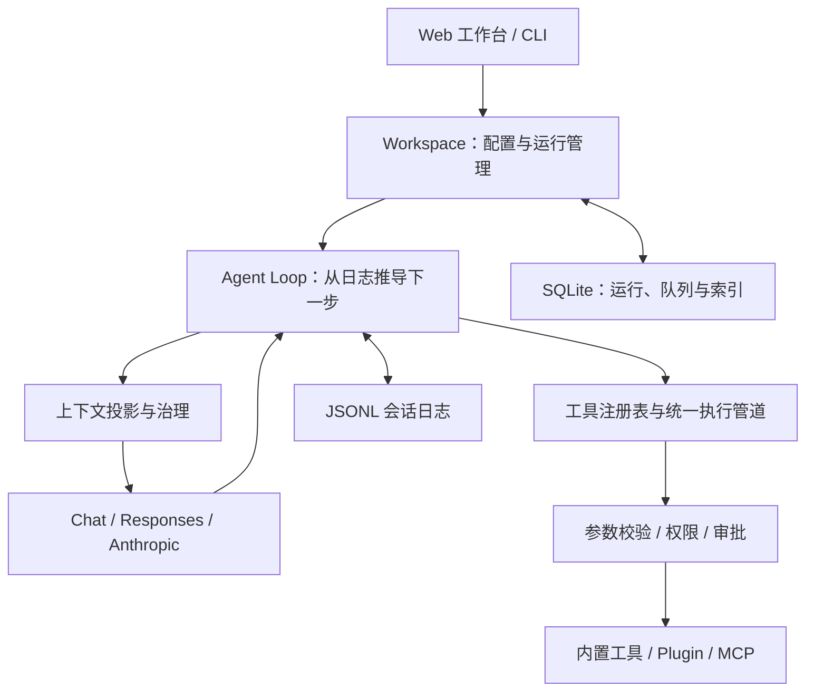

# OpenWorkBuddy

**在本地运行的个人 Agent，支持代码修改、资料调研与文档交付。**

OpenWorkBuddy 使用 Python 实现 Agent 运行时（Harness），提供 Web 工作台和命令行入口。模型可以读取文件、执行命令、调用外部工具，并在权限控制下完成多步任务；会话、执行记录和交付文件保存在本机，支持历史回溯与中断恢复。

项目将会话、模型调用、工具执行和上下文管理保持为清晰的核心模块，文档、搜索、飞书与浏览器通过可选插件接入，适合个人使用和学习 Agent 运行时的实现。

> 仓库名为 **OpenWorkBuddy**，Python 包名为 `nano-workbuddy`，命令为 `nwb`，默认数据目录为 `~/.nwb/`。

[快速开始](#快速开始) · [功能](#功能) · [配置](#配置) · [权限与沙箱](#权限与沙箱) · [架构](#架构) · [开发与验证](#开发与验证) · [文档](#文档)

## 功能

| 能力 | 说明 |
| --- | --- |
| 代码与文件操作 | 读写和编辑文件、搜索目录与内容、运行 shell 命令；修改已有文件前检查读取版本 |
| Web 工作台 | 流式回答、工具执行轨迹、审批卡片、附件、项目与会话管理、分支切换、运行中插话与排队 |
| 模型连接 | 支持 OpenAI Chat、OpenAI Responses、Anthropic 三类协议；管理多个连接和模型，查看 Token 用量 |
| 上下文治理 | 大工具结果落盘外置、旧输出裁剪、历史摘要压缩；完整历史保留供追溯 |
| 记忆与 Skill | 用户记忆和项目规则在请求前刷新；Skill 按需加载，压缩后恢复有效正文；历史记录按需检索 |
| 工具扩展 | MCP 支持 stdio / Streamable HTTP，工具定义可延迟加载；Python Plugin 与内置工具共享执行管道 |
| 调研与文档 | 读取 PDF、Word、PPT、Excel，搜索和读取网页，生成 Markdown / Word / PDF 并保存交付版本 |
| 办公与浏览器 | 可选飞书连接器与 Playwright MCP 浏览器，外部写操作和浏览器交互需要审批 |
| 后台任务 | 单次、每天、每周任务，错过执行策略、结果通知，以及数据备份与恢复 |

## 快速开始

### 环境要求

- Python **3.12+** 和 `uv`。
- 构建 Web 工作台需要 Node.js 与 npm；CI 使用 Node.js **22**。
- macOS 或 Linux。命令沙箱分别使用 macOS Seatbelt、Linux `bubblewrap`，Linux 需安装 `bwrap`。
- 一个支持 Tool Calling 的模型服务及其 API Key。界面在本地运行，模型请求发送到你配置的服务。

`ripgrep` 可选，缺少时文件搜索使用 Python 实现。飞书和浏览器需要单独配置，基础对话无需启用这些连接器。

### 安装并启动工作台

```bash
git clone https://github.com/ranyuzhou654/OpenWorkBuddy.git
cd OpenWorkBuddy
uv sync --locked

cd web
npm ci
npm run build
cd ..

uv run nwb serve
```

服务默认监听 `127.0.0.1:8765`，启动后自动打开带登录令牌的浏览器链接。在“设置 → 模型与密钥”配置服务地址、协议、API Key 和模型，测试连接后设为默认模型，即可创建对话。

首次加载配置时会创建 `~/.nwb/config.toml`。内置默认连接是 `deepseek`；实际模型名称和上下文窗口应按你的服务配置。使用其他服务时，可直接在设置中新增连接和模型。

```bash
# 更换端口，或只输出登录链接而不自动打开浏览器
uv run nwb serve --port 8767 --no-open
```

### 命令行使用

```bash
uv run nwb key                  # 查看已配置连接的密钥状态
uv run nwb key deepseek         # 隐藏输入密钥，保存到本地密钥文件
uv run nwb -C /path/to/project  # 进入指定项目的交互会话
uv run nwb "列出当前目录下最大的五个文件"
uv run nwb -c                  # 继续当前项目最近的会话
```

首次使用项目目录时会询问是否信任。不信任的项目默认只读，且不自动加载项目规则和 Skill。交互会话中输入 `/help` 查看命令，支持 `/model`、`/preset`、`/compact`、`/tree`、`/fork` 和 `/resume` 等操作。

## 配置

### 模型与密钥

推荐通过 Web 设置管理连接；也可以编辑 `~/.nwb/config.toml`。每个连接对应服务地址、协议和一份密钥引用，多个模型可以共享连接。

以下为配置结构示例，需将地址、模型 ID 和窗口大小替换为服务支持的值：

```toml
default_model = "my-model"

[providers.my-provider]
protocol = "openai-chat" # 也可选 openai-responses 或 anthropic
base_url = "https://your-provider.example/v1"
api_key = "env:MY_LLM_API_KEY"

[models.my-model]
provider = "my-provider"
id = "your-model-id"
context_window = 32768
max_output = 4096
```

密钥支持环境变量引用 `env:NAME`、系统钥匙串引用 `keyring:NAME` 和本地密钥引用 `secret:NAME`。设置页和 `nwb key` 将密钥保存到权限为 `0600` 的 `secrets.json`，配置文件只保存引用。

### 可选能力

在“设置 → 插件”启停文档、联网、飞书和浏览器能力。关闭插件会保留已有连接、密钥和历史产物；基础助手模式可显式设置：

```toml
[plugins]
enabled = []
```

网页搜索使用 Tavily，需要单独配置搜索密钥；飞书依赖已安装并授权的 `lark-cli`；浏览器需启用对应连接器并准备其运行环境。详见[连接器教程](docs/tutorial/15-飞书与浏览器.md)和[搜索与飞书配置](docs/tutorial/17-联网搜索与飞书配置.md)。

### MCP、Skill 与 Plugin

- **MCP**：通过设置页添加 stdio 或 Streamable HTTP 服务。工具共用权限与执行入口，工具目录较大时通过 `tool_search` 按需加载。
- **Skill**：发现项目 `.agents/skills/`、`~/.nwb/skills/` 和 `~/.agents/skills/` 下的 `SKILL.md`，按需加载正文；可用 `[skills] dirs` 添加其他目录。
- **Plugin**：通过 `nano_workbuddy.plugins` Python entry point 或 `Workspace(..., extensions=(plugin,))` 注入工具与服务。插件扩展能力，核心循环继续负责调度。

Python Plugin 是本机代码，需要信任其来源；它本身不构成隔离边界。扩展方式见[内核与扩展设计](docs/design/2026-10-27-harness-core.md)。

### 本地数据

| 位置 | 内容 |
| --- | --- |
| `~/.nwb/config.toml` | 模型连接、插件、MCP、权限和其他设置 |
| `~/.nwb/secrets.json` | 通过设置页或 CLI 保存的密钥 |
| `~/.nwb/sessions/` | 追加式会话日志 |
| `~/.nwb/index.db` | 项目、会话、运行和队列数据 |
| `~/.nwb/knowledge.db` | 历史检索索引 |
| `~/.nwb/files/` | 附件、解析缓存与交付文件版本 |

可通过 `NWB_HOME` 指定其他数据目录。备份默认不包含密钥和浏览器登录态，也不包含外部项目目录：

```bash
uv run nwb backup /path/to/backup.tar.gz
uv run nwb restore /path/to/backup.tar.gz
```

## 权限与沙箱

工具调用按“动作 + 目标资源”匹配规则，结果为允许、拒绝或请求审批。普通规则按顺序最后匹配生效，部分外部操作另有固定审批约束。

| 档位 | 默认行为 |
| --- | --- |
| `readonly`：只读 | 允许读取文件，文件写入和命令执行需要审批；获准的命令在只读沙箱内运行 |
| `workspace`：工作区 | 允许项目内读写，命令在工作区沙箱内执行；工作区外写入和沙箱外执行需要审批 |
| `trust`：完全信任 | 放宽普通工具的审批并关闭命令沙箱，固定外部操作审批规则仍然有效 |

默认工作区沙箱限制命令写入范围与网络访问，并保护凭据目录；没有可用沙箱后端时拒绝执行沙箱命令。项目内的 `.git` 等受保护目录也需要单独审批。

飞书写操作和浏览器交互需逐次确认，不能通过“总是允许”跳过。飞书写操作提供 dry-run 预览、幂等键和回执；恢复时无法核实副作用的调用标记为 `unknown`，交回 Agent 检查现状后决定后续操作。

权限规则与命令沙箱职责不同：前者控制工具是否执行，后者限制命令进程的访问范围。MCP stdio 服务有独立的沙箱、联网和可写目录配置。详见[权限、沙箱与上下文治理](docs/tutorial/03-权限沙箱与上下文治理.md)。

## 架构



- **会话与恢复**：原始历史保存在追加式 JSONL 中；Agent 下一步动作由日志路径推导，正常运行与崩溃恢复共用执行流程。运行、队列与审批等状态由 SQLite 配合管理。
- **上下文与记忆**：完整历史、当前模型输入和长期记忆分别管理。大结果外置、旧输出裁剪和摘要压缩只改变输入投影；当前规则和已加载 Skill 的变化在后续请求中生效。
- **工具与扩展**：内置工具、Plugin 和 MCP 共用执行入口，办公能力通过可选插件组合；模型协议差异由适配层处理。

当前面向单用户本地部署，服务使用单进程、单 worker。macOS 是主要开发与沙箱测试平台，Linux 提供 bubblewrap 路径；不提供 Windows 原生命令沙箱。

## 开发与验证

```bash
# 后端测试与静态检查（仓库根目录）
uv run pytest -q
uv run ruff check src tests

# 前端类型检查与生产构建
cd web
npm ci
npm run build

# 浏览器回归：启动独立的本地模拟服务
npx playwright install chromium
npm run test:e2e
```

前端开发时分别启动后端与 Vite：

```bash
# 终端 1：仓库根目录
uv run nwb serve --no-open

# 终端 2：web 目录
npm run dev
```

Vite 将 `/api` 代理到 `127.0.0.1:8765`。使用后端输出的登录链接，将端口换成 Vite 实际监听的端口，保留 `/api/login?token=…`。

GitHub Actions 执行 macOS 后端测试与 Ruff 检查，以及 Linux 前端构建和浏览器回归。浏览器测试使用模拟模型与服务，验证交互与状态流程。

真实模型评测另由 `evals/` 管理，保存冻结任务、预算、逐次结果和失败轨迹，运行前需配置模型并确认调用预算。详见[评测指南](evals/README.md)。已有[上下文 A/B 复测](docs/research/2026-10-29-context-retest/README.md)在 2 个合成长材料任务的 6 组配对中观察到累计输入 Token 减少 **75.76%**，双方均通过预设验收；该结果只描述这批任务的输入量，不代表通用任务完成率或费用降幅。

## 项目结构

```text
src/nano_workbuddy/
  runtime.py, loop.py       运行管理与 Agent 循环
  log.py, index.py          会话日志与 SQLite 索引
  context.py, compaction.py 上下文投影、裁剪与压缩
  memory.py, skills.py      长期记忆与技能
  llm/                     模型协议适配
  tools/, connectors/      工具与外部连接器
  plugins.py               可选能力装配
  policy.py, sandbox.py    权限与命令隔离
  api.py, server.py         HTTP / SSE 与本地服务
  eval/                    评测执行与评分
web/                       React + TypeScript 工作台
tests/                    后端测试与模拟服务
evals/                    评测任务、材料和运行脚本
docs/                     架构设计、实现教程与研究记录
```

## 文档

| 主题 | 入口 |
| --- | --- |
| 架构设计与取舍 | [初始架构设计](docs/design/2026-10-23-architecture-plan.md)、[内核与扩展边界](docs/design/2026-10-27-harness-core.md) |
| 核心执行与恢复 | [核心闭环](docs/tutorial/01-核心闭环.md)、[可靠内核](docs/tutorial/13-可靠内核.md) |
| 模型、工具与记忆 | [模型与密钥](docs/tutorial/04-模型与密钥管理.md)、[MCP](docs/tutorial/05-MCP接入.md)、[Skill 与记忆](docs/tutorial/06-Skill与记忆.md) |
| 文档与办公能力 | [文件与调研](docs/tutorial/14-文件与调研.md)、[飞书与浏览器](docs/tutorial/15-飞书与浏览器.md)、[定时任务与个人知识](docs/tutorial/16-定时任务与个人知识.md) |
| 评测与历史记录 | [评测指南](evals/README.md)、[内核组合评测](docs/research/2026-10-28-core-evaluation/README.md)、[上下文复测](docs/research/2026-10-29-context-retest/README.md) |

教程与研究目录保留开发过程和当时的验证结果；使用方式以当前 README 和代码为准。

## 参与贡献

欢迎通过 Issue 提供问题复现、使用场景或改进建议。提交代码时，请说明改动原因、复现步骤与验证结果；运行时和工具行为变更应补充对应回归测试，界面变更应完成构建并检查相关交互。
