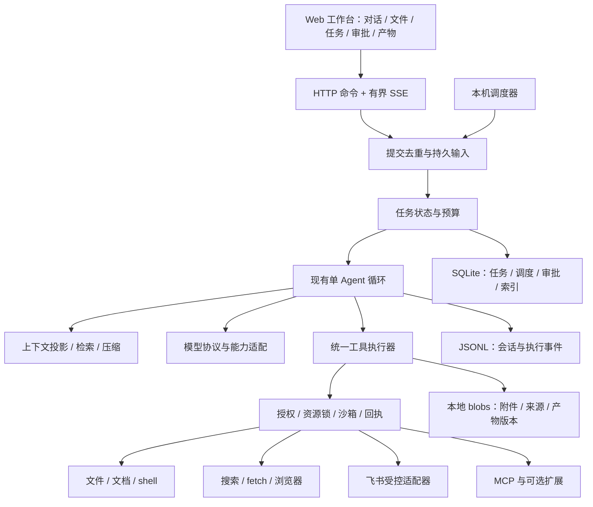

# nano-workbuddy 个人助手：项目审查、竞品技术调研与改进方案

日期：2026-10-24（Asia/Shanghai）  
审查基线：`1ea4a4d5c0ac79f174808d1f85141d24408f6db6`  
适用项目：当前 OpenWorkBuddy 工作区中的 Python `nano-workbuddy`。  
交付性质：技术审查和实施设计；本文中的新增能力尚未实现。

## 1. 结论与已确认需求

**建议继续建设现有 Python 内核，以“可靠完成个人工作”为产品中心，补齐调研、文件交付、飞书、可恢复后台任务四条能力链。当前最需要的是完成任务的闭环和可信执行，不是继续增加聊天界面功能，也不是重写成另一个大型框架。**

现有项目已经具备可用的 Agent 原型地基，且具有独立改进的价值。但目前不能据此宣称整体超过 pi、OpenCode 或 DeepSeek Harness：尚无同模型、同任务的比较评测，实际办公能力也明显不足。最有希望形成优势的范围是：**中文个人工作、本地资料与飞书协同、低维护成本、明确的交付和审批、长任务可恢复**。

### 1.1 本次用户明确选择

| 决策 | 已确认结果 | 对方案的影响 |
|---|---|---|
| 产品定位 | 综合个人工作助手：调研、文档、办公自动化，兼顾编程 | 文档、搜索、交付物优先于完整 IDE 能力 |
| 使用范围 | 自己使用、本机优先、小规模持续迭代 | 保持单用户服务；不引入多租户、集群、复杂云端 |
| 首批集成 | 本地文件 + 浏览器 + 飞书 | 优先做这三者的端到端任务，暂缓更多办公平台 |
| 主动工作 | 可定时调研、整理、准备草稿；对外发送、发布、删除前确认 | 调度可自动运行，外部副作用必须有具体操作审批 |

“本机优先”指历史、索引、附件和产物优先存本地，并不等于模型推理完全离线。模型调用可能发送所选材料；连接器应显示账户、资料范围和数据去向。本次未选择固定主模型或每月预算，方案保留可配置项，不替用户作采购决定。

### 1.2 最重要的六项改进

1. 修复已复现的运行边界问题，再扩大工具权限和后台执行能力。
2. 把附件、来源、交付物、外部操作回执变成一等数据，而不只是聊天文本。
3. 增加真正的搜索—阅读—取证—成稿链路；已有 `web_fetch` 不能代替搜索。
4. 通过受控适配器接入浏览器和官方飞书 CLI，复用生态能力，避免重复实现整个办公平台。
5. 在现有循环之外增加轻量任务与调度层，区分任务完成、等待确认、失败、结果未知。
6. 建立个人任务评测集，用成功率、用户介入次数、时间和费用决定优化方向。

## 2. 审查方法与证据边界

### 2.1 本次实际完成

- 阅读现有 README、架构决策、前期调研；审查循环、存储、恢复、权限、沙箱、上下文、模型适配、MCP、记忆、API 和前端会话状态等实现。
- 按 Git 跟踪文件统计：后端 Python 31 个文件、5,434 行；测试 Python 20 个文件、2,747 行；`web/src` 16 个文件、3,077 行。行数含注释和空行，只用于估计维护规模，不作为质量评分。
- 执行现有测试：`147 passed in 16.53s`。
- 执行 `ruff check`、前端 `tsc --noEmit` 和 Vite 生产构建，均通过。
- 在临时目录使用假模型、合成文件和模拟流，复现五个具体问题；没有读取真实凭据，没有调用付费模型，也没有执行真实外部写操作。
- 重新查询三家官方仓库，固定以下 revision，阅读官方文档及关键源码。没有安装运行三家产品进行横向任务实测。

| 项目 | 本次固定 revision | 范围 |
|---|---|---|
| pi / `earendil-works/pi` | `136b87e8a7f5a3e5186de0289523ba327dc592fc` | coding-agent 文档、agent-loop 源码、Code Mode、MCP、compaction、security、实验性 durable 文档 |
| OpenCode / `anomalyco/opencode` | `dbd99a940b8d92b403a77a0ce169e9a6861ba073` | 当前仓库 README、Code Mode、SSE 源码与设计、MCP 默认策略；结合 V2 官网文档 |
| DeepSeek Harness / `deepseek-ai/deepseek-harness` | `22ddee3792402c3e70ec5f86a63c3e3e895a2f60` | 架构、agent-loop 实现说明、PTC、调度、权限、浏览器、交付物、压缩、子代理和 workflow |

pi 原 `badlogic/pi-mono` 地址已跳转到 `earendil-works/pi`。OpenCode 官网同时保留 V1、V2，当前 README 指向 V2；本文以 **V2 能力**为主，不把 V1 配置格式和默认值混用。在线文档按本次访问状态记录，固定源码链接用于复核，开发分支不代表所有发行包都已包含该能力。[pi 仓库](https://github.com/earendil-works/pi)、[OpenCode V2](https://opencode.ai/v2/docs/)

### 2.2 结论分级

- **已复现**：有本地隔离探针结果。
- **源码确认**：能从当前实现直接看到，但未进行完整故障注入或真实业务验证。
- **方案建议**：本项目应实施的设计，不代表竞品原样采用或已经验证有效。
- **待实测**：速度、费用、模型质量、实际办公授权与文档渲染效果。

测试通过说明现有测试覆盖范围内行为正常，不代表恢复、安全、真实模型兼容和办公任务已经验收。本文不采用 stars 数、营销演示或未经核对的排行榜作为技术优势证据。

## 3. 当前项目值得保留的基础

| 能力 | 当前实现与价值 | 判断 |
|---|---|---|
| 单 Agent 循环 | `loop.py` 根据日志推导下一步，工具错误回给模型，截断调用处理，取消和收尾 | 保留，修补边界 |
| 可追溯会话 | `log.py` 追加式 JSONL、父节点树、分支、fork、尾行修复 | 保留，补写入独占与恢复一致性 |
| 权限与隔离 | `policy.py` allow/ask/deny，`sandbox.py` Seatbelt/bwrap，无后端不静默放行 | 是有价值的基础，但边界需覆盖所有执行路径 |
| 上下文 | 大输出外置、旧结果清理、结构化摘要、技能和 TODO 回填 | 保留，改为可测量的预算与检索 |
| 模型协议 | Chat Completions、Responses、Anthropic；推理字段回传；SDK 自带请求重试 | 不需换成大型模型框架，需补能力协商和协议测试 |
| 工具接入 | 内置文件/命令/搜索，MCP stdio/HTTP，延迟工具发现 | 保留统一执行闸门 |
| 人机协作 | 审批、提问、steer/queue、分支、用量与设置 UI | 保留；让“已收到”和“已执行”的语义更可靠 |
| 可读的个性化 | USER.md / AGENTS.md、技能按需加载 | 适合个人使用；需补历史检索、来源和遗忘 |

现有 `types.py` 和模型适配层支持图片块，`read` / `web_fetch` 可返回图片，前端能显示工具图片；所以不能写成“完全没有多模态”。实际缺口是**用户附件入口、文档解析、能力校验、持久资产和交付体验**。

现有 hooks、Skills 和 MCP 也已构成扩展基础，不能写成“完全没有扩展能力”。缺少的是稳定的能力契约、连接器生命周期及工作流验证，不是再做一套插件菜单。

## 4. 先解决的正确性与可靠性问题

优先级定义：P0 = 扩大办公写权限和启用无人值守前必须解决；P1 = 近期闭环所必需；P2 = 后续效率与体验优化。它不是漏洞评分体系。

### 4.1 五项已复现问题

| 编号 / 优先级 | 触发与观测 | 代码位置 | 改法与验收 |
|---|---|---|---|
| F01 / P0 | 对同一新消息立即重试相同 `request_id`，第一次返回 `run`，第二次返回 `steer`，正文进入插话队列 | `runs.py:123–145`，首次 `_start` 没有把该 ID 纳入 `Live.seen_requests` | 统一持久提交入口，所有 delivery 都先查同一去重记录；相同 ID/相同正文返回同一 submission；相同 ID/不同正文返回冲突 |
| F02 / P0 | 运行中 `queue` 消息仅存在内存列表，JSONL 不含消息，数据库也没有对应 request；进程丢失时无法恢复 | `loop.py:96–101`、`runs.py:123–145,181–211` | 接收时先持久化 input 及 delivery、ID、状态，再 ACK；恢复所有未消费输入，不能只恢复当前 run |
| F03 / P1 | 同一会话两次使用 `call_0` 产生 >30k 字符输出，第二次 `spill` 抛 `FileExistsError` | `context.py:192–211`；`loop.py` 已承认 provider 可能复用 call ID | 内部生成独立 invocation ID；用 invocation/content hash 命名 blob，不直接用供应商 ID 做文件路径；同一次恢复可复用已校验文件 |
| F04 / P0 | 没有 `rg` 时，项目目录中普通文件名的符号链接指向被拒绝目录；目录搜索被放行，Python 回退读取到了合成受保护内容 | `tools/search.py:26,45–51,109–135` | 对每个实际文件目标重新检查权限；回退与 rg 走同一文件访问边界；补软链接和嵌套敏感目录测试 |
| F05 / P0 | 模拟 Chat 流包含合法 JSON 工具参数，但无 `finish_reason` 就结束；适配器生成 `tool_use`，循环选择 `RunTools` | `llm/openai_chat.py:101–148`、`loop.py:75–90` | 独立记录流是否完整、结束类型与调用有效性；未完整结束、失败或拒绝的响应不能触发副作用工具 |

F04 仅使用临时 `home/fake-secret.txt`，没有接触用户真实秘密。F05 证明的是**组装器接受缺失终止信息的流**，不是断言所有 SDK 网络异常都会静默结束。`next_step` 当前只特别处理 `length`，还应统一覆盖 `error` / `aborted` / 未知完成状态。

本次探针结果摘要：

```json
{"probe":"initial_request_retry","first":"run","second":"steer","steer":["original"]}
{"probe":"queue_persistence","in_memory":["queued-durable-marker"],"in_jsonl":false,"has_sql_run":false}
{"probe":"reused_call_id_spill","second_spill":"FileExistsError"}
{"probe":"grep_fallback_symlink","directory_gate":"allow","direct_target_gate":"deny","found_synthetic_secret":true}
{"probe":"stream_without_terminal","stop":"tool_use","next_step":"RunTools"}
```

### 4.2 源码确认的其它缺口

| 编号 / 优先级 | 证据与影响 | 建议 |
|---|---|---|
| F06 / P0 | MCP `read_only_hint` 不仅决定并行，还被映射为 `effect="read"`；`_recover` 据此允许自动重放，与“只用于并行”的注释不一致。`tools/mcp.py:134–142`、`loop.py:266–279` | `parallel_safe`、`effect`、`replay_policy` 分离。第三方 hint 不能自行赋予安全重放保证；默认未知，可信适配器显式声明 |
| F07 / P1 | SSE 的 snapshot GET 与订阅 GET 分开；订阅只补持久 entry/leaf，不补间隙里的审批、问题和运行状态。`api.py:305–320`、`web/src/session.ts:109–137` | 同一订阅内原子注册并发送当前 live 快照与游标，再发后续事件；避免“刷新后看不到刚出现的审批卡” |
| F08 / P1 | 每个 SSE 订阅 `asyncio.Queue()` 无上限，delta 每次即时广播。`runs.py:36–49` | 队列按事件数和字节限额；慢客户端断开后按快照恢复；合并短时间 delta，持续事件不能静默丢弃 |
| F09 / P1 | `write/edit` 原地 `write_text`，无原子替换、内容前置 hash、跨会话锁。会话分支回退也不恢复磁盘 | 同目录临时文件 + 原子替换 + hash 前置条件；跨会话资源锁；另外提供明确的文件恢复功能 |
| F10 / P1 | 结构化 MCP 结果只有在没有文本块时才转成文本；没有统一结构化返回契约；截断工具名也没有显式冲突检测。`tools/mcp.py:40–42,165–182` | 永久保留 structured result，与给模型的简短展示分开；工具 ID 做碰撞检测和稳定映射 |
| F11 / P1 | `Workspace.last_tools` 是进程级最近工具表，被其它会话的上下文统计、手动压缩/分支摘要使用。`runtime.py:44,132–137,268` | 工具集合及版本按会话/run 捕获；不能用“最近一个会话”代替当前会话 |
| F12 / P1 | 没有文件锁阻止两个进程写同一日志；恢复主要依赖 SQLite 的 unfinished runs；JSONL 与 SQLite 更新间可能中断 | 会话 writer 独占；启动对账；明确定义每类状态权威来源；增加故障注入和数据备份恢复 |
| F13 / P1 | shell 非零退出仍 `Result.ok`，退出码只在字符串中；未来指标和工作流会难以判断成功。`tools/builtin.py:203–216` | 返回结构化 `exit_code/status`；保留合法非零业务含义，不把所有非零退出一概当系统崩溃 |
| F14 / P2 | 历史全量载入内存、快照包含所有分支；读文件先读全量；无前端 E2E、无仓库 CI 配置 | 历史分页/惰性加载、受限读取、事件循环阻塞监控、关键界面 E2E 和 CI |

这些是源码行为和设计缺口；除 4.1 外，没有把它们描述成完整端到端故障复现。最先实施 F01/F02/F04/F05/F06，随后一起收敛输出、文件写入和恢复契约。

## 5. 三家技术调研：应该学什么

### 5.1 pi：小内核的价值来自清晰边界和可组合能力

**定位。** pi coding-agent 仍强调 minimal、可扩展，通过 extension、skill、prompt template、package、RPC 和 SDK 定制。其 README 明确没有把内置 subagent、plan mode 当作必须配置。这说明“更多内置功能”不是唯一方向。[固定版 README](https://github.com/earendil-works/pi/blob/136b87e8a7f5a3e5186de0289523ba327dc592fc/packages/coding-agent/README.md)

**循环与上下文。** `agent-loop.ts` 对 error/aborted 响应停止正常工具调度，对 length 中的工具调用补错误结果；支持 steering 和 follow-up，并把准备下一轮、执行工具、收尾留成边界。压缩保留近期内容和文件操作信息，提供 branch summary。本项目已经借鉴了其中不少设计，继续追求“更短循环”不是当前主要收益。[循环源码](https://github.com/earendil-works/pi/blob/136b87e8a7f5a3e5186de0289523ba327dc592fc/packages/agent/src/agent-loop.ts)、[压缩参考](https://github.com/earendil-works/pi/blob/136b87e8a7f5a3e5186de0289523ba327dc592fc/packages/coding-agent/docs/compaction.md)

**Code Mode。** 模型在 QuickJS 环境中组合工具，可以并行读取、过滤大结果，再只返回必要内容。无 Node API、直接文件和网络权限，外界访问经工具绑定；工具已产生的外部效果不会因为脚本失败而撤销。工具目录有预算，超出部分按需发现。[Code Mode](https://github.com/earendil-works/pi/blob/136b87e8a7f5a3e5186de0289523ba327dc592fc/packages/coding-agent/docs/codemode.md)

**durable 包。** 这是单独的实验性包，不能直接等同 coding-agent 默认行为。它提供提交去重、持久任务、休眠唤醒、子任务所有权、使用量和恢复；工具显式声明 replay policy。可恢复 Code Mode 通过确定性执行与调用结果 journal 重放，外部副作用仍需要自身幂等。这正是本项目从“崩溃续跑”走向“可靠后台工作”应学习的语义。[durable README](https://github.com/earendil-works/pi/blob/136b87e8a7f5a3e5186de0289523ba327dc592fc/packages/durable/README.md)

**MCP 和安全边界。** 当前 pi 已有原生 MCP，支持 resources、OAuth 和多种工具暴露方式；不能沿用“pi 没有 MCP”的旧印象。其安全文档明确，项目 trust 和插件并不构成 OS 隔离，工具通常拥有宿主账户权限。[MCP](https://github.com/earendil-works/pi/blob/136b87e8a7f5a3e5186de0289523ba327dc592fc/packages/coding-agent/docs/mcp.md)、[Security](https://github.com/earendil-works/pi/blob/136b87e8a7f5a3e5186de0289523ba327dc592fc/packages/coding-agent/docs/security.md)

**对本项目的判断：** 学它的 submission、tool replay、上下文和扩展接口；不搬入整套实验性 durable 状态系统。现有 OS 沙箱可成为个人办公信任基础，但必须先消除原生工具绕过路径，不能因为有沙箱模块就宣称整体更安全。

### 5.2 OpenCode 2：任务可见性、工具体验与产品工程更完整

**产品与协议。** V2 提供 CLI、桌面、Web；支持 primary/subagent 配置，子代理可前台或后台运行并继续。模型、提示词、权限、步骤预算可按 agent 配置。[V2 入口](https://opencode.ai/v2/docs/)、[Agents](https://opencode.ai/v2/docs/agents)

**工具体系。** 有文件读写、patch、后台 shell、websearch、webfetch、提问、技能、子代理和 Code Mode。文件编辑形式可按模型选择。后台 shell 返回后仍有完成通知，比当前最长 600 秒且等待完成的 `bash` 更适合构建、转换、下载类任务。[Tools](https://opencode.ai/v2/docs/tools)

**程序化调用。** `@opencode/codemode` 是受限的 JavaScript 类解释器，只实现选定语言能力，不等同于在宿主直接 eval。包本身没有直接外部访问；产品层可以注入 `fetch` 等能力，所以必须区分解释器边界和宿主授予的权限。V2 MCP 默认经 Code Mode 暴露的配置、OAuth、resources/prompts 支持，说明延迟发现只是工具规模化的一部分。[CodeMode 包](https://github.com/anomalyco/opencode/blob/dbd99a940b8d92b403a77a0ce169e9a6861ba073/packages/codemode/README.md)、[V2 MCP](https://opencode.ai/v2/docs/mcp-servers)

**上下文与文件恢复。** V2 文档描述压缩时总结当前对话并额外保留最近约 15k token，利用原有前缀缓存；这和 pi 的文本化旧历史摘要策略不完全一样，不能简单认定某一种最便宜。Snapshot 把对话回退与文件回退连接起来，但仅 best effort，Git 范围、忽略文件、超大文件和外部副作用都有边界。[Compaction](https://opencode.ai/v2/docs/compaction)、[Snapshots](https://opencode.ai/v2/docs/snapshots)

**事件工程。** 当前 `event-feed.ts` 为每个连接维护有界队列，共享编码结果，慢订阅者溢出时只终止自身。现有 nano-workbuddy 的无界队列有明确可借鉴对象。无需照搬它的 Effect 体系。[实现](https://github.com/anomalyco/opencode/blob/dbd99a940b8d92b403a77a0ce169e9a6861ba073/packages/server/src/event-feed.ts)、[设计说明](https://github.com/anomalyco/opencode/blob/dbd99a940b8d92b403a77a0ce169e9a6861ba073/specs/v2/event-stream-architecture.md)

**面向办公的启发。** V2 已支持用户拖拽附件、图片规范化、PDF 能力校验和多搜索提供商。它不是只会读代码，因此本项目不能仅靠“有 Web UI、能打开文档”形成差异。[Attachments](https://opencode.ai/v2/docs/attachments)、[Websearch](https://opencode.ai/v2/docs/websearch)

**对本项目的判断：** 借鉴附件、后台进程、交付变更、事件契约和任务 UI。编程方面先做到受控修改、diff、测试命令闭环，LSP/完整 IDE/ACP 暂缓。也不要把 OpenCode 的命令审批等同 OS 沙箱：其 V2 文档明确 shell 使用宿主的文件、进程和网络权限。[工具权限说明](https://opencode.ai/v2/docs/tools)

### 5.3 DeepSeek Harness：通用助手能力广，但插件体系成本也高

**架构。** Cordis 让模型适配、工具、会话、循环乃至 UI 都作为插件装配；通过 profile、bundle、配置覆盖和生命周期卸载组织能力。其 Python SDK 仍启动/包装 dsh 运行时，不意味着用 Python 替代了 Node 核心。当前 README 仍标 developer preview、可能破坏兼容。[README](https://github.com/deepseek-ai/deepseek-harness/blob/22ddee3792402c3e70ec5f86a63c3e3e895a2f60/README.md)、[架构](https://github.com/deepseek-ai/deepseek-harness/blob/22ddee3792402c3e70ec5f86a63c3e3e895a2f60/docs/architecture.md)

**运行语义。** agent-loop 接入持久 inbox、会话写入独占、请求冻结、工具执行与取消。失败时区分尚未启动的工具与启动后结果未知的工具；不盲目重放不确定副作用。并发安全调用使用有界池，独占调用形成执行屏障。循环文档也明示没有内建通用 turn budget，需要策略层提供。[实现说明](https://github.com/deepseek-ai/deepseek-harness/blob/22ddee3792402c3e70ec5f86a63c3e3e895a2f60/packages/core/agent-loop/README.md)

**PTC 与 workflow。** PTC 运行时有显式参数、超时、取消、隔离状态和错误分类；当前文档指向 sandboxed Node 执行提供者，并非所有实现都靠同一种 VM。Workflow 是可选的模型编排脚本，可启动子代理，输出结构化结果；它不属于循环的必需核心，也不能把文档中的运行展示记录等同完整 crash-resumable workflow。[PTC](https://github.com/deepseek-ai/deepseek-harness/blob/22ddee3792402c3e70ec5f86a63c3e3e895a2f60/docs/subsystems/ptc-runtime.md)、[Workflow](https://github.com/deepseek-ai/deepseek-harness/blob/22ddee3792402c3e70ec5f86a63c3e3e895a2f60/docs/subsystems/workflow.md)、[Subagent](https://github.com/deepseek-ai/deepseek-harness/blob/22ddee3792402c3e70ec5f86a63c3e3e895a2f60/docs/subsystems/subagent.md)

**与个人助手最相关的能力。** Host-wide schedule 独立存任务并投递原会话，时间包含明确时区；浏览器已有 Playwright MCP、Chrome DevTools MCP、Stagehand 实验性提供者；交付物支持 present 和文件变更视图。[Schedule](https://github.com/deepseek-ai/deepseek-harness/blob/22ddee3792402c3e70ec5f86a63c3e3e895a2f60/docs/subsystems/schedule.md)、[Browser use](https://github.com/deepseek-ai/deepseek-harness/blob/22ddee3792402c3e70ec5f86a63c3e3e895a2f60/docs/subsystems/browser-use.md)、[Deliverables](https://github.com/deepseek-ai/deepseek-harness/blob/22ddee3792402c3e70ec5f86a63c3e3e895a2f60/docs/subsystems/deliverables.md)

**必须看到的限制。** 浏览器提供者需显式激活，登录态不随会话日志自动恢复；取消已交付的浏览器动作不能撤销副作用。交付物中的 changed-files summary/diff 在该版本只供 live session 使用，Host 重启后历史卡片不可取。这些是设计边界，恰好提供了本项目可以争取优势的具体方向：持久交付物及可核验回执，而不是泛称“比 DSH 功能更多”。同上浏览器与交付物文档。

**对本项目的判断：** 借鉴能力接口、持久 inbox、任务调度、明确 ownership、审批和产物；保持普通 Python 服务组合，不复制 Cordis 插件树、全套热更新、所有 UI slot 和插件市场。

### 5.4 能力对照与应对

下表描述本次核验范围内的能力，不是性能打分。“可扩展”不等于开箱可用；“未核验”不等于不存在。来源为本节各项目的逐项链接。

| 维度 | nano-workbuddy 当前 | pi | OpenCode 2 | DeepSeek Harness | 本项目动作 |
|---|---|---|---|---|---|
| 核心循环 / 多协议 | 已有，边界待补 | 工具包与可扩展循环 | 完整产品内核 | 可替换循环/适配器 | 修复而非重写 |
| 持久提交 / 后台任务 | run 可恢复；输入队列内存化 | durable 独立实验包 | 有后台 shell / subagent；未完整核验 crash 恢复 | 持久 inbox、schedule、jobs 等 | 近期必做 |
| 工具编排 | 整批只读并发，否则串行 | Code Mode | Code Mode | PTC / workflow | 结构化结果后再做 |
| 文件安全 | OS 沙箱 + 规则，存在原生路径缺口 | 宿主权限，需外部隔离 | 命令/路径权限，shell 宿主权限 | 沙箱与审批分离 | 统一执行边界 |
| 工具生态 | MCP/Skills/hooks | MCP/扩展/SDK | MCP/插件/SDK | 大量能力插件 | 接口够用优先 |
| Web 调研 | fetch，无内置 web search | 可接工具/MCP；未评测默认搜索 | 内置搜索提供商 | 有 Web/浏览器能力 | 搜索 + 证据链 |
| 用户文件入口 | 文本输入，工具可读图片 | 媒体与扩展能力 | 附件、图片、PDF | 附件、交付物能力 | 高优先级 |
| 产物与文件回退 | 主要聊天文本，分支不回退文件 | 会话能力强，办公交付未评测 | 文件 snapshots 有明确限制 | present + live change view | 持久产物 + 冲突安全恢复 |
| 主动工作 | 无 scheduler | durable sleep/wake 可承载 | 本次未核验日历型调度 | Host schedule | 第二个主要闭环 |
| 长期个人知识 | 两个 Markdown 文件 | 可定制 | 可通过 instructions/扩展 | 有 MCP 记忆接入方向 | 可审计检索记忆 |
| 多代理 | 无 | coding-agent 非内置，durable 可构建 | 原生子代理 | 多提供者子代理；Teams 实验 | 后期仅限有价值分工 |
| 飞书工作流 | 无原生产品封装 | 可扩展 | 可扩展 | 可扩展 | 用户指定差异化 |
| 竞争力证据 | 单测与一次历史冒烟；无横评 | 本次未跑同题评测 | 同左 | 同左 | 自建真实任务基准 |

## 6. 技术路线抉择：保留 Python，小步补齐任务层

| 路线 | 优点 | 主要代价 | 本次选择 |
|---|---|---|---|
| 继续现有 Python + React | 最大化复用，办公/数据处理方便，运行与数据可控 | 自己承担恢复/适配测试 | **推荐主线** |
| 整体切换 pi SDK / durable | 快速获得上游抽象，生态好 | TypeScript/Node 常驻、现有状态迁移、durable 实验 API 变动 | 备选，仅在维护内核明显拖累时做限时原型 |
| 把 OpenCode 当服务内核 | 编程、终端、工具生态成熟 | 需适配其会话/权限/交付语义，办公仍要自建 | 后期可作为外部编码执行器 |
| 整体转 DSH Python SDK | 很多通用助手能力可装配 | 实质依赖 Node/Cordis；preview 升级和迁移成本 | 当前不推荐整体迁移 |

这不是永久拒绝成熟内核：如果连续两个里程碑大部分时间都在修基础协议而不是完成个人工作，安排一个不超过 3 个开发日的替换原型，用同一组任务比较再决策。不能以“已经写了代码”为唯一保留理由，也不能以竞品功能多为理由重写。

延续 [现有架构决策](2026-10-23-architecture-plan.md)：Python、React、HTTP+SSE、JSONL 会话历史、自有中立消息、官方模型 SDK、可编辑记忆均保留。将原先“暂不做通用任务框架”的边界扩展为**少量持久后台任务状态**，因为用户本次明确需要定时工作；不引入 Temporal/Celery/Redis 集群。

### 6.1 目标结构



模块按实际需要逐步引入，不一次建立所有空目录：第一批 `submissions.py`、`tool_execution.py`；第二批 `artifacts.py`、`documents.py`、`connectors/`；第三批 `tasks.py`、`scheduler.py`。`api.py` 只路由，业务状态由服务负责。

### 6.2 最小持久契约

| 实体 | 最少字段 | 解决的问题 |
|---|---|---|
| Submission | id、session_id、request_id、payload_hash、delivery、accepted_seq、status | 接收/去重/消费同一消息的语义 |
| Task | id、origin、session_id、goal、status、budget、checkpoint、next_wake_at、version | 长任务、等待人、恢复与取消 |
| ToolInvocation | internal_id、provider_call_id、tool_version、args_hash、effect、replay_policy、status、receipt | 工具 ID 复用、恢复、外部副作用 |
| Artifact | id、version、path/blob_hash、mime、task_id、source_refs、validation | 文件确实存在、版本可追溯、验证可见 |
| Source | id、origin_uri、fetched_at、content_hash、locator、trust、access_scope | 引用原文与权限来源 |
| Approval | id、task_id、action、account、target、payload_hash、expires_at、status | 用户确认具体操作，不是放行整个工具 |

JSONL 继续作为会话历史权威。接收记录先写入日志，再更新可重建 submission 索引并返回 ACK；日志控制事件与“模型已看到的 user 消息”分开。重启通过 accepted/consumed 事件对账，不能因为一个 accepted 控制事件就让循环误判为已消费。

任务、调度、业务操作审批等非对话实体由 SQLite 持有；同一 SQLite 事务写出待投递 outbox，投递给日志时带稳定 ID 去重。**不要声称 JSONL 和 SQLite 可以天然跨存储原子提交。** 需要明确崩溃在两次写入之间如何补齐，并验证迁移和重建。

任务状态建议：`pending → running → waiting_user / waiting_io / completed / failed / cancelled / outcome_unknown`。恢复先查询持久状态与回执。达到步数上限是暂停/部分完成，不能自动变为 completed；模型一句“做完了”也不构成完成证据。

外部发送没有通用 exactly-once 保证：优先使用服务端幂等键，保存返回对象 ID；超时后查询回执。若无法查询，进入 `outcome_unknown` 并交给人判断，不能自动再发送一次。

## 7. 能力建设的详细方案

### 7.1 统一工具执行与运行恢复：所有能力共享一条路径

将现在 gate、started、execute、after_tool、spill 的共同流程收敛为可复用入口：

```text
校验参数 → 解析真实资源 → 授权与审批 → 预算/资源锁
→ 持久化调用意图 → 执行 → 保存结构化结果与回执 → 发布结果
```

- 内部调用 ID 与 provider call ID 分开；恢复绑定具体调用与参数 hash。
- replay policy 至少区分 `safe`、`verify_then_retry`、`never_auto`；工具 hint 不是授权或幂等凭证。
- 文件操作使用真实路径、受限文件描述符和原子写入，防止检查路径与实际打开目标不一致。
- 文档转换、浏览器和连接器在可关闭的子进程运行；每个任务声明网络、文件与凭据能力。
- 模型 API 的 429/5xx/连接失败允许有界重试；半截流先作废本次生成。工具重试独立判断，不能跟着模型重试一起重放。
- 补 failure taxonomy：validation、denied、timeout、cancelled、transient、permanent、outcome_unknown。UI 和模型分别得到适合自己的表达。
- `ask_user` / approval 的等待状态要持久化，用户可稍后回来处理；恢复后继续同一问题，而不是凭空变成工具失败。
- session writer 锁覆盖 Web、CLI 和其它进程；不同会话的写文件冲突由资源锁和 hash 检查保护。

### 7.2 调研能力：从“抓取网页”升级为“有证据的结论”

推荐最短链路：`search → fetch/read → source registry → evidence snippets → answer/report`。

1. **SearchProvider 接口。** 首先接一个维护中的搜索 API/MCP。Exa、Tavily 等作为候选，用一组中文/英文真实问题测试召回、来源质量、费用、国内网络可用性后选默认；不同时绑定五家，不依赖某个模型私有内置搜索。
2. **规范搜索结果。** `{title,url,snippet,published_at?,retrieved_at,provider}`；没有发布日期时明确缺失，不能把抓取日当发布日期。
3. **正文阅读。** 现有 HTMLParser 作为轻量回退；优先保留标题层级、表格和链接，必要时进浏览器。PDF 转页级文本/图片；大文档分段而不是整份塞入提示词。
4. **来源存证。** 保存规范 URL、获取时间、内容 hash、必要片段及页码/段落定位；访问失败、搜索摘要和已读全文分开标注。来源内容是数据，不能变成新的工具指令。
5. **报告验收。** 数字、日期、版本、比较性结论能回到证据；对冲突来源说明分歧；区分事实、推断、建议；引用不是只在尾部堆链接。
6. **复用。** 相同内容 hash 的解析缓存可复用；查询缓存有 TTL，显式“最新”会刷新；过期材料仍可查看但不冒充现状。

本项目可以争取的优势是：一份研究结果可在下一次任务中继续查证、更新并生成新文件，而非每次重搜且无法解释依据。OpenCode V2 已有成熟搜索入口，不能把“增加 websearch 工具”本身当成领先。[V2 Websearch](https://opencode.ai/v2/docs/websearch)

### 7.3 附件、文档与交付物：最高优先级的产品补全

**输入。** 支持拖拽、粘贴图片、选文件和项目文件引用；API 从纯 `text` 过渡到 `content + attachment_ids`，兼容旧客户端。附件先落盘并检测 MIME、大小、页数，标明原文件、提取版本和访问范围。

**解析。** 建议分层而不是一次引入最重解析栈：

| 资料 | 首选处理 | 后备与边界 |
|---|---|---|
| Markdown/TXT/CSV/JSON | 本地直接解析、分页、表格结构化 | 编码错误明确告知 |
| DOCX/PPTX/常规 Office 文本 | MarkItDown 按需安装格式依赖 | 它是分析输入转换器，不承担高保真排版回写 |
| XLSX | openpyxl 等读取结构、单元格位置、公式与缓存值 | 不把转 Markdown 后丢失公式/类型的结果作为财务或计算真值 |
| 常规 PDF | 页级文本提取，必要时保留页图 | 图表/扫描/复杂版式按需启用 Docling/OCR |
| 扫描件和复杂表格 | Docling 候选，在自己的中文样本上评测 | 模型下载与资源占用独立管理；失败保留原件并说明 |

MarkItDown 官方定位为面向文本分析的 Markdown 转换器；Docling 提供本地结构化解析、OCR 和来源定位，适合作为复杂文档的可选后端。[MarkItDown](https://github.com/microsoft/markitdown)、[Docling](https://docling.ai/)

**生成。** 将 Word、Excel、PPT、PDF 能力做成受测试的模板/脚本工具包。Python 的 `python-docx`、`openpyxl`、`python-pptx` 是可评估候选，安装版本与格式兼容需在实施时锁定。文件“能保存”与“版面正确”分开验证：重新打开检查结构；按格式渲染预览；表格公式必须有明确重算引擎或标记“未重算”，不能把 openpyxl 当公式计算器。[python-docx](https://python-docx.readthedocs.io/en/latest/)、[openpyxl 公式说明](https://openpyxl.readthedocs.io/en/stable/simple_formulae.html)、[python-pptx](https://python-pptx.readthedocs.io/en/latest/)

**交付。** 引入 `artifact_register/present`：验证文件存在、hash 和可访问性，注册版本，再展示文件卡、预览、下载、打开所在目录、来源及验证结果。至少先完成 Markdown、PDF、图片、DOCX、XLSX；PPT 精细排版在第二批。

**变更。** 普通文档也需要版本和恢复，不应只依赖 Git。受控写工具记录 before/after hash 与备份；恢复前检测是否被人改过，冲突时保留两份。shell 任意改动不能承诺逐文件完整捕获：Git 项目用受限 snapshot；非 Git 工作区明确覆盖范围；外部飞书操作另用回执/补偿处理。持久产物应跨服务重启可打开。

### 7.4 浏览器：先复用 Playwright，限制会话串扰

建议先做 `BrowserAdapter`，首个提供者用固定版本的官方 Playwright MCP，通过既有 MCP 运输复用；不自研完整 CDP 或像素视觉点击引擎。官方也提供 CLI+Skills 路线，适合后续重复流程的精简调用；两种形式都应进入相同授权和回执链。[官方项目说明](https://github.com/microsoft/playwright-mcp)

- 默认专用浏览器 profile，用户手动登录；不直接读取或复制日常浏览器 cookie。
- 同一浏览器上下文由一个任务拥有；共享登录账户也不能让两个任务同时控制同一 tab。长期登录和每任务页面状态分开管理。
- 读取优先 accessibility/DOM，图像用于不可访问控件或视觉验证；截图按需取，避免每步全屏增加延迟和 token。
- 下载自动登记附件/产物；提取结果带页面 URL 和时间；完成动作后二次读取页面或查询官方 API 验证。
- 自动定时任务默认只读。浏览器点击可能发送/发布/删除，通用点击和任意页面脚本不能自动获得写权限；必要时进入人工确认后的前台操作。
- 登录失效、验证码、MFA 进入 waiting_user，不循环重试。关闭任务时释放页面；用户拥有的外部浏览器仅断开，不关闭。
- 一旦某类流程频繁使用，优先迁移到官方 API/CLI 或确定性脚本，让浏览器保留为缺少接口时的补充。

### 7.5 飞书：用官方 CLI 做能力后端，自己掌握授权边界

**推荐：先封装官方 `larksuite/cli`，不从零写文档、搜索、日历、任务的全部 HTTP 客户端。** 官方 CLI 已覆盖这些业务，提供结构化输出、Skills 和 OS keychain 凭据管理；也给出嵌入宿主 Agent 的扩展路线。[官方仓库](https://github.com/larksuite/cli)

首批只开放用户实际需要的四组能力：

| 能力组 | 自动可做 | 需具体审批后做 |
|---|---|---|
| 搜索与阅读 | 在已授权范围内搜索、读取文档与材料 | 扩大资料/账户访问范围 |
| 文档与表格 | 本地整理、分析、生成修改草稿和 diff | 写回共享文档、上传/发布、改共享权限 |
| 日历与任务 | 查询日程、待办，生成安排建议 | 创建含他人的邀请、修改共享事项、删除 |
| 消息 | 获取明确授权范围内的上下文、准备草稿 | 发送、回复、转发、群操作 |

云端“草稿”如果本身会写到共享文件夹或产生通知，也属于待审批写操作；首版草稿默认保存在本地。

实现要求：

1. 服务端用固定 argv 调 CLI，参数由 schema 校验，JSON stdin/文件传复杂正文；不让模型拼接带令牌的 shell 字符串。
2. read 和 write 命令分别白名单，不把 `raw API` 作为后台任务的通用逃生口。
3. 保留当前身份、tenant/account、已授 scopes、授权过期和错误信息。个人助手默认优先使用用户身份，bot 身份要显式区分；不是所有接口都支持同一身份。
4. 凭据由 CLI/专用 broker 持有；普通 bash、Code Mode、日志和模型拿不到 refresh token。当前 shell 沙箱禁网且屏蔽 keychain，不能通过把所有 bash 改成 unsandboxed 来解决：应设专用连接器边界。
5. 审批卡展示账户、目标、收件人/共享范围、最终正文、附件和动作；批准绑定 payload hash。内容或收件人变化，审批失效。名称解析为稳定对象 ID；同名联系人、同名文档或目标范围不清时先询问，不能猜测后发送。
6. 外部结果持久保存对象 ID、链接和校验状态；超时后对账，不确定时不重发。
7. 现有 MCP 路线保留为替代提供者；业务层不依赖具体 CLI 命令拼写，方便后续切官方 API。

首版不接飞书审批、考勤、真实会议入会、批量通讯录等与首批任务无关的能力。接入前逐项核验账号可用性和权限范围，当前报告未访问用户飞书数据。

### 7.6 主动任务与后台执行：任务不能等同一条聊天

调度器只负责在应触发时提交任务，不把一条 asyncio 长 sleep 当作持久调度。

- SQLite 保存 schedule、时区、next_run、enabled、last_result；默认显示 Asia/Shanghai，内部存 UTC 瞬间，重复规则保留 IANA 时区。
- 唯一键 `(schedule_id, planned_occurrence)` 防止重启重复触发；进程租约/单实例锁防并发双跑。
- 休眠/离线后明确选择补跑一次、跳过或询问；定时摘要默认合并补跑，不把遗漏的几十次全部执行。
- 运行预算覆盖模型、工具、解析和子任务。连接器失败有 backoff、最大重试和 next_wake，不占用一个长等待调用。
- 状态变化、完成、失败、需确认时通知；无变化不刷屏。所有通知只发本机/UI；外部飞书通知也遵守用户的发送确认规则。
- 前台停止是取消，服务退出是中断待恢复，两者不可混同；取消父任务释放其后台进程和子任务。
- 本机休眠或关机时不能保证按时执行。后续可增加登录启动和 macOS 本机服务管理；持续在线需求出现后再评估常驻设备/远程执行。

起步用单进程 asyncio 调度扫描 + SQLite 事务即可，日期解析/重复规则采用维护中的库；先支持单次、每日、每周，再考虑完整 cron。不要同时自研通用 DAG、分布式队列和集群 worker。

### 7.7 上下文与记忆：从两份文件升级为可检索知识

保持三类边界：

1. **用户明确偏好和项目规则**：继续 USER.md / AGENTS.md，短、小、可编辑。
2. **任务记录与产物事实**：从日志、回执、source/artifact registry 检索，不依赖模型凭空记住。
3. **可选知识库**：用户选定文件夹或飞书资料的本地索引；必须保存来源与访问范围。

先实现 SQLite FTS5 + 文件/会话元数据筛选，补中文分词或 n-gram 并评估召回；不能直接把默认英文分词器当中文检索验收。只有同义词检索明显不足，再加本地 embedding 与重排；不急着部署向量数据库或知识图谱。

记忆条目需有 source、scope、created/updated、supersedes、可删除状态。自动提炼“候选记忆”，高置信低风险偏好可按用户设置保存；推断、网页内容、临时任务约束不直接写成永久用户事实。用户可以看到、改正和删除；删除要同步索引和未来检索，并说明备份保留策略。

上下文预算改进：保留冻结前缀；按实际 provider usage 校准估算；限制已激活技能和工具声明总量；压缩后重新检查 pinned 内容是否再次超限；结构化保留目标、限制、授权、未完成动作、产物与外部 ID。重要授权的执行依据是结构化审批记录，不是摘要中一句“用户同意了”。

### 7.8 效率：先优化往返和输出，再考虑更多代理

**模型策略。** 保留三个协议适配器，增加 capability profile：工具、图片、PDF、reasoning、structured output、上下文/输出上限、usage 含义。建立真实端点冒烟矩阵；“OpenAI compatible”不代表所有字段都兼容。路由起步只分主执行、轻量提取/摘要、视觉三个角色；由基准选择模型，不先绑定某家或虚构成本排名。

**测量。** 每次模型/工具/解析调用记录耗时、tokens、cache_read/write、重试、原因、估算金额；手动压缩、分支摘要、失败和恢复前后用量都要记账。价格表注明日期；缺价格或未知用量标 unknown，不能当 0 元。调试请求记录默认脱敏、按需启用。

**工具并发。** 初期只读并发上限可设 4，单资源写入串行；这是待测配置，不是最优常数。用资源冲突和 side-effect 属性控制调度，不能仅看 `readOnlyHint`。对快速低成本工具批量调用，避免为每个单元格都往返模型。

**Code Mode。** 在统一 executor 和结构化结果稳定后引入。建议独立 QuickJS worker/sidecar，经窄 RPC 调 Python 工具；锁定版本、限制内存/CPU/时间/输出/子调用数。第一版不提供网络、文件、imports，仅允许已授权工具。不要在主 Python 进程使用 `exec/eval` 冒充隔离，也不要自研整个 JavaScript 解释器。

第一版 Code Mode 只开放读取、查询、聚合；中断后不自动重跑包含副作用的脚本。待嵌套调用 journal、审批和回执完善再支持写操作。与普通批量工具调用做 A/B：只有实际减少 token/耗时且不损害成功率时才默认启用。批量获取飞书记录再本地过滤，是比“多代理互相讨论”更直接的效率收益。

**多代理。** 后续仅提供 investigator/reviewer 等有限子任务，默认深度 1、并发 2、共享总预算、权限不大于父任务、不自行发消息/建调度。代码写任务使用隔离 worktree 或互斥文件范围。主代理获得结构化发现、引用和产物，不复制所有中间聊天。没有证明可并行的任务继续单代理。

### 7.9 UI 与维护：围绕任务结果组织工作台

优先增加附件入口、来源面板、产物预览、运行状态/预算、待审批列表、任务历史和搜索。现有聊天主题已够用，不继续把主要工时投入视觉重做。

用有界 SSE 和可恢复快照保障流式一致性；长会话分页/虚拟列表；保留取消、恢复和重新执行某一步的入口，显示它会不会产生副作用。对话 fork/rewind 与文件 restore 必须在文案上分开。

维护上补：锁定依赖的 CI、协议契约测试、关键 UI E2E、数据库/日志版本迁移、脱敏诊断包、备份与恢复演练、连接器健康页。单用户本机无需 Redis、Kubernetes、RBAC 平台；未来要开放多用户必须重新设计身份隔离，不能只靠当前 `owner_id="local"` 字段。

### 7.10 扩展生态：补能力契约，不先做插件市场

MCP 当前以 list/call tools 为主。后续按实际连接器需要补 resources/list/read、远程 OAuth 和认证状态；协议运输与认证优先复用官方 SDK。prompts、elicitation、任务扩展逐项确认 SDK/服务端支持后接入，不把某协议版本的“存在”当作所有 server 都可用。MCP 工具和资源的内容仍是外部数据，权限检查和结果预算不能因为协议标准化而省略。

Skills 保持说明书与按需加载的角色：增加版本/hash、来源、依赖检查、所需工具和示例验收任务。技能声明可以影响工具发现，不能自授网络、凭据或写权限；发现一个 SKILL.md 不等于执行其中脚本。当前 shell hooks 会执行宿主代码，应继续只允许用户信任的配置，并记录失败和耗时。

用小型内部 capability manifest 连接“说明、工具、依赖、可用状态、测试”；只有真的出现第三方插件兼容问题，才设计稳定公共插件 API。配置变更显示当前运行使用的版本和下次运行生效的版本，避免用户以为改了设置就能改变已经开始的任务。

## 8. 第一条完整工作流应该长什么样

**建议第一个产品验收任务：针对一个工作主题，结合本地材料、公开网页和指定飞书文档，生成可追溯的研究简报、对比表及待发布草稿。**

一个完整过程应当是：

1. 用户上传两份资料、选一个项目目录，说明研究问题和输出格式。
2. 助手只在有重大歧义时提问，其余准备检索计划并显示预算。
3. 搜索网页、读取飞书文档；来源去重，对冲突证据标记；用户随时能看到当前读到哪里。
4. 本地生成 Markdown/DOCX 简报和 XLSX 对比表，提供来源定位与文件预览。
5. 自动检查文件结构、必要引用、表格数值和模板溢出；未能验证的项目单独显示。
6. 用户要求发到飞书时，显示目标位置、最终内容和操作预览；确认后执行，返回远端对象链接。
7. 任务结束登记产物和回执。重启应用后仍能找到文件、来源及未发送的草稿。

然后把同一任务配置为每周定时更新：只在有新信息时生成差异与新版本，本地通知，等待用户决定是否对外发布。第一版不需要多代理、不需要自建工作流 DSL，也不需要自主网页任意点击就能创造实际价值。

第二、三条验收任务再扩展为：

- **日程与材料准备**：读未来日程、相关文档和未完成任务，形成会议准备包；待办建议与邀请草稿留在本地。
- **文件与表格整理**：批量提取合同/报告信息，生成可核查表格，列出低置信字段，保留原件和改动前版本。

编程验收作为并行保底：在指定仓库修复小问题，提供 diff、测试结果和产物，不擅自 push。不要为了覆盖所有办公场景推迟第一条工作流上线。

## 9. 里程碑、工作量与停止条件

以下是单名熟悉项目的开发者的**专注开发日估计**，不是日历承诺，未包含复杂租户审批、模型不可用、长期用户验证或设计精修。按实际每周可投入时间折算；不要把 AI 生成代码速度当成完成所有验收的速度。

| 阶段 | 范围与可用成果 | 前置依赖 | 开发日估计 | 必须达到的验收 |
|---|---|---|---:|---|
| M0 可靠内核 | F01–F06、持久输入、完整流验证、文件路径边界、调用 ID、重放契约；兼顾 F07–F09 | 当前代码 | 6–10 | 五个探针转回归后通过；关键中断恢复和慢连接测试通过；未知副作用不自动重放 |
| M1 文件与调研 | 附件、source/artifact registry、一个 search provider、文档解析、MD/DOCX/XLSX 模板、预览 | M0 | 10–15 | 本地+网页研究简报端到端可用；产物跨重启可访问；引用定位、数字核验 |
| M2 飞书与浏览器 | 官方 CLI 受控适配、四组最小能力、审批与回执；单任务 Playwright provider | M0，产物依赖 M1 | 8–12 | 同一任务可读飞书、产出本地草稿、审批后写回；无审批不会经 bash/browser/MCP 绕过 |
| M3 主动任务与个人知识 | 持久 task/schedule、离线补跑策略、本机通知、基础历史/资料检索、备份恢复 | M0，业务任务依赖 M1/M2 | 8–12 | 关机/休眠/重启后任务可解释恢复；不重复投递；找得到历史来源和产物 |
| M4 按证据优化（可选） | Code Mode、有限子代理、复杂 OCR/PPT、更细模型路由、代码工具 | 前几阶段稳定且有测量 | 10–20 | 目标任务有可量化收益，成功率和授权边界不退化 |

核心 M0–M3 约 **32–49 个专注开发日**，另预留约 25% 联调和真实任务修订空间。全职可按约 2–3 个月组织；每周投入 2 天则通常是数月，完整范围可能超过半年。小规模迭代建议先承诺 M0+M1，M2 限定首批命令，M3 先支持一种周报任务，随后根据实际使用频率裁剪。

每个阶段均应可独立发布使用。M0 不能等全部功能完成再补；M4 不是“功能齐全”的先决条件。

### 9.1 可直接拆 Issue 的实现清单

| ID | 变更位置 | 交付项 | 验收重点 |
|---|---|---|---|
| B01 | `runs.py`、`index.py`、`log.py`，可抽 `submissions.py` | 稳定 request/submission ID、payload hash、持久 queue/steer、消费事件 | 并发重试/重启重试只有一个逻辑提交；改正文冲突可解释 |
| B02 | 三个 `llm/*`、`loop.py` | 完成状态契约、协议回归、未知流阻止调度 | 正常、截断、拒绝、异常 EOF、取消均产生正确工具处理 |
| B03 | `tools/search.py`、`tools/builtin.py`、`policy.py` | 一致路径解析、逐文件校验、原子写入、hash 前置条件 | rg 缺失不改变权限；软链接目标不能绕过；用户并发修改不被静默覆盖 |
| B04 | `context.py`、`tools/registry.py`、`loop.py` | invocation ID、blob 存储、structured result、replay policy | provider ID 重复无冲突；结果恢复不重复副作用；大结果不塞满上下文 |
| B05 | `api.py`、`runs.py`、`web/src/session.ts` | SSE 初始 live 快照、队列预算、重连、前端状态测试 | snapshot/subscription 间发生审批或结束事件也能正确呈现 |
| B06 | `runtime.py`、`tools/mcp.py` | 每 run 工具快照、目录 TTL、schema 预算、命名冲突检查、连接 ownership | 两会话工具集合不会串；浏览器状态不共享；单连接器失败不拖垮全部 |
| B07 | 新增 `artifacts.py` / 附件 API / 前端文件区 | 上传、资产元数据、版本、present、预览 | 缺文件不宣告交付；历史版本跨重启可打开 |
| B08 | `tools/web.py` + `connectors/search.py` + 来源存储 | 一个搜索后端、正文抽取、证据定位、缓存 | 不能访问的全文不伪装已读；日期与引用对得上 |
| B09 | 新增 `documents.py`、模板/脚本包 | 解析与生成工具，格式检查与渲染验证 | 中文、复杂表格、字体缺失、坏文件样本可解释；原件不丢 |
| B10 | `connectors/feishu.py`、审批 UI | 受控 CLI 命令、账户/权限、草稿、payload-bound approval、回执 | 修改收件人或正文后必须重新确认；网络超时不自动重复发送 |
| B11 | `connectors/browser.py` | per-task context/profile、只读路径、下载注册、生命周期 | 两任务页面不串；用户浏览器不被误关闭；登录问题转 waiting_user |
| B12 | 新增 `tasks.py`、`scheduler.py` | 任务/调度表、租约、outbox、错过执行策略、通知 | 重启/休眠/重复触发/取消时行为确定；外部动作仍需确认 |
| B13 | `memory.py` + 检索模块 | 来源化记忆、历史与文件索引、遗忘 | 查得到中文历史；被移除权限的材料不再检索；记忆可编辑删除 |
| B14 | 测试目录、CI、配置迁移与导出命令 | 回归、冒烟、恢复演练、评测记录 | 同一版本可复现；备份能完整恢复任务、来源、产物和设置 |

B01–B06 应优先尽量在原模块内修复，出现真正重复职责时再提取服务。上表的拟新增模块是职责边界，不要求每项都形成独立框架或包。

## 10. 如何证明“更高效、更有竞争力”

### 10.1 评测分两条赛道

**产品赛道**：按各家的正常安装配置运行，记录初次设置时间、需补插件、学习成本和任务完成情况，衡量开箱体验。

**内核赛道**：尽量使用同模型版本、同工具实现/数据、同任务说明、同权限、同 token/时间预算，衡量上下文、调度、可靠性和 UI 对完成任务的影响。某能力无法对齐时单列，不能拿自己定制的飞书工具和竞品零配置直接宣称模型或循环更强。

禁止将“工具调用次数少”“生成文字多”“最后说完成”当作任务成功。需要检查最终文件、实际状态、引用质量和授权记录。

### 10.2 先小样本，再扩展

先做 8 个高频任务、每个重复 2 次；只针对最有参考价值的两个对照配置跑，控制费用。核心稳定后扩至 40 个任务、每个至少 3 次，拆开发集和保留集。公开网页变动的任务保存输入快照；另设独立在线新鲜度测试。冷缓存、热缓存分别记录。

| 类别 | 建议数量 | 代表性任务 / 判定 |
|---|---:|---|
| 调研 | 10 | 中英混合来源比较、冲突证据、新旧版本辨别、长 PDF 找指定依据；关键主张都有正确引用 |
| 文档与表格 | 10 | 多份资料合并报告、表格去重、公式核查、中文模板输出；文件结构、内容和视觉各自验收 |
| 飞书与浏览器 | 8 | 查询资料、生成写回 diff、会议准备、下载归档、草稿发送；目标正确且审批完整 |
| 编程 | 6 | 修小 bug、加局部功能、运行测试、解释 diff；行为和测试通过且范围受控 |
| 持续任务与记忆 | 6 | 每周更新、重启续跑、查历史产物、偏好冲突、忘记资料；任务状态与来源准确 |

另外单列确定性故障注入集，不让真实模型的随机性掩盖基础可靠性问题：

| 故障 | 必须满足的不变量 |
|---|---|
| 接收 input 后、SQLite 更新前退出 | 重启后仍可恢复，用户无需重输 |
| 写文件/发请求后、结果入库前退出 | 可对账则恢复；无法确定则标 unknown，不盲重放 |
| 相同 request_id 并发提交 | 同正文一次逻辑执行；异正文冲突 |
| 模型流缺终止信息 / JSON 截断 | 不执行工具副作用，保留可见输出或错误说明 |
| MCP server 错标只读 | 不凭 hint 自动重放未知副作用 |
| 文件 symlink / 并发替换 / rg 缺失 | 真实目标授权一致，不绕过权限 |
| SSE 慢读 / 订阅间隙 / 重连 | 内存有上限，状态最终一致，审批不丢 |
| 任务跨午夜、时区切换、机器休眠 | 计划触发身份稳定，补跑遵循显式策略 |
| 浏览器第二任务请求同 profile | 拒绝并发或隔离页面，不互相操控 |
| 用户修改已批准正文或收件人 | 原审批不可复用 |
| 压缩后恢复任务 | 原用户限制、产物引用、未完成动作保持正确 |
| 索引删除 / 备份还原 | 权威数据可恢复；无法重建的配置明确列入备份 |

### 10.3 指标与建议验收目标

以下是**规划目标，尚未测得**，完成最初基线后再校准。

| 指标 | 记录方式 | 建议目标 |
|---|---|---|
| 完整任务成功率 | 环境/文件检查 + 人工盲评 | 个人高频集达到 85% 以上；与基线同时报告样本数 |
| 用户介入 | 需求澄清、必要审批、故障救援分别统计 | 优先减少故障救援，不通过省略审批降低次数 |
| 引用准确性 | 人工核对关键主张与出处 | 关键事实可核验；不得伪造来源；小样本先全检 |
| 时间 | 端到端、模型、工具、等待人分开；P50/P95 | 同等质量下较当前基线降低约 20% 可作为优化候选目标 |
| 费用 | 全部主/辅模型、失败重试、缓存、搜索 API | 每任务有预算且不漏计；价格不明时标 unknown |
| 可恢复性 | 对每个关键持久化边界注入退出 | 故障集不丢已 ACK 输入，不自动重复未知副作用 |
| 授权边界 | 检查工具调用/审批/回执 | 回归集中未经授权的发送、发布、删除为 0 |
| 交付物 | 能打开、内容准确、格式/视觉符合要求 | 首版模板样本全部通过结构验证；视觉质量由人验收 |

小样本成功率波动较大，不据一次 85% 就宣称全面领先。报告配对胜/负、失败原因和置信范围，保留原始轨迹。模型裁判可辅助分类，但不能单独判断发送是否真的发生、文件是否正确、用户是否授权。

### 10.4 最小评测用例格式

```yaml
id: research_local_web_feishu_01
category: research
inputs:
  workspace_fixture: fixtures/research_01
  web_fixture: fixtures/web_snapshot_01
  connector: fake_feishu
goal: 根据本地资料、网页和指定飞书文档，生成比较简报与表格
budget:
  max_model_steps: 30
  max_tool_calls: 100
  max_elapsed_seconds: 600
expected:
  artifacts: [brief.docx, comparison.xlsx]
  source_locators_required: true
  unapproved_external_writes: 0
  checks: [content_facts, file_openable, table_values, citation_match]
faults:
  - restart_after_first_artifact_saved
human_review: [readability, layout, usefulness]
```

预算值是用例示例，需根据实际模型和材料大小调节。开发阶段默认用 fake connector；真实飞书端到端验收在用户明确选择的测试目标中进行，不为了跑评测给真实联系人发送内容。

## 11. 暂缓的投入，以及何时再做

| 暂缓项 | 原因 | 启动条件 |
|---|---|---|
| 全量迁移 TypeScript / Cordis | 与当前办公目标相比迁移风险高 | 现有内核维护成本持续高于替代方案，限时原型证明值得 |
| 热加载插件市场、任意插件 UI | 增加兼容面与信任边界 | 已有多个稳定外部扩展且当前内置接口确实不够 |
| 多代理团队默认工作 | 增加费用、上下文复制、协调和权限问题 | 可并行任务评测显示稳定收益 |
| 通用持久 Code Mode / DAG | 复杂的重放与外部一致性难题 | 普通 task + 明确步骤不足，且代码编排使用频繁 |
| 默认全盘扫描 / 自动永久记忆 | 检索噪声和隐私范围不清 | 用户选定数据源；删除/范围变化能可靠传播 |
| 先上向量数据库、知识图谱 | 小规模文件可先用本地索引验证 | 真实召回失败证明需要语义或关系检索 |
| 完整 IDE、LSP、ACP、多语言重构 | 不是本次优先目标 | 编程成为高频且现有外部编码工具无法满足 |
| Electron/Tauri 重做桌面 | 当前 Web 已可用，不能解决能力闭环 | 后台启动、系统通知、文件关联需求足够强 |
| 默认开放公网、多租户、手机远程 | 需要新的身份与隔离体系 | 用户明确改变单机单用户范围 |
| 自训 Agent 模型 | 无真实失败样本和评测闭环 | 稳定收集数据后，证明缺口来自模型而非工具/上下文 |

## 12. 实施前仍需按阶段确认的事项

目前没有阻碍完成本方案的需求分歧；前述四项用户选择已作为设计约束。下列决策在对应阶段开始时再询问，不要求现在一次决定全部：

- **M1**：日常最常处理的 5–10 份样本文档和最终交付格式；是否愿意安装额外 OCR/渲染依赖；搜索服务与模型费用上限。
- **M2**：飞书用户身份/应用配置、允许读取的资料范围、首批写回目标；浏览器是否采用独立登录 profile。
- **M3**：第一条定时任务、执行时间和离线补跑策略；通知渠道；允许被索引的本地文件夹。
- **M4**：是否存在足够多批量工具任务值得增加 Code Mode sidecar；是否有必须并行的研究或编程场景。

默认实现只添加必要能力，不因缺少上述选择而预先扫描所有文件、连接所有账户或开启自动发送。

## 13. 本地证据导航与研究资料索引

### 13.1 本项目

- [README](../../README.md)：已有能力、用法、测试与限制。
- [现有架构计划](2026-10-23-architecture-plan.md)：设计决策来源，本文说明了哪些保留、哪些扩展。
- [前期基础调研](../research/2026-10-23-agent-foundation.md)：历史背景；其中竞品状态应以本次重新核验结果为准。
- [循环与恢复](../../src/nano_workbuddy/loop.py)、[RunManager](../../src/nano_workbuddy/runs.py)、[会话日志](../../src/nano_workbuddy/log.py)、[索引](../../src/nano_workbuddy/index.py)。
- [上下文](../../src/nano_workbuddy/context.py)、[压缩](../../src/nano_workbuddy/compaction.py)、[运行时](../../src/nano_workbuddy/runtime.py)。
- [权限](../../src/nano_workbuddy/policy.py)、[沙箱](../../src/nano_workbuddy/sandbox.py)、[内置工具](../../src/nano_workbuddy/tools/builtin.py)、[搜索](../../src/nano_workbuddy/tools/search.py)、[MCP](../../src/nano_workbuddy/tools/mcp.py)。
- [Chat 流适配](../../src/nano_workbuddy/llm/openai_chat.py)、[API](../../src/nano_workbuddy/api.py)、[前端事件状态](../../web/src/session.ts)、[附件入口所需扩展位置](../../web/src/Composer.tsx)。

### 13.2 外部来源使用说明

所有技术比较优先使用第 5 节直接链接的官方仓库、固定 revision 和官方文档。第 7 节工具选择使用官方项目/文档；没有依赖二手评测得出性能结论。上游更新快，开始实施时需要重新确认发行版本、许可证、安装方式和接口，避免将开发分支能力当成已安装包能力。

推荐后续精读顺序：pi durable 的提交/重放契约 → DSH agent-loop 的持久 inbox 与未知结果 → OpenCode event-feed 的慢订阅处理 → DSH browser/deliverables 生命周期 → 官方 lark-cli 的嵌入边界。阅读目的是落实具体接口与测试，不是复制整套项目结构。

## 附录 A：五项探针的复现方法

在本文基线 checkout、已安装开发依赖的虚拟环境中，将下面脚本保存到仓库外的临时文件，用 `.venv/bin/python <临时脚本>` 从仓库根目录运行。脚本只创建临时目录，使用仓库 `FakeModel`、合成内容和模拟 SDK 流；不会使用真实 API key，也不会修改项目源码。

探针是最小行为验证，尚未替代正式的进程级 crash、真实 SDK 网络或 UI 端到端测试。实施 M0 时将断言移入正式回归，避免依赖本文中的演示代码作为长期测试框架。

```python
import asyncio, json, sys, tempfile
from pathlib import Path
from types import SimpleNamespace as NS
from unittest.mock import patch
sys.path.insert(0, str(Path.cwd() / 'tests'))
from conftest import FakeModel, HANG
from nano_workbuddy import skills
from nano_workbuddy.config import load
from nano_workbuddy.runtime import Workspace
from nano_workbuddy.runs import RunManager
from nano_workbuddy.context import spill
from nano_workbuddy.tools.registry import Result, ToolCtx
from nano_workbuddy.tools.search import grep, GrepArgs
from nano_workbuddy.llm.openai_chat import assemble
from nano_workbuddy.llm import Response
from nano_workbuddy.loop import next_step
from nano_workbuddy.types import Entry, ASSISTANT

async def main():
    with tempfile.TemporaryDirectory(prefix='nwb-review-') as tmp:
        base=Path(tmp); project=base/'project'; project.mkdir(); home=base/'home'
        skills.SHARED=base/'empty-skills'
        ws=Workspace(load(home), connect=FakeModel(HANG).connect)
        log=ws.new_session(project); mgr=RunManager(ws)
        first=mgr.send(log, 'original', request_id='r-one')
        second=mgr.send(log, 'original', request_id='r-one')
        print(json.dumps({'probe':'initial_request_retry','first':first,'second':second,'steer':mgr.live[log.id].inbox.steer}))
        await asyncio.sleep(.05)
        mgr.send(log, 'queued-durable-marker', request_id='r-two', delivery='queue')
        print(json.dumps({'probe':'queue_persistence','in_memory':mgr.live[log.id].inbox.queue,'in_jsonl':'queued-durable-marker' in log.file.read_text(),'has_sql_run':bool(ws.index._one('select * from runs where request_id=?','r-two'))}))
        await mgr.shutdown()
        for l in ws._logs.values(): l.close()
        ws.index.db.close()
        spilldir=base/'spill'
        spill(Result.ok('a'*31000),spilldir,'call_0')
        try:
            spill(Result.ok('b'*31000),spilldir,'call_0')
            duplicate='no_error'
        except Exception as e: duplicate=type(e).__name__
        print(json.dumps({'probe':'reused_call_id_spill','second_spill':duplicate}))
        secret=home/'fake-secret.txt';secret.write_text('SYNTHETIC_MARKER_20261024')
        (project/'ordinary.txt').symlink_to(secret)
        ctx=ToolCtx(project,'probe',base/'spill2')
        args=GrepArgs(pattern='SYNTHETIC_MARKER',mode='content')
        with patch('nano_workbuddy.tools.search.shutil.which', return_value=None):
            result=await grep.fn(args,ctx)
        from nano_workbuddy.policy import check,PRESETS
        places={'root':str(project),'home':str(home),'spill':str(ctx.spill_dir)}
        action,resource=grep.permission_scope(args,ctx)
        allowed=check(action,resource,list(PRESETS['workspace'].rules),places).effect
        direct=check('read',str(secret),list(PRESETS['workspace'].rules),places).effect
        print(json.dumps({'probe':'grep_fallback_symlink','directory_gate':allowed,'direct_target_gate':direct,'found_synthetic_secret':'SYNTHETIC_MARKER' in str(result.content)}))
        async def chunks():
            yield NS(usage=None,choices=[NS(finish_reason=None,delta=NS(content=None,tool_calls=[NS(index=0,id='c',function=NS(name='write',arguments='{"path":"x","content":"y"}'))]))])
        final=None
        async for x in assemble(chunks(),'fake','fake'):
            if isinstance(x,Response): final=x
        e=Entry('e',None,ASSISTANT,{'content':final.content,'stop':final.stop})
        print(json.dumps({'probe':'stream_without_terminal','stop':final.stop,'next_step':type(next_step([e])).__name__}))
asyncio.run(main())
```
