# 教程 01：核心闭环 —— 从一条消息到一次完整的 Agent 运行

> 对应阶段 1。代码位于 `src/nano_workbuddy/`，后端核心 1,534 行，测试 612 行（48 个用例）。
> 设计依据见 [架构方案](../design/2026-10-23-architecture-plan.md)，文中的 D 编号指那里的决策。
> 图使用 Mermaid，在 GitHub、VS Code（装 Markdown Preview Mermaid 插件）、Typora 中都能直接渲染。

## 目录

1. [这一步做了什么](#1-这一步做了什么)
2. [全局结构：模块和依赖方向](#2-全局结构模块和依赖方向)
3. [一条消息的完整旅程](#3-一条消息的完整旅程)
4. [数据模型：中立消息格式](#4-数据模型中立消息格式)
5. [会话日志：追加式 JSONL 树](#5-会话日志追加式-jsonl-树)
6. [SQLite 索引：为什么要两份数据](#6-sqlite-索引为什么要两份数据)
7. [Agent 循环：next_step 与 drive](#7-agent-循环next_step-与-drive)
8. [工具系统](#8-工具系统)
9. [bash：进程组、超时和取消](#9-bash进程组超时和取消)
10. [模型适配：OpenAI Chat 协议](#10-模型适配openai-chat-协议)
11. [取消是怎么传播的](#11-取消是怎么传播的)
12. [崩溃恢复：日志即检查点](#12-崩溃恢复日志即检查点)
13. [系统提示词：组装与冻结](#13-系统提示词组装与冻结)
14. [配置、密钥与运行](#14-配置密钥与运行)
15. [测试是怎么写的](#15-测试是怎么写的)
16. [已知限制和下一步](#16-已知限制和下一步)

---

## 1. 这一步做了什么

阶段 1 的目标是“核心闭环”：不需要 Web 界面，在终端里就能让模型读文件、跑命令、改文件，多轮往返直到完成任务；并且这个过程可以被 Ctrl-C 干净地停下，被 `kill -9` 打断后还能接着跑。

| 能力 | 实现位置 | 对应决策 |
|---|---|---|
| 中立消息格式 | `types.py` | D8 |
| 树形 JSONL 会话日志 | `log.py` | D4、D5 |
| SQLite 索引（项目、run、会话缓存） | `index.py` | D4、D16 |
| 从日志推导下一步的 Agent 循环 | `loop.py` | D6 |
| OpenAI Chat 协议适配（DeepSeek 等） | `llm/openai_chat.py` | D7 |
| read / write / edit / bash 四个工具 | `tools/` | D11 |
| 大输出外置（上下文治理第 1 级） | `context.py` | D10 |
| 冻结的系统提示词 | `prompt.py`、`prompts/system.md` | D9、D18 |
| `config.toml` + 密钥引用 | `config.py` | D17 |
| 运行时组装 | `runtime.py` | — |
| 开发用 CLI | `cli.py` | D1 |

各文件行数：

```text
cli.py 210   loop.py 196   tools/builtin.py 187   llm/openai_chat.py 154   log.py 127
runtime.py 114   index.py 111   tools/registry.py 105   config.py 99   types.py 95
context.py 48   llm/__init__.py 46   prompt.py 38
```

---

## 2. 全局结构：模块和依赖方向

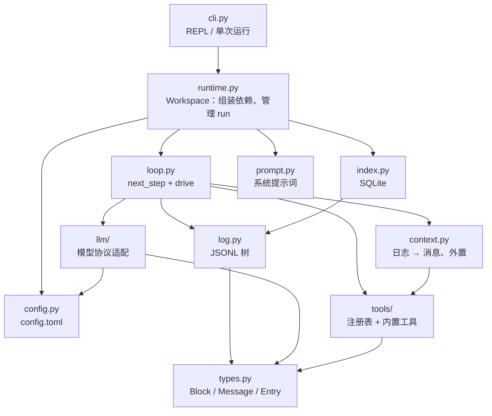

三条规则让这张图保持简单：

1. **依赖只能向下。** `loop.py` 不知道 CLI、HTTP、SQLite 的存在，所以阶段 2 加 Web 服务时，循环一行都不用改。
2. **没有全局单例。** 所有依赖由 `Workspace`（`runtime.py`）在启动时创建，并通过参数传下去。测试时直接塞一个假模型进去：`Workspace(cfg, connect=lambda spec: FakeModel(...))`。
3. **只有一个实现的东西不建接口。** 唯一的“接口”是 `llm.Model`（它确实会有多个实现：OpenAI Chat、Anthropic、Responses），以及 `Tool` 这个数据结构。

---

## 3. 一条消息的完整旅程

以用户在 CLI 输入“把 README 第一行改成中文”为例：

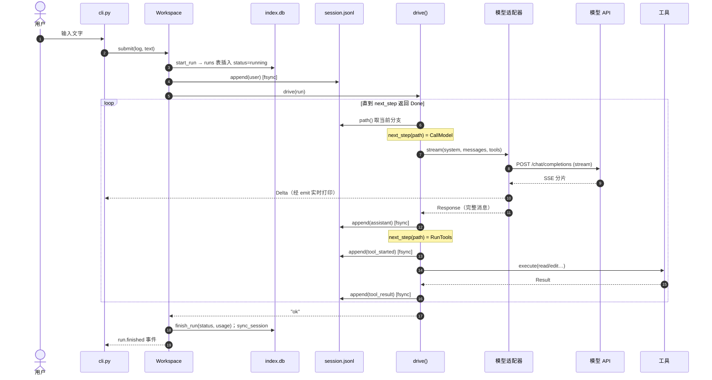

注意第 2 步和最后一步：**run 的状态在 SQLite，对话内容在 JSONL**。这条分工是第 6 节和第 12 节的基础。

---

## 4. 数据模型：中立消息格式

不同供应商的消息格式差别很大：OpenAI 把推理放在 `reasoning_content` 字段，Anthropic 用带签名的 `thinking` 块，工具结果一个用 `role: tool`，一个用 `tool_result` 内容块。D8 决定内部使用一种**与供应商无关**的格式，由适配器负责翻译。

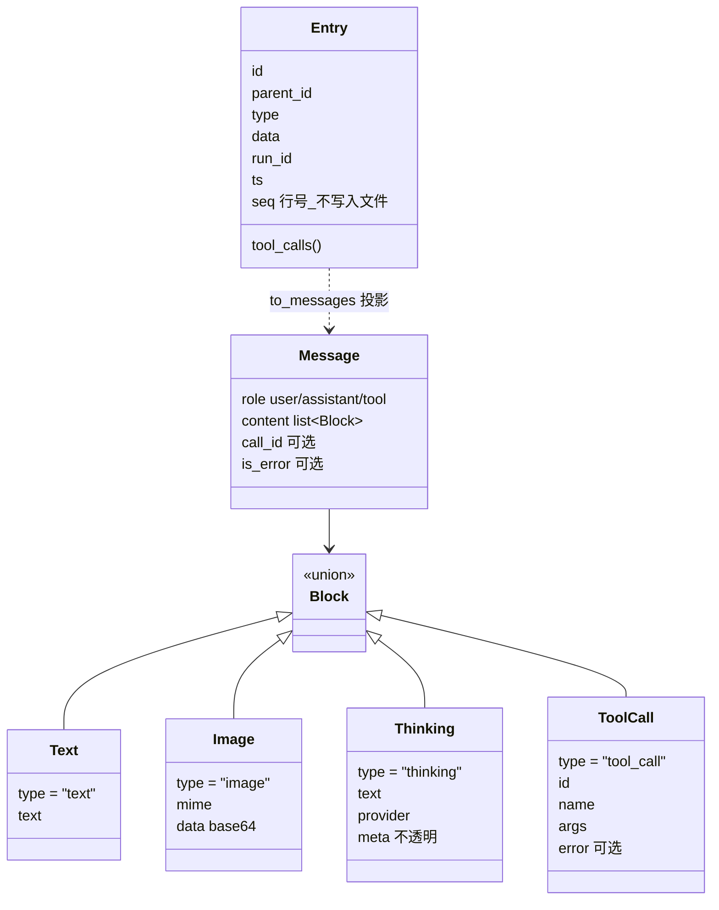

几个关键设计：

- **Block 用 `TypedDict`（本质是普通 dict）**，而不是 Pydantic 模型。它们要原样写进 JSONL、原样发给 SDK，用 dict 就不需要任何序列化代码。
- **`Thinking.provider`**：推理内容只回传给产生它的供应商。DeepSeek 要求在带工具的多轮对话里把以前的 `reasoning_content` 全部传回，否则返回 400；而别的供应商不认识这个字段。用 `provider` 标记来源，换供应商时自动丢弃。
- **`ToolCall.error`**：模型给的参数如果不是合法 JSON，不丢弃这个调用，而是带上 `error`。执行时会直接返回错误结果，让模型知道并重发；调用和结果始终配对。
- **`Entry` 与 `Message` 是两层东西**：`Entry` 是日志里的一行（发生过什么），`Message` 是发给模型的东西（模型看到什么）。`context.to_messages()` 负责把前者投影成后者，例如 `tool_started` 和 `state` 条目不会发给模型。

---

## 5. 会话日志：追加式 JSONL 树

### 5.1 文件长什么样

每个会话一个文件：`~/.nwb/sessions/<project_id>/<session_id>.jsonl`。下面是一次真实运行产生的文件（为便于阅读截短了）：

```text
行0 {"type":"session","v":1,"id":"s_745f…","project_id":"p_…","forked_from":null,"ts":…}
行1 {"id":"e_d9a3…","parent_id":null,          "type":"system_prompt","data":{"text":"You are…","hash":"…"}}
行2 {"id":"e_a1c7…","parent_id":"e_d9a3…",     "type":"user",        "data":{"content":[{"type":"text","text":"please sleep"}]},"run_id":"r_…"}
行3 {"id":"e_9d38…","parent_id":"e_a1c7…",     "type":"assistant",   "data":{"content":[{"type":"thinking",…},{"type":"tool_call","id":"call_s","name":"bash",…}],"stop":"tool_use","usage":{…}}}
行4 {"id":"e_8fde…","parent_id":"e_9d38…",     "type":"tool_started","data":{"call_id":"call_s","name":"bash"}}
行5 {"id":"e_…",    "parent_id":"e_8fde…",     "type":"tool_result", "data":{"call_id":"call_s","content":[…],"is_error":true}}
…
行11 {"type":"checkout","leaf_id":"e_9d38…","ts":…}          ← 元数据行：移动“当前位置”，不属于树
行12 {"id":"e_c29d…","parent_id":"e_9d38…",    "type":"user",        "data":{"content":[{"type":"text","text":"edited message"}]}}
```

- 第 0 行是会话头。
- 带 `id` 的行是**树条目**，`parent_id` 指向父节点。
- `type: checkout` 的行是**元数据行**，只改变“当前叶子”指针。

### 5.2 这些行组成的树

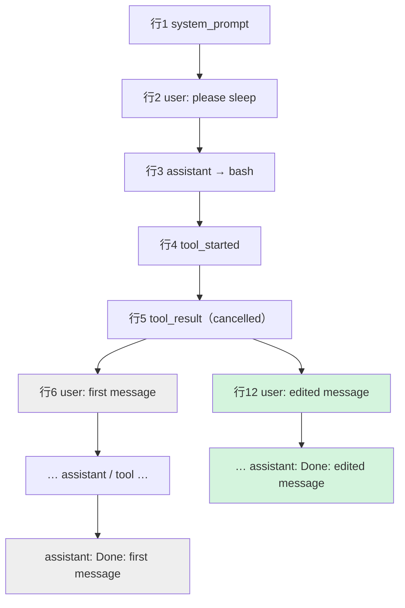

`/edit` 做的事情就是 checkout 到被编辑消息的**父节点**，然后把新消息追加为该父节点的另一个孩子。绿色是当前分支，灰色是被放弃的分支。旧分支的数据仍然完整保留，随时可以 `/checkout` 回去。

### 5.3 当前分支 = 从叶子走回根

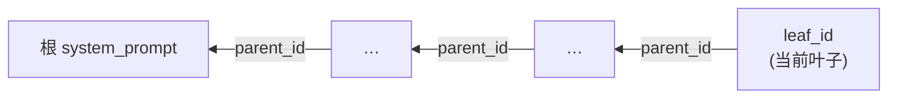

`SessionLog.path()` 从 `leaf_id` 沿着 `parent_id` 一路走到根，再反转，得到“根 → 叶子”的条目列表。**发给模型的上下文、循环的决策，都只看这条路径**，其他分支对它们不可见。

`leaf_id` 怎么确定？打开文件时按顺序重放每一行：遇到树条目，叶子变成它；遇到 checkout 行，叶子变成它指定的条目。所以“最后发生的事”永远决定当前位置，不需要额外存储。

### 5.4 写入的三个保证

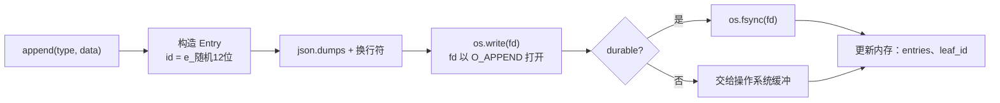

1. **只追加，从不修改已写的行。** 文件用 `O_APPEND` 打开，每行用一次 `write` 写完。这是崩溃安全的基础：已经写下的东西不会被后来的写入破坏。
2. **关键条目写完立即 `fsync`。** `user`、`assistant`、`tool_started`、`tool_result` 默认 `durable=True`。`fsync` 要求操作系统把数据真正交给磁盘，进程随后被杀也不会丢。checkout 行丢了无伤大雅，不 fsync。
3. **打开时修复半行。** 如果进程恰好死在 `write` 中间，文件末尾会有一行不完整的 JSON。`SessionLog.open()` 找到最后一个换行符，把它之后的内容截掉。但**中间某行坏了会直接报错**：那说明文件被损坏了，静默跳过会悄悄丢数据。

### 5.5 分叉成新会话

`/fork ID` 把“根 → ID”这条路径复制到一个新文件，头部记录 `forked_from`。条目 id 保持不变，所以两个会话的公共前缀可以对得上。

---

## 6. SQLite 索引：为什么要两份数据

JSONL 适合存对话：追加快、人能直接读、出问题时可以手工 grep。但有些问题用 JSONL 很难回答：“这个项目有哪些会话？”“哪些 run 还没结束？”“这个 request_id 是不是已经处理过？”这些交给 SQLite。

两份数据最容易出的问题是不一致，所以只定一条规则：

> **对话里发生的事以 JSONL 为准；对话之外的实体以 SQLite 为准；SQLite 中关于会话的部分都可以从 JSONL 重建。**

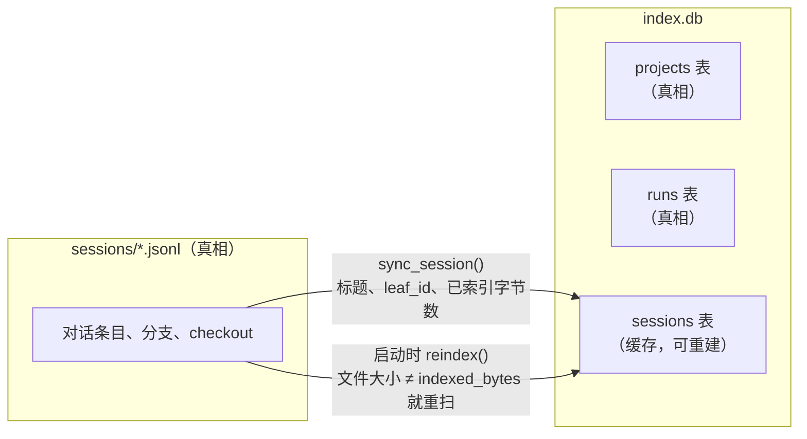

三张表的作用：

| 表 | 存什么 | 谁是真相 |
|---|---|---|
| `projects` | 项目 = 一个目录；`owner_id` 固定为 `local`（D16 预留多用户） | SQLite |
| `runs` | 每次运行的状态（running / ok / cancelled / error / limit）、所用模型、`request_id`、续跑次数、token 用量 | SQLite |
| `sessions` | 标题、文件路径、当前叶子、已索引到的字节数 | JSONL（这里只是缓存） |

**写入顺序是先 JSONL，后 SQLite。** 两步之间如果崩溃，SQLite 里的 `indexed_bytes` 会小于文件实际大小，下次启动时 `reindex()` 发现不一致，就重扫这个文件。反过来的顺序会出现“索引说有、文件里没有”的情况，无法修复。

**`request_id` 的唯一约束**：客户端为每次发送生成一个 id。网络重试导致同一个请求到达两次时，`start_run` 返回已有的 run，不会再启动一次。CLI 目前不传这个 id，它在阶段 2 的 HTTP 接口里才真正发挥作用。

---

## 7. Agent 循环：next_step 与 drive

这是整个项目最重要的设计。

### 7.1 思路：循环没有自己的状态

常见的 Agent 循环把状态放在局部变量里，例如“现在第几轮、有哪些工具调用待执行”。进程一死，这些就没了。

我们的循环**不保存任何决策状态**。每一步都重新看一眼日志，问一个问题：“按这份日志，接下来应该做什么？”这个问题由纯函数 `next_step(path)` 回答。

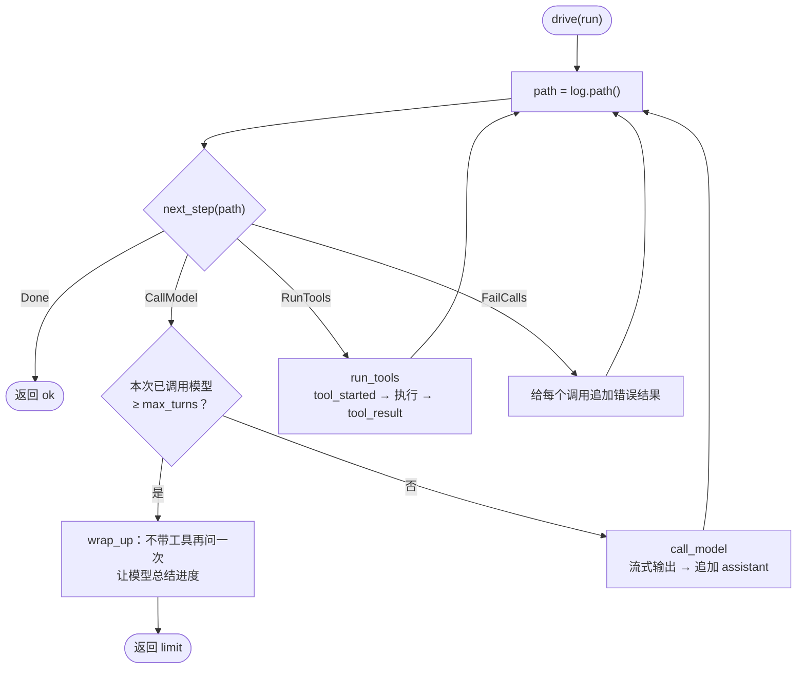

### 7.2 next_step 的判断规则

`next_step` 从路径末尾往回看，跳过 `tool_started` 和 `state`，并记下已经有结果的 `call_id`：

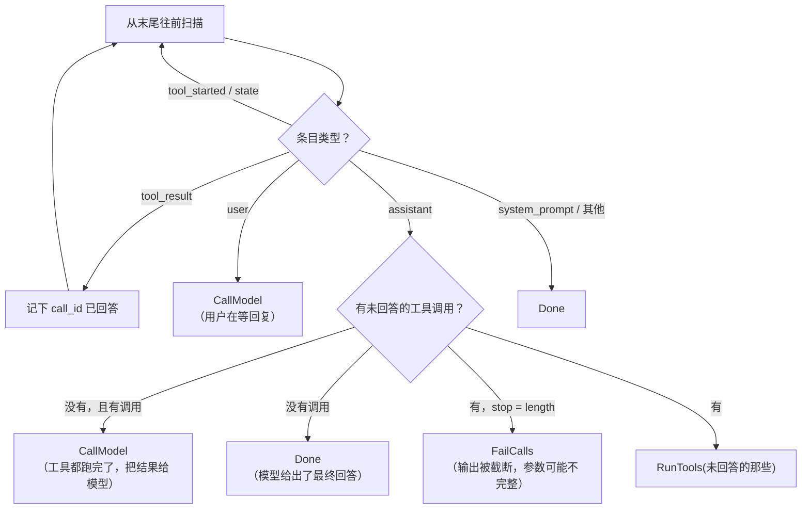

完整的情况表（即 `tests/test_next_step.py` 的 13 个用例）：

| 日志末尾 | 下一步 | 说明 |
|---|---|---|
| 空，或只有 system_prompt | Done | 还没有用户输入 |
| user | CallModel | 用户在等回复 |
| assistant（无工具调用） | Done | 最终回答 |
| assistant（stop = aborted） | Done | 用户中途取消 |
| assistant + 2 个调用 | RunTools([c1, c2]) | |
| assistant + 2 个调用 + c1 的结果 | RunTools([c2]) | 只跑没回答的 |
| assistant + c1 + tool_started(c1) | RunTools([c1]) | 崩溃留下的，交给 recover 判断 |
| assistant + c1 + 结果 | CallModel | 把结果交回模型 |
| assistant(stop = length) + c1 | FailCalls | 截断的调用绝不执行 |
| assistant(stop = length) + c1 + 结果 | CallModel | |
| user + state | CallModel | state 是透明的 |
| … + 结果 + user（插话） | CallModel | 阶段 2 的 steer 也走这条 |

### 7.3 为什么这样设计

1. **正常运行和崩溃恢复是同一段代码。** 恢复只是“打开日志，再调一次 `drive`”。不需要单独的恢复逻辑，也就不会有“恢复路径没测到”的问题。
2. **纯函数可以穷举测试。** 构造一个条目列表，断言返回值，不需要模型、网络和文件。
3. **调用与结果永远配对。** 所有出口（取消、截断、未知工具、崩溃、步数上限）最后都会给每个 `tool_call` 补上一个 `tool_result`。模型 API 要求每个工具调用都有对应结果，否则直接报错。`close_pending()` 是最后一道保险：用户发新消息前，如果路径上还有没回答的调用，先补上错误结果。

### 7.4 步数上限的收尾

模型可能陷入反复调用工具的循环。`max_turns`（默认 50，可在 `config.toml` 设置）限制一个 run 内调用模型的次数。到达上限时，不是直接停下，而是追加一条合成的用户消息，并用 `tool_choice="none"` 再请求一次，让模型说清楚做完了什么、改了哪些文件、从哪里继续。这个做法借鉴了 OpenWorkBuddy：直接停下，用户看到的最后一句往往是半句过程描述。

---

## 8. 工具系统

### 8.1 定义一个工具只需要一个函数

```python
class ReadArgs(Args):                       # Pydantic 模型 = 参数校验 + JSON Schema
    path: str = Field(description="File path, absolute or relative to the project root")
    offset: int = Field(1, ge=1)
    limit: int = Field(2000, ge=1, le=5000)

@tool(effect="read", parallel=True)        # effect 给权限层用（阶段 3），parallel 决定能否并发
async def read(args: ReadArgs, ctx: ToolCtx) -> Result:
    """Read a text file with line numbers…"""   # docstring 就是给模型看的说明
```

`@tool` 装饰器从函数签名里取出参数模型，从 docstring 取出说明，生成一个 `Tool` 数据对象。`Tool.schema()` 调用 Pydantic 的 `model_json_schema()` 生成 JSON Schema，并去掉无用的 `title` 字段以节省 token。工具没有基类，也没有继承。

### 8.2 一次调用的执行管线

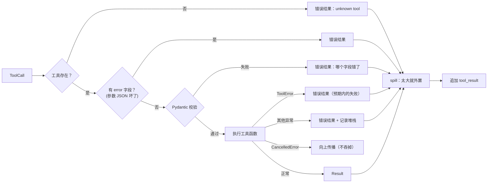

原则：**工具失败不等于运行失败。** 文件不存在、参数写错、命令报错，都作为 `is_error=True` 的结果交给模型，模型会自己换个办法。只有取消（`CancelledError`）会穿透出去，因为那是用户要停下。

### 8.3 并行规则

一批工具调用里，只有当**每一个**都标了 `parallel=True`（目前只有 `read`）时才并发执行（`asyncio.gather`）。只要混入一个写操作或命令，整批按顺序执行。因为“先写再读”和“先读再写”结果不同，顺序本身就是语义的一部分。

### 8.4 先读后写

`write`（覆盖已有文件时）和 `edit` 要求：

1. 本会话里读过这个文件；
2. 读过之后文件没有被别人修改（比较 mtime）。

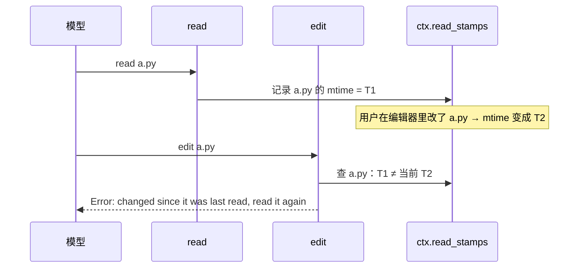

这能防住两类真实问题：模型凭记忆“盲改”一个它没看过的文件，以及覆盖掉用户刚刚手动做的修改。

### 8.5 edit 的精确替换

`old_string` 必须在文件里**恰好出现一次**（除非设置 `replace_all`）。出现 0 次就提示“重新读文件，精确复制”；出现多次就提示“多带一些上下文”。这比让模型输出行号或 diff 更稳：行号会随编辑漂移，diff 格式各家模型掌握程度不一（D11）。

### 8.6 大输出外置（上下文治理第 1 级）

一次 `bash` 可能输出几兆的日志。全部放进上下文，既浪费钱，又会把重要信息淹没。

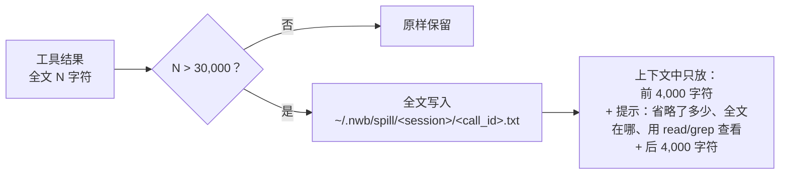

文件的创建方式是 `os.open(..., O_CREAT | O_EXCL | O_NOFOLLOW, 0o600)`，所在目录权限为 0700：

- `0o600` / `0700`：只有你自己能读，因为命令输出里可能有敏感信息；
- `O_EXCL`：文件已存在就失败，不会覆盖；
- `O_NOFOLLOW`：如果有人预先放了一个同名软链接，不会顺着它写到别处去。

---

## 9. bash：进程组、超时和取消

### 9.1 为什么要进程组

`bash -c "npm run dev"` 实际上会启动一棵进程树：bash → npm → node → ……。如果只杀 bash，它的子孙进程会变成孤儿，继续占着端口和 CPU。

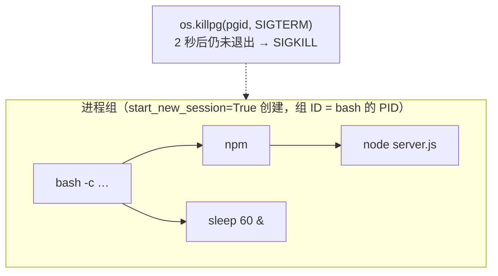

`start_new_session=True` 让 bash 成为一个新会话和进程组的组长。之后 `os.killpg` 能一次性给组内所有进程发信号。测试 `test_bash_cancel_kills_the_whole_process_group` 专门验证了这一点：命令里起一个后台 `sleep`，取消后检查它的 PID 已经不存在。

### 9.2 三种结束方式

| 情况 | 处理 | 给模型的结果 |
|---|---|---|
| 正常退出 | 读完输出 | 输出 + `[exit code N]`（非零退出码不算工具错误，模型自己判断） |
| 超时（默认 120 秒，最多 600 秒） | 杀进程组 | 错误：timed out，附上已有的输出 |
| 用户取消 | 杀进程组，然后继续抛出 `CancelledError` | 由循环统一补“cancelled”结果 |

### 9.3 环境变量白名单

子进程只拿到 `PATH`、`HOME`、`LANG`、`LC_*` 等少数几个环境变量，**不继承**父进程里的 `OPENDESIGN_API_KEY` 之类的密钥（D17）。否则模型只要执行一次 `env`，密钥就会进入对话历史。测试 `test_bash_reports_exit_code_and_scrubs_env` 验证了这一点。

---

## 10. 模型适配：OpenAI Chat 协议

### 10.1 适配器的职责

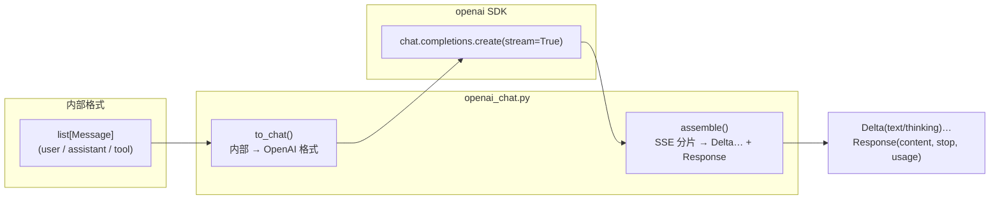

模型协议统一成一个异步生成器：先不断产出 `Delta`（给界面实时显示），最后产出**恰好一个** `Response`（完整的消息，写入日志）。网络重试由官方 SDK 处理（`max_retries=3`），我们不再包一层。

### 10.2 to_chat：格式翻译

| 内部 | OpenAI Chat |
|---|---|
| user，全是文本 | `{"role":"user","content":"…"}` |
| user，含图片 | `content` 是数组，图片转成 `data:` URL |
| assistant 的 text | `content` |
| assistant 的 tool_call | `tool_calls[]`，`arguments` 是 JSON 字符串；没有文本时 `content` 为 `null` |
| assistant 的 thinking（**同一供应商**） | `reasoning_content` 字段 |
| tool 结果 | `{"role":"tool","tool_call_id":…,"content":"文本"}` |
| tool 结果里的图片 | Chat 协议的 tool 消息只能放文本，所以在这批 tool 消息之后追加一条 user 消息来放图片 |

### 10.3 assemble：把流式分片拼回完整消息

流式响应中，工具调用的参数是被切碎了发过来的。例如一个调用的参数 `{"command": "ls"}` 可能分三片到达：

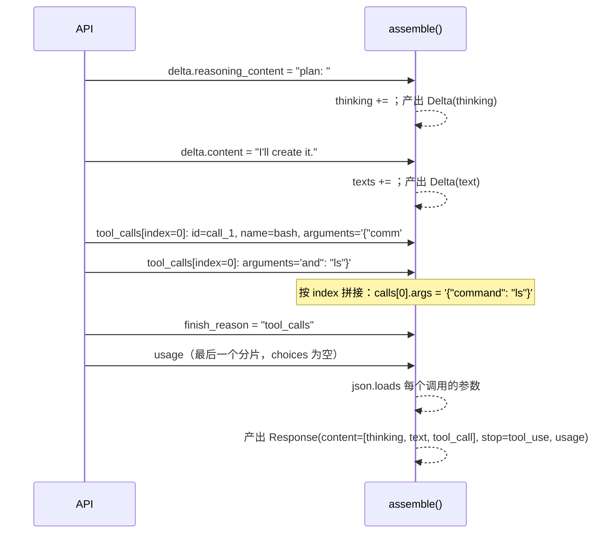

要点：

- **按 `index` 拼接，而不是按 `id`**：只有第一片带 `id`，后续分片只有 `index`。
- **工具调用只在流结束后才整体产出**，不会执行半截参数。
- **`finish_reason` 映射**：`stop`→`end`，`tool_calls`→`tool_use`，`length`→`length`（被截断，循环会拒绝执行其中的工具调用），`content_filter`→`error`。
- **用量**：`stream_options.include_usage=True` 让最后一个分片带上 usage。缓存命中数各家字段不同：OpenAI 是 `prompt_tokens_details.cached_tokens`，DeepSeek 是 `prompt_cache_hit_tokens`，两个都读。

### 10.4 DeepSeek 的推理回传

DeepSeek 文档要求：请求里带了 `tools` 时，之前所有轮次的 `reasoning_content` 都必须传回，否则返回 400。我们的处理：

1. `assemble` 把推理内容存成 `Thinking` 块，带上 `provider` 和 `meta.field = "reasoning_content"`；
2. `to_chat` 只在 `provider` 与当前供应商一致时，把它放回 assistant 消息的 `reasoning_content` 字段。

用假服务端到端跑过之后，抓到的真实请求体如下，第二轮请求里第一轮的推理内容被正确带回：

```json
{"role": "assistant", "content": "I'll create it.",
 "tool_calls": [{"id": "call_1", "type": "function", "function": {"name": "bash", "arguments": "{\"command\": \"echo '你好世界' > out.txt && cat out.txt\"}"}}],
 "reasoning_content": "plan: write file"}
```

### 10.5 超窗错误

如果供应商返回 `context_length_exceeded`，或错误信息里含有 “context length” / “maximum context”，适配器抛出 `ContextOverflow`。阶段 1 只是把它作为错误报给用户；阶段 3 的压缩会接住它，压缩后重试一次。

---

## 11. 取消是怎么传播的

Python asyncio 的取消机制是：对一个 Task 调用 `cancel()`，会在它当前 `await` 的位置抛出 `CancelledError`。我们利用这一点，让取消沿调用栈逐层传播，每一层只做自己的清理：

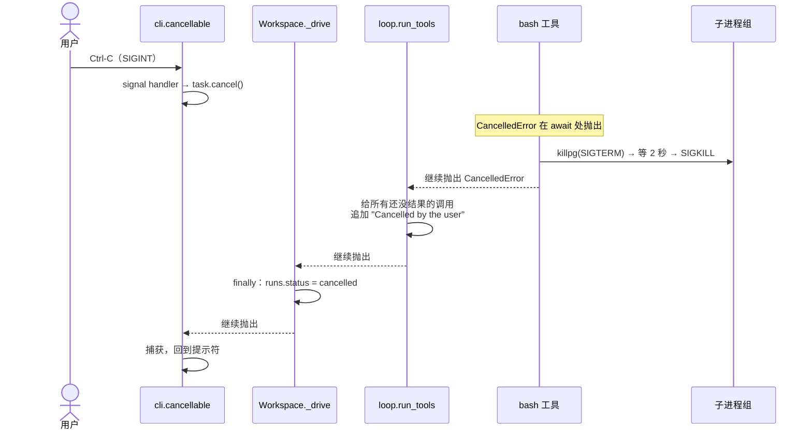

如果取消发生在模型流式输出途中，`call_model` 会把**已经显示给用户的文字**存成一条 `stop="aborted"` 的 assistant 消息，但**丢弃没有收完的工具调用**。用户看到过的内容不会凭空消失，半截的调用也不会被执行。

CLI 里 Ctrl-C 的双重含义：运行中按下只取消这次运行，在空提示符下按下才退出程序。实现方式是运行期间用 `loop.add_signal_handler(SIGINT, task.cancel)` 临时接管信号，运行结束后再还原。

---

## 12. 崩溃恢复：日志即检查点

### 12.1 时间线

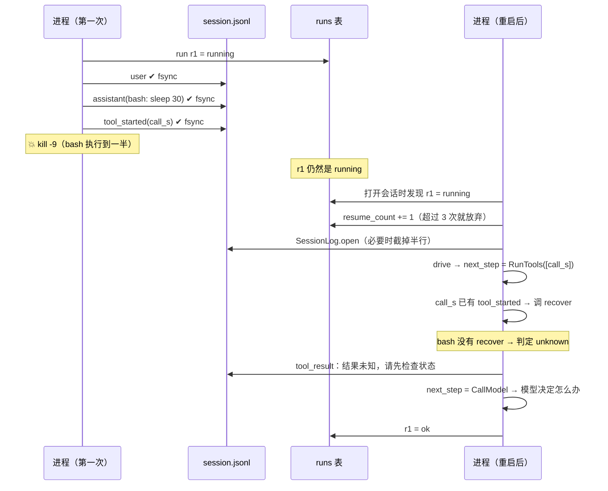

### 12.2 recover：工具自己判断“做没做完”

崩溃后最难处理的是：一个工具有 `tool_started` 却没有 `tool_result`，它到底执行了没有？

| 工具 | 判断方式 | 结论 → 处理 |
|---|---|---|
| read（effect = read） | 无副作用 | 直接重跑 |
| write | 文件内容与参数中的 content 完全相同？ | 相同 → done，补成功结果；不同 → not_done，重跑 |
| edit | old_string 已不存在且 new_string 存在？ | 是 → done；old_string 仍唯一存在 → not_done，重跑；其他 → unknown |
| bash | 无法判断 | unknown → 补错误结果，交给模型 |

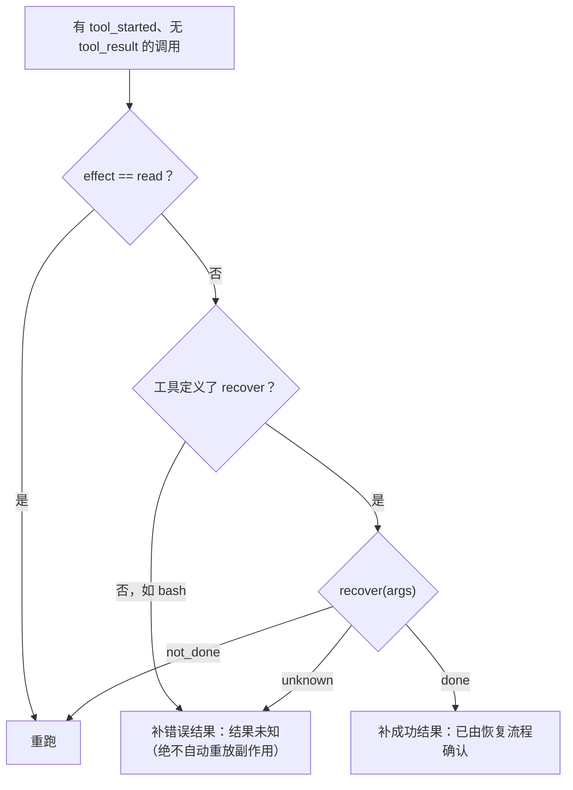

为什么 bash 不重跑？`rm -rf build && make` 跑到一半被杀，再跑一遍可能没问题；但 `git push`、发邮件、扣款之类的操作重复执行就是事故。“结果未知，先检查再决定”交给模型，是唯一安全的默认值。

### 12.3 防止崩溃循环

如果某个操作每次都让进程崩溃，无限续跑只会无限崩溃。`runs.resume_count` 每次续跑加 1，超过 3 次就把 run 标为 error，不再自动续跑。

---

## 13. 系统提示词：组装与冻结

会话创建时，`prompt.build()` 组装一次系统提示词，作为日志的**根条目**（`system_prompt`）写进 JSONL。之后这个会话的每一次请求都用它，不再重新生成。

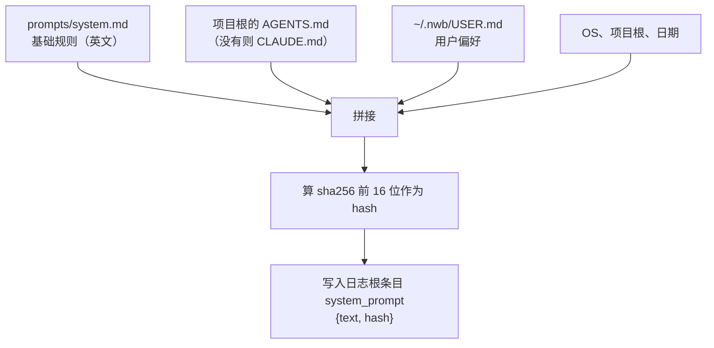

为什么要冻结？**提示词缓存。** OpenAI、DeepSeek 等供应商会缓存请求的最长公共前缀，命中部分的价格低一个数量级，首字延迟也更短。缓存按前缀匹配，开头哪怕变一个字（比如每轮更新的时间戳），后面全部失效。端到端测试里第二轮请求 2,000 个输入 token 中有 1,800 个命中缓存，就是这个原因。

```text
请求 1：[系统提示词][工具定义][user1]
请求 2：[系统提示词][工具定义][user1][assistant1][tool1]          ← 前面部分全部命中缓存
请求 3：[系统提示词][工具定义][user1][assistant1][tool1][assistant2]…
         └────────────── 只要开头不变，就一直命中 ──────────────┘
```

工具定义的顺序也是固定的（注册表按声明顺序），理由相同。会话中途需要改变提示词（激活 skill、MCP 上线等）时，会追加消息而不是改写开头，这在阶段 3、4 实现（D9）。

基础提示词用英文写，要求模型用用户的语言回复：多数模型对英文指令遵循更稳定，同样的内容 token 也更少。

---

## 14. 配置、密钥与运行

### 14.1 你的 OpenDesign 配置

`~/.nwb/config.toml` 已经写好：

```toml
default_model = "ds-flash"

[providers.opendesign]
protocol = "openai-chat"
base_url = "https://amr-link.open-design.ai/v1"
api_key = "env:OPENDESIGN_API_KEY"

[models.ds-flash]
provider = "opendesign"
id = "DeepSeek-v4.1-flash"
context_window = 1_000_000   # DeepSeek's published limit; the gateway may differ
max_output = 32_000
```

配置分两层（D7）：**Provider** 是“去哪里、用什么协议、凭什么认证”，**Model** 是“具体哪个模型、多大窗口”。同一个 Provider 下可以加多个模型，切换时用 `-m 名字` 或会话里的 `/model 名字`。

### 14.2 密钥只存引用

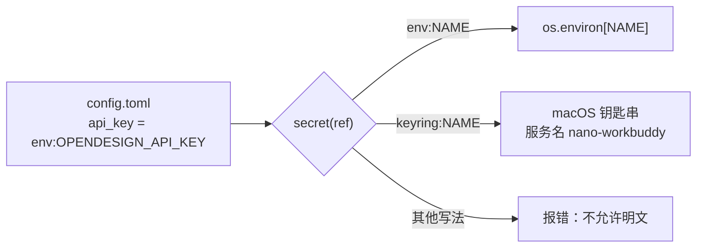

配置文件里永远不出现明文密钥，所以这个文件可以放心地备份、同步，甚至提交到私有仓库。两种提供密钥的方式：

```bash
# 方式一：环境变量（写进 ~/.zshrc 就一劳永逸）
export OPENDESIGN_API_KEY=你的key
```

```bash
# 方式二：存进 macOS 钥匙串，然后把 config.toml 改成 api_key = "keyring:opendesign"
uv run python -c "import getpass, keyring; keyring.set_password('nano-workbuddy', 'opendesign', getpass.getpass('key: '))"
```

### 14.3 运行

```bash
uv run nwb                          # 以当前目录为项目，进入交互模式
uv run nwb "统计这个仓库每种文件的行数"   # 单次运行
uv run nwb -c                       # 继续最近一个会话（若上次崩溃，会自动续跑）
uv run nwb -C ~/some/project        # 指定项目目录
```

交互命令：

| 命令 | 作用 |
|---|---|
| `/tree` | 显示会话树，`*` 标出当前分支 |
| `/edit ID` | 回到某条用户消息之前，下一句输入成为新分支 |
| `/checkout ID` | 移动到任意节点（ID 可以只写前缀） |
| `/fork ID` | 把到该节点的路径复制成新会话 |
| `/model [名字]` | 查看或切换模型（下一次运行生效） |
| `/sessions`、`/open ID`、`/new` | 会话管理 |
| `/resume` | 手动续跑被中断的运行 |

数据都在 `~/.nwb/` 下：`config.toml`、`index.db`、`sessions/`、`spill/`。设置环境变量 `NWB_HOME` 可以换一个目录（测试就是这么隔离的）。

---

## 15. 测试是怎么写的

### 15.1 假模型

`tests/conftest.py` 里的 `FakeModel` 按剧本依次返回响应，并记录每次收到的请求：

```python
model = FakeModel(
    reply("writing", call("write", path="notes.md", content="# hi\n")),   # 第 1 次：调 write
    reply(None, call("read", path="notes.md")),                          # 第 2 次：调 read
    lambda msgs: reply("done: " + ...),                                  # 第 3 次：根据收到的消息动态回答
)
```

剧本项还可以是一个异常（模拟 API 出错），或者 `HANG`（先输出一点文字，然后永远等待，用来测试流式途中的取消）。

### 15.2 测试矩阵

```mermaid
mindmap
  root((48 个测试))
    next_step 13
      每种日志末尾形状
    log 7
      分支与 checkout 重开
      半行截断
      中间损坏报错
      fork 只复制路径
    tools 13
      read 分页 / 图片 / 错误
      先读后写
      edit 唯一匹配
      recover 判定
      bash 退出码 / 超时
      取消杀进程组
      外置首尾与权限
    loop 13
      多步文件任务
      截断不执行
      未知工具与错误回传
      并行读
      工具中取消
      流式中取消
      步数上限收尾
      编辑分支
      request_id 去重
      崩溃续跑 ×5
    openai_chat 3
      分片拼接与用量
      坏 JSON 参数
      推理只回传给同供应商
```

崩溃续跑的测试不需要真的杀进程：直接构造一份“写到一半”的 JSONL（有 `tool_started`、没有 `tool_result`，run 仍为 running），重新打开后调用 `resume()`，检查追加了哪些条目。日志即检查点，所以测试也只需要日志。

### 15.3 端到端验证

单元测试之外，还用一个本地假 OpenAI 服务（标准库写的 SSE 服务器）跑了真实的 SDK、真实的流式解析和真实的 CLI：

| 场景 | 结果 |
|---|---|
| 单次运行：中文参数、参数分两片到达、推理回传 | 文件内容正确，第二轮请求带回了 `reasoning_content` |
| 交互模式中，bash 执行 `sleep 30 &` 时按 Ctrl-C | 运行标为 cancelled，后台 sleep 进程已被杀死 |
| `/edit` 一条旧消息并重发 | `/tree` 显示两个分支，新分支的请求不含旧分支内容 |
| bash 执行途中 `kill -9` 整个程序，再 `nwb -c` | 自动续跑；bash 判为结果未知、未重放；run 最终为 ok |

**还没做的**：用你的真实 OpenDesign 密钥跑一次。设置好 `OPENDESIGN_API_KEY` 后运行 `uv run nwb "列出当前目录最大的 5 个文件并写进 top5.txt"` 即可验证。需要留意两点：网关是否原样透传 `reasoning_content`，以及它的实际上下文窗口。

---

## 16. 已知限制和下一步

| 限制 | 原因 | 何时解决 |
|---|---|---|
| 没有沙箱，工具以你的用户权限运行 | 阶段 1 先打通闭环 | 阶段 3：Seatbelt / bwrap + 权限规则 |
| `kill -9` 时正在运行的子进程会变成孤儿 | 子进程在独立的进程组里，父进程被强杀时没有机会清理 | 以后可以在启动时根据记录的 PGID 清理 |
| 重启后“读过哪些文件”的记录丢失 | `read_stamps` 只在内存里 | 有意为之：重启后模型先重读一次，更安全 |
| 只有一个协议适配器 | 按计划 | 阶段 3：Anthropic Messages |
| 上下文治理只有外置这一级 | 按计划 | 阶段 3：清理旧结果 + 摘要压缩 |

**阶段 2：Web 工作台。** 包括 FastAPI 服务、HTTP 命令 + SSE 事件流（断线按 seq 补发）、React 界面、分支切换器、steer/queue 插话、本机令牌鉴权，以及服务启动时自动续跑所有中断的运行。循环和日志不需要改动，阶段 2 只是在 `Workspace` 外面再包一层。
