# 教程 03：权限、沙箱与上下文治理

> 对应阶段 3。新增 `policy.py`、`sandbox.py`、`compaction.py`、`llm/anthropic.py`，重写了 `context.py` 和 `runtime.py` 的运行组装部分。
> 后端核心 3,128 行（设计目标是阶段 3 结束时不超过 5,000 行），前端 895 行，测试 1,424 行（85 个用例）。
> 上一篇：[02-Web工作台](02-Web工作台.md)。设计依据：[架构方案](../design/2026-10-23-architecture-plan.md)（D7、D9、D10、D12、D13）。

## 目录

1. [这一步做了什么](#1-这一步做了什么)
2. [两道防线：规则和沙箱](#2-两道防线规则和沙箱)
3. [权限规则](#3-权限规则)
4. [闸门与审批](#4-闸门与审批)
5. [沙箱](#5-沙箱)
6. [让模型知道自己的权限：通知条目](#6-让模型知道自己的权限通知条目)
7. [上下文治理总览](#7-上下文治理总览)
8. [第 2 级：清理旧工具输出](#8-第-2-级清理旧工具输出)
9. [第 3 级：摘要压缩](#9-第-3-级摘要压缩)
10. [历史被编辑之后的思考块](#10-历史被编辑之后的思考块)
11. [Anthropic 协议适配](#11-anthropic-协议适配)
12. [实测中发现的问题](#12-实测中发现的问题)
13. [对照调研文档的验收表](#13-对照调研文档的验收表)
14. [测试](#14-测试)
15. [使用方式](#15-使用方式)
16. [已知限制和下一步](#16-已知限制和下一步)

---

## 1. 这一步做了什么

| 能力 | 位置 | 决策 |
|---|---|---|
| 规则表：`(动作, 资源通配, allow/ask/deny)`，最后匹配者生效 | `policy.py` | D12 |
| 三个预设档位：只读 / 工作区 / 完全信任 | `policy.py` | D12 |
| “总是允许”沉淀为会话规则，`config.toml` 可写全局规则 | `index.py`、`config.py` | D12 |
| macOS Seatbelt 沙箱、Linux bubblewrap 沙箱 | `sandbox.py` | D13 |
| bash 的 `unsandboxed` 提权申请、沙箱拒绝时的提示 | `tools/builtin.py` | D13 |
| 权限说明以“通知条目”追加给模型，而不改系统提示词 | `loop.py`、`context.py` | D9 |
| 上下文治理第 2 级（清理旧工具输出）和第 3 级（摘要压缩） | `compaction.py`、`context.py` | D10 |
| 供应商报“超窗”时压缩并重试一次 | `loop.py` | D10 |
| Anthropic Messages 协议适配，含缓存断点 | `llm/anthropic.py` | D7 |
| 界面：档位选择、上下文用量、压缩按钮、提权警告、压缩/清理分隔线 | `web/src` | — |
| CLI：终端审批（y / a / n）、`/preset`、`/compact` | `cli.py` | — |

阶段 3 唯一推迟的内容是“分支摘要”（切换分支时总结离开的那条分支），挪到阶段 4，原因见第 16 节。

---

## 2. 两道防线：规则和沙箱

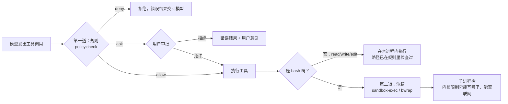

为什么需要两道？

- **规则**检查的是“模型要做什么”：写哪个文件、跑哪条命令。对 `write`/`edit` 这类在本进程内执行的工具，路径检查已经足够。
- 但一条 `bash` 命令能做的事无法从字符串里看出来：`python build.py` 可能写任何地方、可能联网。扫描命令字符串（比如找 `rm`）不是安全边界。只有**内核**能限制一个进程树实际能碰到什么，这就是**沙箱**。

所以“工作区”档的默认规则直接放行 `bash`：它在沙箱里，写不出项目、连不上网，最坏也只能弄乱项目目录（而项目通常有 git）。

---

## 3. 权限规则

### 3.1 把每个调用归一成 (动作, 资源)

| 工具 | 动作 | 资源 |
|---|---|---|
| `read` / `write` / `edit` | 工具名 | 解析后的**绝对真实路径**（展开 `~`、相对路径，并解析符号链接） |
| `bash` | `bash`；带 `unsandboxed=true` 且当前有沙箱时为 `bash.unsandboxed` | 命令原文 |
| 其他（以后的 MCP 工具） | 工具名 | 空字符串 |

工具通过 `@tool(scope=...)` 声明自己的归一方式，策略模块不需要认识每一个工具。

**为什么要解析符号链接？** 项目里放一个 `escape -> /` 的链接，`write("escape/etc/x")` 看起来在项目内，实际写到了外面。`resolve()` 之后，资源就是真实落点，规则看到的是真相（测试 `test_symlinks_resolve_before_permission_checks`）。

### 3.2 最后匹配者生效

```python
def check(action, resource, rules, places):
    for rule in reversed(rules):              # 从后往前找第一条匹配的
        if rule.matches(action, resource, places):
            return Check(..., rule.effect, rule)
    return Check(..., "ask", None)            # 都不匹配：询问
```

规则列表按三层拼起来，后面的覆盖前面的：


资源用通配符匹配（`fnmatch`，`*` 也跨越 `/`），规则里可以写这些占位符：`{root}` 项目根，`{home}` nano-workbuddy 数据目录，`{spill}` 本会话的外置文件目录，`~` 用户主目录。

### 3.3 三个预设

| 规则 | 只读 | 工作区（默认） | 完全信任 |
|---|---|---|---|
| 兜底 | `* * ask` | `* * ask` | `* * allow` |
| 读文件 | allow | allow | allow |
| 写/编辑项目内（`{root}/*`） | ask | allow | allow |
| 写/编辑项目内的 `.git/`、`.nwb/` | ask | **ask** | allow |
| 写/编辑项目外 | ask | ask | allow |
| bash（沙箱内） | ask | allow | allow |
| bash.unsandboxed | ask | ask | allow |
| 读凭据目录（`~/.ssh`、`~/.aws`、`~/.gnupg`、`~/.kube`、`~/.docker`、`~/.config/gh`、`~/.netrc`、钥匙串、`{home}`） | **deny** | **deny** | allow |
| 读本会话的外置文件（`{spill}/*`） | allow | allow | allow |
| 沙箱 | 只读（仅 `$TMPDIR` 可写） | 项目目录 + `$TMPDIR` 可写 | 不进沙箱 |

两个细节：

- `{home}`（默认 `~/.nwb`）里有登录令牌和**其他会话**的日志，所以整体禁止读取；但本会话的外置文件也在里面，于是在禁止之后再追加一条“允许读 `{spill}/*`”。因为最后匹配者生效，这条例外刚好覆盖它需要覆盖的范围。
- `.git/` 在项目里，但写 `.git/hooks/pre-commit` 等于植入一个下次 `git commit` 时执行的脚本，所以单独设为 ask。

### 3.4 “总是允许”不能变成通配符

审批卡片上的“本会话总是允许”会生成一条规则：

- 路径类：允许所在目录 `目录/*`；
- 命令类：允许**这条确切的命令**。

命令里本身可能含有通配符。用户“总是允许” `rm *`，如果直接把 `rm *` 当作规则，以后 `rm -rf /` 也会匹配上。所以生成规则时用 `glob.escape` 转义：`rm *` 变成 `rm [*]`，只匹配字面上的 `rm *`。

```python
def suggestion(self) -> Rule:
    if self.resource.startswith("/"):
        return Rule(self.action, glob.escape(str(Path(self.resource).parent)) + "/*", "allow")
    return Rule(self.action, glob.escape(self.resource), "allow")
```

测试 `test_always_allow_suggestion_never_widens_into_a_wildcard` 专门验证这一点。

---

## 4. 闸门与审批

### 4.1 闸门在每次运行开始时组装

`Workspace.make_run()` 冻结一次运行的设置（模型和档位只读一次，D12），并把权限检查装进第 02 篇里的 `gate` 钩子：

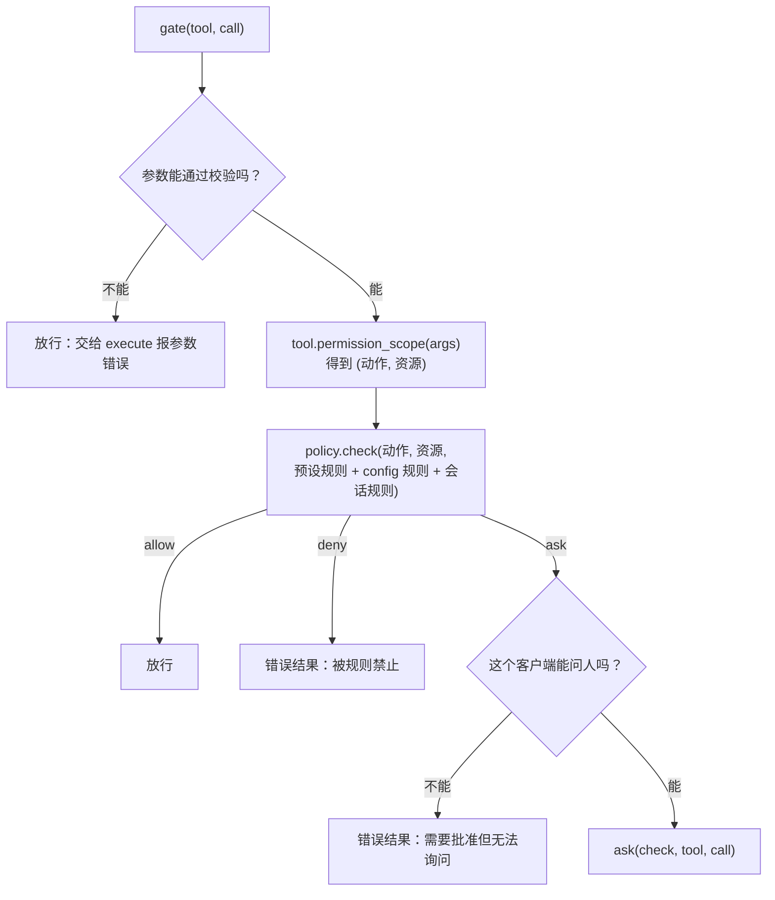

注意：档位在运行开始时冻结，但**会话规则每次检查时实时读取**。所以在审批卡片上点了“总是允许”，同一次运行里后面同类的调用立刻就不再询问。

### 4.2 两种“问人”的方式，同一个接口

```python
type Ask = Callable[[Check, Tool, ToolCall], Awaitable[Result | None]]   # None = 允许
```

| 客户端 | 实现 | 交互 |
|---|---|---|
| Web | `RunManager._asker` | 推送 `approval.requested`（带动作、资源、建议规则），`await` 一个 Future，直到 POST `/api/approvals/{id}` |
| CLI | `cli.terminal_ask` | 在终端打印 `? 动作: 资源`，读一行：`y` 一次、`a` 总是、`n 理由` 拒绝 |

CLI 版有一个小技巧：等待输入期间临时移除事件循环的 SIGINT 处理器，让 Ctrl-C 直接打断 `input()`；随后取消当前运行，再恢复处理器。否则 Ctrl-C 要等用户按回车才生效。

---

## 5. 沙箱

### 5.1 macOS：Seatbelt

macOS 自带 `sandbox-exec`，它用一种 Lisp 风格的策略语言（SBPL）描述进程能做什么。Codex 和 Claude Code 也用它。我们的策略分两段：固定的基础段，加上按会话生成的路径段。

```text
(version 1)
(deny default)                                  ← 默认什么都不许
(allow process-exec process-fork)               ← 能启动子进程（子进程继承同样的限制）
(allow signal (target same-sandbox))
(allow sysctl-read)
(allow file-read*)                              ← 默认可读所有文件……
(allow file-read* file-write* ... (literal "/dev/null") ...)
(allow mach-lookup (global-name "com.apple.system.opendirectoryd.libinfo")   ← whoami 等需要
                   (global-name "com.apple.bsd.dirhelper"))                  ← git 取临时目录需要
;; ---- 以下按会话生成，路径通过 -D 参数传入 ----
(deny  file-read*  (subpath (param "R0")) ...)  ← ……但凭据目录不可读
(allow file-read*  (subpath (param "A0")))      ← 本会话外置文件例外
(allow file-write* (subpath (param "W0")) (subpath (param "W1")))   ← 项目根、临时目录可写
(deny  file-write* (subpath (param "P0")) ...)  ← .git、.nwb 不可写
;; 允许联网时才追加：network-outbound、DNS、TLS 证书服务等
```

SBPL 的关键规则同样是**后面的规则覆盖前面的**，所以“先大范围允许、再挖掉例外、再在例外里开小口”这种写法成立。这和我们的权限规则是同一个思路。

路径不拼进策略文本，而是用 `-D 名=值` 作为参数传入，策略里写 `(param "W0")`。这样路径里有引号、括号也不会破坏策略语法。

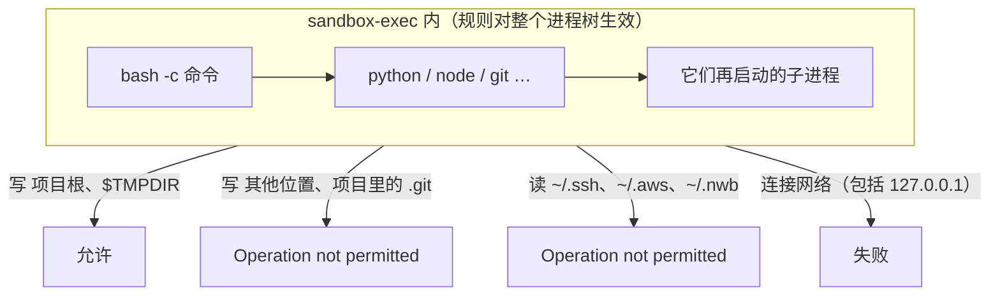

### 5.2 实测

策略不是照搬来的，每条放行都在这台 Mac 上试出来：

| 命令（工作区档，不联网） | 结果 |
|---|---|
| `echo ok > inside.txt` | 成功 |
| `echo bad > 项目外/x.txt` | Operation not permitted |
| `cat 机密目录/key` | Operation not permitted |
| `echo x > .git/hooks_test` | Operation not permitted |
| `git status`、`python3`、`node`、`uv --version`、`whoami`、`date`、`sort /etc/hosts` | 全部正常 |
| `curl https://example.com` | 失败（连不上本机代理 127.0.0.1:7897） |
| 同样的 curl，联网版策略 | 200 |

`git status` 最初会警告“couldn't get path of DARWIN_USER_TEMP_DIR”，加上 `com.apple.bsd.dirhelper` 这个 mach 服务后消失。这类细节只能实测出来。

### 5.3 Linux：bubblewrap

bubblewrap 用 Linux 的挂载命名空间：把整个根目录**只读**地挂进新的命名空间，再把可写目录挂成可写：

```text
bwrap --ro-bind / /  --dev /dev  --proc /proc  --die-with-parent  --unshare-pid
      --bind 项目根 项目根          ← 可写
      --ro-bind 项目根/.git ...     ← 再盖一层只读
      --tmpfs ~/.ssh                ← 用空的内存盘盖住凭据目录
      --unshare-net                 ← 新的网络命名空间：只有回环口
      -- bash -c 命令
```

思路和 Seatbelt 一致，只是手段不同：Seatbelt 是“检查每次访问”，bwrap 是“让进程看到一个被改造过的文件系统”。**本机是 macOS，bwrap 版只做了参数构造的单元测试，没有在 Linux 上实际运行过。**

### 5.4 沙箱不可用时不降级

```python
try:
    argv = wrap(argv, ctx.sandbox)
except SandboxUnavailable as e:   # 没有 sandbox-exec / 没装 bwrap / Windows
    raise ToolError(f"{e}. Sandboxed commands cannot run here; ask the user to install the sandbox "
                    "or switch to the full-trust preset.")
```

用户选择了“工作区”档，就是要求命令在沙箱里跑。沙箱不可用时，悄悄改成不受限运行，会让用户以为自己受保护，这是最糟糕的结果。所以直接报错，告诉模型（和用户）原因和出路（测试 `test_bash_never_falls_back_to_running_unconfined`）。

### 5.5 申请到沙箱外运行

有些命令确实需要联网（`npm install`、`git push`），或要写项目外的文件。bash 工具有一个参数：

```python
unsandboxed: bool = Field(False, description="Run outside the sandbox, for commands that need the network "
                          "or must write outside the project. Requires the user's approval; ...")
```

模型带上 `unsandboxed=true` 时，动作变成 `bash.unsandboxed`，工作区档会询问用户；界面上的审批卡片会显示红字警告“可以联网，也可以写项目目录以外的文件”。

模型怎么知道该申请？命令在沙箱里失败、且输出匹配典型的拒绝特征（`Operation not permitted`、`Could not resolve host` 等）时，结果末尾会追加一句提示：

```text
[This command ran in the sandbox. If it failed because it needs the network or must write outside
 the project, re-run it with unsandboxed=true; the user will be asked to approve.]
```

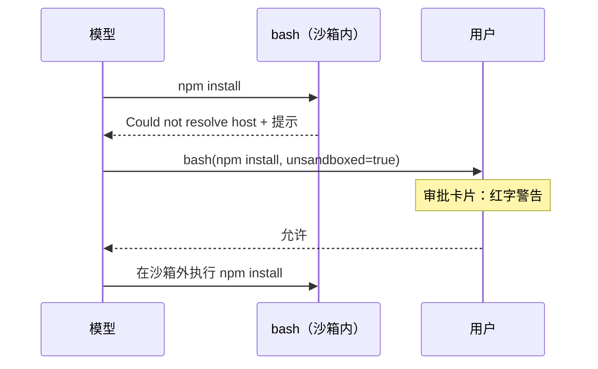

### 5.6 其他配套

- **临时目录**：沙箱里的命令把 `TMPDIR` 指到 `系统临时目录/nwb-<会话>`，它可写。不能放在 `~/.nwb` 下，因为那里整体不可读。
- **代理变量**：环境变量白名单加上了 `HTTP_PROXY`、`HTTPS_PROXY`、`ALL_PROXY`、`NO_PROXY`（及小写）。你的机器走本地代理，否则即使在完全信任档下 `curl` 也连不上外网。

---

## 6. 让模型知道自己的权限：通知条目

模型需要知道自己处在哪个档位，否则它会对着沙箱反复撞墙，或者不知道可以申请 `unsandboxed`。最直接的做法是把说明写进系统提示词，但第 01 篇讲过：系统提示词在会话开始时冻结，改它会让整段提示词缓存失效（D9）。

做法是新增一种日志条目 `notice`，以用户角色、`<system-notice>` 标签发给模型：

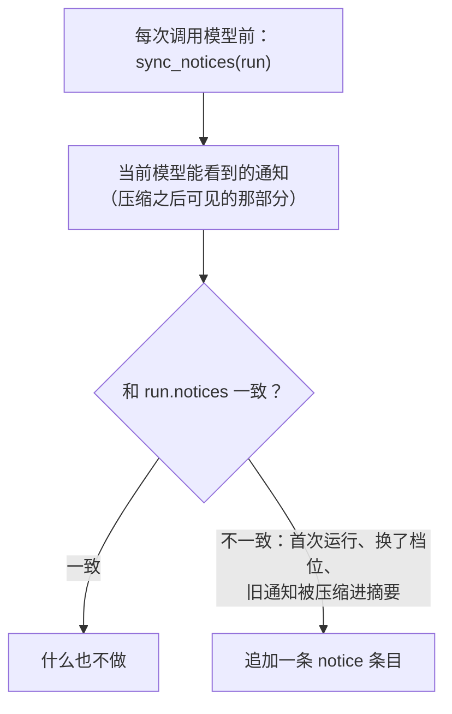

三种需要追加的情况：

1. 会话第一次运行：还没有任何通知；
2. 用户换了档位：文字不同了；
3. 压缩把旧通知折进了摘要：它已经不在模型能看到的范围里。

通知是**追加**的，前面的历史一个字不变，缓存照常命中。系统提示词里只留一句：权限以最新的 `<system-notice>` 为准，这些标签来自程序而不是用户。

`next_step` 把 `notice` 当作透明条目：它不改变“下一步该做什么”的判断。

---

## 7. 上下文治理总览

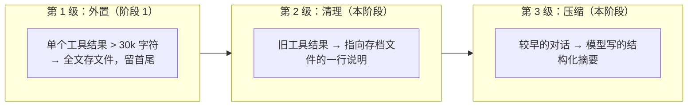

| | 何时发生 | 是否调用模型 | 记录方式 |
|---|---|---|---|
| 外置 | 工具结果产生时 | 否 | 直接写进 tool_result |
| 清理 | 下一次请求放不下时，先试这个 | 否 | 追加 `prune` 条目 |
| 压缩 | 清理后仍放不下 | 是（一次摘要请求） | 追加 `compaction` 条目 |

清理和压缩都是**追加条目**，不删除任何东西：原始历史永远在 JSONL 里，界面、导出、分支都能看到全文；变化的只是“投影给模型看的那部分”。而且投影只在这两个时刻变化，其余时候前缀稳定，缓存持续命中。

### 7.1 预算

```python
def budget(spec):            # 一次请求的输入最多能用多少
    return spec.context_window - max(16_384, spec.max_output)
```

预留出完整的输出空间，否则模型写到一半会被截断。DeepSeek Flash 窗口 1M、输出 32k，预算约 968k；测试用的假模型窗口 128k、输出 4k，界面上显示“上下文 2k/112k”。

### 7.2 估算 token

```python
def estimate_tokens(s):
    cjk = 中日韩字符数                   # 大约 1 字 1 token
    return cjk + (其余字符数) / 3.5 + 1
```

故意做得很简单。真实用量以供应商返回的 usage 为准（界面右上角显示的就是它）；估算只用来决定“要不要缩”。中文按 1 字 1 token 计，偏保守；如果估低了，供应商会报超窗，我们会压缩后重试（9.5 节）。

### 7.3 fit()：每次请求前的检查

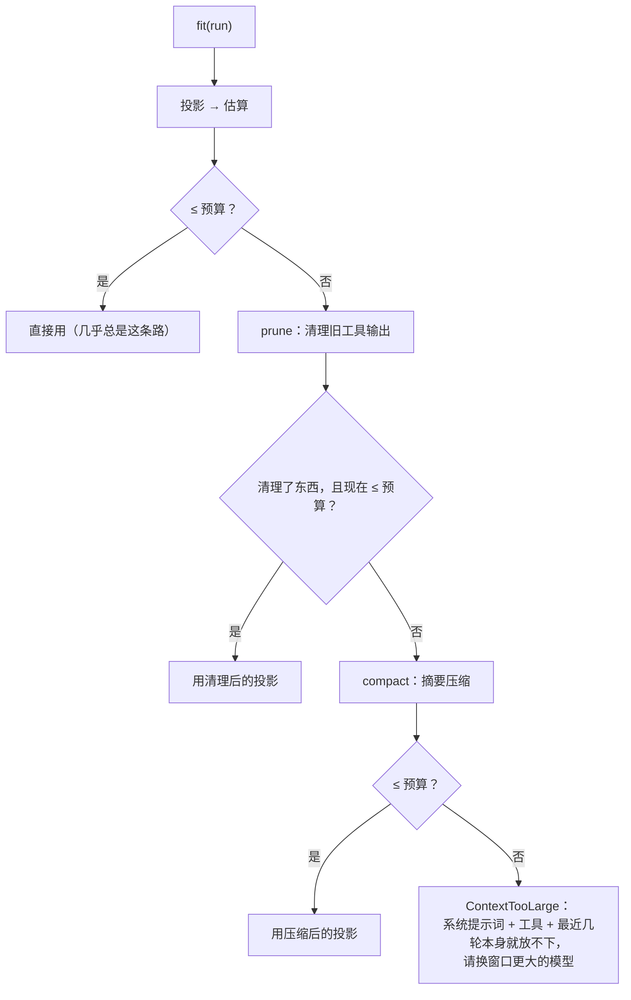

`keep`（保留不动的最近 token 数）取 `min(20_000, 预算 / 4)`。窗口很小的模型（比如从 1M 的模型切换到 32k 的模型）也能留出空间。这正是设计文档里“切换小窗口模型 → 预算重算，压缩或明确提示超限”的实现：切换后的第一次请求按新模型的预算检查。

---

## 8. 第 2 级：清理旧工具输出

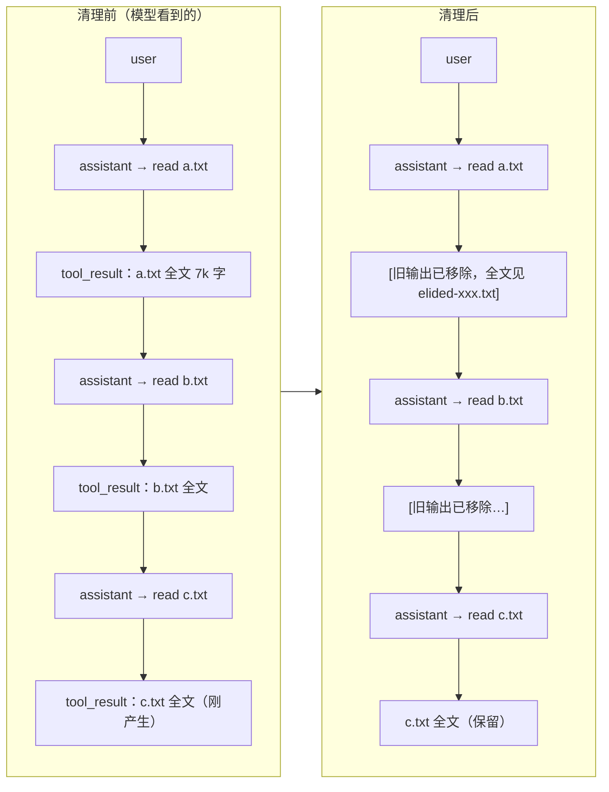

规则：

1. 从后往前累计 token，最近 `keep` 个 token 之内的不动；
2. **最新一条 assistant 之后的结果永远不动**：模型还没看过它们。这条是写测试时发现的漏洞，见第 12 节；
3. 只清理超过 1,000 字符的结果，小结果清掉也省不了多少；
4. 被清理的结果先写入 `spill/<会话>/elided-<条目id>.txt`（0600 权限），占位文字里写明路径，模型需要时可以用 `read` 读回来；
5. 追加一条 `prune` 条目：`{"upto_seq": N, "dir": 存档目录, "count": 清理条数}`。投影时，seq ≤ N 且足够大的结果都显示为占位文字。

清理对模型的影响最小：它丢掉的是**已经用过**的原始输出，而它当时根据这些输出做的结论、调用和回答都还在。

---

## 9. 第 3 级：摘要压缩

### 9.1 选切点

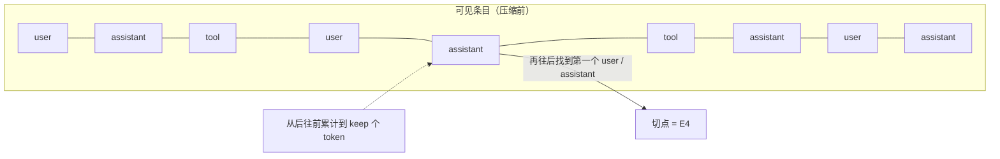

```python
def choose_cut(body, keep):
    从末尾往前累计，直到 ≥ keep，得到位置 start
    若全部加起来都不到 keep：start = 最后一条 user 的位置（只保留最新一轮）
    切点 = start 之后第一个 user 或 assistant（至少为 1，保证有东西可摘要）
```

切点**不能落在 tool_result 上**，结果必须和它的调用在一起。落在 assistant 上是允许的：保留部分从一条 assistant 开始，它的工具结果紧随其后，仍然合法。

### 9.2 生成摘要

切点之前的条目被**序列化成纯文本**交给模型，不是作为对话消息：

```text
[User]: 帮我整理 docs 目录
[Assistant]: 我先看看目录结构。
[Assistant tool calls]: bash({"command": "ls docs"})
[Tool result]: design research tutorial
[Notice]: Permission preset: workspace. ...
```

以对话形式给模型，它容易“接着聊”；以文本给，它知道这是一份要总结的记录（Pi 的做法）。工具结果只截取前 2,000 字符。

要求的格式（沿用 Pi）：目标、约束与偏好、进展（已完成 / 进行中 / 受阻）、关键决定、下一步、关键上下文（确切的路径、标识符、命令、报错和数值）。最后一项最重要：摘要里丢了一个文件名，模型就得重新去找。

如果之前已经压缩过，会把上一份摘要放在 `<previous-summary>` 里，要求“在它的基础上更新”。摘要会一次次累积，而不是只覆盖最近一段。读过和改过的文件列表也逐次累积（`file_ops`）。

### 9.3 压缩条目与投影

```json
{"type": "compaction", "data": {"summary": "## Goal ...", "first_kept_id": "e_…",
  "files": {"read": ["a.txt"], "modified": ["notes.md"]}, "tokens_before": 7342, "usage": {...}}}
```

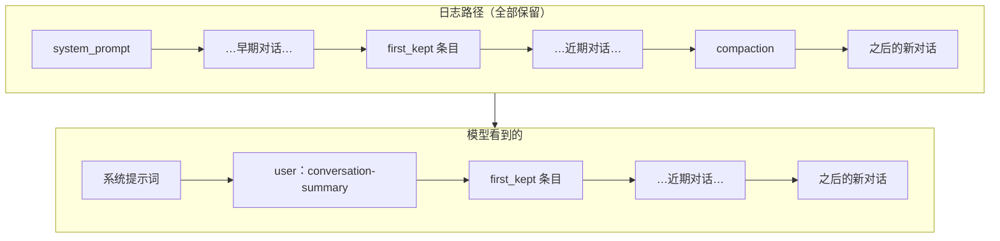

`visible(path)` 找到路径上最后一个 `compaction`，用它的摘要代替 `first_kept_id` 之前的所有内容。压缩条目本身挂在当前叶子之后（日志只追加），所以投影时把它“提”到最前面。较早的压缩条目都已包含在最新的摘要里，投影时跳过。

实测中，压缩之后发给模型的请求是这样的：

```text
system    | You are nano-workbuddy, ...
user      | <conversation-summary> The earlier part of this conversation was compacted ... ## Goal ...
user      | please escalate                    ← first_kept：保留的最近一轮
assistant |  (tool_calls)
tool      | [exit code 0]
assistant | Done: [exit code 0]
user      | next step                          ← 新消息
user      | <system-notice> Permission preset: workspace ...   ← 旧通知被折进摘要，重新追加
```

### 9.4 失败不推进

摘要请求失败（网络、模型报错）或返回空文本时，抛出异常，**不追加任何条目**，日志保持原样。下次请求会重新尝试。绝不能留下“压缩了一半”的状态（测试 `test_failed_summary_appends_nothing`）。

### 9.5 超窗恢复

估算可能偏低。供应商返回“超窗”错误时（OpenAI 协议的 `context_length_exceeded`，Anthropic 的 `prompt is too long`），适配器把它转成统一的 `ContextOverflow`：

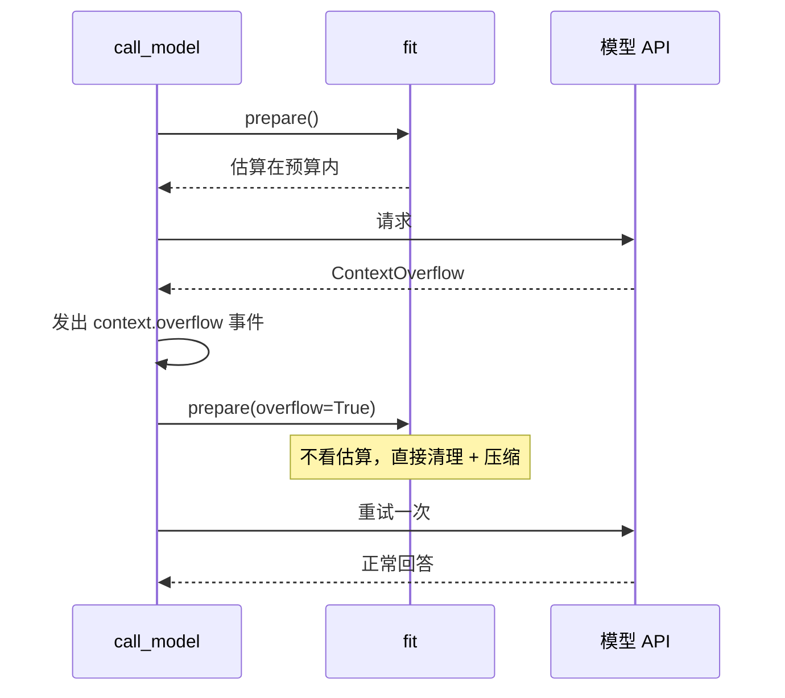

只重试一次。第二次还超窗，说明问题不在估算，直接报错。

### 9.6 手动压缩

Web 顶栏的“压缩”按钮、CLI 的 `/compact [重点]`。手动压缩不看预算，“重点”会作为 `Focus:` 附在摘要提示词后面，比如“保留所有文件名”。它通过 `RunManager` 作为一个运行执行，所以运行期间不能同时发消息，界面也显示忙碌状态。

---

## 10. 历史被编辑之后的思考块

这一节的内容是读 Anthropic 文档时发现的，它影响的是设计本身。

**背景**：较新的 Claude 模型启用了“保留思考”（preserved thinking）。每个思考块的签名记录了产生它时的完整上文；把它回传给 API 时，API 会检查这段上文**是否被改过**。改过就返回 400。

**问题**：第 2、3 级治理恰恰就是在“改历史”：清理把旧结果换成了占位文字，压缩用摘要替换了前文。文档明确写着：“保留最近几轮原文的压缩（keep-tail compaction）”会让保留轮次里的思考块失效，应当把它们的思考块去掉（文字和工具调用可以保留）。

**另一边**：DeepSeek 的规则相反。带工具的多轮对话里，**必须**回传以前的 `reasoning_content`，否则也是 400。

**解法**：在投影层做标记，由各适配器决定怎么处理：

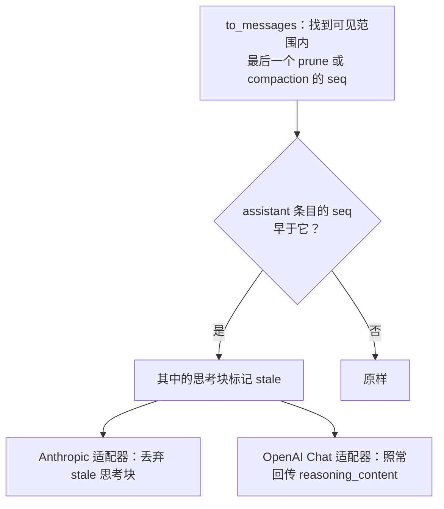

规则只有一句：**在最近一次历史编辑之前产生的思考，不再是对当前历史的思考。** 编辑之后新产生的思考块是基于编辑后的历史签名的，可以正常回传（测试 `test_thinking_from_before_an_edit_is_not_replayed_to_anthropic`）。

文档也说明，在压缩这样的边界上丢一次思考影响很小，因为摘要承载了之前的工作。真正有害的是每次请求都改历史；我们只在超预算时才编辑，所以这种情况很少发生。

---

## 11. Anthropic 协议适配

### 11.1 格式翻译

| 内部 | Anthropic Messages |
|---|---|
| 系统提示词 | `system: [{type: text, text, cache_control}]` |
| user 文本 / 图片 | `text` / `image`（`source.type = base64`） |
| assistant 文本 | `text` |
| assistant 工具调用 | `tool_use {id, name, input}` |
| 本供应商、未失效的思考块 | `thinking {thinking, signature}` 或 `redacted_thinking {data}` |
| 其他供应商的思考块、stale 思考块 | 丢弃 |
| tool 结果 | 放进**下一个 user 消息**的 `tool_result {tool_use_id, content, is_error}` |
| 连续同角色消息 | 合并成一个（多个工具结果必须在同一个 user 消息里，通知也并进去） |
| 空的工具输出 | `(no output)`（API 不接受空文本块） |
| `tool_choice="none"` | `{type: "none"}` |

### 11.2 两个缓存断点

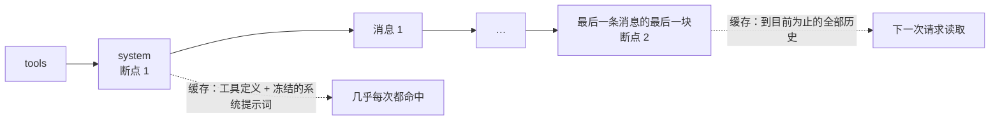

Anthropic 需要显式标注 `cache_control`（OpenAI、DeepSeek 自动缓存前缀）。渲染顺序是 tools → system → messages，所以：

- 断点 1 在 system 上：工具定义和冻结的系统提示词一起被缓存；
- 断点 2 在最后一条消息的最后一块上：这次请求的全部前缀被写入缓存，下一次请求只多出新追加的部分，前面全部从缓存读取。

一个请求最多允许 4 个断点，我们只用 2 个。

### 11.3 流式处理交给 SDK

```python
async with self.client.messages.stream(**req) as stream:
    async for event in stream:
        if event.type == "content_block_delta":
            if event.delta.type == "text_delta":      yield Delta("text", ...)
            elif event.delta.type == "thinking_delta": yield Delta("thinking", ...)
    final = await stream.get_final_message()          # SDK 已经拼好签名、工具参数 JSON
yield from_anthropic(final, provider, model)
```

和 OpenAI 适配器不同，这里**不自己拼流式分片**。Anthropic 的流有思考签名（`signature_delta`）、工具参数（`input_json_delta`）、被遮盖的思考等多种块，官方 SDK 的 `get_final_message()` 已经正确处理。我们只转发文字和思考的增量给界面，最后翻译完整消息。

用量换算：Anthropic 的 `input_tokens` **不含**缓存部分，所以输入总量 = `input_tokens + cache_read_input_tokens + cache_creation_input_tokens`，这样和 OpenAI 协议的口径一致，界面上的“↑2000（缓存 1800）”才有意义。

停止原因：`end_turn`→end，`tool_use`→tool_use，`max_tokens` 和 `model_context_window_exceeded`→length（截断的工具调用不执行），`refusal`→error。

### 11.4 用假服务端测试真 SDK

`tests/test_anthropic.py` 起一个本地 HTTP 服务，按 Anthropic 的 SSE 格式逐条发出 `message_start`、思考块（含 `signature_delta`）、文字块、工具块（参数分两片 `input_json_delta`）、`message_delta`、`message_stop`。适配器用真实的 `anthropic` SDK 连它，验证：

- 增量顺序：先思考，后文字；
- 签名、工具参数被正确拼好；
- 用量换算：10 + 90 + 5 = 105；
- 请求体：两个断点的位置、工具结果的合并、自己的思考回传、其他供应商的思考被丢弃、空输出变成 `(no output)`；
- `prompt is too long` 被转成 `ContextOverflow`。

**还没有用真实的 Claude 接口跑过**（没有密钥）。

接入示例见 README：`protocol = "anthropic"`，`params` 里可以放 `thinking = { type = "adaptive", display = "summarized" }`。新模型默认不显示思考内容，设置 `display` 后界面才有“思考过程”可看。

---

## 12. 实测中发现的问题

| # | 现象 | 原因 | 修复 |
|---|---|---|---|
| 1 | 写清理测试时意识到：如果最新一条工具结果本身就很大，`prune` 会在模型还没看到它之前就把它清掉 | 边界只按“最近 N 个 token”计算 | 最新 assistant 之后的结果永远不清理 |
| 2 | 设计压缩时发现保留轮次的思考块会让 Anthropic 返回 400 | 保留思考的签名校验（第 10 节） | stale 标记，由适配器决定是否丢弃 |
| 3 | 重启测试服务时 `duplicate column name: settings_json` | 这个数据库由阶段 2 的建表语句创建，已经有这一列，但版本号是 0，迁移又加了一次 | 加列迁移遇到“列已存在”时跳过，并补了回归测试 |
| 4 | OpenAI 适配器遇到 Anthropic 的思考块会因 `meta["field"]` 抛 KeyError | 两种思考块的 meta 结构不同 | 只回传带 `field` 的思考块 |
| 5 | 清理测试一开始没触发清理 | 测试数据的问题：`read` 工具把超长行截到 2,000 字符，单行 7k 字的文件读出来很短 | 测试改用多行文件 |

---

## 13. 对照调研文档的验收表

[前一份调研](../research/2026-10-23-agent-foundation.md)第 11 节列了 10 个必须通过的场景，现在的状态：

| 场景 | 状态 | 依据 |
|---|---|---|
| 多步文件任务 | ✅ | `test_multi_step_file_task`；真实模型冒烟测试**待你的密钥** |
| SSE 断线重连 | ✅ | 阶段 2 `test_reconnect_replays_only_newer_entries` + 浏览器重启测试 |
| 同一会话重复发送 | ✅ | `request_id` 去重、运行中插话/排队 |
| 停止模型与 shell | ✅ | 取消测试 + 浏览器实测后台进程被杀 |
| 重启时工具结果不确定 | ✅ | recover：bash 判为结果未知、不重放 |
| 切换小窗口模型 | ✅ | `fit()` 按当前模型预算检查，压缩或报 `ContextTooLarge` |
| 反复压缩 | ✅ | `test_compaction_summarises_old_turns_and_keeps_recent_ones`：两次压缩、原始历史仍在、通知不丢 |
| 文件越界与软链接 | ✅ | 路径解析后再检查规则；沙箱拒绝项目外写入 |
| 沙箱缺失 | ✅ | `test_bash_never_falls_back_to_running_unconfined` |
| MCP / Skill 走统一权限路径 | ⏳ | 阶段 4。闸门已按 (动作, 资源) 通用设计，MCP 工具默认 ask |

---

## 14. 测试

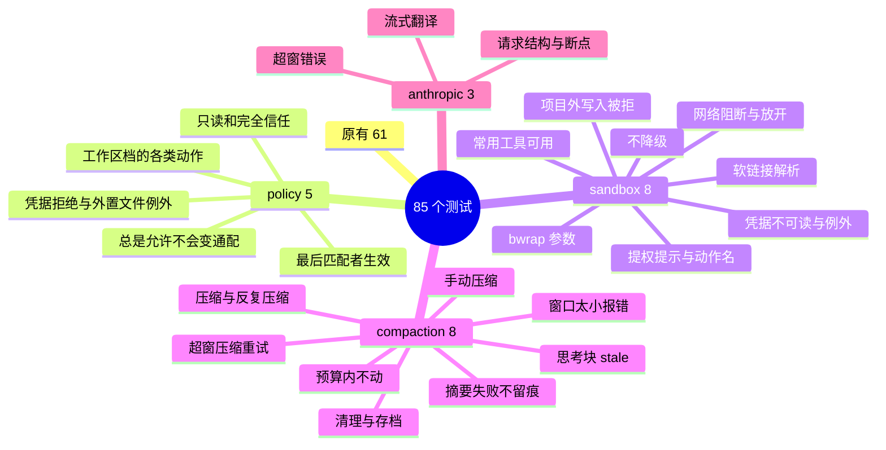

`test_sandbox.py` 里标了 `darwin` 的测试会**真的调用 `sandbox-exec`**，在 macOS 以外自动跳过。压缩测试通过给 `FakeModel` 指定小窗口（38,000 → 预算约 6,000 token）来触发；`FakeModel` 会识别摘要请求（系统提示词以 “You write handoff summaries” 开头），自动回答，不占用剧本。

浏览器和终端的端到端实测：

| 操作 | 结果 |
|---|---|
| 工作区档，模型在沙箱里写 `/tmp` | Operation not permitted + 提权提示；文件确实没有产生 |
| 模型申请 `unsandboxed` | 审批卡片带红字警告；点允许后命令在沙箱外执行，文件产生 |
| 点“压缩” | 上下文从 2k 降到 1k，出现压缩分隔线；下一次请求以摘要开头，并重新追加了权限通知 |
| CLI 中拒绝并附理由 `n 不要在沙箱外运行` | 理由原样交给模型 |
| CLI `/preset trust` 后再申请 | 直接执行，不询问 |

---

## 15. 使用方式

```bash
uv run nwb serve                 # Web：顶栏选择档位、查看上下文用量、手动压缩
uv run nwb -p readonly           # CLI：指定档位
```

CLI 内：`/preset workspace`、`/compact 保留所有文件名`。审批时输入 `y`（一次）、`a`（总是）、`n 理由`（拒绝）。

自定义规则写在 `~/.nwb/config.toml`：

```toml
[[rules]]            # git push 一律先问我
action = "bash.unsandboxed"
resource = "git push*"
effect = "ask"

[[rules]]            # 这个目录随便写
action = "write"
resource = "~/Documents/notes/*"
effect = "allow"
```

---

## 16. 已知限制和下一步

| 限制 | 说明 |
|---|---|
| Linux 沙箱未实测 | bwrap 只做了参数构造测试；Windows 没有沙箱后端，只能用完全信任档 |
| 网络只能全开或全关 | 按域名放行需要一个过滤代理（Anthropic 的 sandbox-runtime 就是这么做的），以后再加 |
| 项目级规则没有界面 | 目前有全局规则（config.toml）和会话规则（审批产生）；项目级规则表结构已预留 |
| Anthropic 适配器未连真实接口 | 用假服务端测过真 SDK；有密钥后需要冒烟一次 |
| 分支摘要推迟 | 切换分支时总结离开的分支，需要在一次 HTTP 请求里调用模型，而现在的分支切换是即时操作。等阶段 4 有了更多“后台任务”形态时一起做 |
| 估算偏粗 | 靠超窗重试兜底；如果频繁触发，再接入各家的 token 计数接口 |

**阶段 4：扩展接入。** 包括 MCP（官方 SDK v2，direct / deferred + tool_search，stdio server 在沙箱里启动）、Skill 工具、memory 工具、OpenAI Responses 适配、配置式 shell 钩子，以及推迟下来的分支摘要。
