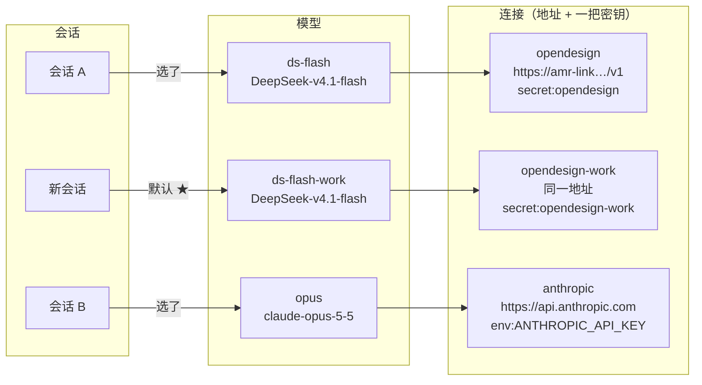
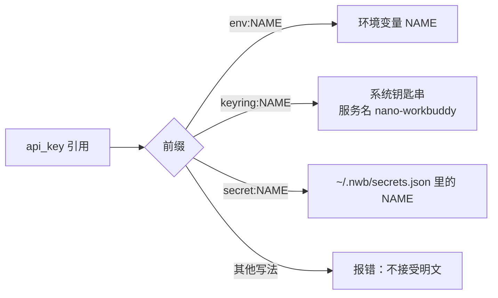
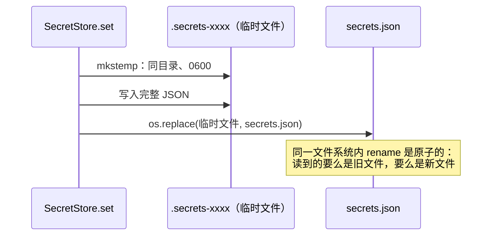
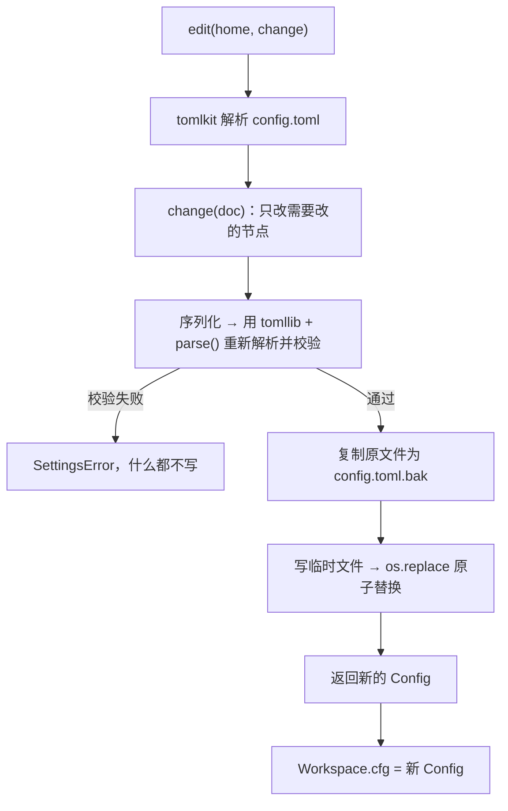
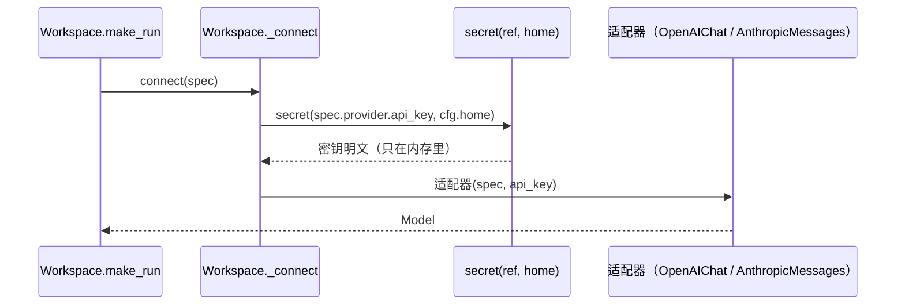
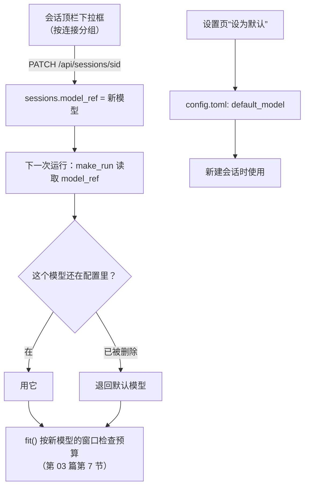
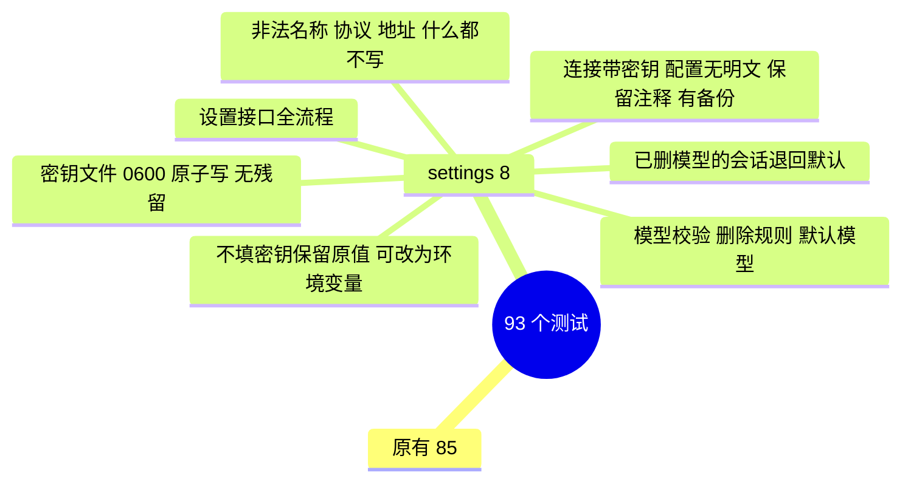

# 教程 04：模型与密钥管理 —— 多个连接、多把密钥、按需切换

> 新增 `settings.py`（写配置）、`web/src/Settings.tsx`（设置页），改动 `config.py`（密钥来源、密钥文件）、`llm/`（密钥由调用方传入、获取模型列表）、`api.py`（设置接口）、`cli.py`（`nwb key`）。
> 后端核心 3,499 行，前端 1,249 行，测试 1,595 行（93 个用例）。
> 上一篇：[03-权限沙箱与上下文治理](03-权限沙箱与上下文治理.md)。

## 0. 先用起来：设置你的 OpenDesign 密钥

三种方式任选其一，效果相同：

**方式一：网页（推荐）**

1. `uv run nwb serve`，在左下角点“⚙ 模型与密钥”；
2. 在 `opendesign` 连接上点“编辑 / 换密钥”，把密钥粘贴进“API 密钥”框，保存；
3. 在模型表里点 `ds-flash` 的“测试”，看到 ✓ 就说明地址、密钥、模型名都对。

**方式二：终端**

```bash
uv run nwb key opendesign
```

输入时不回显。`uv run nwb key` 不带参数时会列出所有连接和它们的密钥状态。

**方式三：环境变量**（原来的方式，仍然可用）

```bash
echo 'export OPENDESIGN_API_KEY=你的key' >> ~/.zshrc && source ~/.zshrc
```

前两种方式把密钥写入 `~/.nwb/secrets.json`（权限 0600），并把 `config.toml` 里这个连接的 `api_key` 改成 `secret:opendesign`。

---

## 1. 这一步做了什么

本步的四项决定（由你拍板）：

| 问题 | 结论 |
|---|---|
| 网页上填的密钥存在哪 | 本地私有文件 `~/.nwb/secrets.json`，权限 0600 |
| 多把密钥怎么组织 | 一个连接 = 一个地址 + 一把密钥；同一服务商多把密钥就建多个连接 |
| 切换范围 | 每个会话各自选模型，另有一个全局默认，作用于新会话 |
| 网页修改怎么落盘 | 写回 `config.toml`，用 tomlkit 保留手写的注释和格式 |

| 能力 | 位置 |
|---|---|
| 密钥的三种来源：`env:` / `keyring:` / `secret:` | `config.py` |
| `SecretStore`：0600、原子替换 | `config.py` |
| 编辑配置：先校验、再备份、再原子替换 | `settings.py` |
| 适配器接收已解析的密钥；获取远端模型列表 | `llm/` |
| 设置接口：连接、模型、默认模型、模型列表、连通测试 | `api.py` |
| 设置页：模板、密钥状态、获取模型、一键添加、测试、设为默认 | `web/src/Settings.tsx` |
| 会话顶栏的模型下拉按连接分组 | `web/src/App.tsx` |
| `nwb key [连接]` | `cli.py` |

---

## 2. 概念：连接、模型、会话



- **连接**回答“去哪、用谁的身份”：协议、地址、一把密钥。
- **模型**回答“用哪个模型、窗口多大”：所属连接、服务商那边的模型 ID、上下文窗口、最大输出、额外参数。
- **会话**只记“我用哪个模型”。

“同一个模型换一把密钥”，就是建一个指向新连接的模型（比如上图的 `ds-flash-work`），然后在会话里切换过去。只有三个概念，每一层只管一件事。

---

## 3. 密钥存在哪

### 3.1 配置文件里只有引用

```toml
[providers.opendesign]
protocol = "openai-chat"
base_url = "https://amr-link.open-design.ai/v1"
api_key = "secret:opendesign"      # 引用，不是密钥本身
```



`config.toml` 因此可以放心备份、同步、发给别人看，甚至提交到仓库。

### 3.2 密钥文件的写法

```python
def _write(self, data):
    fd, tmp = tempfile.mkstemp(dir=self.file.parent, prefix=".secrets-")   # 创建时就是 0600
    with os.fdopen(fd, "w") as out:
        json.dump(data, out, indent=2)
    os.replace(tmp, self.file)                                            # 原子替换
```



两个细节：

- **权限从创建那一刻起就是 0600**：`mkstemp` 直接以 0600 创建。如果先建文件再 `chmod`，中间会有一小段时间文件对别人可读。
- **临时文件放在同一目录**：`os.replace` 只有在同一文件系统内才是原子的。

### 3.3 密钥只进不出

服务端从不把密钥返回给浏览器。设置接口只返回它的状态：

```json
"key": {"source": "secret", "name": "opendesign", "set": true, "hint": "…cdef"}
```

末 4 位用来区分“这个连接用的是哪把密钥”，常见的 API 控制台也是这么显示的。不足 8 个字符的密钥连末 4 位都不显示。测试 `test_settings_api_end_to_end` 检查了所有设置接口的响应中都找不到密钥字符串。

---

## 4. 写回 config.toml

### 4.1 为什么用 tomlkit

Python 标准库的 `tomllib` 只能读。常见的写入库（如 `tomli-w`）会把整份文件重新生成，你手写的注释会消失。`tomlkit` 把 TOML 解析成一棵保留了注释、空行、数字格式（`1_000_000`）的文档树，改哪个值就只动那一处：

```toml
default_model = "ds-flash"

# OpenDesign Go (OpenAI-compatible). The key is read from the environment, never stored here.   ← 保留
[providers.opendesign]
...
context_window = 1_000_000   # DeepSeek's published limit; the gateway may differ               ← 保留
```

### 4.2 一次编辑的流程



**先校验再写**是关键：`parse()` 和启动时读配置用的是同一个函数，它检查协议合法、模型引用的连接存在、默认模型存在。这样网页上的任何操作都不可能写出一份下次启动读不了的配置。

设置操作还有自己的规则：

| 操作 | 规则 |
|---|---|
| 新建 / 修改连接 | 名称只能用字母、数字、`.` `_` `-`；地址必须以 http(s):// 开头；不填新密钥就保留原密钥 |
| 删除连接 | 还有模型在用它时拒绝，并列出这些模型；删除后它的密钥一并从 secrets.json 删除 |
| 新建 / 修改模型 | 连接必须存在；上下文窗口 ≥ 1000 且大于最大输出 |
| 删除模型 | 拒绝删除当前的默认模型 |

还有一个顺序上的细节：连接带新密钥保存时，**先写配置、配置校验通过后才写密钥**。配置不合法时，密钥文件不会留下一把无主的密钥（测试 `test_invalid_changes_write_nothing`）。

---

## 5. 运行时怎么拿到密钥



阶段 3 之前，适配器自己调用 `secret(ref)` 解析密钥。现在改成由 `Workspace` 解析后传进去，原因有两个：

1. `secret:` 来源需要知道数据目录在哪（`NWB_HOME` 可以改），这个信息属于 Workspace，不应该让适配器去猜。
2. **每次运行都重新解析**：在网页上换了密钥，下一次运行就生效，不需要重启服务。

测试里的 `FakeModel.connect(spec)` 替换的正是这一层，所以几十个测试不需要任何密钥。

---

## 6. 获取模型列表

```python
async def list_models(provider, api_key):
    if provider.protocol == "anthropic":
        → client.models.list()：每个模型带 max_input_tokens（上下文窗口）和 max_tokens（最大输出）
    else:
        → GET {base_url}/models：OpenAI 兼容协议只返回 id
```

点“获取模型列表”后，结果显示为一排可点的标签。点一个就打开“添加模型”表单，名称、连接、模型 ID 已经填好。Anthropic 的模型会顺带填好窗口和输出上限；OpenAI 兼容的服务只给 ID，窗口要按服务商文档自己填（默认 128,000 / 8,192）。

这个请求也起到了**密钥检查**的作用：密钥错了会返回 401，界面直接显示错误信息。有的网关不提供 `/models` 接口，这时手动填写模型 ID 即可。

---

## 7. 连通性测试

“测试”按钮发一次真实但极小的请求：

```python
model = ws.connect(replace(spec, max_output=256))
system = "Connection test. Reply with the single word OK."
messages = [user("ping")]   # 没有工具
```

它同时验证了**地址 + 密钥 + 模型 ID + 协议**四件事，任何一项不对都会失败，并显示原始错误（截取 500 字符）：

| 现象 | 通常的原因 |
|---|---|
| `AuthenticationError … 401` | 密钥错了，或者这把密钥没有开通这个模型 |
| `NotFoundError … 404` | 模型 ID 拼错，或地址少了 `/v1` |
| `APIConnectionError` | 地址错误、网络或代理问题 |
| ✓ 但回复为空 | 推理模型把 256 个 token 都用在思考上了，连接本身没问题 |

这个接口刻意捕获所有异常：它存在的目的就是把出了什么错告诉你。

---

## 8. 切换



- **为什么下一次运行才生效？** 正在进行的运行已经冻结了模型（D12 的“运行开始时冻结设置”）。半路换模型，会让同一批工具调用的前后两半由不同模型处理。
- **切到小窗口模型**：顶栏的上下文用量立刻按新模型的预算重新显示（`session` 事件带着新的 `context`）。下一次运行如果放不下，会先清理、再压缩，实在不行明确报错。
- **模型被删除的会话**不会坏掉：`model_ref()` 发现它已不在配置里，就退回默认模型（测试 `test_session_on_a_deleted_model_falls_back_to_the_default`）。

---

## 9. 设置页

```text
┌ ⚙ 模型与密钥 ───────────────────────────────────────────────────────────────┐
│ 连接                                                                        │
│ ┌──────────────────────────────────────────────────────────────────────────┐ │
│ │ opendesign  [OpenAI 兼容]  https://amr-link…/v1   ✓ …a1b2 · 本地文件      │ │
│ │ [获取模型列表] [编辑 / 换密钥] [删除]                                     │ │
│ │ (DeepSeek-v4.1-flash) (fake-chat-mini) (…)    ← 点一个即添加为模型        │ │
│ └──────────────────────────────────────────────────────────────────────────┘ │
│ ＋ 添加连接   → [从模板开始 ▾ OpenDesign / DeepSeek / Anthropic / OpenAI /     │
│                  OpenRouter / Kimi / 智谱 / 百炼 / 本机 Ollama]                │
│                名称  协议  地址  □从环境变量读取  API 密钥(••••)  [保存]       │
│                                                                             │
│ 模型                                                                        │
│  ★ 名称        连接         模型 ID               上下文     最大输出          │
│  ★ ds-flash    opendesign   DeepSeek-v4.1-flash   1,000,000  32,000  [测试]… │
│    opus        anthropic    claude-opus-5-5       1,000,000  64,000  [测试][设为默认][编辑][删除] │
│                                                    ✓ 812ms「OK」              │
│ ＋ 添加模型                                                                  │
└─────────────────────────────────────────────────────────────────────────────┘
```

- 模板只用来预填地址和协议，填完都可以改。模板里的地址来自各家的公开文档，以服务商的最新文档为准。
- 编辑连接时密钥框留空表示“不修改”；占位文字会显示当前密钥的末 4 位，方便确认要不要换。
- “额外参数”是一段 JSON，原样合并进请求体，比如 Claude 的 `{"thinking": {"type": "adaptive", "display": "summarized"}}`。界面会实时校验 JSON 格式。

---

## 10. 安全考虑

| 风险 | 措施 |
|---|---|
| 其他网页调用设置接口偷换地址 | 与其他接口一样：令牌 cookie（SameSite=Strict）+ Origin 校验（第 02 篇第 10 节） |
| 密钥出现在响应、日志、配置里 | 只返回来源 / 是否设置 / 末 4 位；配置只存引用；`.bak` 备份同样不含密钥 |
| 其他用户读到密钥文件 | 0600，创建时即生效；原子替换，不会留下写了一半的文件 |
| 模型读到密钥文件 | `~/.nwb` 整体在凭据拒绝列表里：文件工具被规则拒绝，沙箱里的命令被内核拒绝（第 03 篇） |
| 子进程拿到密钥 | 密钥只在适配器内存里，子进程的环境变量走白名单（第 01 篇 9.3 节） |

`secrets.json` 是明文文件，安全性取决于文件权限和磁盘加密（macOS 默认开启 FileVault）。这是你选“本地私有文件”时接受的权衡：换来的是任何系统都能用、迁移时整个目录拷走即可。如果以后想改用钥匙串，把引用写成 `keyring:NAME` 就行，代码已经支持。

---

## 11. 测试



`test_settings_api_end_to_end` 起了一个会**校验 Authorization 头**的假 OpenAI 服务：

1. 通过接口新建连接（带密钥）→ 响应里没有密钥；
2. 获取模型列表 → 按 ID 排序返回；服务端收到的都是正确的 Bearer 密钥；
3. 新建模型 → 测试 → 回复 "OK"；
4. 设为默认 → `/api/info` 里能看到；
5. 换成一把错误的密钥 → 测试返回 `ok: false` 和 401；获取列表返回 502；
6. 删除仍被使用的连接 → 400；`key_ref` 填明文 → 400。

浏览器端到端实测：

| 操作 | 结果 |
|---|---|
| 打开设置页 | 原有连接显示“已设置 · 环境变量 FAKE_KEY” |
| 添加连接：选模板 OpenDesign Go，改地址，粘贴测试密钥 | 显示“✓ …2222 · 本地文件”；`config.toml` 里只有 `secret:fake-work`；`secrets.json` 权限为 `-rw-------`；生成了 `config.toml.bak` |
| 获取模型列表 → 点 `fake-chat-pro` | 表单自动填好，保存后出现在模型表 |
| 测试 | ✓ 28ms；假服务端收到的正是这个连接的密钥 |
| 设为默认 | `config.toml` 的 `default_model` 变更；新建会话自动使用它 |
| 会话顶栏切换到 `fake-chat-pro` 再发消息 | 请求体里的 `model` 变为 `fake-chat-pro` |

---

## 12. 已知限制

| 限制 | 说明 |
|---|---|
| 不能重命名连接或模型 | 名称是引用键；需要时先新建、再删除旧的 |
| 不做额度 / 余额检查 | 各家接口不统一。额度用完时，运行会报服务商的错误，到设置页换一个连接即可 |
| 没有“自动换密钥重试” | 一把密钥失败时不会自动切到另一把；这属于“故障转移”，等真有需要再做 |
| 模板地址可能过时 | 来自公开文档，以服务商最新文档为准，表单里可以随时改 |
| 真实服务未实测 | 全部用本地假服务验证；你的 OpenDesign 密钥设置好后，点一次“测试”即可确认 |
