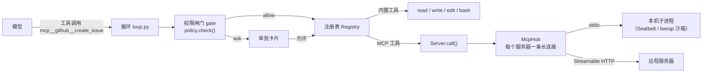
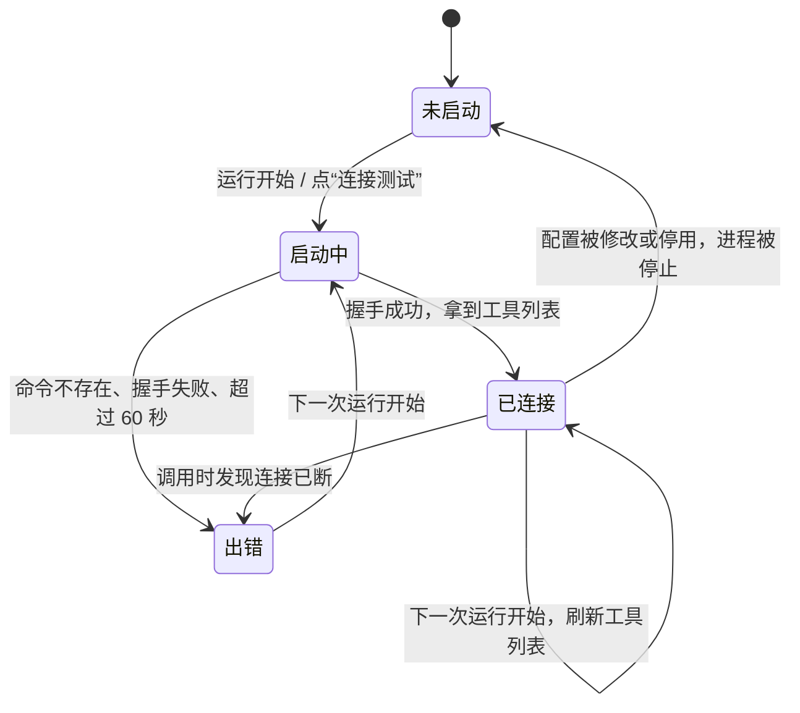
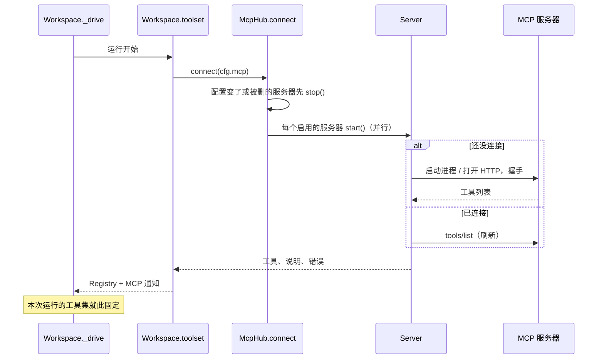
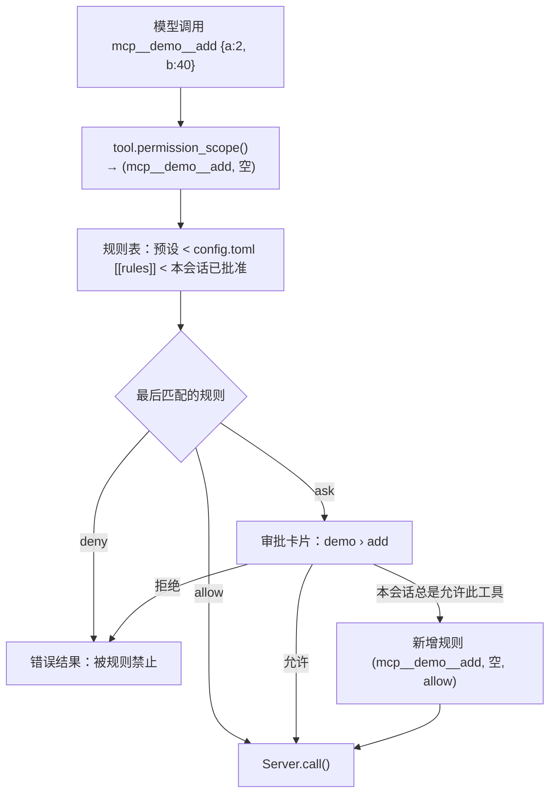
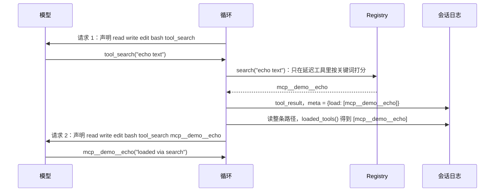
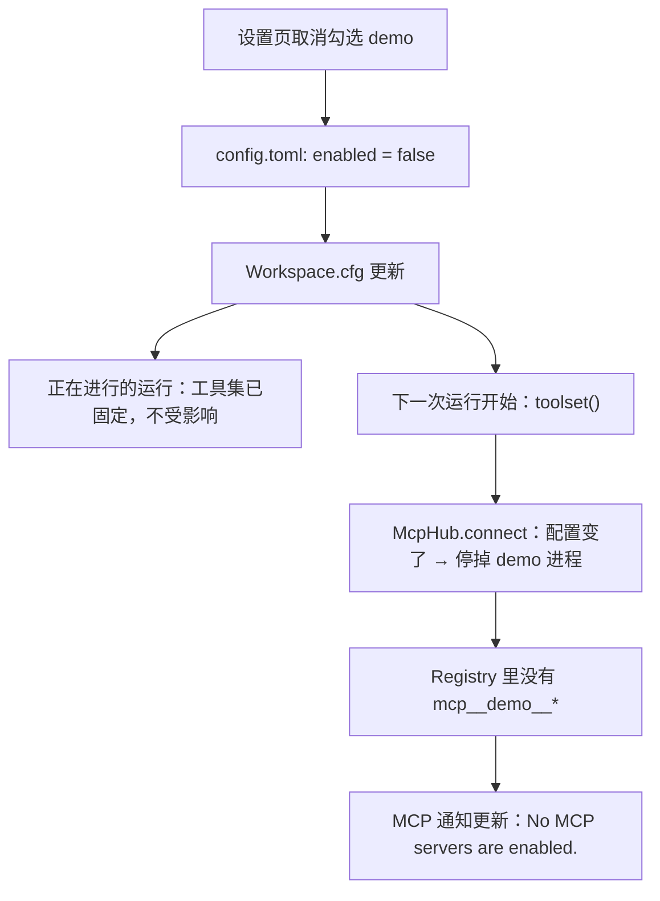
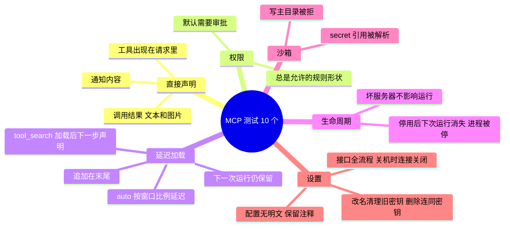

# 教程 05：MCP 接入 —— 外部工具走同一条权限路径

> 新增 `tools/mcp.py`（连接、工具转换、`tool_search`）、`web/src/Mcp.tsx`（设置页的 MCP 区）、`tests/test_mcp.py` 和测试用的 stdio 服务器 `tests/fixtures/mcp_server.py`。
> 改动 `config.py`（`[mcp.*]`）、`tools/registry.py`（延迟工具、透传 schema、结果元数据）、`loop.py` / `context.py`（每次请求按日志算出要声明的工具）、`runtime.py`（每次运行组装工具集）、`policy.py`（服务器沙箱、内部工具放行）、`settings.py` / `api.py`（增删改、连接测试）、`cli.py`。
> 后端核心 4,042 行，测试 103 个。依赖新增官方 SDK `mcp>=2.3,<3`。
> 上一篇：[04-模型与密钥管理](04-模型与密钥管理.md)。

阶段 4 分三小步：本篇是 MCP；下一篇是 Skill 与记忆；最后是 shell 钩子、OpenAI Responses 适配和分支摘要。

## 0. 先用起来：接一个 MCP 服务器

**网页**：`uv run nwb serve` → 左下角“⚙ 模型与密钥” → 拉到“MCP 服务器” → “＋ 添加 MCP 服务器”。可以从模板开始（文件系统、Fetch、Context7、GitHub），保存后点“连接测试”，看到“✓ 已连接 · N 个工具”就可以在会话里用了。

**手写配置**：在 `~/.nwb/config.toml` 末尾加一节，效果相同。

```toml
[mcp.fetch]                       # 本机命令（stdio），默认在沙箱里运行
command = "uvx"
args = ["mcp-server-fetch"]
writable = ["~/.cache/uv", "~/.local/share/uv"]   # uvx 的缓存目录要可写

[mcp.github]                      # 远程服务器（Streamable HTTP）
url = "https://api.githubcopilot.com/mcp/"
headers = { Authorization = "secret:mcp-github-Authorization" }   # 值存在 secrets.json 里
exposure = "deferred"             # 工具很多：先不声明，模型用 tool_search 按需加载
```

在会话里，模型第一次调用某个 MCP 工具时会弹审批卡片。选“本会话总是允许此工具”后，这个会话里再调用就不再询问。

---

## 1. 这一步做了什么

本步的决定（由你拍板）：

| 问题 | 结论 |
|---|---|
| 服务器配置放哪 | 只放全局 `config.toml` 的 `[mcp.NAME]`，所有项目共用；项目级 `.nwb/mcp` 等做了“信任此项目”再加 |
| 本机服务器怎么跑 | 默认进沙箱、允许联网；只能写临时目录和配置里列出的路径；单个服务器可标 `sandbox = false` |
| 暴露方式（D14） | 每个服务器 `exposure = auto / direct / deferred`；延迟的工具由 `tool_search` 按需加载 |
| 权限（D12） | MCP 工具和内置工具走同一个闸门，默认询问 |

| 能力 | 位置 |
|---|---|
| `[mcp.NAME]` 解析与校验，键引用解析 `resolve()` | `config.py` |
| 每个服务器一条长连接、断了下次运行重连、工具转换、结果转换 | `tools/mcp.py` |
| `tool_search`：按关键词或 `select:名字` 加载延迟工具 | `tools/mcp.py` |
| 注册表支持“可调用但暂不声明”的工具；工具可自带 schema；结果可带元数据 | `tools/registry.py` |
| 每次请求按日志算出声明哪些工具 | `context.py` 的 `loaded_tools()`，`loop.py` 的 `Run.schemas()` |
| 每次运行开始时组装工具集，并生成 MCP 状态通知 | `runtime.py` 的 `toolset()`、`mcp_notice()` |
| 服务器沙箱；`tool_search` 免审批 | `policy.py` |
| 增删改、启停、连接测试；环境变量和请求头的值存为密钥 | `settings.py`、`api.py` |
| 设置页 MCP 区；聊天里显示 `服务器 › 工具` | `web/src/Mcp.tsx`、`web/src/Chat.tsx` |

---

## 2. MCP 在整个系统里的位置

MCP（Model Context Protocol）把“工具”从程序里搬到了独立进程或远程服务里：服务器声明自己有哪些工具（名字、说明、参数的 JSON Schema），客户端按名字调用。对我们的循环来说，MCP 工具和 `read`、`bash` 没有区别：都在注册表里，都经过权限闸门，结果都写进日志。



和内置工具相比，多出来的只有三件事：

1. **连接管理**：服务器要启动、握手、保持连接、出错后重连。
2. **格式转换**：MCP 的工具描述和返回内容要转成我们的中性格式。
3. **上下文成本**：一个服务器可能有几十个工具，每个工具的 schema 都要随每次请求发给模型，所以需要“延迟加载”。

下面逐一讲。

---

## 3. 配置：`[mcp.NAME]`

| 字段 | 默认 | 含义 |
|---|---|---|
| `command` / `args` | — | 本机服务器的启动命令。和 `url` 二选一 |
| `env` | `{}` | 额外环境变量；值可以是键引用 `env:` / `keyring:` / `secret:` |
| `url` / `headers` | — | 远程服务器地址和请求头；请求头的值同样可以是键引用 |
| `enabled` | `true` | 关掉后下一次运行起不再出现 |
| `exposure` | `"auto"` | `direct` 直接声明；`deferred` 用 `tool_search` 按需加载；`auto` 见第 8 节 |
| `sandbox` | `true` | 本机服务器是否进沙箱 |
| `network` | `true` | 沙箱里是否允许联网 |
| `writable` | `[]` | 沙箱里额外可写的路径，如 `~/.npm` |
| `timeout` | `300` | 单次工具调用的超时（秒） |
| `description` | `""` | 一句话说明。延迟加载时，模型靠它判断要不要去搜这个服务器的工具 |

令牌不进配置文件，做法和上一篇的连接密钥一样。设置页保存时，勾选的环境变量或请求头的值会写进 `~/.nwb/secrets.json`，名字是 `mcp-服务器-变量名`，配置里只留 `secret:mcp-github-Authorization` 这样的引用。服务器启动时，`config.resolve()` 把引用换成真值：

```python
def resolve(value: str, home: Path) -> str:
    """A value that is exactly a key reference is replaced by the key; anything else is literal."""
    kind, sep, name = value.partition(":")
    return secret(value, home) if sep and kind in ("env", "keyring", "secret") and name else value
```

只有整个值恰好是引用时才替换，像 `LOG_LEVEL=debug` 这样的普通值原样传给服务器。

---

## 4. 连接：每个服务器一个任务

### 4.1 为什么每个连接要单独一个任务

官方 SDK 的传输层（stdio、Streamable HTTP）基于 anyio 的任务组和取消域（cancel scope），有一条硬约束：进入 `async with Client(...)` 的任务，必须也是退出它的任务。我们的运行（run）各自是独立的 asyncio 任务，有的先结束、有的被取消。如果让某个运行任务去打开连接、另一个去关闭，就会出现“在错误的任务里退出取消域”的错误。

所以每个服务器的连接由一个专属任务持有，运行只通过它调用工具：

```python
async def _serve(self, transport: Any) -> None:
    async with Client(transport) as client:
        self.instructions = (client.instructions or "")[:INSTRUCTIONS_CHARS]
        self.tools = await list_tools(client)
        self.client, self.error = client, ""
        self._ready.set()          # 通知等待的运行：可以用了
        await self._stop.wait()    # 一直挂着，直到要求停止
```

### 4.2 状态与重连



规则只有两条：

- **启动不抛异常**。`Server.start()` 失败时把原因记在 `.error`，运行照常进行，只是这个服务器的工具不出现，模型会从通知里得知它不可用（第 9 节）。一个坏掉的服务器不会拖垮整个助手。
- **断了就等下一次运行再连**。调用时如果收到 `CONNECTION_CLOSED`，就停掉这个服务器，本次调用以错误结果返回给模型；下一次运行开始时自动重启。不在调用中途重试，因为 MCP 工具可能有副作用，重放不安全。

还有一个细节：启动卡住（比如 `npx` 第一次下载很慢）时，任务还没走到 `await self._stop.wait()`，只设置停止事件没有用，所以 `stop()` 会直接取消还在启动的任务：

```python
async def stop(self) -> None:
    self._stop.set()
    if self._task and not self._task.done():
        if self.client is None:  # still starting: it is not waiting for _stop yet
            self._task.cancel()
        await asyncio.gather(self._task, return_exceptions=True)
    self.client = None
```

### 4.3 什么时候连接、什么时候断开



`McpHub` 在整个进程里只有一个，所有会话共享同一批连接。`nwb serve` 退出时，`lifespan` 在停掉运行后调用 `ws.mcp.close()`，子进程随之结束。

开发用的 CLI 每条提示用一个新的 `asyncio.run()`，而连接任务属于创建它的事件循环，所以 CLI 在每条提示结束时关闭连接，下一条再重连。本机服务器重连只需要零点几秒，开发时可以接受。

---

## 5. 把 MCP 工具变成我们的工具

### 5.1 名字

MCP 工具在注册表里叫 `mcp__服务器__工具`。各家模型对函数名的限制是 `[A-Za-z0-9_-]`、最多 64 个字符，所以其他字符替换成 `_`，超长截断：

```python
def tool_name(server: str, name: str) -> str:
    return re.sub(r"[^A-Za-z0-9_-]", "_", f"mcp__{server}__{name}")[:64]
```

前缀有两个用途：模型能看出工具来自哪个服务器；权限规则可以用 `mcp__github__*` 一次匹配整个服务器。

### 5.2 参数 schema：透传，不再校验

内置工具的参数是一个 Pydantic 模型，schema 由它生成，调用前先校验。MCP 工具的 schema 由服务器给出，我们没有对应的 Pydantic 模型，也不该替服务器校验。于是 `Tool` 加了一个可选字段 `input_schema`，参数模型用一个什么都接受的 `AnyArgs`：

```python
class AnyArgs(BaseModel):
    """Arguments of a tool whose schema we only pass through; its owner validates them."""
    model_config = ConfigDict(extra="allow")
```

`Tool.schema()` 有 `input_schema` 时直接用它。参数不合法时，服务器会返回错误结果，模型看到后自己修正。

### 5.3 只读提示只用来决定能否并行

MCP 工具可以带 `readOnlyHint` 等注解。规范明确说这些只是提示，不能用来做安全决定。我们只用它决定两件不涉及安全的事：

- 能否和其他只读工具并行执行（`parallel`）；
- 崩溃恢复时能否直接重跑（`effect="read"` 的调用重跑无害，其余按“结果未知”报给模型，第 01 篇第 12 节）。

权限照样按工具名走规则，不看提示。

### 5.4 返回内容

| MCP 内容 | 转成 |
|---|---|
| `text` | 文本块 |
| `image` | 图片块（发给支持视觉的模型） |
| 嵌入的文本资源 | `[resource 地址]` + 正文 |
| 嵌入的二进制资源、音频等 | 一行说明，不发内容 |
| `resource_link` | `[resource link 地址 名称]` |
| 只有 `structuredContent` 没有 `content` | JSON 文本 |

`isError` 原样对应我们的 `is_error`。转换后的结果和内置工具一样经过外置（第 01 篇 8.6 节），很长的输出不会撑爆上下文。

---

## 6. 权限：同一个闸门

这是本阶段的完成标准之一：“MCP 和 skill 走同一权限路径”。实现上没有为 MCP 写任何特殊分支，它就是注册表里的一个工具：



几个设计点：

- **资源是空字符串**。路径类工具的资源是绝对路径，`bash` 的资源是命令，MCP 工具的参数对规则没有统一含义，所以资源留空。“总是允许”生成的规则资源也是空，于是放行这个工具的任何参数。审批卡片会写明这一点。
- **默认询问**。工作区档的第一条规则是 `("*", "*", "ask")`，MCP 工具命中它。完全信任档一律放行。
- **想对整个服务器免审批**，在 `config.toml` 里加一条规则：

```toml
[[rules]]
action = "mcp__context7__*"
resource = "*"
effect = "allow"
```

- **`tool_search` 免审批**。它只读我们自己的工具目录，所以只读档和工作区档里都加了 `Rule("tool_search", "*", "allow")`（`policy.HARNESS`）。

---

## 7. 沙箱：本机服务器也被关起来

本机服务器是一个以你的身份运行的程序，常见的来源是 `npx` / `uvx` 临时下载的第三方包。按你的决定，它默认在沙箱里启动，复用第 03 篇的 Seatbelt / bwrap 后端，只是策略不同：

| | `bash`（工作区档） | MCP 本机服务器 |
|---|---|---|
| 可写 | 项目目录、会话临时目录 | 服务器自己的临时目录 + `writable` 里列的路径 |
| 不可读 | `~/.ssh`、`~/.aws`、`~/.nwb` 等凭据目录 | 同左 |
| 联网 | 禁止 | 默认允许（`network = false` 可关） |
| 工作目录 | 项目根 | 用户主目录（服务器为所有会话服务，不属于某个项目） |
| 环境变量 | 白名单 | SDK 的白名单（HOME、PATH 等）+ 配置里的 `env` |

```python
def _params(self) -> StdioServerParameters:
    s = self.spec
    argv = [s.command, *s.args]
    env = get_default_environment() | {k: resolve(v, self.home) for k, v in s.env.items()}
    if s.sandbox:  # SandboxUnavailable propagates: never fall back to running unconfined
        self.tmp.mkdir(parents=True, exist_ok=True)
        writable = (self.tmp, *(Path(w).expanduser().resolve() for w in s.writable))
        argv = wrap(argv, server_sandbox(writable, s.network, self.home.resolve()))
        env["TMPDIR"] = str(self.tmp)
    return StdioServerParameters(command=argv[0], args=argv[1:], env=env, cwd=Path.home())
```

和 `bash` 一样，沙箱后端不可用时（比如 Windows）直接报错，这个服务器显示“连接失败”，不会悄悄退回无沙箱运行。

常见问题是包管理器要写缓存。`npx` 要写 `~/.npm`，`uvx` 要写 `~/.cache/uv` 和 `~/.local/share/uv`。设置页的模板已经替你填好；自己添加时，如果连接失败、日志里出现 `Operation not permitted`，就把对应目录加进“可写路径”。服务器的 stderr 写在 `~/.nwb/logs/mcp-服务器名.log`。

文件系统类服务器要把它管理的目录也加进可写路径，否则只能读不能写，模板里的 `~/Documents` 就是这个作用。

远程（HTTP）服务器不在本机执行代码，没有沙箱的概念；它能做什么，取决于你给它的令牌有多大权限。

---

## 8. 直接声明还是延迟加载

### 8.1 问题

每次请求都要带上全部工具的 schema。一个 GitHub 服务器有几十个工具，schema 可能有上万 token。这些 token 每一轮都要付费，也占用窗口，可大部分轮次根本用不到这些工具。

### 8.2 做法：可调用，但先不声明

注册表把工具分成两类：

- **直接工具**：每次请求都声明。
- **延迟工具**：在注册表里，可以被调用，但只有被 `tool_search` 加载过才声明。

```python
def schemas(self, loaded: Iterable[str] = ()) -> list[dict[str, Any]]:
    """Direct tools in declared order, then loaded deferred tools in the order they were loaded,
    so loading one more tool only appends to the declaration."""
    direct = [t.schema() for n, t in self.tools.items() if n not in self.deferred]
    return direct + [self.tools[n].schema() for n in dict.fromkeys(loaded) if n in self.deferred]
```

模型从 MCP 通知里知道有哪些延迟的服务器以及它们能做什么，需要时调用 `tool_search`：



### 8.3 “加载了哪些工具”存在哪：日志里

循环的原则是“日志即状态”（第 01 篇）：下一步做什么，由日志推出来。加载状态也遵守这一点，不在内存里另存一份：

- `Result` 新增 `meta` 字段，写进 `tool_result` 条目，但不发给模型；
- `tool_search` 的结果带 `meta = {"load": [...]}`；
- 每次请求前，`loaded_tools(path)` 扫描当前路径上的 `tool_result`，按首次加载的顺序列出名字。

```python
def loaded_tools(path: list[Entry]) -> list[str]:
    names = (n for e in path if e.type == TOOL_RESULT for n in e.data.get("meta", {}).get("load", ()))
    return list(dict.fromkeys(names))
```

由此自然得到几个性质：

- **崩溃续跑**：重启后从日志重新算出来，不会丢。
- **分支**：在树的另一条分支上没加载过，就不声明，各分支互不影响。
- **压缩**：看的是整条路径，不只是压缩后可见的部分。压缩不会悄悄拿走模型已经在用的工具。
- **下一次运行仍然有效**：同一会话里加载过的工具一直保持声明，除非它的服务器被停用。

### 8.4 声明顺序与缓存

新加载的工具追加在声明末尾，前面的部分不变。Anthropic 的缓存前缀从工具声明开始，DeepSeek 等按前缀匹配缓存，追加意味着之前的内容大部分仍能命中。如果每次都按字母重排，加载一个工具就会让整个缓存失效。

### 8.5 `auto` 怎么决定

设计文档 D14 的规则：所有 `auto` 服务器的工具 schema 加起来超过当前模型窗口的 5%，这些服务器就全部延迟，否则全部直接声明。

```python
auto = sum(estimate_tokens(json.dumps([t.schema() for t in s.as_tools()])) for s in live
           if s.spec.exposure == "auto")
lazy = {s.spec.name for s in live
        if s.spec.exposure == "deferred" or (s.spec.exposure == "auto" and auto > DEFER_SHARE *
                                             spec.context_window)}
```

窗口大的模型（1M）几乎总是直接声明；窗口小的模型（128k）在工具多时自动延迟。换模型后，下一次运行会重新判断。

### 8.6 搜索

`Registry.search()` 是一个朴素的关键词打分：查询词出现在工具名里记 3 分，在说明里每出现一次记 1 分，只搜延迟工具。也支持 `select:名字1,名字2` 精确加载，适合模型已经从通知或上一次搜索里知道名字的情况。工具数量是几十到几百个，用不着向量检索。

---

## 9. 告诉模型：MCP 通知

系统提示在会话开始时冻结（D9），而服务器随时可能被添加、停用或连不上。和权限档位一样，MCP 状态以通知的形式追加，内容变了才追加新的一条：

```text
MCP servers (their tools are named mcp__<server>__<tool>):
- demo (5 tools, tools declared directly): Demo tools for tests.
- github (41 tools, deferred: load its tools with tool_search): GitHub issues, PRs and code search
- ghost: unavailable (FileNotFoundError: ...); its tools cannot be used now.
Deferred tools are not declared yet. Call tool_search with keywords, or "select:<name>", to load the ones
you need; they become callable from your next step.
```

服务器说明优先用配置里的 `description`，没有就用服务器自己在握手时给出的 `instructions`（截到 1,000 字）。如果所有服务器都被停用，通知变成 “No MCP servers are enabled.”，模型就不会再去调用已经不存在的工具。

聊天界面里这条通知显示为“已告知模型 MCP 服务器状态”，点开能看到全文。

---

## 10. 关掉即消失

阶段 4 的另一条完成标准是：“关闭后下一个 run 不再暴露”。实现方式是每次运行开始时重新组装工具集：



运行进行到一半时不换工具集，和模型、权限档位的规则一致（第 03 篇）：一次运行内，模型看到的工具和权限不会突然变化。

---

## 11. 设置页与接口

| 接口 | 作用 |
|---|---|
| `GET /api/settings` | 多了 `mcp` 列表：配置、状态、工具、密钥状态（只给末 4 位） |
| `PUT /api/settings/mcp/{name}` | 新建或替换；`secret_keys` 里列的变量值存进 secrets.json |
| `PATCH /api/settings/mcp/{name}` | 启用或停用 |
| `DELETE /api/settings/mcp/{name}` | 删除，连同它的密钥 |
| `POST /api/settings/mcp/{name}/connect` | 立即（重新）连接，返回工具列表或错误，不必等下一次运行 |

改密钥时，界面把已有的引用（如 `secret:mcp-demo-TOKEN`）原样送回，后端看到是引用就保留；变量改名或删除后，旧的密钥会被清理掉。

设置页每个服务器一张卡片：启用开关、类型、状态（已连接 / 连接失败 / 未启动 / 已停用）、是否在沙箱里、声明方式、命令或地址、密钥状态，展开可以看到全部工具。聊天里 MCP 工具显示为 `demo › add`。

---

## 12. 测试

测试用 `tests/fixtures/mcp_server.py`，一个用官方 SDK 写的真实 stdio 服务器，有 `echo`、`add`、`touch`（写文件）、`whoami`（报告环境变量）、`pixel`（返回图片）五个工具。传入数字参数时会额外注册一批体积大的工具，用于测试 `auto`。



另外在浏览器里实测过：设置页添加一个本机服务器（默认进沙箱），“连接测试”显示 5 个工具，`config.toml` 里只有 `secret:` 引用，`secrets.json` 权限为 0600；会话里调用 `demo › add` 弹出审批，选“总是允许此工具”后得到 42；把服务器改成延迟加载后，模型先调 `tool_search`，下一次请求末尾多出 `mcp__demo__echo` 并成功调用；停止 `nwb serve` 后服务器子进程随之退出。

---

## 13. 已知限制

- **没有 OAuth**。远程服务器只支持在请求头里放令牌。需要浏览器授权的服务器（OAuth 2.1）要等以后补上回调页面和令牌刷新。
- **没有项目级配置**，按你的决定，等“信任此项目”做了再加。
- **只用了工具**。MCP 的 resources、prompts、sampling、elicitation 都没有接。prompts 以后可以做成斜杠命令。
- **工具列表在运行开始时刷新**。运行中服务器发来的 `tools/list_changed` 通知不处理，下一次运行生效。
- **schema 原样透传**。个别模型服务商不接受某些 JSON Schema 关键字（如 `$ref`、`oneOf`）。按“有真实故障证据才加补丁”的原则，遇到再针对性处理。
- **沙箱里的服务器能联网**。它可以读取工作区以外的非凭据文件并发出去。对不信任的服务器，可以关掉联网，或者干脆不装。
