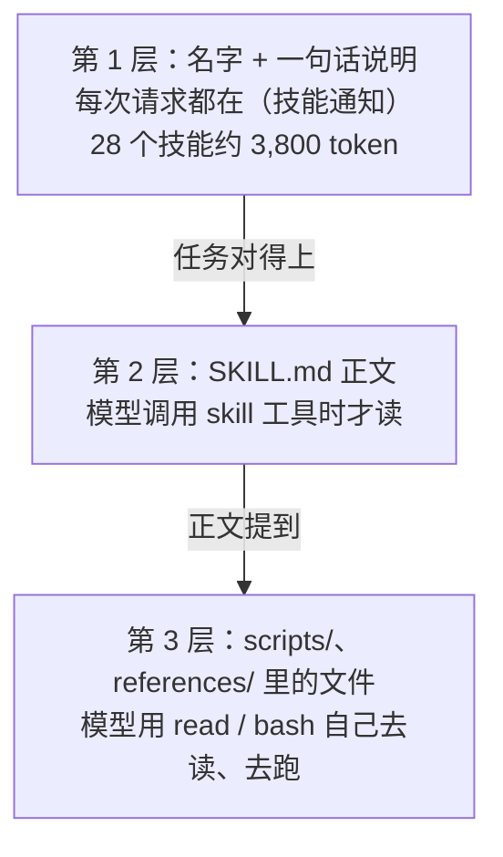
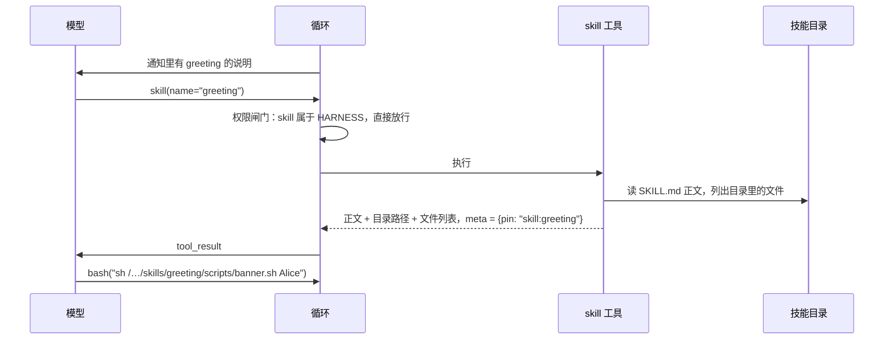
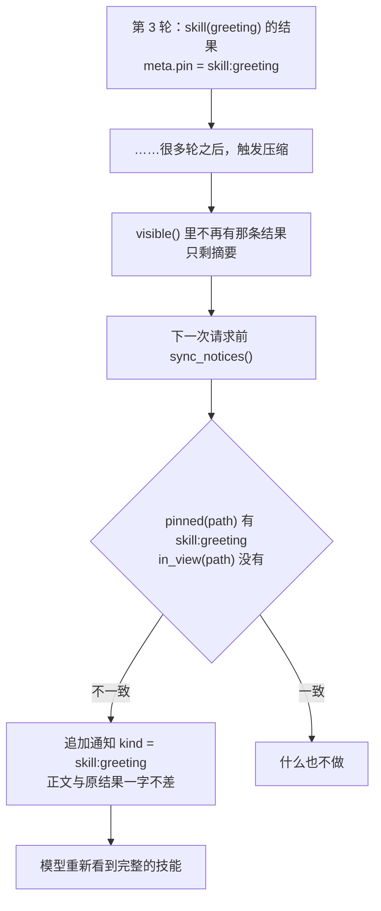
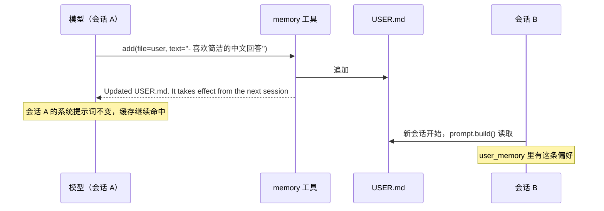
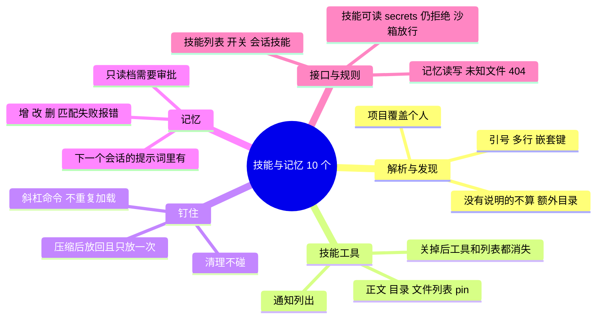

# 教程 06：Skill 与记忆 —— 按需加载的说明书，和跨会话的笔记

> 2026-10-27 更新：以下正文保留初版设计过程。当前实现已将长期记忆改为每次模型请求前刷新，已有会话也会看到修改；已加载 Skill 的更新、停用和删除同样生效，原始日志不改写。当前设计见 [个人助手内核与扩展边界](../design/2026-10-27-harness-core.md)。

> 新增 `skills.py`（发现、解析、`skill` 工具）、`memory.py`（`memory` 工具）、`web/src/Skills.tsx`（设置页的技能区和记忆区）、`tests/test_skills_memory.py`。
> 改动 `context.py` / `loop.py`（钉住的内容在压缩后自动放回）、`runtime.py`（技能进入每次运行的工具集；`/技能名`）、`policy.py`（技能可读、记忆的审批规则）、`config.py` / `settings.py` / `api.py`、`prompts/system.md`、`web/src/Composer.tsx`（`/` 补全）。
> 后端核心 4,368 行，测试 113 个。
> 上一篇：[05-MCP接入](05-MCP接入.md)。

## 0. 先用起来

**技能**：在 `~/.nwb/skills/`、`~/.agents/skills/` 或项目的 `.agents/skills/` 下放一个目录，里面有一个 `SKILL.md`：

```markdown
---
name: greeting
description: >
  Greet people in a festive way. Use when the user asks for a greeting card
  or a celebratory message.
---
# Greeting

Run `scripts/banner.sh NAME` and include its output.
```

不用重启。下一次运行起，模型就知道有这个技能，任务对得上时会自己用 `skill` 工具加载它。你也可以在输入框里敲 `/`，从弹出的列表里选，或者直接输入 `/greeting 给 Bob 写一张贺卡`，强制先加载这个技能。

你的机器上 `~/.agents/skills/` 已经有 27 个飞书（lark）技能，它们会直接出现。设置页可以逐个关掉。如果想把 Claude Code 的技能（`~/.claude/skills`）也拿来用，在设置页“额外的技能目录”里填上即可。

**记忆**：对助手说“记住我喜欢简洁的中文回答”，它会用 `memory` 工具写进 `~/.nwb/USER.md`；项目约定（比如“测试用 `uv run pytest`”）写进项目的 `AGENTS.md`。设置页最下面的“记忆”区可以查看和改正它记下的任何内容。

---

## 1. 这一步做了什么

| 决定 | 结论 | 出处 |
|---|---|---|
| 技能怎么加载 | 专用 `skill` 工具；加载后的正文被“钉住”，压缩后自动放回 | D15 |
| 用户强制加载 | 消息以 `/技能名` 开头 | D15 |
| 记忆放哪 | `~/.nwb/USER.md` 和项目 `AGENTS.md`，会话开始时冻结进提示词 | D18 |
| 记忆要不要审批 | 工作区档不审批，只读档审批（本步由你拍板） | D18 |

| 能力 | 位置 |
|---|---|
| 发现技能：项目 > `~/.nwb/skills` > `~/.agents/skills` > 额外目录 | `skills.py` |
| 解析 SKILL.md 的 frontmatter（不引入 YAML 依赖） | `skills.split()` |
| `skill` 工具：返回正文、目录位置和目录里的文件 | `skills.skill_tool()` |
| 钉住：加载过的技能被压缩掉后作为通知放回；清理（prune）不动它 | `context.pinned()`、`loop.sync_notices()` |
| `/技能名`：在用户消息前插入技能正文 | `runtime.submit()` |
| `memory` 工具：add / replace / remove 两个文件 | `memory.py` |
| 技能目录可读（含沙箱内）；记忆写入按档位审批 | `policy.py` |
| 设置页：技能开关、额外目录、记忆编辑器；输入框 `/` 补全 | `web/src/Skills.tsx`、`Composer.tsx` |

---

## 2. 技能是什么，为什么要“按需”

技能（Agent Skills 规范）是一份写给模型的操作手册：如何填 PDF 表单、如何按公司模板写周报、如何调用飞书 API。一份手册可能有几千字，还附带脚本和参考资料。

全部塞进系统提示词，几十个技能就是几万 token，每一轮都要付费，绝大部分时候又用不上。所以采用“渐进披露”，分三层：



第 1 层多少技能都放得下；第 2、3 层只在需要时花 token。

---

## 3. 发现与解析

### 3.1 去哪里找

```python
def roots(project, home, extra=()):
    found = [(project / ".agents" / "skills", "project")] if project else []
    return found + [(home / "skills", "user"), (SHARED, "user"), *((Path(d).expanduser(), "user") for d in extra)]
```

顺序就是优先级：同名时项目里的技能覆盖个人的，因为项目里的更具体。每个根目录下找 `*/SKILL.md`，只看一层。

`~/.agents/skills` 是 Agent Skills 规范约定的跨工具位置。测试里用 `monkeypatch` 把它换成临时目录，否则开发机上真实存在的技能会混进测试（第一次跑测试时正是因为这个挂了 8 个用例）。

### 3.2 frontmatter：只认两个字段

技能只需要 `name` 和 `description`（`name` 缺省时用目录名，没有 `description` 的不算技能）。规范里的 `license`、`metadata`、`allowed-tools` 第一版不用。

为了这两个字段引入 PyYAML 不划算，`split()` 只处理顶层的 `key: value`，支持引号和 `>` / `|` 多行写法，嵌套的键忽略：

```python
for line in m.group(1).splitlines():
    if key and (line.startswith((" ", "\t")) or not line.strip()):
        meta[key] += " " + line.strip()  # continuation of a block scalar (| or >)
        continue
    ...
```

说明里的换行和多余空白最后会被压成单个空格，在通知里占一行。

### 3.3 告诉模型有哪些技能

和 MCP 一样，技能列表不进冻结的系统提示词，而是一条 `skills` 通知，有变化（新增、删除、开关）才追加新的一条：

```text
Skills are packaged instructions for specific tasks. When a task matches a skill's description, load it with
the skill tool before starting, then follow it. Available skills:
- greeting: Greet people in a festive way. Use when the user asks for a greeting card or a celebratory message.
- lark-calendar: ...
```

只要找到过任何技能，这条通知就一直维护；全部关掉时变成 “No skills are enabled.”，模型就不会再去加载已经关掉的技能。

---

## 4. `skill` 工具



返回内容：

```text
<skill name="greeting" dir="/Users/you/.nwb/skills/greeting">
# Greeting

Run `scripts/banner.sh NAME` and include its output.
</skill>
Relative paths above are inside the skill directory. Files there: scripts/banner.sh. Read them only when the
instructions call for them.
```

带上 `dir` 是因为正文里的相对路径（`scripts/banner.sh`）是相对技能目录的，而模型的工作目录是项目根。

`skill` 工具每次运行时按当前启用的技能重新生成。关掉的技能，模型即使记得名字也加载不了，会得到“没有这个技能”和可用列表。

### 4.1 技能目录要能读、脚本要能跑

`~/.nwb/` 整个属于凭据目录：规则层拒绝所有工具访问，沙箱里也读不到，因为 `secrets.json` 在里面。可 `~/.nwb/skills/` 里的文件要让模型读，脚本要在沙箱里跑。于是在拒绝规则之后各开一个小口子：

```python
return (*denies, Rule("read", "{spill}/*", "allow"), Rule("read", "{home}/skills/*", "allow"),
        Rule("memory", "{home}/USER.md", memory))
```

沙箱策略的 `allow_read` 也加上 `home / "skills"`。规则是“最后匹配者生效”，所以这几条放在拒绝之后；`secrets.json`、`token` 仍然拒绝，测试里两边都断言了。

技能脚本和其他命令一样在沙箱里跑：技能能改变的只是模型读到的文字，改变不了权限。

---

## 5. 钉住：压缩之后，技能不能只剩一句摘要

### 5.1 问题

长任务会触发压缩（第 03 篇）：较早的对话被换成一段摘要。如果技能是在早期加载的，它的正文就在被摘要的那一段里。摘要大概只会写“加载了 greeting 技能”，具体步骤就没了，模型只能凭印象继续。设计文档 D15 的要求是：激活的技能由状态重新注入，不靠摘要猜。

### 5.2 做法

结果可以“钉住”：`skill` 工具的结果带 `meta = {"pin": "skill:greeting"}`。每次请求前，`sync_notices()` 比较两样东西：

- **应该看到的**：权限、MCP、技能列表这些通知（`run.notices`），加上整条路径上所有钉住的内容（`pinned(path)`，同一个键取最新的一份）；
- **实际看得到的**：压缩之后仍然可见的通知和钉住的结果（`in_view(path)`）。

不一致的就追加一条通知补上：

```python
def sync_notices(run: Run) -> bool:
    path = run.log.path()
    seen = in_view(path)
    changed = [(k, v) for k, v in (run.notices | pinned(path)).items() if seen.get(k) != v]
    for kind, body in changed:
        run.log.append(NOTICE, {"kind": kind, "text": body}, run_id=run.run_id)
    return bool(changed)
```



几个细节：

- **放回的是日志里那一份**，不重新读磁盘。技能文件中途被改了，模型看到的仍然和它当初加载的一致。
- **清理（第 2 级）不碰钉住的结果**。`is_prunable()` 跳过带 `pin` 的结果，否则技能正文会先被换成“已另存到某文件”的指针。
- **只放回一次**。放回的通知本身是可见的，下一次比较就一致了；如果它后来也被压缩掉，再放回。测试里断言了最后一次请求中技能正文恰好出现一次。
- **这是通用机制**。任何工具只要在结果里带 `pin`，就能获得“压缩后自动放回”。目前只有技能用它。

### 5.3 `/技能名`

用户消息以 `/名字` 开头且名字是启用的技能时，`submit()` 在用户消息之前追加一条钉住的通知（`{"kind": "skill:名字", "pin": true}`），内容和 `skill` 工具返回的完全相同。于是模型在读到请求之前已经拿到了技能，压缩后的放回也照常生效。如果模型此刻已经看得到同样的内容（比如刚用工具加载过），就不再重复。

`/` 后面不是技能名的消息原样发送，不做任何处理。

---

## 6. 记忆

### 6.1 两个文件，两种寿命

| 文件 | 写什么 | 位置 |
|---|---|---|
| `USER.md` | 关于你、在所有项目都成立的事：语言、风格偏好、身份信息 | `~/.nwb/USER.md` |
| `AGENTS.md` | 关于这个项目的事：约定、命令、踩过的坑 | 项目根目录（只有 `CLAUDE.md` 时写它） |

两者都在会话开始时冻结进系统提示词（第 01 篇第 13 节）。`memory` 工具写盘立即生效，但当前会话的提示词不变，从下一个会话起才看到。这是 Hermes 的“冻结快照”做法，好处是当前会话的提示词缓存不会因为记了一笔就全部失效。工具的返回值会明说这一点，免得模型以为自己已经“记住”了。



### 6.2 三种操作

| 操作 | 参数 | 行为 |
|---|---|---|
| `add` | `text` | 追加一段，前面空一行 |
| `replace` | `old_text`、`text` | `old_text` 必须恰好出现一次，替换成 `text` |
| `remove` | `old_text` | 删除；如果它独占一行，整行删掉 |

和 `edit` 工具一样要求精确且唯一的匹配，出错信息会说出匹配了几次。文件超过 20,000 字（提示词里每个文件的上限）时拒绝写入，并提示模型先整理合并。`recover` 函数让崩溃续跑时能判断这次写入是否已经生效（第 01 篇第 12 节）。

### 6.3 审批

按你的决定：

| 档位 | `USER.md` | 项目 `AGENTS.md` |
|---|---|---|
| 只读 | 询问 | 询问 |
| 工作区 | 不询问 | 不询问 |
| 完全信任 | 不询问 | 不询问 |

`USER.md` 在 `~/.nwb/` 里，原本被凭据规则拒绝；工作区档在拒绝之后加了 `Rule("memory", "{home}/USER.md", "allow")`，只读档加的是同样的 `ask`。规则只放开 `memory` 这一个动作，`write`、`edit`、`bash` 仍然碰不到 `~/.nwb/`。

### 6.4 可见、可改

“界面可见、可撤销”（D18）分两处：

- 聊天里，每次记忆修改都是一张工具卡片，标题如“memory 添加 USER.md”，展开能看到增删的文字（红删绿增）。
- 设置页的“记忆”区列出 `USER.md` 和每个项目的 `AGENTS.md`，可以直接编辑保存。

系统提示词里加了一小节，告诉模型什么值得记、什么不该记：任务进度、临时细节和密钥都不记，过时的条目要改而不是重复追加。这一节只对新会话生效，原因同上。

---

## 7. 设置页与接口

| 接口 | 作用 |
|---|---|
| `GET /api/settings` | 多了 `skills`（个人的一组，加上每个项目自己的）和 `skill_dirs` |
| `PATCH /api/settings/skills/{name}` | 开关一个技能，写入 `[skills] disabled` |
| `PUT /api/settings/skill-dirs` | 额外的技能目录，写入 `[skills] dirs` |
| `GET /api/sessions/{sid}/skills` | 这个会话所在项目启用的技能，给输入框的 `/` 补全用 |
| `GET /api/memory`、`PUT /api/memory/{key}` | 读写 `USER.md`（key = user）和各项目的 `AGENTS.md`（key = 项目 id） |

对应的 `config.toml`：

```toml
[skills]
disabled = ["lark-vc", "lark-minutes"]
dirs = ["~/.claude/skills"]
```

输入框：敲 `/` 加前几个字母，上方弹出匹配的技能，点击或按 Tab 补全为 `/名字 `。

---

## 8. 测试



另外在浏览器里实测过：设置页列出 `greeting` 和机器上已有的 27 个飞书技能，可以开关；会话里“please greet Alice”触发 `skill` 卡片；输入 `/gre` 弹出补全，按 Tab 后发送，请求里技能正文紧挨在用户消息之前；“记住我的风格”生成“memory 添加 USER.md”卡片，设置页的记忆区随即显示新内容。

---

## 9. 已知限制

- **插话不触发 `/技能名`**。运行中发的插话直接进入当前运行，不经过 `submit()`，以 `/` 开头也只是普通文字。
- **同名技能的开关是按名字的**。项目里和个人目录里同名的技能一起开、一起关。
- **`allowed-tools` 被忽略**（设计文档已说明第一版不做）。技能不能放宽也不能收紧权限。
- **项目技能不需要“信任此项目”**。它和项目的 `AGENTS.md` 一样只是文字，执行任何东西仍然要经过权限和沙箱。等做项目信任时再一并收紧。
- **记忆没有自动整理**。文件长了需要模型或你手动合并；向量检索之类的设计留到真有大量跨会话资料时（D18 的 C 选项）。
