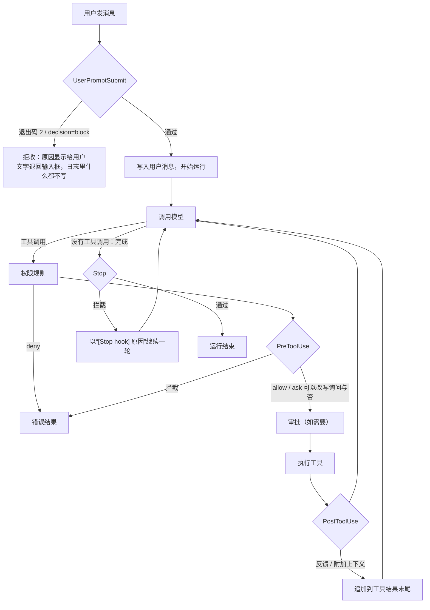
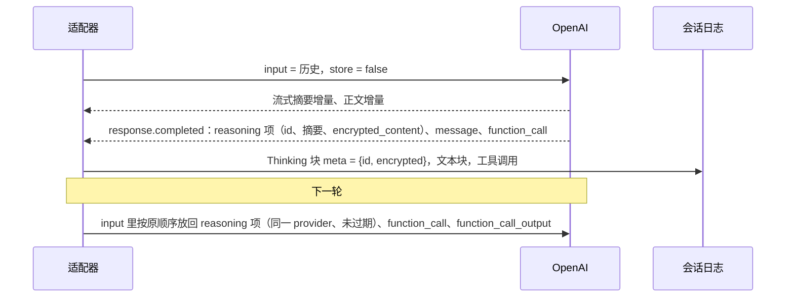
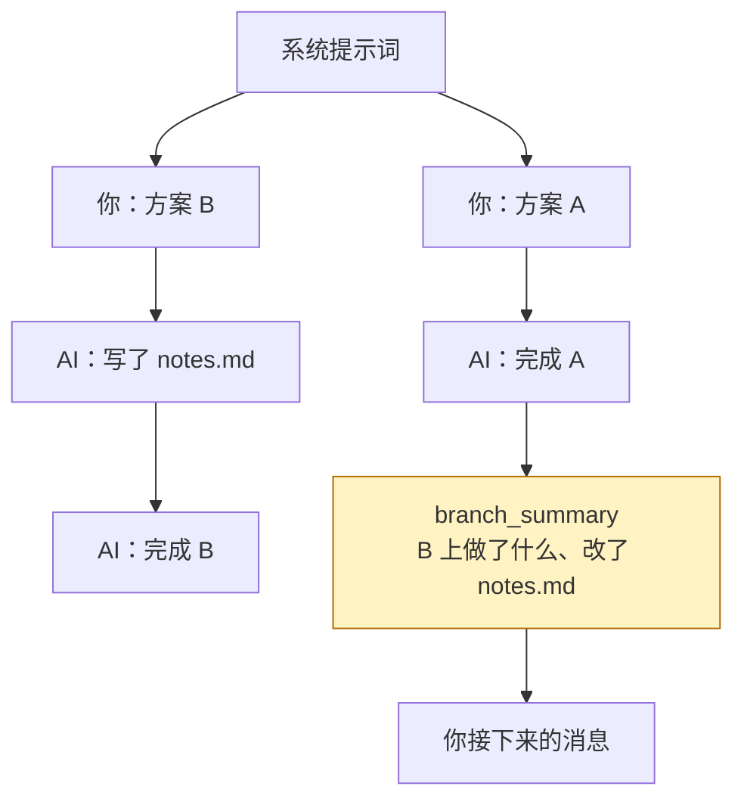
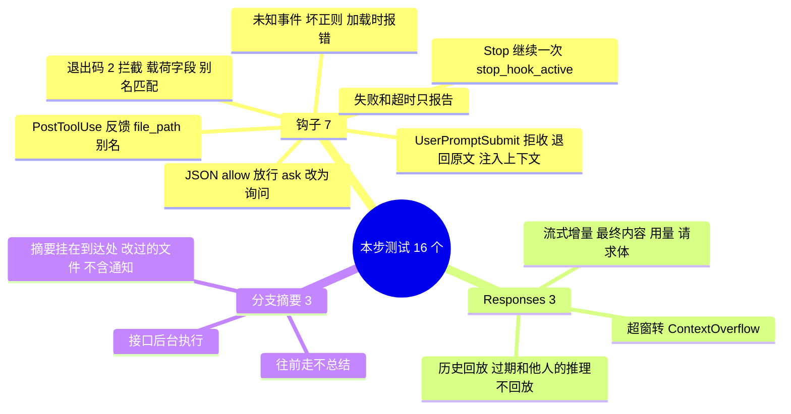

# 教程 07：shell 钩子、OpenAI Responses 与分支摘要

> 新增 `hooks.py`（Claude Code 格式的钩子）、`llm/openai_responses.py`（Responses 协议）、`tests/test_hooks.py`、`tests/test_openai_responses.py`、`tests/test_branch_summary.py`。
> 改动 `loop.py`（工具后、停止前两个钩子点；`branch_summary` 是记账条目）、`runtime.py`（钩子接入闸门与提交；`switch_branch`）、`compaction.py`（`summarize_branch`；转写不再带通知）、`context.py`、`config.py`、`api.py`、`runs.py`、`cli.py`（`/branch`）、前端的会话树和设置页。
> 后端核心 4,778 行，前端 1,560 行，测试 126 个。阶段 4 到此完成。
> 上一篇：[06-Skill与记忆](06-Skill与记忆.md)。

## 0. 先用起来

**钩子**：在 `~/.nwb/config.toml` 里加，格式沿用 Claude Code，已有的脚本大多可以直接用：

```toml
# 拦下包含密码的消息
[[hooks.UserPromptSubmit]]
command = '''grep -qi password && { echo '不要在对话里粘贴密码' >&2; exit 2; } || true'''

# 每次改完 Python 文件就格式化，把结果告诉模型
[[hooks.PostToolUse]]
matcher = "Edit|Write"
command = '''f=$(jq -r .tool_input.file_path); [[ $f == *.py ]] && ruff format "$f" || true'''
```

命令里有引号时用 TOML 的 `'''…'''`（字面字符串），里面什么都不用转义。

**OpenAI Responses**：设置页新建连接时选协议“OpenAI Responses（GPT 推理模型）”，OpenAI 模板默认就是它。推理强度写在模型的“额外参数”里，如 `{"reasoning": {"effort": "high", "summary": "auto"}}`。

**分支摘要**：打开会话树，勾选“切换分支时总结离开的分支”。之后用消息上的 ‹ › 或在树上点击切换分支时，模型会先把离开的那条分支总结成一段话，挂在你到达的位置。CLI 里对应 `/branch ID`。

---

## 1. 这一步做了什么

| 能力 | 位置 | 出处 |
|---|---|---|
| 四种钩子：PreToolUse / PostToolUse / UserPromptSubmit / Stop | `hooks.py` | D19 的 C 选项；格式由你定为兼容 Claude Code |
| 循环新增两个钩子点：工具执行后、模型说“完成”时 | `loop.py` 的 `after_tool`、`on_stop` | D19 |
| OpenAI Responses 适配：无状态请求、加密推理回传 | `llm/openai_responses.py` | 设计文档 4.5 节的第 3 种协议 |
| 分支摘要：切换分支时总结离开的分支 | `compaction.summarize_branch()`、`Workspace.switch_branch()` | 阶段 3 推迟到这里 |

---

## 2. 钩子：用户自己的脚本插进循环

### 2.1 四个事件在循环里的位置



### 2.2 和 Claude Code 一致的部分

- **输入**：钩子从 stdin 读一个 JSON 对象。公共字段有 `hook_event_name`、`session_id`、`transcript_path`（我们的会话 JSONL）、`cwd`（项目根）和 `permission_mode`（档位）。工具类事件另有 `tool_name`、`tool_input`、`tool_use_id`，PostToolUse 还有 `tool_response`。UserPromptSubmit 有 `prompt`，Stop 有 `stop_hook_active`。
- **退出码**：0 表示放行；2 表示拦截，stderr 是原因；其他非零值表示钩子自己出错，报告给用户，不影响运行。
- **JSON 输出**（退出码 0 且 stdout 以 `{` 开头）：
  - `hookSpecificOutput.permissionDecision`：`allow` / `deny` / `ask`；
  - 旧写法 `decision: approve / block` 加 `reason`；
  - `continue: false` 加 `stopReason`；
  - `hookSpecificOutput.additionalContext`：给模型的补充信息。
- **UserPromptSubmit 的纯文本输出**会作为上下文加给模型，例如注入“今天是发版日”。
- **环境变量**：`CLAUDE_PROJECT_DIR`（以及我们自己的 `NWB_PROJECT_DIR`）指向项目根。

### 2.3 为了让现成脚本能用，做的两处翻译

我们的内置工具叫 `bash`、`read`、`write`、`edit`，参数里的路径叫 `path`；Claude Code 的叫 `Bash`、`Read`、`Write`、`Edit`，路径叫 `file_path`。很多现成脚本写的是 `matcher = "Edit|Write"` 和 `jq .tool_input.file_path`，所以：

```python
ALIASES = {"bash": "Bash", "read": "Read", "write": "Write", "edit": "Edit"}

def tool_payload(tool: str, args: dict[str, Any]) -> dict[str, Any]:
    extra = {"file_path": args["path"]} if "path" in args else {}
    return {"tool_name": ALIASES.get(tool, tool), "tool_input": {**args, **extra}}
```

`matcher` 同时匹配两种名字（正则全匹配），所以 `Bash` 和 `bash` 都能命中。MCP 工具沿用 `mcp__服务器__工具`，和 Claude Code 的命名一样。

### 2.4 和 Claude Code 不同的部分

| | Claude Code | 这里 |
|---|---|---|
| 配置位置 | `settings.json` 的 `hooks` | `config.toml` 的 `[[hooks.事件]]` |
| 配置层级 | 事件 → 匹配器 → 钩子列表 | 每张表一个钩子，直接写 `matcher` |
| 同一事件多个钩子 | 并行 | 依次执行，结果合并（任一拦截即拦截） |
| PreToolUse 的 `allow` | 可以绕过全部权限检查 | 只能把“询问”变成“放行”，规则里的 `deny` 照样生效 |
| `updatedInput`（改写参数） | 支持 | 不支持 |
| 其他事件（SessionStart、PreCompact…） | 有 | 暂不支持 |

依次执行是为了让钩子的副作用有确定的顺序（比如先格式化再检查）。`allow` 不能越过 `deny`，是为了让凭据目录这类硬性保护不会被一个写错的钩子打开。

### 2.5 PreToolUse 放在闸门的哪一步

```python
check = policy.check(action, resource, self.rules(log, preset_name), places)
if check.effect == "deny":
    return Result.error(...)                         # 1. 规则禁止的，钩子都不必跑
if self.cfg.hooks:
    hook = await self._hook(log, "PreToolUse", ...)  # 2. 钩子可以拦截，或改写 ask / allow
    if hook.block:
        return Result.error(f"Blocked by a PreToolUse hook: {hook.reason}")
    if hook.decision in ("allow", "ask"):
        check = dataclasses.replace(check, effect=hook.decision)
if check.effect == "allow":
    return None
return await ask(check, tool, call)                  # 3. 剩下的问用户
```

钩子在 `tool_started` 写入日志之前执行。被拦下的调用和被规则拒绝的一样，只有一条错误结果，崩溃续跑时不会被当成“执行到一半”。

### 2.6 Stop：让模型别急着收工

模型回复里没有工具调用，循环原本就结束了。配置了 Stop 钩子后，`drive()` 在结束前问一句：

```python
case Done():
    if _take_steer(run):
        continue
    if run.on_stop and (more := await run.on_stop(stop_asked)):
        stop_asked = True
        run.log.append(USER, {"content": [text(more)], "synthetic": True}, run_id=run.run_id)
        continue
    return "ok"
```

被拦截时，原因以一条合成的用户消息“[Stop hook] 先跑测试”写进日志。`next_step()` 看到新的用户消息，自然进入下一轮，不需要任何特殊状态。

无限循环有两道保险：钩子收到 `stop_hook_active`，第二次起为 `true`，脚本应据此放行（和 Claude Code 的约定相同）；即使脚本不检查，`max_turns` 也会让运行在步数上限处收尾。

### 2.7 拒收的消息去哪了

UserPromptSubmit 在**写任何东西之前**运行。被拒时：运行记录标为 `blocked`，不会被当成未完成而续跑；发出一个 `run.error` 事件，界面顶部显示原因；再发一个带 `dropped` 的 `inbox` 事件，输入框把原文还给你修改。会话日志里没有这条消息，所以模型永远看不到它。这正是“别把密码发给模型”这类钩子需要的效果。

### 2.8 运行环境

钩子是你自己写在配置里的命令，所以不进沙箱、不需要审批。它在项目根目录运行，环境变量按白名单构造（和 `bash` 工具相同，不继承服务进程里的 API 密钥），默认超时 60 秒。超时或异常退出都只作为 `hook.error` 事件报告给用户，运行照常进行：钩子坏了不该让助手停摆。

---

## 3. OpenAI Responses 适配

### 3.1 为什么要第三种协议

GPT 系列推理模型的思考内容只能通过 Responses API 跨轮次保留。用 Chat Completions，每一轮推理都从头开始，多步工具任务的质量和缓存命中都会下降。设计文档把它列为第三个适配器。

### 3.2 无状态 + 加密推理

Responses 可以让服务端保存对话（`store=true`、`previous_response_id`）。我们不用这个功能，原因是会话树和压缩都要求“历史以本地日志为准”（D4）。服务端存的历史没法分支，也没法被我们的压缩改写。所以每一轮都发完整历史：

```python
req = {"model": ..., "instructions": system, "input": to_input(messages, provider),
       "max_output_tokens": ..., "stream": True, "store": False,
       "include": ["reasoning.encrypted_content"]}
```

`include` 让服务端把推理内容加密后返回。我们把它和推理摘要一起存进 Thinking 块的 `meta`，下一轮原样放回 `input`：



回放规则和 Anthropic 的签名思考完全一样（D8，第 03 篇第 10 节）：只回放给产生它的连接；历史被清理或压缩改过之后标为 `stale`，不再回放。

### 3.3 消息怎么对应

| 中性格式 | Responses `input` |
|---|---|
| 用户消息（文字、图片） | `{"role": "user", "content": [input_text, input_image]}` |
| 助手文字 | `{"role": "assistant", "content": "…"}` |
| 工具调用 | `{"type": "function_call", "call_id", "name", "arguments"}` |
| 工具结果 | `{"type": "function_call_output", "call_id", "output"}`，有图片时 `output` 是内容数组 |
| 思考（可回放时） | `{"type": "reasoning", "id", "summary", "encrypted_content"}` |

Responses 的工具结果可以直接带图片，不用像 Chat 协议那样另外补一条用户消息。

### 3.4 其余

- 工具声明 `strict: false`。严格模式要求 schema 满足一组额外约束，MCP 服务器给的 schema 不一定满足。
- `response.incomplete` 且原因是 `max_output_tokens` 时，`stop = "length"`，循环会照常拒绝执行可能被截断的工具调用（第 01 篇）。
- 超窗错误（`context_length_exceeded`）转成 `ContextOverflow`，触发压缩后重试一次（第 03 篇）。
- 测试用一个本地服务器按 Responses 的 SSE 格式吐事件，由真实的 SDK 解析，检查增量、最终内容、用量、请求体，以及回放规则。

---

## 4. 分支摘要

### 4.1 问题

会话是一棵树（D5）。你在 A 分支试了一个方案，回到岔路口换成 B，过一会儿又切回 A。这时模型只看得到 A 这条路径，完全不知道你在 B 上试过什么、改过哪些文件。可那些文件改动还留在磁盘上。

### 4.2 做法（Pi 的 branch summary）

切换时，把“离开的那一段”总结成一个 `branch_summary` 条目，挂在到达的位置下面：



“离开的那一段”用集合差算出来：当前路径上不在目标路径里的条目。

```python
keep = {e.id for e in log.path(target_id)}
left = [e for e in log.path() if e.id not in keep]
if not any(e.type in (USER, ASSISTANT) for e in left):
    log.checkout(target_id)          # 往前走、或者没有对话被丢下：直接切换
    return None
```

然后用和压缩相同的总结模型（同一个 SUMMARIZER 系统提示），配一段专门的指令：做了什么尝试、改了什么文件、执行了哪些有副作用的命令、学到了什么、为什么放弃。总结成功后才切换并写入条目。模型出错时什么都不变，你还停在原来的分支上。

### 4.3 模型看到的样子

```text
<branch-summary>
The user went back to this point from another branch of the conversation. What happened on that branch:

- tried a rewrite
- wrote notes.md
Files modified on that branch (still changed on disk unless reverted): notes.md
</branch-summary>
```

改过的文件单独列一行，并提醒“磁盘上仍然是改过的”。这是分支摘要最重要的信息：对话可以回退，文件系统不会跟着回退。

### 4.4 它是记账条目

`branch_summary` 和 `notice`、`compaction` 一样属于 `TRANSPARENT`，`next_step()` 会跳过它，所以切换过去不会触发模型调用。它在投影里是一条用户消息，以后压缩时作为“[Earlier summary]”进入转写。

需要调用模型，所以它像手动压缩一样由运行管理器在后台执行（同一会话里有运行时会被拒绝）。接口立即返回，新的位置和摘要条目通过事件流到达界面。

### 4.5 顺带的修正：转写里不再带通知

实测时发现，被总结的 B 分支里有重新发送的权限、技能列表和 MCP 通知（新分支的路径上没有这些通知，于是又补发了一遍）。光技能列表就有约 6,000 字，全部进了总结模型的输入。这些通知由框架负责维护，压缩或切换之后会自动补上，钉住的技能也会自动放回（第 06 篇）。所以 `serialize()` 不再输出通知，压缩也同样受益。

---

## 5. 测试



浏览器实测：配置两个钩子后，发送含 “password” 的消息被拒，顶部显示原因，原文回到输入框；正常消息触发 bash，PreToolUse 钩子收到的载荷里 `tool_name` 是 `Bash`、`cwd` 是项目根；把“plan A”改成“plan B”产生两个分支，勾选“切换分支时总结离开的分支”后点 ‹，回到 A 分支末尾出现“已总结离开的分支”，总结模型收到的正是 B 分支的转写。

---

## 6. 阶段 4 回顾

| 设计文档的完成标准 | 结果 |
|---|---|
| MCP 和 skill 走同一权限路径 | 两者都是注册表里的工具，经过同一个闸门（第 05 篇第 6 节、第 06 篇第 4.1 节） |
| 关闭后下一个 run 不再暴露 | 工具集在每次运行开始时重新组装，测试覆盖了 MCP 和技能两种情况 |

| 阶段 4 交付 | 篇目 |
|---|---|
| MCP（direct / deferred + tool_search） | 05 |
| skill 工具、memory 工具 | 06 |
| shell 钩子、Responses 适配、分支摘要（从阶段 3 推迟） | 07 |

后端从阶段 3 结束时的 3,499 行增长到 4,778 行，仍在设计文档 5,000 行的预算内。

---

## 7. 已知限制

- **钩子只能在 `config.toml` 里手写**，设置页还没有编辑界面。
- **钩子不支持改写参数**（`updatedInput`），也没有 SessionStart、PreCompact 等事件。
- **Responses 只接了函数工具**。OpenAI 的内置工具（网页搜索、代码解释器）没有接；`previous_response_id` 有意不用。
- **Responses 适配没有对真实的 OpenAI 服务跑过**，只对本地模拟服务器验证过协议格式。接入 GPT 模型时请先在设置页点“测试”。
- **分支摘要是浏览器级别的开关**（存在 localStorage 里），不同浏览器各自设置。
- **分支摘要需要一次模型调用**，切换会有几秒延迟；不需要时关掉开关即可瞬间切换。
