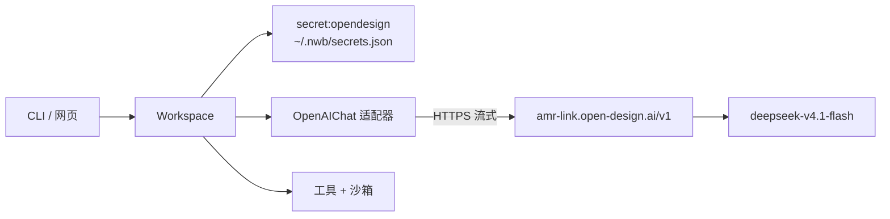
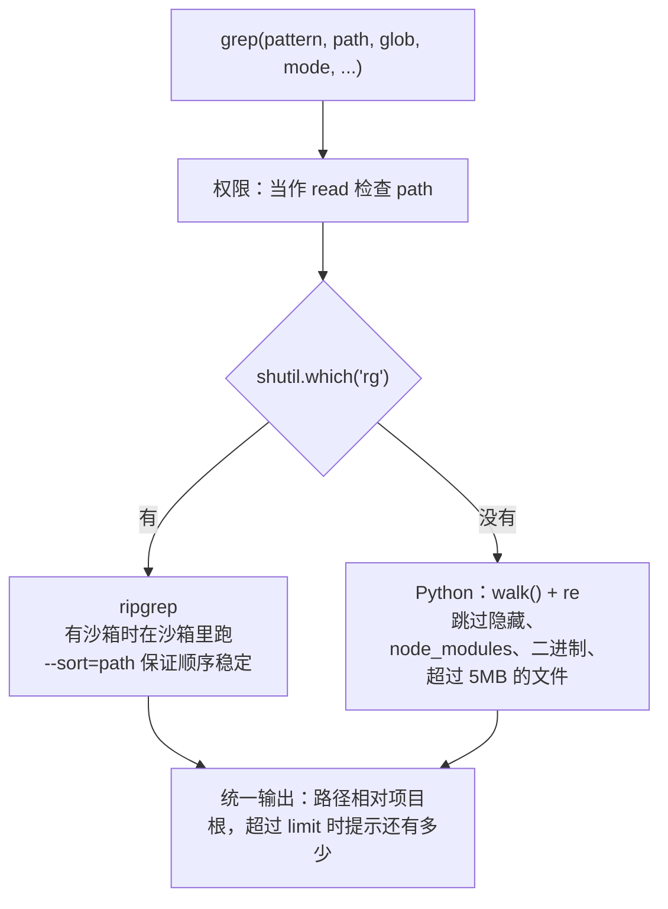
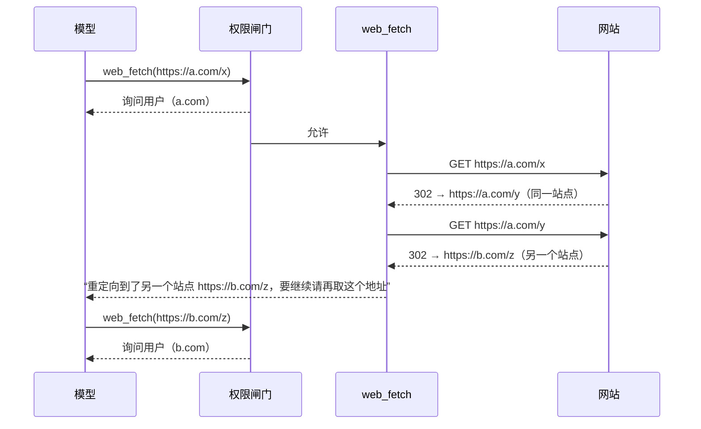
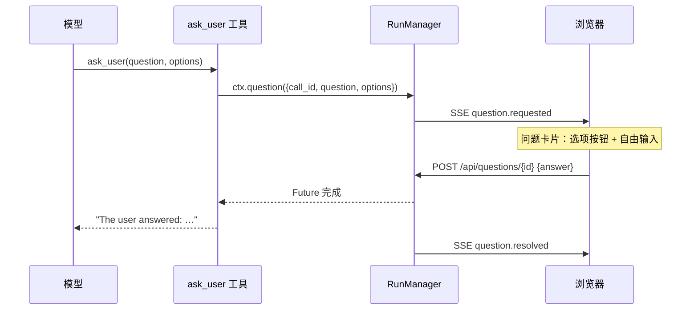
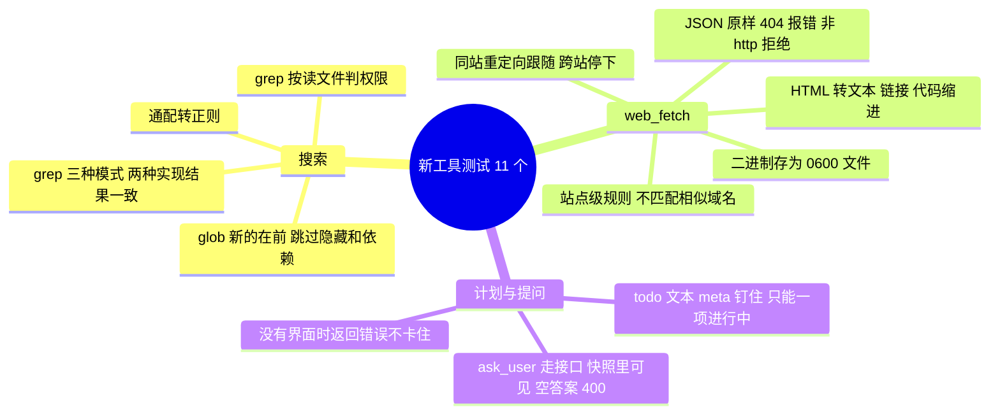

# 教程 08：真实模型冒烟测试，以及补齐内置工具

> 新增 `tools/search.py`（`grep`、`glob`）、`tools/web.py`（`web_fetch`）、`tools/interact.py`（`todo`、`ask_user`）、`tests/test_more_tools.py`。
> 改动 `tools/__init__.py`（内置工具清单）、`tools/registry.py`（`ToolCtx.question`）、`policy.py`（按站点放行、内部工具免审批）、`runtime.py` / `runs.py` / `api.py` / `cli.py`（提问的通道）、`prompts/system.md`、前端的问题卡片和计划面板。
> 后端核心 5,227 行，测试 140 个（其中 3 个只在装了 ripgrep 的机器上跑）。
> 上一篇：[07-钩子Responses与分支摘要](07-钩子Responses与分支摘要.md)。

这一步做两件事：第一次用你的真实密钥连 OpenDesign 跑通整条链路；补上设计文档 D11 里列了、但前几个阶段漏掉的四个内置工具。

## 1. 冒烟测试：第一次连真实模型

前面七篇的所有测试都用本地假服务。这次用 `~/.nwb/config.toml` 里的 `opendesign` 连接（密钥 `…KKPE`）和 `ds-flash` 模型（`deepseek-v4.1-flash`）：

| 检查 | 结果 |
|---|---|
| 获取模型列表 | 返回 13 个模型，包括 `deepseek-v4.1-flash`、`deepseek-v4-pro`、`kimi-k2.7-code`、`glm-5.3-flash`、`claude-haiku-5.5` |
| 一次流式请求 | 正常流式输出，usage 正确；这个网关上的 `deepseek-v4.1-flash` 没有返回思考内容（`reasoning_content`） |
| 多步文件任务（CLI） | 列目录 → 写 `calc.py` → 运行 → `edit` 修改 → 再运行 → 汇报，全部正确；输入 31k token，其中 25k 命中缓存 |
| 沙箱拒绝联网 | 模型读懂了沙箱提示，自己改用 `unsandboxed=true` 申请；被拒后如实说明没拿到结果，没有编造状态码 |
| 浏览器里的新工具 | 见第 7 节 |



结论：协议适配、流式、工具调用、缓存、沙箱、审批这几层，在真实模型上都按设计工作。

---

## 2. 补哪四个工具，为什么

设计文档 D11 定下的第一批内置工具，前几个阶段只做了 `read`、`write`、`edit`、`bash`：

| 工具 | 没有它时 | 有了以后 |
|---|---|---|
| `grep` / `glob` | 模型用 `bash` 跑 `grep -r`、`find`，输出可能几万行，还会搜进 `node_modules` | 结构化参数、结果有上限、跳过隐藏和依赖目录，按读文件处理权限 |
| `web_fetch` | 只能装 Fetch MCP 服务器，或在沙箱外 `curl`，拿到的是原始 HTML | 正文抽取成可读文本，按站点审批 |
| `todo` | 长任务里你看不到模型打算怎么做 | 计划显示在对话底部，压缩后也不会丢 |
| `ask_user` | 模型只能停下来用文字提问，这一轮运行就结束了 | 运行中弹出选项卡片，答完继续 |

内置工具清单从 `builtin.py` 挪到了 `tools/__init__.py`，一眼能看到全部：

```python
BUILTIN = [read, write, edit, bash, grep, glob, web_fetch, todo, ask_user]
```

---

## 3. grep 与 glob

### 3.1 两条实现路径

设计文档的要求是“调 ripgrep；没有时退回 Python 实现”。实测发现你的机器上 `rg` 只是一个 shell 函数（转给 Claude Code 自带的程序），并没有真正的 `rg` 可执行文件，所以 Python 实现是你机器上实际走的路径，两条都要可靠。



测试用参数化同时覆盖两条路径，期望结果完全相同。CI 机器上没有 `rg` 时那一半跳过。

### 3.1.1 装上 ripgrep 之后的对比

后来用 `brew install ripgrep` 装了 15.2.0，两条路径的测试都在本机实际跑过。实测对比：

| 场景 | ripgrep | Python |
|---|---|---|
| Python 标准库 1,088 个文件，列出含 `asyncio` 的文件 | 26 ms | 110 ms |
| 同上，统计每个文件 `def __init__(` 的行数 | 189 ms | 103 ms |
| 本仓库搜 `createElement`（只出现在被 `.gitignore` 忽略的 `static/` 构建产物里） | 无结果（正确） | 搜进了构建产物 |
| 在工作区档的 Seatbelt 沙箱里运行 | 正常，13–20 ms | 不涉及（进程内） |

这个规模下两者速度差不多。统计行数时 ripgrep 反而慢，是因为 `--sort=path` 让它只用单线程，换来的是结果顺序稳定。ripgrep 真正的好处是遵守 `.gitignore`，不会搜进构建产物和依赖。

对比时发现一个差异：超过 300 字符的命中行，ripgrep 默认整行换成 `[Omitted long matching line]`，模型看不到命中了什么；Python 版会保留前 300 个字符。给 ripgrep 加上 `--max-columns-preview` 后，两边行为一致，测试里两条路径都覆盖了这一点。

最后用真实模型在本仓库、只读档下提问“`src/` 里哪些地方直接用到了 sandbox-exec 或 bwrap”。模型连续几次调用 `grep`（不需要审批，ripgrep 在沙箱里跑），给出的文件和行号全部准确，还区分了直接引用和经由 `wrap()` 的间接调用。

### 3.2 三种模式

| `mode` | 输出 | 用途 |
|---|---|---|
| `files`（默认） | 匹配的文件路径 | 先定位，再用 `read` 看 |
| `content` | `路径:行号:内容` | 直接看命中的行 |
| `count` | `路径:命中行数` | 估计改动范围 |

`glob` 参数只搜指定类型的文件：不带 `/` 时匹配文件名（`*.py`），带 `/` 时匹配相对路径（`src/**/*.ts`）。

### 3.3 glob 的通配规则

Python 3.12 的 `PurePath.match` 对 `**` 支持不完整（3.13 才有 `full_match`），所以自己写了一个十几行的转换，`**/` 可以匹配零层或多层目录：

```python
def glob_regex(pattern: str) -> re.Pattern[str]:
    """Shell glob to regex over "/"-separated relative paths: ** crosses directories, * and ? do not."""
    ...  # "**/" → (?:.*/)?   "**" → .*   "*" → [^/]*   "?" → [^/]
```

`glob` 工具的结果按修改时间从新到旧排列：刚改过的文件通常就是要找的。

### 3.4 权限：搜索就是读

两个工具的权限范围都是 `("read", 解析后的路径)`，所以读文件的规则对它们照样生效：

- 工作区档里读不需要审批；
- `grep(path="~/.ssh")` 命中凭据目录的拒绝规则，测试里断言了这一点；
- 从主目录往下搜时，隐藏目录（`.ssh`、`.aws`、`.nwb`……）本来就会被跳过；
- 有沙箱时，ripgrep 在沙箱里运行，凭据目录在操作系统层面也读不到。

---

## 4. web_fetch

### 4.1 审批：按站点（你的决定）

| 档位 | 第一次访问某站点 | “总是允许”之后 |
|---|---|---|
| 只读 / 工作区 | 询问 | 本会话内这个站点不再询问 |
| 完全信任 | 不询问 | — |

权限资源是规范化后的完整 URL。“总是允许”生成的规则是 `scheme://host/*`：

```python
if self.resource.startswith(("http://", "https://")):  # a site: scheme://host/*
    u = urlsplit(self.resource)
    return Rule(self.action, glob.escape(f"{u.scheme}://{u.netloc}") + "/*", "allow")
```

规则以 `/*` 结尾，所以 `https://docs.python.org/*` 不会匹配 `https://docs.python.org.evil.com/`，测试里专门断言了这一条。

### 4.2 重定向不能绕过审批

如果允许了 `a.com`，而 `a.com` 一跳转就到了 `b.com`，按站点审批就形同虚设。所以重定向由我们自己一步步跟随：



### 4.3 返回什么

| 内容类型 | 处理 |
|---|---|
| HTML | 转成可读文本：标题、`#` 级标题、列表 `-`、链接 `[文字](绝对地址)`、代码块保留缩进；去掉 script、style、head |
| JSON、XML、纯文本 | 原样 |
| 图片（5MB 以内） | 图片块，交给视觉模型 |
| 其他（PDF、压缩包……） | 存进会话的私有目录（0600），返回路径，让模型用 `bash` 处理 |
| 4xx / 5xx | 错误结果，带状态码和前 2,000 字节 |

HTML 转文本只用了标准库的 `HTMLParser`，没有引入新依赖。长页面不在这里截断：第 1 级外置（第 01 篇 8.6 节）会把超长结果的全文另存，只留头尾。

`web_fetch` 在我们自己的进程里发请求，不经过 `bash` 的沙箱。所以工作区档的“沙箱禁网”管不到它，它靠审批来管。代理设置（`HTTPS_PROXY` 等）照常生效。

---

## 5. todo：计划留在日志里

```python
@tool(effect="read", scope=lambda args, ctx: ("todo", ""))
async def todo(args: TodoArgs, ctx: ToolCtx) -> Result:
    ...
    return Result([text(f"Todo list ({done}/{len(args.todos)} done):\n{body}")],
                  meta={"todos": [t.model_dump() for t in args.todos], "pin": "todo"})
```

它不改任何文件，只在工具结果的 `meta` 里留下完整清单。三个性质都来自前面已有的机制，没有新增状态：

- **界面**：从当前路径上最后一次 `todo` 结果读出清单，显示在对话底部的“计划 1/3”面板里。切换分支后，看到的就是那条分支上的计划。
- **压缩不丢**：带 `pin: "todo"`，按第 06 篇的钉住机制，被压缩掉以后会把最新的那份清单放回。
- **规则**：每次发送完整清单，同一时间最多一项 `in_progress`，违反时返回错误让模型改。

文档里原本写的是“写进 `state` 条目”。实际改成了工具结果的 `meta`，原因是工具拿不到日志对象，而 `meta` 加“从路径推导”的做法，`tool_search` 和技能已经在用。

---

## 6. ask_user：运行中向你提问

### 6.1 和审批共用一套做法

审批（第 02 篇）的做法是：运行管理器里放一个 Future，界面答复时把它完成。提问照搬这一套：



- 待回答的问题也在快照的 `live.questions` 里，刷新页面或断线重连后卡片还在。
- 运行被停止时 Future 被取消，工具结果记为“已取消”，和审批一样。
- 同一个问题回答两次（比如双击），第二次直接忽略，不会出错。
- CLI 里是终端提问：输入数字选择选项，或者直接输入回答。
- 没有界面可以提问时（比如测试或脚本调用），工具返回错误，提示模型“说明你的假设然后继续”，运行不会卡住。

### 6.2 通道怎么传进去

审批函数 `ask` 原本就一路从运行管理器传到 `make_run`。提问函数 `question` 沿同一条路径多传一个参数，最后放进 `ToolCtx.question`。工具只看到一个“给我答案”的异步函数，不知道背后是网页还是终端。

### 6.3 崩溃时

`ask_user` 和 `todo` 都标为 `effect="read"`：崩溃续跑时直接重新执行，等价于再问一次、再发一次计划，没有副作用。两者在只读和工作区档都免审批（`policy.HARNESS`）。

---

## 7. 浏览器实测（真实模型）

在一个有 3 处 TODO 的小项目里，对 `ds-flash` 说：“找出项目里所有的 TODO，用 todo 工具列一个修复计划，然后问我先修哪一个（给我选项），按我的选择只修那一个并验证。”

1. 模型自己选用了 `grep`（`TODO|FIXME|XXX|HACK`），再 `read` 两个文件，找到 3 处；
2. 调 `todo` 列出 3 项计划，对话底部出现“计划 0/3”；
3. 调 `ask_user`，卡片上是它给的 3 个选项；
4. 选了 `discount()` 之后，它只改了这一处，用 `python3 -c` 验证了边界值和异常，计划更新为 1/3，其余两处没有动；
5. 整个运行输入 68k token，其中 60k 命中缓存。

接着让它用 `web_fetch` 读 `https://example.com`：弹出审批卡片，地址一栏显示 URL，按钮是“本会话总是允许 https://example.com/*”；允许后它正确报出页面标题和第一段话。

---

## 8. 测试



---

## 9. 已知限制

- **这个网关上的 `deepseek-v4.1-flash` 不返回思考内容**。如果需要思考，可以试 `deepseek-v4-pro`，或按网关文档在模型的“额外参数”里打开。
- **Python 版 grep 不读 `.gitignore`**，只跳过隐藏目录、`node_modules` 和 `__pycache__`。装了 ripgrep 就会自动改用它（你的机器现在已经装了）。
- **web_fetch 不执行 JavaScript**，纯前端渲染的页面只能拿到空壳，需要浏览器类 MCP 服务器。
- **todo 只在一个会话内有效**，不会跨会话延续。
- **后端代码到了 5,227 行**，超过设计文档里“阶段 3 结束时不超过 5,000 行”的目标。那是阶段 3 的预算，阶段 4 和这一步加了 MCP、技能、钩子和九个工具，属于计划外增长，之后会留意。
- 冒烟测试在你的 `~/.nwb` 里留下了两个项目（`smoke-proj`、`real-proj`），它们指向一个临时目录，可以在侧栏忽略。
