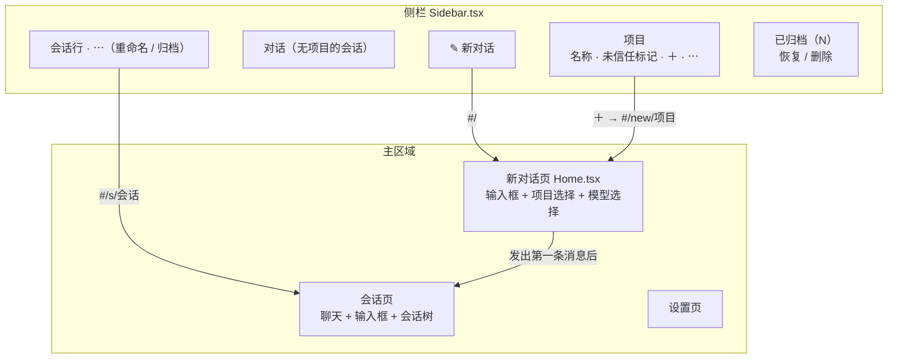
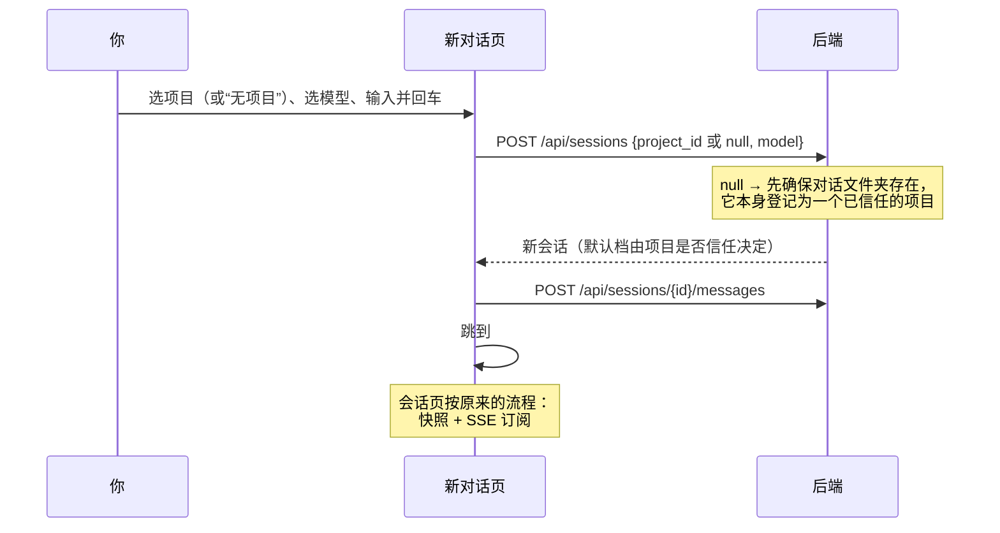
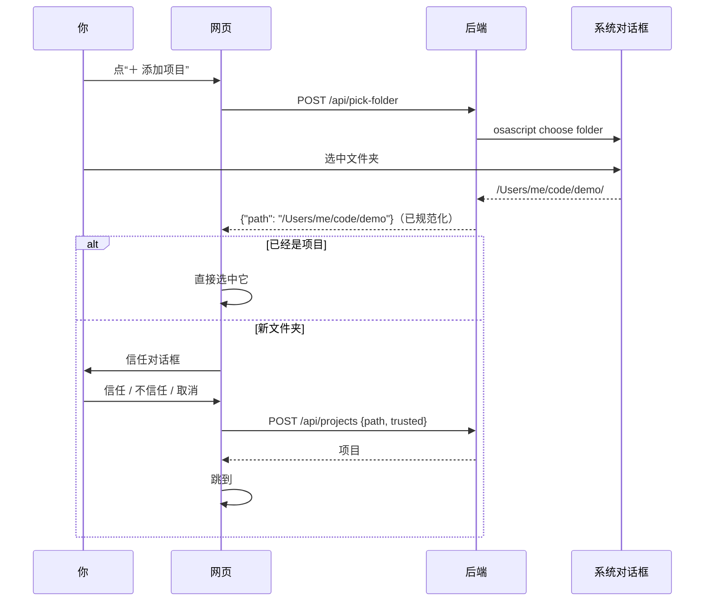
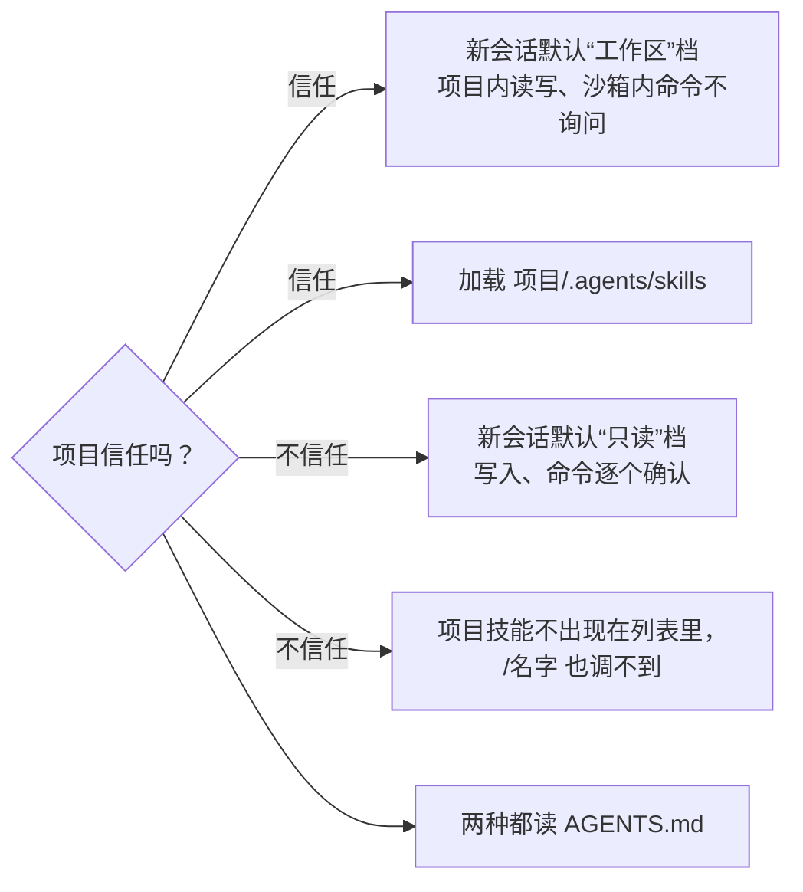
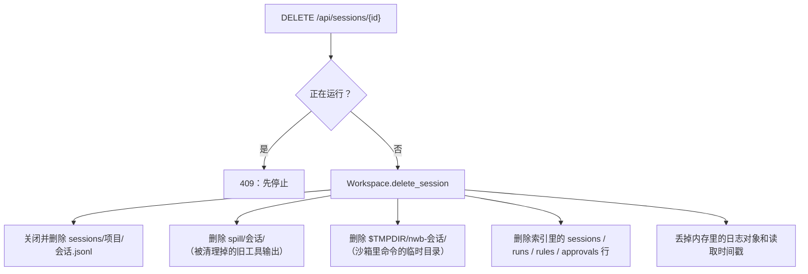
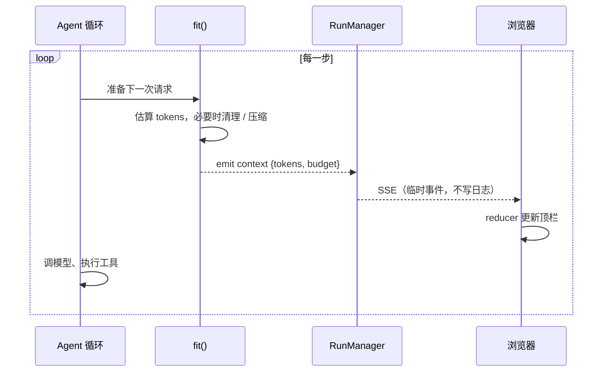

# 教程 09：会话与项目管理——新对话页、选文件夹、信任、归档与删除

> 新增 `web/src/Home.tsx`（新对话页）、`web/src/Sidebar.tsx`（侧栏、菜单、信任对话框）、`tests/test_manage.py`。
> 改动 `index.py`（三条迁移、改名 / 归档 / 删除 / 信任）、`config.py`（`scratch_dir`）、`runtime.py`（按信任定默认档、无项目对话、删除会话与项目、项目技能看信任）、`compaction.py`（运行中推送上下文用量）、`api.py`（新路由和原生选文件夹）、`cli.py`（第一次进入目录时询问信任）、前端 `App.tsx` / `Composer.tsx` / `api.ts` / `session.ts` / `style.css`。
> 后端核心 5,386 行，测试 146 个。
> 上一篇：[08-补齐内置工具](08-补齐内置工具.md)。

前八篇把 Agent 本身做全了，但用起来还像个开发工具：会话只能建、不能删；添加项目要手打绝对路径；不进项目就没法开始。这一篇向 Codex、Claude Code 的桌面端看齐，补上日常管理的这一层，顺带修好运行中上下文用量不刷新的问题。

## 1. 这一步的几个决定

| 问题 | 你的选择 | 含义 |
|---|---|---|
| 删除做成什么样 | 归档 + 永久删除 | 会话先归档（从列表消失，可恢复），在“已归档”里才能永久删除；项目只能“从列表移除”，同时删掉它的会话记录，磁盘上的文件夹不动 |
| 信任控制什么 | 仿 Codex | 不信任：新会话默认只读档，不加载项目自带技能；`AGENTS.md` 照常读取。信任：默认工作区档 |
| 能否不选项目直接聊 | 允许无项目 | 不选项目时在一个“对话文件夹”里工作 |

“对话文件夹”放在哪里，有个约束：沙箱规则把 `~/.nwb` 整个列为禁区（里面有密钥），所以它不能放在 `~/.nwb` 下。默认用 `~/Documents/nano-workbuddy`（没有“文稿”目录时用 `~/nano-workbuddy`），模型在里面写的文件你在访达里一眼能找到；想换位置，在 `config.toml` 顶部写 `scratch_dir = "..."`。

---

## 2. 页面结构

以前打开网页，没选会话时只有一行“在左侧选择或新建一个会话”。现在路由变成四种，都放在地址的 `#` 后面，刷新和收藏都不丢：

| 地址 | 页面 |
|---|---|
| `#/` | 新对话页，默认选中最近用过的项目 |
| `#/new/<项目 id>` | 新对话页，预先选中这个项目（侧栏项目旁的 ＋ 跳到这里） |
| `#/s/<会话 id>` | 会话 |
| `#/settings` | 模型与密钥 |



注意侧栏的 ＋ 现在不再“立刻建一个空会话”，而是跳到新对话页并选好项目。会话在**发出第一条消息时**才创建，所以列表里不会再堆一串标题为“新会话”的空壳。

### 2.1 新对话页怎么发出第一条消息



两次请求而不是一次，是为了复用现有的发送接口：请求 id 去重、插话 / 排队、钩子拦截都在 `messages` 那条路径上，不需要再写一遍。

输入框组件 `Composer` 也因此改成了通用的：它不再自己调 `api.send(sid)`，而是接收一个 `submit` 函数；会话页传“发到这个会话”，新对话页传“先建会话再发”。项目选择器和模型选择器作为 `children` 塞进按钮行左边。`/技能名` 补全改成按项目取（`GET /api/skills?project_id=`），这样还没有会话时也能补全。

---

## 3. 添加项目：原生选文件夹 + 信任

### 3.1 为什么由后端弹出对话框

浏览器出于隐私，**不会**把文件的真实路径告诉网页：`<input type="file" webkitdirectory>` 只给文件名和相对路径。而我们需要的恰恰是绝对路径（项目根目录、沙箱可写范围都基于它）。

好在服务端就跑在你这台电脑上，可以让它来弹系统自带的对话框：

| 系统 | 命令 |
|---|---|
| macOS | `osascript -e activate -e 'POSIX path of (choose folder with prompt "选择项目文件夹")'` |
| Linux | `zenity --file-selection --directory`（装了才有） |
| 其他 | 返回 501，网页退回“手动输入路径”的小对话框 |

`activate` 让 osascript 自己成为前台程序，对话框就不会被浏览器窗口挡住；它不需要“自动化”权限（不去控制别的 App）。你点“取消”时 osascript 以非零码退出，接口返回 `{"path": null}`，网页什么也不做。



如果服务跑在另一台机器上（比如 `--host 0.0.0.0` 给手机用），对话框会弹在服务端那台电脑上。这种情况很少，目前不特别处理。

### 3.2 信任到底管什么

`projects` 表从第一阶段起就预留了 `trusted` 列，这次才用上：



为什么这样分：

- **技能是“指令”**。项目里的 `.agents/skills/*/SKILL.md` 会被原样塞进上下文，写技能的人能直接指挥模型。来历不明的仓库，这一层先关掉。
- **权限档是“兜底”**。只读档下模型就算被仓库里的文字诱导，任何写入和命令都要你点头。
- **`AGENTS.md` 照读**。它和技能一样是项目作者写的文字，但通常是“怎么构建、怎么跑测试”这类信息，Codex 也是不论信任都读。真有恶意内容，只读档会拦住它想做的事。
- **信任只决定默认值**。会话里仍然可以手动切档；在项目菜单里随时改信任，之后的新会话和技能列表立即跟着变，已有会话的档位不动。

代码上只有三处：

```python
# runtime.py
def new_session(self, root, model=None, *, trusted=True):
    project = self.index.project_for(root, trusted)   # 新项目才用 trusted；已有项目保持原样
    ...
    self.index.update_settings(sid, {"preset": "workspace" if project["trusted"] else "readonly"})

def skills(self, root, enabled=True):
    root = root if root and self.trusted(root) else None   # 不信任：当作没有项目目录
    found = skills.discover(root, self.cfg.home, self.cfg.skill_dirs)
```

`new_session` 的 `trusted=True` 默认值看起来宽松，其实只在“这次调用顺带创建了项目”时起作用。网页总是先经过信任对话框建好项目，CLI 在建之前会先问（见 3.3），剩下的调用方只有测试。

另外，`POST /api/projects` 遇到已存在的项目**不会**改它的信任：重复添加同一个文件夹，结果不应取决于这次点了哪个按钮。改信任只能走 `PATCH /api/projects/{id}`。

### 3.3 CLI 也问

在一个新目录里第一次运行 `nwb`：

```
/Users/me/Downloads/some-repo is not a project yet. Do you trust the files in it?
Trusted: the agent may edit files here and run sandboxed commands without asking, and the
project's skills are loaded. Not trusted: read-only until you switch the preset.
Trust this folder? [y/N]
```

默认是 N。标准输入不是终端时（脚本、管道里跑 `nwb "prompt"`）不问，按不信任处理，脚本不会卡在提示上。

### 3.4 老数据

升级前加过的项目都是你亲手加的，迁移里一句 `update projects set trusted=1` 把它们全标为信任，行为和以前一致。

---

## 4. 重命名、归档、删除

### 4.1 存在哪里

索引的分工（D4）是：JSONL 是对话内容的唯一来源，SQLite 存“只属于管理层面”的东西。会话名和归档状态都不是对话内容，所以放 SQLite，三条迁移：

```python
MIGRATIONS = [
    "alter table sessions add column settings_json ...",          # 阶段 2
    "alter table sessions add column name text",                   # 你起的名字
    "alter table sessions add column archived_at real",            # 归档时间，null 表示没归档
    "update projects set trusted=1",                               # 见 3.4
]
```

标题以前就是“缓存”：每次同步都从第一条用户消息重新算出 `title`。如果把你起的名字直接写进 `title`，下一次同步就会把它覆盖掉。所以名字单独一列 `name`，读出时合并：

```python
row["title"] = row.pop("name") or row["title"]   # 起过名就用名字，否则用第一条消息
```

把名字改成空字符串，就回到自动标题。

### 4.2 删除会话删掉什么



顺序上**先删文件、后删索引行**。原因在启动时的 `reindex`：它会扫描 `sessions/*/*.jsonl`，把索引里没有的文件重新登记。如果先删索引行、删文件时又失败了，重启后会话会“复活”；反过来，最坏情况只是索引里留一行指向不存在文件的记录。

从分叉来的会话不受影响：分叉时整条路径已经复制进新文件（`log.fork`），和原会话没有共享数据。

### 4.3 移除项目

“从列表移除”= 删除它的每个会话（同上），再删 `sessions/项目/` 目录和项目行。你的代码目录一个字节都不碰，`AGENTS.md` 也不碰；以后再添加同一个文件夹，会得到一个新的、空的项目。确认框会写明会删掉几个会话记录。

对话文件夹也是一个（标了 `scratch`）项目，它的会话显示在侧栏顶部的“对话”分组，不出现在“项目”分组里。

### 4.4 接口一览

| 方法 | 路径 | 作用 |
|---|---|---|
| `POST` | `/api/pick-folder` | 弹系统选文件夹对话框 |
| `POST` | `/api/projects` | 添加项目 `{path, trusted}` |
| `PATCH` | `/api/projects/{id}` | 改名、改信任 |
| `DELETE` | `/api/projects/{id}` | 从列表移除（连同会话记录） |
| `POST` | `/api/sessions` | 新建会话 `{project_id 或 null, model}` |
| `PATCH` | `/api/sessions/{id}` | 原有的 `model`、`preset`，新增 `title`、`archived` |
| `DELETE` | `/api/sessions/{id}` | 永久删除 |
| `GET` | `/api/skills?project_id=` | 某项目可用的技能（替代原来按会话取的接口） |

旧的 `POST /api/projects/{id}/sessions` 保留，内部转给 `POST /api/sessions`。

---

## 5. 运行中刷新上下文用量

### 5.1 问题

顶栏的“上下文 7k/968k”只在两个时机更新：打开会话（快照）和运行结束（`session` 事件）。一次跑十几步的任务，中途读了好几个大文件，这个数字一直不动，等结束才跳一下。

### 5.2 做法

每次请求模型之前，`compaction.fit()` 本来就要算一遍“这次请求有多大”，以决定要不要清理或压缩。算完顺手发一个事件就行：

```python
async def fit(run, overflow=False):
    ...
    system, messages, used = project()
    if used > limit or overflow:
        ...  # 清理旧工具输出 → 仍不够就压缩
    run.emit({"type": "context", "tokens": used, "budget": limit})
    return system, messages
```



这个数和快照里的 `context_usage` 用的是同一个函数（`request_tokens`），只是工具清单取的是本次运行实际声明的那一份，所以运行中的数比运行前的估计更准。`context` 和 `assistant.delta` 一样是临时事件，不写进 JSONL；断线重连时由快照给出当前值。

顺带把显示精度改了：10 万以下显示一位小数（`6.9k`），否则一步只多几百 token 时看不出变化。

在真实模型上的验证：一次“运行 main.py 再 cat 它”的任务里，浏览器收到了 `6878 → 6921` 两个 `context` 事件，结束后快照给出 `6956`（多了最后一条回复）。

---

## 6. 浏览器实测

用一个独立的 `NWB_HOME` 和真实的 `ds-flash` 模型，在内置浏览器里走了一遍：

| 操作 | 结果 |
|---|---|
| 点“＋ 添加项目” | 后端起了 `osascript` 的选文件夹对话框；关闭对话框（相当于取消）后网页无报错、无变化 |
| 选中 `proj-a` → 信任 | 侧栏出现 `proj-a`，跳到 `#/new/…`，选择器已选中它 |
| 在选择器里“＋ 添加项目…”→ `proj-b` → 不信任 | 侧栏 `proj-b` 带“未信任”标记，页面下方提示“会话以只读档开始” |
| 在 `proj-a` 发第一条消息 | 创建会话、跳转、工作区档；模型用 glob → read → bash 完成任务 |
| ⋯ → 重命名为“运行 main.py” | 侧栏和顶栏标题同时更新 |
| 归档 → 恢复 → 再归档 → 删除 | 归档后回到新对话页、“已归档（1）”出现；恢复后回到列表；删除后 JSONL、spill、临时目录、索引行全部消失 |
| 无项目发消息“写 hello.txt” | 文件写进对话文件夹，侧栏出现“对话”分组 |
| proj-b ⋯ → 信任此项目 → 从列表移除 | 标记消失；确认框写明“0 个会话记录会被永久删除；磁盘上的文件夹不受影响” |

（选文件夹对话框本身是系统窗口，自动化工具点不到，所以“选中某个文件夹”这一步在页面里替换了 `pick-folder` 的返回值来模拟；真实对话框的弹出和取消是实测的。）

---

## 7. 测试

`tests/test_manage.py` 六个用例：

| 用例 | 验证 |
|---|---|
| `test_rename_archive_and_delete_a_session` | 改名后再次同步不被覆盖；空名回到自动标题；归档 / 取消归档；删除后文件、spill、临时目录、索引行都没了，`reindex` 不会让它复活 |
| `test_remove_a_project_keeps_its_folder` | 项目改名；移除后列表为空、会话目录删掉，项目文件夹里的文件原封不动 |
| `test_untrusted_projects_start_read_only_without_their_skills` | 不信任 → 只读档、技能列表为空；重复添加不改信任；`PATCH` 改为信任后技能出现、新会话为工作区档 |
| `test_chat_without_a_project` | `project_id: null` 建在对话文件夹里，它被登记为已信任的 `scratch` 项目，第二次复用同一个 |
| `test_pick_folder` | 选中（路径被规范化、去掉末尾斜杠）、取消（`null`）、系统没有对话框（501） |
| `test_context_usage_is_published_before_each_request` | 一次两步的运行收到两个 `context` 事件，第二个更大 |

已有测试的改动：测试工具 `Server.session()` 添加项目时带上 `trusted: True`（否则默认不信任，会话变成只读档，很多写文件的测试会卡在审批上）；两个迁移测试把版本号断言改成 `len(MIGRATIONS)`。

---

## 8. 已知限制

- 选文件夹只支持 macOS 和装了 zenity 的 Linux；Windows 和无桌面环境走手动输入。
- 删除没有“撤销”。归档就是撤销的余地，所以菜单里只有归档，永久删除要进“已归档”才能点。
- 不信任的项目里，已有会话不会因为你后来点了“信任”而自动换档；需要的话在顶栏手动切。
- 项目级 MCP 配置、项目级权限规则仍未做：信任已经有了，它们可以作为下一步挂在信任上。
- 会话只能逐个删除，没有批量操作和按时间自动清理。
