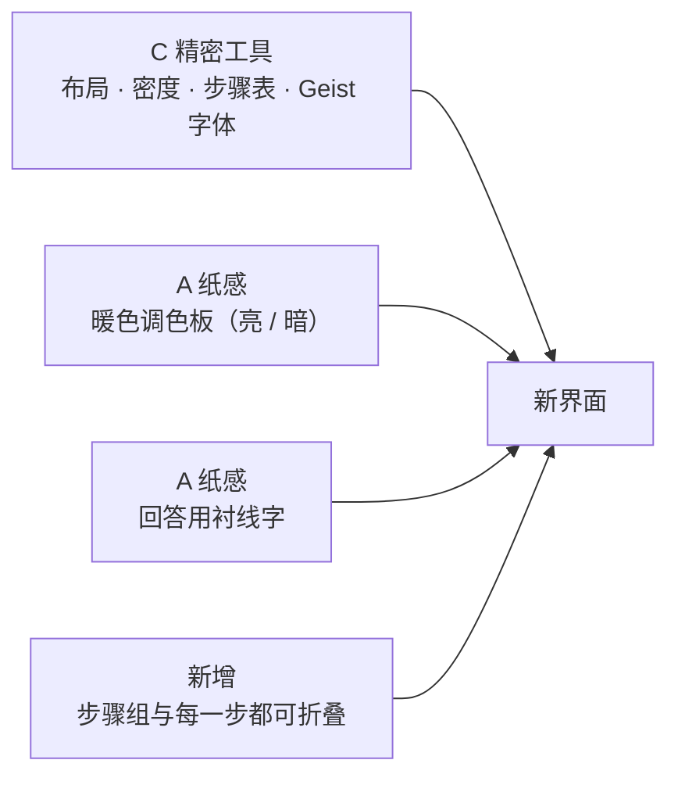
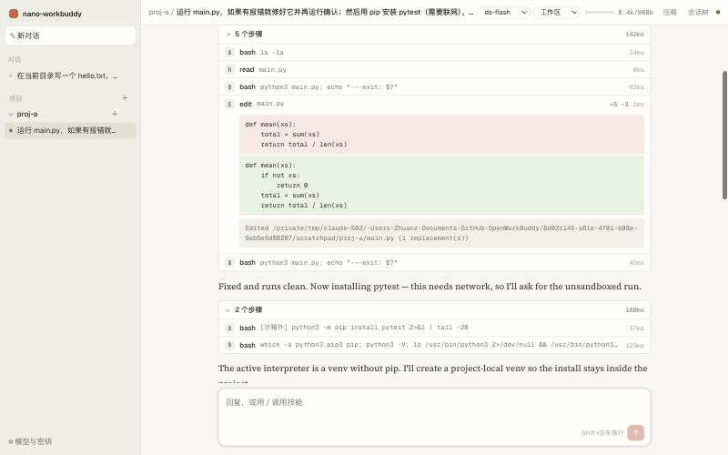
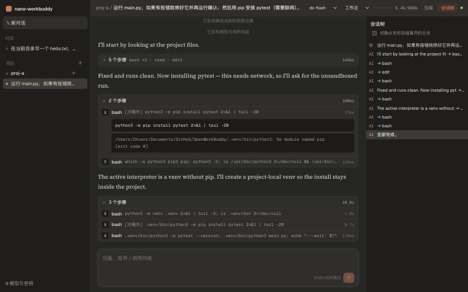
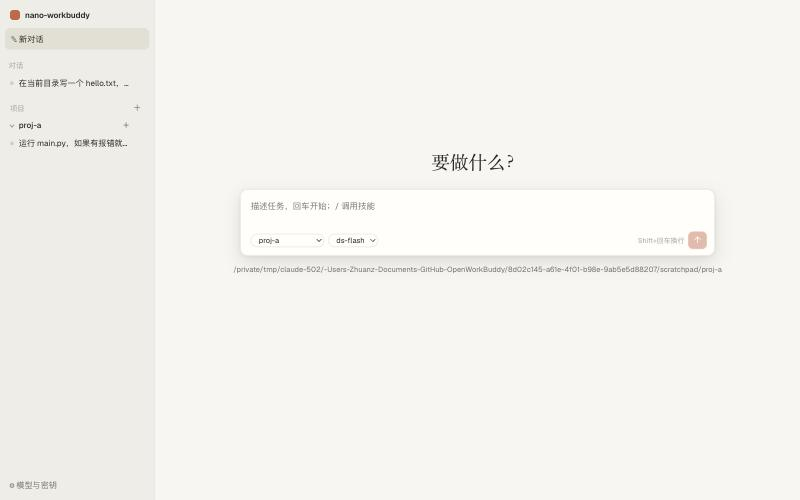
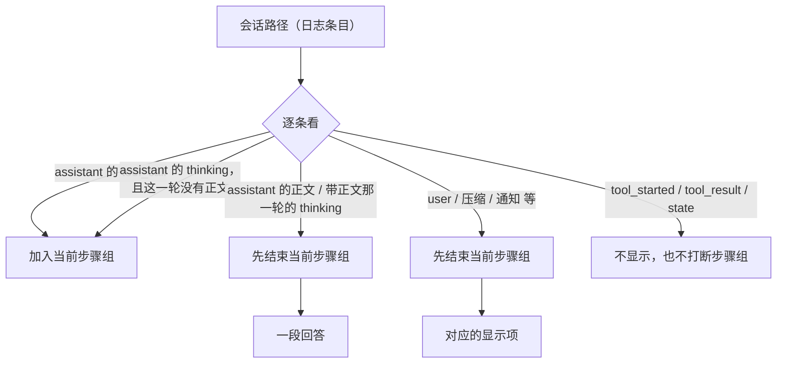
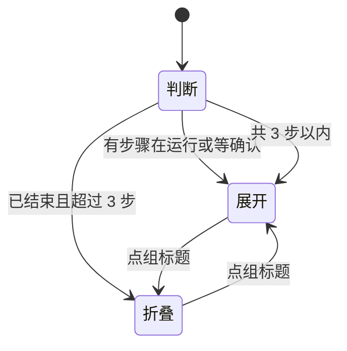

# 教程 10：界面重做——精密工具的骨架，纸感的配色与字体

> 改动 `web/src/style.css`（整份重写）、`Chat.tsx`（工具调用合并成可折叠的步骤组）、`Composer.tsx`、`Sidebar.tsx`（项目可折叠、运行中的会话亮点）、`App.tsx`（面包屑标题、上下文进度条）、`Home.tsx`、`main.tsx`（字体）、`package.json`（三个字体包）。
> 后端没有改动，测试仍是 146 个。
> 上一篇：[09-会话与项目管理](09-会话与项目管理.md)。

## 1. 怎么选出来的

我们先做了一个对比页，把同一屏（侧栏、顶栏、一轮带工具调用的对话、审批卡片、输入框）按四个方向各画一遍：

| 方向 | 参考 | 一句话 |
|---|---|---|
| A 纸感 | Claude 桌面端 | 暖白纸色，回答用衬线字，陶土橙只用在“发送” |
| B 极简 | Codex、ChatGPT | 纯白、几乎无边框，工具调用缩成一行灰字 |
| C 精密工具 | Linear、Cursor | 冷灰细线、13px、等宽数字，工具调用合成带耗时的步骤表 |
| D 终端 | OpenCode | 深色、全程等宽，像命令行日志 |

你的决定是：**以 C 为骨架，回答用 A 的衬线字，配色用 A，工具调用可以折叠展开。**









---

## 2. 设计令牌：一处定义，全站引用

以前的样式里颜色散落在各处，暗色模式只改了一半。这次整份 `style.css` 从一组令牌（CSS 变量）出发，所有组件只引用令牌，不写字面颜色：

| 令牌 | 亮色 | 暗色 | 用途 |
|---|---|---|---|
| `--bg` | `#f7f6f2` | `#262624` | 主区域底色（纸） |
| `--side` | `#efede6` | `#1f1e1c` | 侧栏、会话树，比纸深一档 |
| `--panel` | `#fffefb` | `#2f2e2b` | 卡片、输入框、步骤表 |
| `--sunk` | `#f1efe8` | `#1c1b19` | 代码、工具输出这类“凹下去”的块 |
| `--text` / `--muted` / `--faint` | 三级文字 | 三级文字 | 正文 / 说明 / 最弱的标签 |
| `--line` / `--line-strong` | 两级细线 | 两级细线 | 分隔线、边框 |
| `--clay` | `#c96442` | `#d97757` | 只用于“把活交给模型”的东西：发送按钮、运行中的点 |
| `--warn*` / `--err*` / `--ok` | 语义色 | 语义色 | 审批卡、出错、成功；和强调色分开 |

暗色模式只在 `@media (prefers-color-scheme: dark)` 里重新给这些变量赋值，组件规则一行不动，所以不会出现“亮色的字压在暗色的底上”。

几个刻意的约束：

- **陶土橙只给模型的动作。** 发送按钮、运行中会话前的脉冲点、工作中的提示是橙色；你自己的主要操作（“允许”）用深色按钮。这样橙色一出现，意思就是“模型在干活”。
- **中性色带一点暖。** 灰色都偏黄褐，和陶土橙同一个色相家族，看起来是一套而不是拼凑。
- **一套圆角**：5px（按钮、输入）、8px（卡片）、12px（输入框、对话框）。

## 3. 字体：谁在说话，一眼可见

| 角色 | 字体 | 来源 |
|---|---|---|
| 界面 | Geist（中文回落到苹方） | npm 包 `@fontsource-variable/geist` |
| 代码、路径、数字 | Geist Mono | `@fontsource-variable/geist-mono` |
| 模型的回答 | Source Serif 4 + 系统宋体（宋体-简 / 思源宋体） | `@fontsource-variable/source-serif-4` |

字体打包进前端，而不是从 Google Fonts 在线加载：nano-workbuddy 是本机服务，断网时界面也不该变样。中文衬线字太大（几十 MB），不打包，用系统自带的宋体：macOS 有“宋体-简”，Linux 常见“思源宋体”，Windows 有“宋体”。

回答正文 15.5px、行高 1.75，界面其余部分 13px。字号差和字体差一起，把“读的内容”和“操作的界面”分开。

## 4. 步骤组：工具调用折叠展开

### 4.1 以前的问题

每个工具调用一张卡片，十几步的任务就是十几张卡片竖着排，模型说的话被挤在中间，很难一眼看出它做了什么。

### 4.2 怎么分组

渲染前先把会话路径转换成一串“显示项”：



要点：

- **跨轮合并。** 模型调一个工具、看结果、再调下一个，在日志里是好几条 assistant 条目，但对你来说是一串连续的动作，所以合成一组，直到模型开口说话。
- **思考不打断。** 推理模型每一轮都先思考。如果这一轮只是为了调工具，思考就作为组里的一行“思考”，否则每一步都会被拆成单独一组。
- 工具的开始、结果这些条目本来就不单独显示，它们不打断分组。

### 4.3 什么时候展开



- 运行中的组总是展开，你能看到正在进行的那一步和它的实时输出。
- 结束后超过 3 步的组自动折起来，只留一行：“5 个步骤　bash ×3 · read · edit　142ms”。
- 你点过之后就以你的选择为准。
- 每一行也能单独点开，看参数和输出；`edit` 显示红绿差异，行尾标出“+5 −3”。

### 4.4 每一步的耗时

日志里每个工具调用开始时有一条 `tool_started`，结束时有一条 `tool_result`，各带时间戳。两者相减就是耗时，不需要后端新增任何字段：

```ts
function seconds(call, runs) {
  const r = runs.results[call.id];
  const t0 = runs.started[call.id];
  return r && t0 ? Math.max(0, r.ts - t0) : null;
}
```

显示成 `84ms`、`9.7s`、`1m 05s`；组标题上是总和。

## 5. 其他界面变化

| 位置 | 变化 |
|---|---|
| 侧栏 | 项目可以折叠（记在浏览器里）；会话行前有状态点，正在运行的会话是跳动的橙点；“对话”分组字号更小、更像标题 |
| 顶栏 | 面包屑“项目 / 标题”；模型和权限档做成胶囊；上下文用量加一条细进度条，超过 80% 变成警示色；第一次运行还没结束时，标题先显示第一条消息 |
| 用户消息 | 细边框卡片，“编辑 / 分叉”鼠标移上去才出现 |
| 审批卡 | 暖黄底、等宽命令，“允许”是深色主按钮 |
| 输入框 | 圆角大卡片，发送按钮是唯一的橙色按钮，旁边提示 Shift+回车换行 |
| 新对话页 | 衬线大标题“要做什么？”，输入框带阴影浮起 |
| 折叠箭头 | 改用 CSS 画的人字形：Geist 里没有 ▸ ▾ 这类字形，回落字体里又太小，看起来像一个点 |

## 6. 实测中发现并修掉的问题

| 现象 | 原因 | 修法 |
|---|---|---|
| 会话标题按钮带上了边框和白底 | 行首加了状态点，`.session > button:first-child` 不再匹配 | 改成 `:first-of-type` |
| 第一个步骤组被压成一条缝 | 对话区是纵向 flex，带 `overflow: hidden` 的子元素默认可以被压缩 | `.chat > * { flex-shrink: 0 }` |
| 会话树里当前路径的节点是橙色底 | 通用的 `button.on` 规则优先级更高 | 改成 `button.tree-node.on` |
| 折叠箭头几乎看不见 | 见上表最后一行 | CSS 人字形 |

## 7. 已知限制

- 中文衬线依赖系统字体：没有宋体的 Linux 会回落到默认衬线字。
- 只跟随系统的亮 / 暗设置，还没有手动切换开关。
- 窄屏（手机宽度）还没专门适配，侧栏不会收起。
- 步骤组的折叠状态不保存，刷新后回到默认规则。
