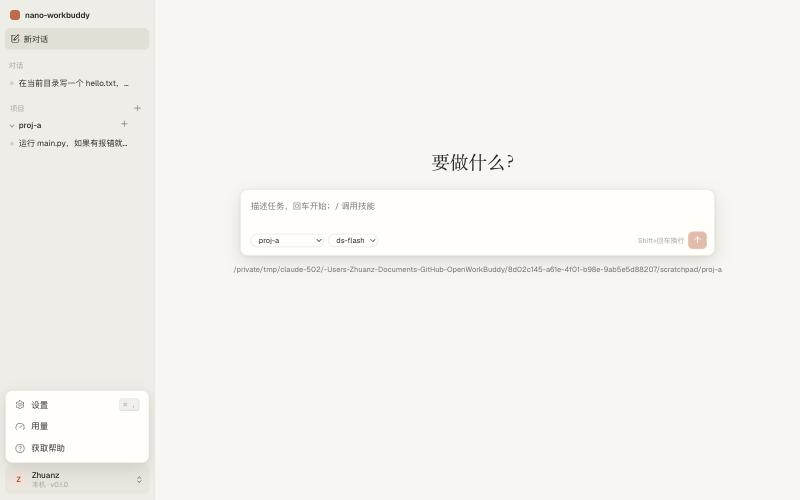
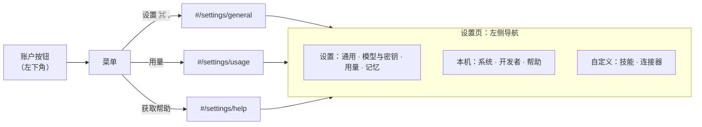
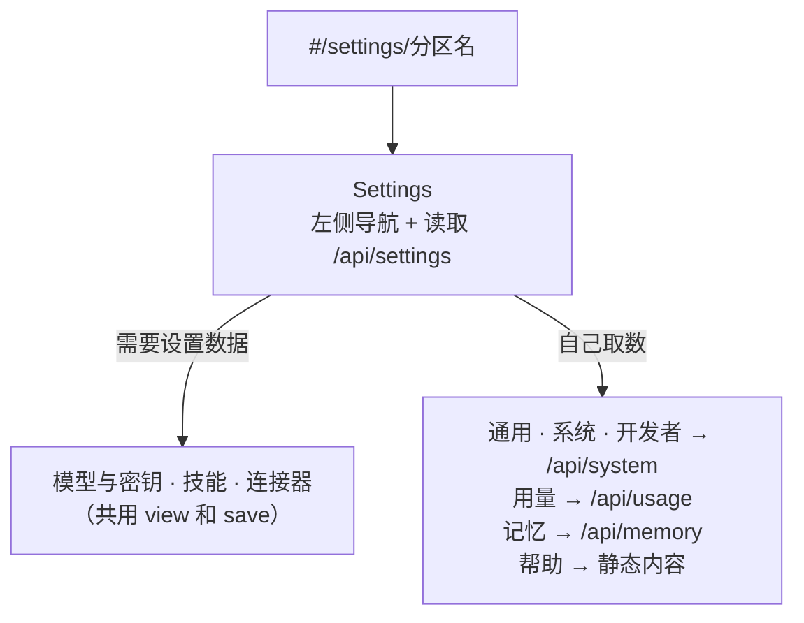
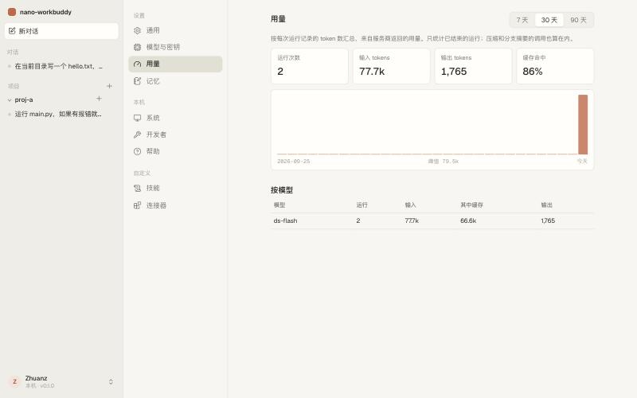
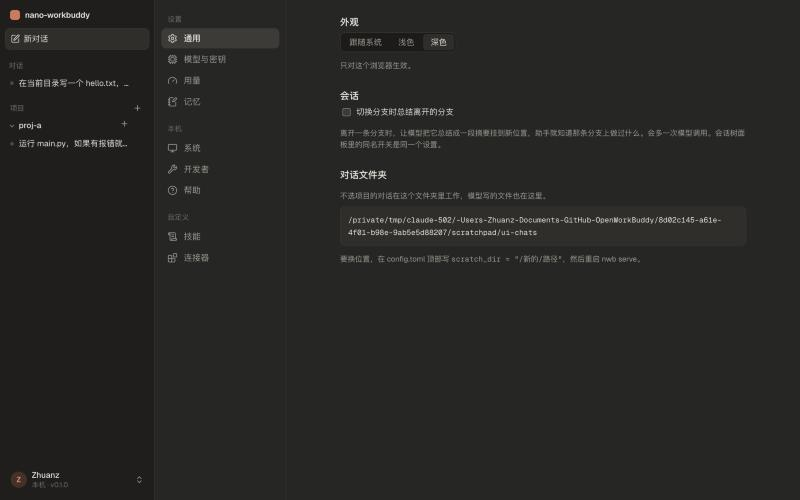

# 教程 11：账户菜单与设置页

> 新增 `web/src/System.tsx`（通用、用量、系统、开发者、帮助五个设置分区）。
> 改动 `web/src/Settings.tsx`（左侧分区导航，原来的连接与模型变成“模型与密钥”分区）、`Sidebar.tsx`（左下角账户按钮和菜单、图标换成 Lucide）、`App.tsx`（`#/settings/分区` 路由、⌘, 快捷键）、`api.ts`（主题偏好、新接口类型）、`style.css`（手动深色、设置页、账户菜单）、`main.tsx`；后端 `api.py`（`/api/usage`、`/api/system`、`/api/info` 多了用户名和版本）、`index.py`（`usage()`）、`sandbox.py`（`backend()`）。
> 新依赖 `lucide-react`（图标）。测试 147 个。
> 上一篇：[10-界面重做](10-界面重做.md)。

## 1. 要做什么

你给了两张 Claude 桌面端的截图：左下角点开账户后的菜单（设置、用量、语言、获取帮助），以及设置页左侧的分区导航。要求是照着做，删掉不适用的功能。



## 2. 哪些保留，哪些删掉

nano-workbuddy 是本机、单用户、不收费的工具，Claude 设置页里和账号、订阅、Anthropic 自家产品相关的分区都不适用：

| Claude 的分区 | 处理 | 原因 / 对应 |
|---|---|---|
| General 通用 | 保留 | 外观（跟随系统 / 浅色 / 深色）、切换分支时总结、对话文件夹位置 |
| Account 账户、Privacy 隐私、Billing 计费 | 删掉 | 没有云端账号，也不收费；账户按钮只显示本机用户名 |
| Usage 用量 | 保留 | 从运行记录里汇总 token 用量（新做的） |
| Capabilities 能力 | 并入“模型与密钥” | 我们的“能力”就是连接和模型 |
| Memory 记忆 | 保留 | 原来的 USER.md / AGENTS.md 编辑器 |
| Design systems、Claude Code、Cowork、Claude in Chrome | 删掉 | Anthropic 自家产品 |
| System 系统 | 保留 | 沙箱、ripgrep、选文件夹、数据目录、版本 |
| Extensions 扩展、Plugins 插件 | 删掉 | 没有这两种机制；能扩展的是技能和 MCP |
| Developer 开发者 | 保留 | 只读展示 config.toml 里的钩子和权限规则 |
| Skills 技能 | 保留 | 原有 |
| Connectors 连接器 | 保留 | 就是 MCP 服务器 |
| 菜单里的 Language 语言 | 删掉 | 界面目前只有中文，没有可切换的语言 |

另外加了一个“帮助”分区（快捷键、命令行、文档位置），对应菜单里的“获取帮助”。



## 3. 账户按钮

- 头像是本机用户名的首字母，下面一行是“本机 · v0.1.0”。用户名来自后端的 `getpass.getuser()`，就是运行 `nwb serve` 的那个系统账户。
- 菜单向上弹出，点别处关闭，做法和会话的 ⋯ 菜单一样（`window` 上挂一次性的 click 监听）。
- 设置的快捷键 ⌘ ,（Windows / Linux 上是 Ctrl ,）在 `App` 里监听 `keydown`，任何页面都能用。

## 4. 设置页的结构

地址从 `#/settings` 变成 `#/settings/分区名`，刷新和收藏都停在同一个分区。`Settings` 组件只负责导航和取数据，各分区是独立的组件：



原来的设置页是一长条，连接、模型、MCP、技能、记忆从上到下排着。拆成分区后，每一屏只放一件事，原有的增删改逻辑没有变化，只是挪了位置。

## 5. 用量



数据早就有了：每次运行结束时，`runs` 表的 `usage_json` 记下这次运行累计的 token 数（服务商返回的 `input`、`output`、`cache_read` 等）。新接口只是把它们加起来：

```python
@app.get("/api/usage")
async def usage(days: int = Query(30, ge=1, le=365)):
    for run in ws.index.usage(time.time() - days * 86400):
        day = time.strftime("%Y-%m-%d", time.localtime(run.pop("at")))
        for bucket in (per_day.setdefault(day, {}), per_model.setdefault(run.pop("model") or "?", {})):
            bucket["runs"] = bucket.get("runs", 0) + 1
            for k, v in run.items():
                if isinstance(v, int):
                    bucket[k] = bucket.get(k, 0) + v
```

- 按“数字字段都加起来”的方式汇总，而不是写死字段名：不同协议的适配器返回的字段不完全一样（例如 Anthropic 多一个 `cache_write`），新增字段不用改这里。
- 页面上四个数字：运行次数、输入、输出、缓存命中率（缓存读取 ÷ 输入）。下面是按天的柱状图，没有运行的日子补 0，柱子的高度按区间内的峰值缩放；再下面是按模型的表。
- 时间范围 7 / 30 / 90 天可切换。按天分组用服务器的本地时区。
- 只统计已结束的运行；压缩、分支摘要也会建运行记录，所以它们的用量也算在内。

## 6. 系统与开发者

`/api/system` 一次返回这两个分区要的东西：

| 字段 | 怎么得到 | 为什么有用 |
|---|---|---|
| `sandbox` | `sandbox.backend()`：macOS 看 `/usr/bin/sandbox-exec`，Linux 看 `bwrap` | 没有沙箱时，命令只能在“完全信任”档或逐条批准后运行，用户应该知道 |
| `ripgrep` | `shutil.which("rg")` | 没装时 grep 用 Python 实现，慢一些 |
| `folder_picker` | macOS，或装了 zenity | 添加项目时是弹对话框还是手动输入 |
| `home` / `config` / `scratch_dir` | 配置 | 出问题时知道去哪里找文件 |
| `hooks` / `rules` | 配置里的 `[[hooks.*]]`、`[[rules]]` | 以前只能打开 config.toml 看，现在在页面上能看到当前生效的是什么 |

钩子和规则目前**只读**：它们能执行任意命令、放开权限，放在页面上一键编辑风险太大。改法写在页面上：编辑 config.toml，重启服务。

## 7. 手动深色



上一篇的深色只跟随系统。这次在“通用”里加了三个选项，存在浏览器的 localStorage 里，通过 `<html data-theme="…">` 生效。CSS 里的写法：

```css
:root { /* 浅色令牌 */ color-scheme: light; }
@media (prefers-color-scheme: dark) {
  :root:not([data-theme="light"]) { /* 深色令牌 */ color-scheme: dark; }
}
:root[data-theme="dark"] { /* 同一套深色令牌 */ color-scheme: dark; }
```

三种状态都覆盖到了：没有 `data-theme` 时听系统的；设成 `light` 时，即使系统是深色，媒体查询里的规则也因为 `:not([data-theme="light"])` 不生效；设成 `dark` 时，最后一条直接生效。`color-scheme` 跟着切换，原生的复选框、滚动条也随之变色。

`theme.apply()` 在 `main.tsx` 里、React 渲染之前调用，所以刷新页面时不会先闪一下浅色。

## 8. 图标

侧栏的“新对话”、加号、⋯，设置导航和账户菜单都换成 Lucide 图标（`lucide-react`），统一 1.75 的线宽，风格和你截图里的线性图标一致。只打包用到的那十几个图标，构建产物增加不多。

## 9. 测试

`test_usage_and_system`：一个会话跑两次（第一次带一个工具调用，所以三次模型回复），`/api/usage` 按模型汇总为 2 次运行、输入 30、输出 15，按天只有今天一条；`/api/system` 返回配置路径、空的钩子列表和版本号；`/api/info` 带上用户名。

## 10. 已知限制

- 钩子和权限规则只能看不能改。
- 用量没有按会话、按项目的拆分，也没有费用估算（各家价格不同，且常变）。
- 外观设置只存在当前浏览器里。
