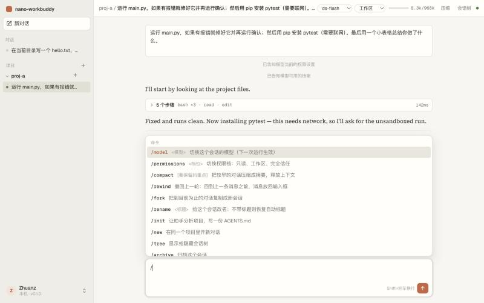
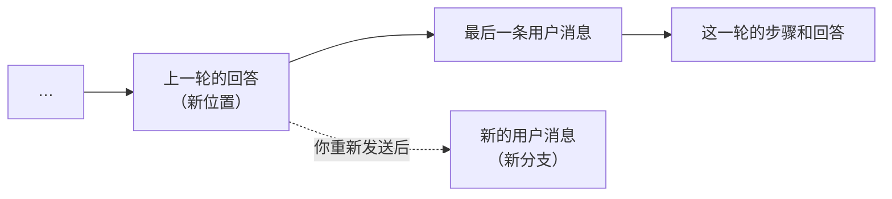
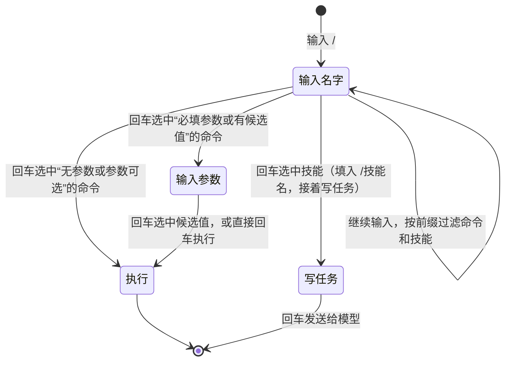
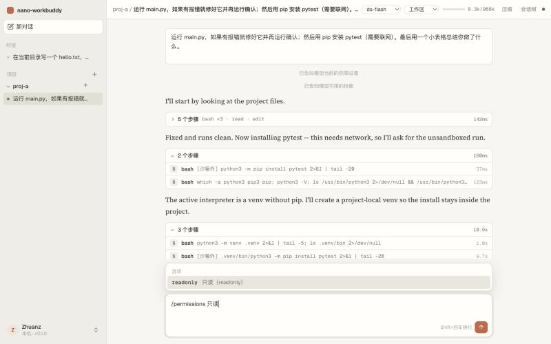

# 教程 12：斜杠命令

> 新增 `web/src/commands.ts`（命令定义）。
> 改动 `Composer.tsx`（命令与技能合在一个 `/` 菜单里，方向键选择、参数补全）、`App.tsx` / `Home.tsx`（把页面状态交给命令）、`System.tsx`（帮助页列出全部命令）、`style.css`。
> 只改了前端，后端和测试不变（147 个）。
> 上一篇：[11-账户菜单与设置页](11-账户菜单与设置页.md)。

## 1. 要做什么

输入框开头输入 `/`，以前只列出技能。现在也列出**命令**：它们作用在界面上（换模型、压缩、撤回……），不会作为文字发给模型。你给了 Claude Code 的命令列表作参考，说明不必照搬。



## 2. 选了哪些命令

原则：只做 nano-workbuddy 已经有对应功能的，命令只是更快的入口。

| 命令 | 作用 | 对应原来的哪个操作 |
|---|---|---|
| `/model <模型>` | 切换会话模型 | 顶栏的模型下拉框 |
| `/permissions <档位>` | 切换权限档 | 顶栏的权限下拉框 |
| `/compact [要保留的重点]` | 压缩上下文，可以附带要求 | 顶栏“压缩”按钮（按钮不能附带要求） |
| `/rewind` | 撤回上一轮，消息放回输入框 | 会话树里点上一个节点，再手动复制消息 |
| `/fork` | 把到目前为止的对话复制成新会话 | 消息上的“分叉” |
| `/rename <标题>` | 改名；不带标题恢复自动标题 | 侧栏 ⋯ → 重命名 |
| `/init` | 让助手分析项目，写 AGENTS.md | 没有，新增 |
| `/new` | 在同一项目开新对话 | 侧栏项目旁的 ＋ |
| `/tree` | 显示或隐藏会话树 | 顶栏“会话树” |
| `/stop` | 停止当前运行（只在运行中出现） | “停止”按钮 |
| `/archive` | 归档这个会话 | 侧栏 ⋯ → 归档 |
| `/skills` `/mcp` `/memory` `/usage` `/settings` `/help` | 打开对应设置页 | 账户菜单 → 设置 |

Claude Code 里没采用的：

| 命令 | 为什么不做 |
|---|---|
| btw（顺便问一句、不进上下文） | 运行中可以“插话”，不需要另一套机制 |
| ultrareview、plugin、feedback | 没有云端审查、插件和反馈渠道 |
| subtask | 子 agent 还没做 |
| effort、fast | 我们的模型配置里没有这两个开关 |
| plan、output-style | 没有计划模式和输出风格 |

## 3. 命令怎么定义

每条命令是一个对象，放在 `commands.ts` 的 `COMMANDS` 数组里：

```ts
export interface Command {
  name: string;
  args?: string;                         // "<...>" 必填，"[...]" 可选
  description: string;
  session?: boolean;                     // 需要打开着的会话
  idle?: boolean;                        // 运行中不能用
  options?: (ctx: Ctx) => Option[];      // 参数的候选值
  run: (ctx: Ctx, arg: string) => unknown;  // 返回字符串就放回输入框
}
```

命令需要的页面状态（会话 id、模型列表、会话树开关……）由调用方打包成 `Ctx` 传进来，所以命令本身是纯数据加函数，不依赖 React。新对话页传 `sid: null`，`available()` 就只留下不需要会话的那几条；运行中会过滤掉 `idle` 的命令，同时出现 `/stop`。

帮助页的命令表直接遍历同一个 `COMMANDS` 数组生成，加一条命令，菜单和帮助页同时更新。

### 3.1 /rewind 怎么实现

会话是一棵树（教程 01）。“撤回上一轮”就是把当前位置移到最后一条用户消息的父节点：



```ts
const last = [...pathTo(c.entries, c.leaf)].reverse().find((e) => e.type === "user" && !e.data.synthetic);
await api.checkout(c.sid!, last.parent_id, false, false);   // 不总结离开的分支
return textOf(last.data.content);                            // 放回输入框
```

- 什么都不删除：撤回的那一轮作为一条分支留在会话树里，随时能点回去。
- `checkout` 的第四个参数显式传 `false`：撤回不是“去别的分支工作”，不需要花一次模型调用去总结。
- 你修改输入框里的文字再发送，新消息就从父节点长出一条新分支。效果等同于“编辑上一条消息”，只是不用把鼠标移到那条消息上。

### 3.2 /init

`/init` 是唯一会发消息给模型的命令：它替你发一段预先写好的请求，让助手阅读项目后在根目录写（或补充）AGENTS.md。写入走正常的权限检查：工作区档下项目内写文件不需要确认，只读档会弹审批。写好的 AGENTS.md 从下一个会话起进入系统提示（教程 06）。

## 4. 菜单的交互



- ↑ ↓ 移动选中项，选中项自动滚进可见区；Tab 只补全不执行；Esc 清空关掉菜单。
- 候选值同时按值和中文标签过滤：`/permissions 只读` 能筛出 `readonly`。



- 不在菜单里也能执行：完整输入 `/compact 保留接口设计的讨论` 后回车，`/compact` 没有候选值，菜单不出现，回车直接执行。
- 判断顺序是：先找命令，找到就执行；否则整段文字原样发给后端，后端再看是不是 `/技能名`（教程 06）。所以命令和技能重名时**命令优先**，菜单里也只显示命令那一条。
- 命令执行出错（比如 `/model` 后面跟了不存在的模型）时，错误显示在顶部横幅里，和点按钮出错一样。

## 5. 实测

在浏览器里对真实会话逐条试过：

| 输入 | 结果 |
|---|---|
| `/` | 会话中显示全部可用命令和技能；新对话页只显示六条全局命令，后面跟技能 |
| `/per` 回车，再输入“只读”回车 | 进入参数补全，只剩 `readonly`，回车后顶栏权限档变成只读 |
| `/rename 修复 main.py` | 顶栏标题变成“proj-a / 修复 main.py” |
| `/rewind` | 对话回到第一条消息之前，那条消息回到输入框；会话树里原来的分支还在 |
| `/tree` | 会话树面板打开 |

## 6. 已知限制

- 命令只在网页里有；命令行（`nwb`）仍是原来的几个内置命令（`/compact`、`/branch` 等）。
- `/rewind` 每次只撤回一轮，要撤回多轮就多执行几次。
- 没有自定义命令（Claude Code 的 `.claude/commands/*.md`）；需要可复用的提示词时，写成技能即可，`/技能名` 用法相同。
