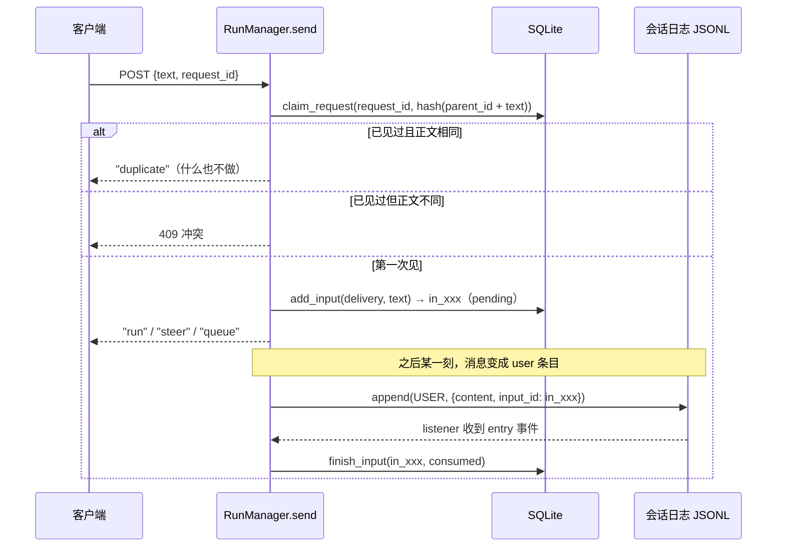
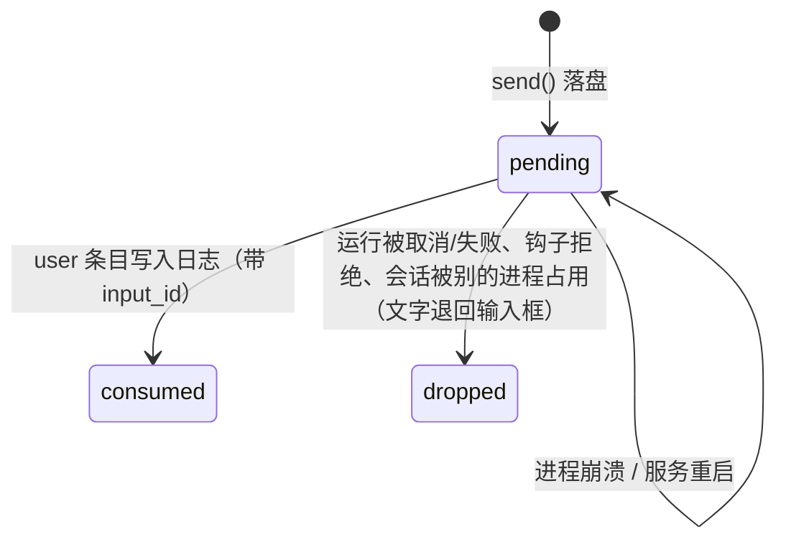
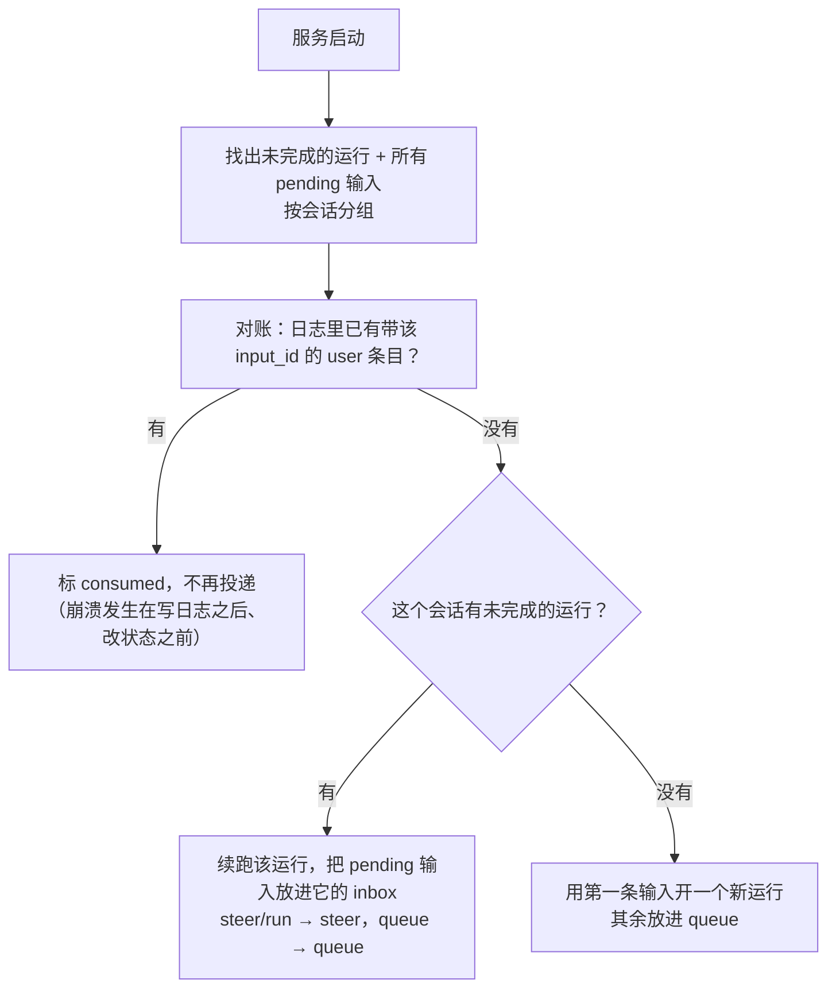
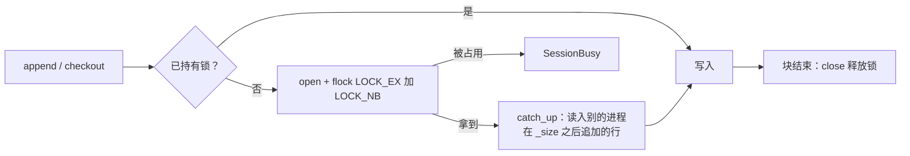
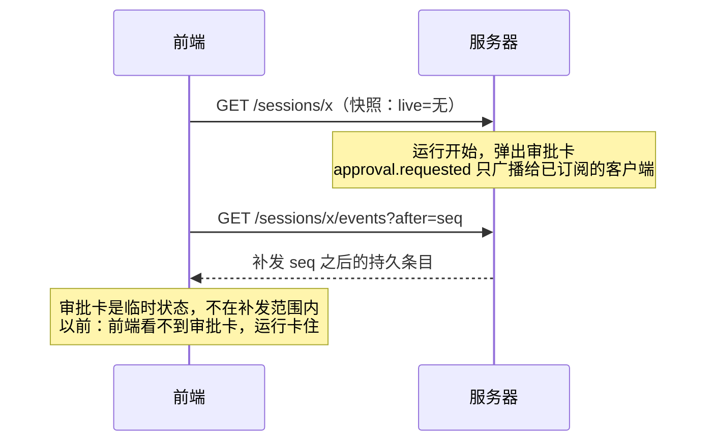

# 教程 13：可靠内核（M0）

> 依据：[GPT 审查与改进方案](../design/2026-10-24-personal-assistant-improvement-plan.md) 第 4 节列出的 F01–F14。
> 改动：`runs.py`、`runtime.py`、`log.py`、`index.py`、`loop.py`、`context.py`、`llm/openai_chat.py`、`tools/builtin.py`、`tools/search.py`、`tools/mcp.py`、`tools/registry.py`、`api.py`、`cli.py`、`web/src/session.ts`；新增 `.github/workflows/ci.yml`。
> 测试从 147 个增加到 166 个。
> 上一篇：[12-斜杠命令](12-斜杠命令.md)。

## 1. 这次做什么，不做什么

审查报告很长，分成两类内容：

| 类别 | 内容 | 处理 |
|---|---|---|
| 具体缺陷（第 4 节 F01–F14） | 每条都有代码位置，五条有复现探针 | **逐条对照源码核实，全部成立；本篇修复 F01–F13，以及 F14 中的 CI** |
| 能力规划（第 6–9 节 M1–M4） | 附件与产物、搜索取证、飞书、浏览器、调度、记忆检索、评测集 | **暂缓**。规模约 32–49 个开发日，每一步都要先定搜索服务、飞书账号、样本文档等，开始时再逐项确认 |

为什么先做 M0？报告的说法是“扩大办公写权限和启用无人值守前必须解决”。换个角度看：后面每项能力都会调用工具、在后台运行、在重启后续跑。如果地基还会丢消息、重复执行副作用、绕过权限，能力加得越多，出事的面就越大。

本次几处需要取舍的地方，按你的选择实施：

- 排队/插话消息持久化放在 **SQLite**（不按报告的方案在 JSONL 里写控制事件）；
- 模型流没有结束标记时，工具调用**一律不执行**；
- 会话日志加**独占写锁**；
- 增加 **GitHub Actions CI**。

## 2. 总览

| 编号 | 问题 | 改法 | 回归测试 |
|---|---|---|---|
| F01 | 同一 `request_id` 立刻重发，第二次被当成插话 | 新增 `requests` 表；收到消息时先**同步登记** request_id，相同正文返回 `duplicate`，不同正文返回 409 | `test_request_ids_are_claimed_before_the_run_starts` |
| F02 | 排队/插话消息只存在内存，进程一挂就丢 | 新增 `inputs` 表：先落盘再回复客户端；user 条目带 `input_id`；启动时对账并补投 | `test_queued_message_survives_a_restart`、`test_accepted_input_without_a_run_is_delivered_once` |
| F03 | 供应商复用 `call_0`，大输出第二次落盘报 `FileExistsError` | 文件名改为 `调用ID-内容hash`；内容相同的重复写入直接复用 | `test_spill_survives_reused_call_ids` |
| F04 | 没装 rg 时，Python 回退会跟随软链接读到受保护文件 | 遍历时不跟随软链接（与 rg 默认行为一致） | `test_search_does_not_follow_symlinks`（两种引擎都跑） |
| F05 | 流没收到 `finish_reason`，合法 JSON 的工具调用照样执行 | 无结束标记 → `stop="error"`；`next_step` 只对 `tool_use`/`end` 执行工具 | `test_stream_without_finish_reason_is_an_error` 和 `next_step` 新用例 |
| F06 | MCP 的 `readOnlyHint` 被当成“可安全重放” | MCP 工具的 `effect` 一律为 `exec`，hint 只用于并行 | `test_read_only_hint_never_makes_a_call_replayable` |
| F07 | SSE 的快照和订阅之间有空档，审批卡可能丢 | 订阅开始时在**同一条流里**先发一个 `live` 事件 | `test_subscription_starts_with_the_live_state` |
| F08 | 每个 SSE 订阅的队列没有上限 | 有界队列；落后太多的客户端被断开，靠快照重连 | `test_a_subscriber_that_falls_behind_is_cut_off` |
| F09 | `write`/`edit` 原地覆盖，非原子 | 同目录临时文件 + `fsync` + `os.replace`，保留权限位；新鲜度检查改用纳秒 mtime + 大小 | `test_writes_are_atomic_and_keep_permissions`、`test_same_second_change_is_noticed` |
| F10 | MCP 结构化结果有文本时被丢掉；截断后的工具名可能重名 | `structuredContent` 存进 `meta`；超长名字截断后加 hash；清洗后重名的加后缀 | `test_structured_content_is_kept`、`test_long_and_clashing_names_stay_distinct` |
| F11 | `last_tools` 是进程级的“最近一次工具表”，各会话之间会串用 | 改为按会话保存的 `session_tools` | `test_tools_are_tracked_per_session` |
| F12 | 两个进程可以同时写同一个日志 | `flock` 独占写锁；拿锁时先读入别人追加的行 | `test_one_writer_at_a_time_and_catch_up`、`test_session_written_by_another_process_is_refused` |
| F13 | bash 非零退出码只写在文本里 | `meta.exit_code`（超时为 `timed_out`），对模型的文本不变 | `test_bash_reports_exit_code_and_scrubs_env` |
| F14 | 没有 CI | `.github/workflows/ci.yml` | — |

## 3. 一条消息的一生（F01、F02）

### 3.1 以前的问题

```
客户端 ──POST {text, request_id}──▶ RunManager.send
                                     │
             没有运行 ───────────────┼──▶ _start(task)          ← request_id 要等 task 里的 start_run 才登记
             正在运行 ───────────────┴──▶ inbox.queue.append()  ← 只在内存里
                                     │
客户端 ◀───────── "run"/"queue" ─────┘                          ← 已经回复“收到”，但消息没落盘
```

两个后果：

1. **F01**：第一次发送走 `_start`，request_id 要等任务真正运行、调用 `index.start_run` 时才写进数据库。网络层立刻重试时，第二次看到“正在运行”，就把同一句话当成插话又塞了一遍。
2. **F02**：排队和插话的消息只在 `Inbox` 列表里。客户端已经收到 `"queue"`，以为消息送达了；这时服务重启，消息就没了。

### 3.2 现在：先登记，再落盘，最后回复



两条关键原则：

- **登记是同步的。** `claim_request` 是一条 `insert or ignore`，在 `send` 返回之前就完成了。重试来得再快，也只能看到 `duplicate`。这里用的是“request_id + 正文 hash”：同 id 同正文是重试；同 id 不同正文说明客户端有 bug，必须报错，不能猜。
- **“已消费”以日志为准。** 消息什么时候算送达？不是放进 inbox 时，而是 user 条目写进 JSONL 时。所以 user 条目带上 `input_id`，`RunManager._on_log` 监听日志事件，看到 user 条目就把对应输入标成 `consumed`。数据库跟着日志走，而不是反过来。

### 3.3 输入的状态



`dropped` 一定配合把原文退回前端输入框（`inbox` 事件里的 `dropped`），用户能看到，不会无声丢失。

### 3.4 重启时怎么补投

`RunManager.resume_all()` 在服务启动时运行：



对账这一步对应报告里的那句话：“接收记录先写入，再更新索引；重启通过 accepted/consumed 对账”。只是这里的“accepted”放在 SQLite，“consumed”的证据是 JSONL 里的 `input_id`。两边各自都是原子写入；它们之间崩溃会出现哪几种状态、每种怎么补齐，就是上面这张图。

> **为什么不写进 JSONL？** 报告建议在日志里写 accepted/consumed 控制事件。那样更彻底，但 `next_step`、回放、分支、fork 都要学会跳过这些事件。本项目 runs 和 approvals 本来就由 SQLite 管理，inputs 放在同一处最小、最好理解。

### 3.5 Inbox 里的元素变成了 `Input`

```python
@dataclass(frozen=True, slots=True)
class Input:
    text: str
    id: str | None = None   # inputs 表里的行；CLI 不持久化时为 None
```

`_take_steer` 写 user 条目时用 `user_data(m)`，带上 `input_id`。发给前端的仍然是字符串列表（`Inbox.view()`），前端不用改。

## 4. 只有正常结束的回复才能产生副作用（F05）

模型流可能因为断网、代理 bug 或服务端异常提前结束。以前 `assemble()` 把 `stop` 默认设成 `"end"`，再因为有工具调用改成 `"tool_use"`。于是一个**被截断的流**，只要 JSON 恰好完整，就会执行 `write`。

现在 `stop` 初始为 `None`，只有收到 `finish_reason` 才赋值；结束时仍是 `None`，就是 `"error"`。`next_step` 按完成类型分流：

| 回复的 `stop` | 有未应答的工具调用时 |
|---|---|
| `tool_use` / `end` | `RunTools`：执行 |
| `length` | `FailCalls(TRUNCATED)`：参数可能不全 |
| `error` / `aborted` / 其它 | `FailCalls(INCOMPLETE)`：回复没有正常结束，不执行 |

原则是白名单：**只有明确的正常结束才放行**，未知状态一律不执行。模型收到 `INCOMPLETE` 的错误结果，下一轮会自己重新发起；最多多花一轮，但不会产生意外的副作用。`content_filter`（映射为 `error`）也走这条路。

## 5. 重放：谁说了算（F06、F10）

崩溃恢复时，`_recover()` 会看一个已经 `tool_started`、但没有结果的调用：

```
effect == "read"   → 直接重跑（读操作重复执行无害）
有 recover 函数     → 让工具自己判断：done / not_done / unknown
都没有             → 报“结果未知”，绝不自动重放（比如 bash）
```

以前 MCP 工具只要声明了 `readOnlyHint`，就被设成 `effect="read"`，崩溃后会被自动重跑。但 hint 只是**第三方服务器自己的说法**：一个标错了的“发送邮件”工具，重启后就会再发一次。

现在 MCP 工具的 `effect` 一律是 `exec`，`readOnlyHint` 只决定能不能和别的工具**并行**（错了最多是并发问题，不会重复副作用）：

```python
read_only = bool(t.annotations and t.annotations.read_only_hint)
return Tool(name, ..., "exec", read_only, None, ...)   # effect, parallel, recover
```

同一处顺手修了 F10：

- `structuredContent` 总是存进 `Result.meta["structured"]`（日志里完整保留，不发给模型）；只有没有文本块时，才把它序列化成文本给模型看。
- 函数名最长 64 字符。以前直接截断，两个前 64 个字符相同的长名字会撞车；现在超长时变成 `前55个字符_8位hash`。清洗后重名的（`a.b` 和 `a_b` 都变成 `a_b`），第二个加上 hash 后缀。短名字保持原样，旧会话里 `tool_search` 加载过的工具名不受影响。
- `Registry` 遇到重名不再静默覆盖，而是记一条警告，保留第一个。

## 6. 文件操作的三个边界（F03、F04、F09）

### 6.1 spill 文件名（F03）

```
以前：spill/<session>/call_0.txt          ← 第二个 call_0 撞上 O_EXCL → FileExistsError，整个运行报错
现在：spill/<session>/call_0-3f2a9c1b7d4e.txt
                      └ 调用 ID ┘└ 内容 sha256 前 12 位 ┘
```

用内容 hash 还有一个好处：崩溃恢复时同一个结果再写一次，文件名相同、内容相同，`write_private` 直接复用。内容不同或者是软链接，仍然报错。

### 6.2 搜索不跟随软链接（F04）

```
project/
├── real.txt
├── ordinary.txt  ──symlink──▶  ~/.ssh/id_rsa      ← 名字普普通通
└── linked/       ──symlink──▶  ~/secrets/

grep pattern=... path=.
  权限检查只看到：read  /path/to/project          → allow
  Python 回退以前：打开 ordinary.txt → 实际读到 ~/.ssh/id_rsa   ✗
```

权限闸门检查的是“搜索这个目录”，而目录里的软链接可以指向任何地方。修法是遍历时**跳过软链接**，与 ripgrep 不加 `--follow` 时的行为一致。两个引擎现在给出相同结果。显式给出的路径仍然先 `resolve()`，所以直接 `grep path=ordinary.txt` 会按真实目标 `~/.ssh/id_rsa` 做权限检查，被拒绝。

> 顺带一提：报告附录的探针在修复后仍然打印 `found_synthetic_secret: true`。原因是它检查的是 `'SYNTHETIC_MARKER' in 结果`，而“No matches for SYNTHETIC_MARKER under …”这句提示本身就包含搜索词。改成检查完整的秘密值后，结果是 `false`。测试里用的是精确断言（`== ["real.txt"]`），不会有这个误报。

### 6.3 原子写（F09）

```python
def atomic_write(p, content):
    mode = 旧文件的权限位 或 0o666 & ~umask
    fd, tmp = mkstemp(dir=p.parent)      # 同目录：rename 才是原子的
    写入 → flush → fsync
    chmod(tmp, mode)
    os.replace(tmp, p)                   # 读者只会看到旧文件或新文件
    出错 → 删除 tmp，旧文件原封不动
```

`umask` 在导入时读一次。设置 umask 是进程级操作，不能在工具运行中途读写。

“读过才能改”的新鲜度检查以前只比较 `st_mtime`（浮点秒）。同一时刻的两次修改可能骗过它；现在比较 `(st_mtime_ns, st_size)`。

报告里的“跨会话资源锁”这次没做：本项目是单用户，同一个文件被两个会话同时改的情况很少；有了原子写和新鲜度检查，最坏情况是后写的那一方收到“文件已变化，请重新读取”。

## 7. 一个会话同一时刻只有一个写者（F12）

### 7.1 为什么需要

`nwb serve` 和 `nwb`（CLI）可以同时打开同一个会话。以前两个进程各自在内存里有一棵树，各自往文件末尾追加，会出现：

```
时间 →
服务器：  读入 (…, u1)                append a1(parent=u1)
CLI：           读入 (…, u1)  append u2(parent=u1)
文件：    …, u1, u2, a1          ← a1 本该接在 u2 后面；两条分支交错，内存里的树和文件不一致
```

另外还有一个更隐蔽的问题：CLI 正在运行时，服务器启动，`resume_all` 看到 SQLite 里的 `running`，把这个**正在别处执行**的运行又续跑一遍。

### 7.2 怎么做



- `SessionLog.writing()` 是可重入的上下文管理器。一次运行（`submit` / `resume` / `compact` / `switch_branch`）**从头到尾持有锁**；零散的写入（比如单独一次 checkout）各自短暂拿锁、写完释放。
- **拿锁时先追平。** 对象记着自己已应用到文件的第几个字节（`_size`）。拿到锁后如果文件变长了，就把新增的行读进内存树，并通知 listener（Web 客户端也能看到 CLI 写的条目）。然后才计算新条目的 `parent_id`。所以 `append` 必须先拿锁，再选父节点。
- **读不需要锁。** 打开、列表、重建索引都照常进行。
- **进程崩溃自动释放。** flock 绑定在文件描述符上，进程退出时由操作系统释放，不会留下“永远被锁”的会话。这正是不用锁文件（`.lock`）的原因。

### 7.3 被占用时的表现

| 场景 | 行为 |
|---|---|
| Web 发消息，但 CLI 正在写这个会话 | 运行不启动；`run.error` 提示“正被另一个进程写入”，文字退回输入框，输入标为 `dropped` |
| Web 切分支 | HTTP 409 |
| 服务器启动时续跑，但 CLI 持有锁 | 跳过（返回 `busy`），未完成的运行和 pending 输入保持原状，下次启动再处理 |
| CLI 命令（`/checkout` 等） | 打印错误信息，继续交互 |

> flock 是“每个打开的文件描述”一把锁，同一进程里打开两次也会互斥。测试正是利用这一点，在单进程里模拟“另一个进程”。

## 8. SSE：快照与订阅之间的空档（F07、F08）

### 8.1 空档在哪里

前端连接会话的流程是：先 `GET` 快照，再用 `after=seq` 订阅事件流。



持久条目（entry/checkout）有 seq，可以补发；审批、问题、流式文字、inbox 这些**临时状态**没有 seq。以前的修法是“快照里带 live”，但快照和订阅是两个请求，中间仍有空档。

### 8.2 现在：在同一条流里先发当前状态

```python
q = runs.hub(log).subscribe()          # 先订阅
backlog = 补发条目; live = runs.live_view(sid)   # 再读状态，中间没有 await
yield 补发条目...
yield {"type": "live", "live": live}  # 当前运行的完整临时状态
yield {"type": "leaf", ...}
yield 后续事件...
```

订阅和读取状态之间没有 `await`，所以不会有事件落在两者之间：此前发生的已经体现在 `live` 里，此后发生的会进入队列。前端 reducer 遇到 `live` 事件就用它替换快照里的 live。

### 8.3 有界队列

```
publish(event)
  ├─ 正常：每个订阅者的队列 put_nowait
  └─ 某个订阅者满了（5000 条，网页卡住或网络很慢）：
       把它移出订阅集合，清空它的队列，放入一个 None
       → 事件流在 None 处结束
       → 浏览器 EventSource 触发 onerror
       → 前端照旧：拉新快照、重新订阅（本来就这样处理所有断线）
```

慢客户端只会影响它自己，内存有上限，事件也不会被悄悄跳过：要么完整收到，要么断开后从快照重来。思路来自 OpenCode 的 `event-feed.ts`。

## 9. 两处小修（F11、F13）

**F11：按会话记录工具表。** `context_usage()`（上下文用量条）和手动压缩以前用 `Workspace.last_tools`，也就是整个进程最近一次运行的工具表。项目 A 加载了技能和 MCP 之后，项目 B 的用量估算也会跟着变。现在 `_drive` 把本次运行的工具表存进 `session_tools[会话ID]`，读取时用 `tools_of(log)`。这个会话在服务启动后还没跑过时，就用内置工具表。

**F13：结构化的退出码。** `grep` 没找到、测试失败，都是非零退出，但调用本身成功了，模型需要看到输出。所以结果仍然是 `ok`，对模型的文本不变（末尾还是 `[exit code 3]`），另外在 `meta` 里存 `{"exit_code": 3}`；超时则是 `{"exit_code": None, "timed_out": True}`。以后做界面展示、指标统计和工作流判断时直接读这个字段，不用解析字符串。

## 10. CI

`.github/workflows/ci.yml` 有两个任务：

| 任务 | 运行环境 | 步骤 |
|---|---|---|
| python | macos-latest | `uv sync --locked` → `ruff check` → `pytest`（先 `brew install ripgrep`，让 grep 两种引擎都测到） |
| web | ubuntu-latest | `npm ci` → `npm run build`（包含 `tsc --noEmit`） |

Python 测试放在 macOS 上跑，因为 Seatbelt 沙箱测试只在 macOS 上真实执行（其他平台会跳过），这也是开发平台。注意：私有仓库的 macOS runner 分钟数按 10 倍计费。

目前仓库**还没有配置 git remote**，工作流要等推到 GitHub 后才会运行。本地已按相同命令跑通。

## 11. 验证

```
uv run ruff check src tests     → All checks passed!
uv run pytest -q                → 166 passed
cd web && npm run build         → ✓ built
```

报告附录的五个探针（改成适配新数据结构后）在新代码上的结果：

```json
{"probe":"initial_request_retry","first":"run","second":"duplicate","steer":[]}
{"probe":"queue_persistence","in_memory":["queued-durable-marker"],"durable":["queued-durable-marker"]}
{"probe":"reused_call_id_spill","second_spill":"no_error"}
{"probe":"grep_fallback_symlink","found_synthetic_secret":false}
{"probe":"stream_without_terminal","stop":"error","next_step":"FailCalls"}
```

## 12. 没做的，以及下一步

| 项目 | 状态 |
|---|---|
| 跨会话的文件资源锁（F09 后半） | 未做：单用户场景收益小，原子写 + 新鲜度检查已兜住最坏情况 |
| 历史分页 / 惰性加载、前端 E2E（F14 其余部分） | 未做：等会话真正变长、界面稳定后再做 |
| 统一的 ToolInvocation 表、replay_policy 三档、失败分类（报告 7.1） | 未做：F06 已解决眼前的风险；等飞书、浏览器这类真正有外部副作用的连接器出现时，再按需引入 |
| M1 文件与调研 | 下一阶段。开始前需要你定：常用的 5–10 份样本文档和交付格式、是否接受额外的 OCR/渲染依赖、搜索服务及费用上限 |
