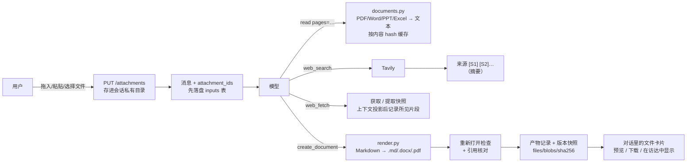
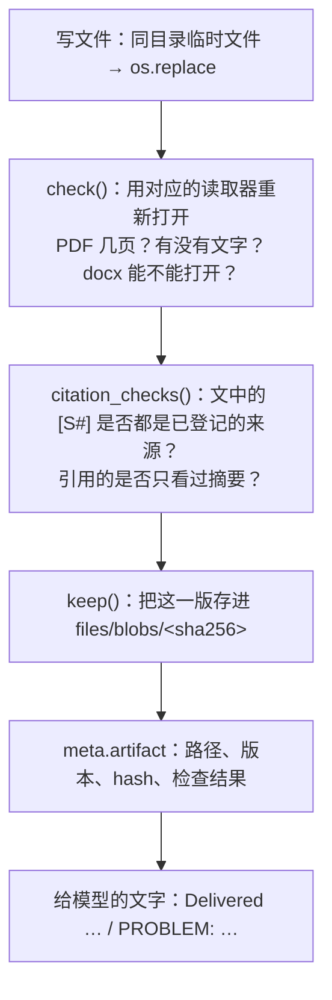
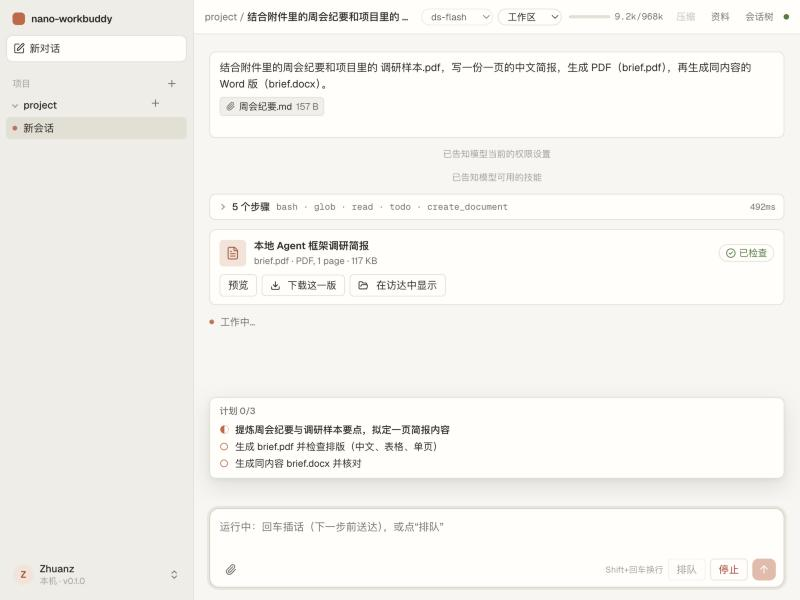
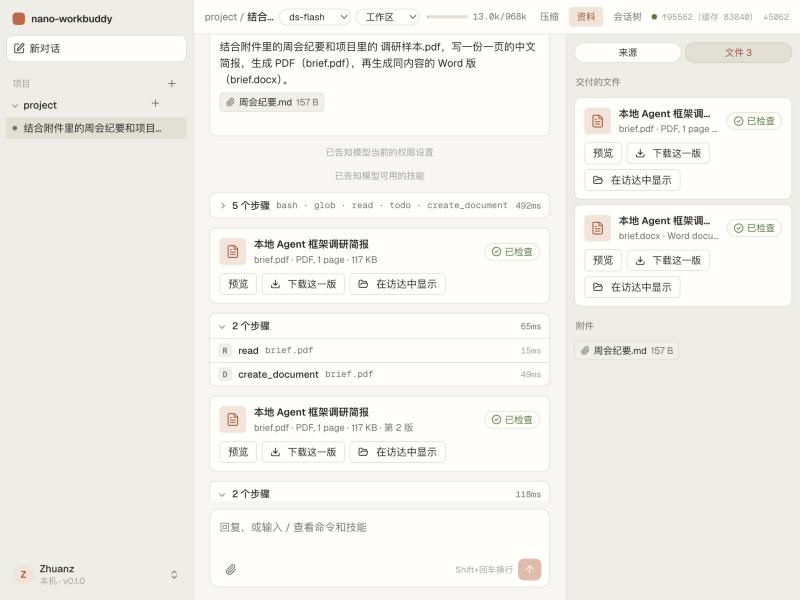
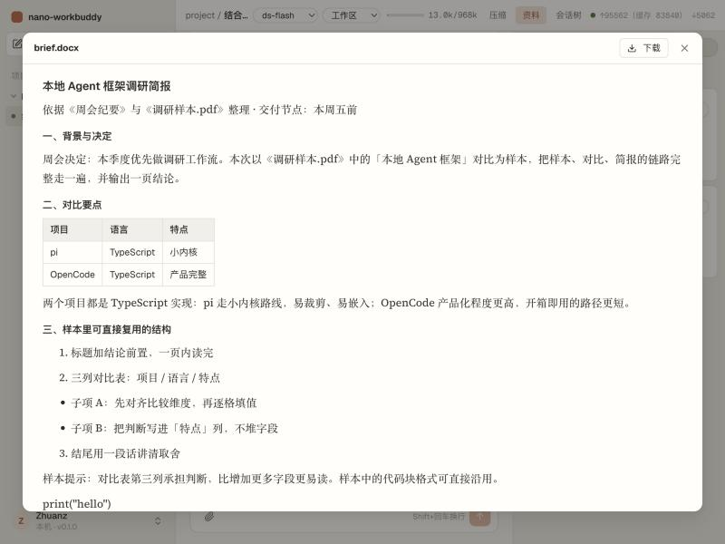

# 教程 14：文件与调研（M1）

> 依据：[审查报告](../design/2026-10-24-personal-assistant-improvement-plan.md) 第 7.2、7.3 节和第 9 节的 M1。
> 新增：`documents.py`（读文档）、`render.py`（Markdown → Word/PDF）、`artifacts.py`（产物、来源、附件）、`search.py`（搜索后端）、`tools/docs.py`（`create_document` / `present`）、前端 `Files.tsx`。
> 改动：`read` 能读 PDF/Word/PPT/Excel，新增 `web_search`，`web_fetch` 登记来源；消息可以带附件；模型配置加 `vision`，配置文件加 `[search]`；设置页加“联网搜索”。
> 新依赖（都是纯 Python）：pypdf、python-docx、python-pptx、openpyxl、reportlab、markdown-it-py。
> 测试从 166 个增加到 185 个，并用真实模型（DeepSeek v4.1 flash）做了端到端冒烟测试。
> 上一篇：[13-可靠内核](13-可靠内核.md)。

## 1. 要做什么

M0 把地基修好了，M1 补上个人助手最缺的一环：**文件进得来，资料查得到，结果交得出去**。

| 你的选择 | 落实方式 |
|---|---|
| 搜索服务：Tavily | 先抽象出一个 `SearchProvider` 接口，这次只实现 Tavily；没配密钥时，模型根本看不到 `web_search` 这个工具 |
| 依赖：轻量纯 Python | pypdf / python-docx / python-pptx / openpyxl；不做 OCR。扫描页明确告诉模型“这一页没有文字层”，不假装读到了 |
| 常用文档：PDF、Word、PPT/截图 | 这三类重点打磨：PDF 按页、PPT 按张、Word 保留标题层级和表格；截图要视觉模型才能看，所以加了 `vision` 开关 |
| 交付格式：Markdown、DOCX、PDF | 模型写 Markdown，`render.py` 负责排版。PDF 用 reportlab，嵌入 macOS 自带的华文黑体，不需要装 LibreOffice |

整体数据流：



## 2. 一个原则：记录放在工具结果的 meta 里

M1 引入了三种新记录：**附件**、**来源**、**产物**。它们存在哪？

M0 的经验是“日志是权威，索引跟着日志走”。所以这次没有给来源和产物各建一张表，而是放进工具结果的 `meta`：

```json
{"type": "tool_result", "data": {"name": "web_search", "content": [...],
  "meta": {"sources": [{"n": 1, "url": "https://pi.dev/docs", "kind": "search", "title": "Pi agent",
                        "snippet": "...", "published": "2026-09-01", "retrieved_at": "2026-10-24T06:00:00Z"}]}}}

{"type": "tool_result", "data": {"name": "create_document", "content": [...],
  "meta": {"artifact": {"path": ".../brief.pdf", "version": 2, "sha256": "…", "checks": [...], "kept": true}}}}

{"type": "user", "data": {"content": [...], "attachments": [{"id": "3f2a…", "name": "周会纪要.md", ...}]}}
```

好处：

- **不会不一致。** 日志写进去就有，没写进去就没有，不存在“表里有、日志里没有”的中间状态。
- **前端自己能算出来。** 前端本来就拿到全部条目，`sourcesOf()`、`artifactsOf()`、`uploadsOf()` 三个函数就能得到来源列表、文件列表和附件列表，不需要新的列表接口。
- **重启后能重建。** 每个进程第一次用到某个会话时，`artifacts.session_records(log)` 扫一遍日志，恢复来源编号和各文件的版本历史。

`meta` 只存在日志里，不发给模型（`Result.meta` 从第一天起就是这个约定）。

## 3. 读文档（documents.py + read）

### 3.1 统一成“带位置标记的 Markdown 文本”

| 格式 | 读法 | 单位与标记 |
|---|---|---|
| PDF | pypdf 逐页 `extract_text()` | `--- page 3 ---` |
| Word | python-docx，按文档顺序遍历段落和表格；标题样式变成 `#`，列表变成 `-`，表格变成 Markdown 表格 | 整篇一个单位（Word 没有稳定的页码） |
| PowerPoint | 每张幻灯片：标题 → `##`，文本框 → 按级别缩进的列表，表格，演讲者备注 | `--- slide 2 ---` |
| Excel | openpyxl 读两遍：一遍读公式，一遍读缓存值 | `--- sheet 1: 预算 ---`，每行带行号 |

为什么要有位置标记？报告 7.2 要求“数字、日期、比较性结论能回到证据”。模型看到 `--- page 7 ---`，引用时就能写“见第 7 页”，用户也能核对。

### 3.2 读不到的东西要说出来

```
paper.pdf: PDF, 12 pages
Note: no text layer on page(s) 3, 4: probably scanned images; their text cannot be read
```

```
budget.xlsx: Excel, 1 sheet
Note: 1 formula cell(s) have no saved result (the file was never recalculated); their values are unknown
3: 合计 | =SUM(B2:B2) (not calculated)
```

两个典型的坑：

- **扫描件**没有文字层，`extract_text()` 返回空字符串。不说明的话，模型会以为“这一页是空的”。
- **openpyxl 不算公式。** 用 openpyxl 写出来的文件，公式单元格没有缓存值。报告特别提醒：不能把转换出的结果当成计算结果的真值。

### 3.3 read 的新参数 pages

```python
read(path="paper.pdf", pages="3-5")   # 只读第 3–5 页
```

先按页（或张、表）切，再按行分页（`offset`/`limit`），两层可以组合。长论文先读目录页，再按需跳到某几页，比整份塞进上下文便宜得多。

### 3.4 按内容 hash 缓存

```
~/.nwb/files/cache/docs/<sha256 of file bytes>.json
```

同一份文件（无论放在哪个路径、哪个会话里）只解析一次。缓存带版本号 `v`：读取器升级后改版本号，旧缓存自动作废。

## 4. 生成文档（render.py）

### 4.1 为什么让模型写 Markdown

模型很擅长写 Markdown，但直接写 docx 的 XML 或 reportlab 代码，既容易出错又浪费 token。所以分工是：**模型负责内容（Markdown），程序负责排版。**

```
Markdown ──markdown-it-py──▶ tokens ──parse()──▶ [Block] ──┬─ to_docx() ──▶ .docx
                                                           └─ to_pdf()  ──▶ .pdf
Block: heading / para / item / quote / code / table / hr
Run:   text + bold / italic / code / href
```

中间这层 `Block` 很薄，两个写入器共用同一份解析结果，所以 Word 版和 PDF 版的内容一定一致。

### 4.2 中文的几个细节

- **软换行。** Markdown 里的单个换行等于空格，但中文之间不该出现空格。`_runs()` 先放一个占位符，最后看两边的字符：只要有一边是中日韩字符就去掉，否则换成空格。
- **PDF 字体。** reportlab 只能嵌入 TrueType 轮廓的字体（冬青黑体、Noto CJK 的 OTF 版本是 PostScript 轮廓，用不了）。所以按顺序尝试：华文黑体（macOS）→ Arial Unicode → 文泉驿（Linux）→ 微软雅黑（Windows）。都找不到时退回 PDF 标准的 `STSong-Light`：不嵌入字体，由阅读器提供。
- **PDF 换行。** 段落样式用 `wordWrap="CJK"`，中文可以在任意两字之间断行。
- **Word 有序列表。** 序号直接写成文字。Word 自带的编号会跨列表接着往下数，两个列表都想从 1 开始时就会出错。
- **Word 表格边框。** 除了套用 “Table Grid” 样式，还显式写了单元格边框。macOS 的快速查看和 Pages 不认这个样式自带的边框。

## 5. 交付（create_document / export_document / present）

### 5.1 三个工具

| 工具 | 用途 | 权限 |
|---|---|---|
| `create_document(path, content, title, overwrite)` | 把 Markdown 排成 .md / .docx / .pdf 并交付 | 按 `write` 检查（项目内不问，项目外问） |
| `export_document(source, path, title, overwrite)` | 将本会话已生成的 Markdown 转成 Word/PDF，不重新生成正文 | 目标按 `write` 检查，源文件另行检查 `read` |
| `present(path, title)` | 交付一个用别的办法（脚本、bash）做好的文件 | 按 `read` 检查（只读取，存一份副本） |

同一报告需要两种格式时，先 `create_document(path="brief.md", content=...)`，再
`export_document(source="brief.md", path="brief.docx")`；两个调用可以放在同一批次，按顺序执行。
转换不请求模型、不追加第二遍文献表，保留原文生成时的来源快照和引用检查，并记录源文件 hash/版本。
这不表示引用事实已通过人工验收；后来读取网页也不会追认旧报告的引用状态。
源文件必须仍与本会话已交付的 Markdown 版本一致，且有读取权限；重启后仍可导出。
用户修改后的源文件或目标文件会被拒绝，不能用导出覆盖用户工作。

交付后运行出错、触及预算或被取消时，会话持久显示原状态与本轮交付记录。点击“检查已交付版本”
会核验保留副本的 hash 并提供下载，不调用模型、不重写正文，也不覆盖用户修改后的项目文件。
副本缺失、损坏或不可读会明确提示，下载不可用副本返回 HTTP 410；本地检查不把任务状态改为成功。
相同请求 ID 重试仍返回原状态，显式提交新的补做或修改要求才会启动新任务。

三个工具最后都走 `_deliver()`：



**保存成功和文件可用是两回事。** 每次交付后都用读取器重新打开一遍。打不开、没有文字、引用了不存在的来源，都会以 `PROBLEM:` 的形式告诉模型，系统提示要求模型把问题转告用户，或者修好重交。界面上的卡片也会显示“N 个问题”。

### 5.2 覆盖保护

```
create_document(path="brief.docx", overwrite=False)  文件已存在 → 报错：换个名字，或设 overwrite
create_document(path="brief.docx", overwrite=True)
   ├─ 这个路径在本会话里没交付过   → 拒绝：可能是用户自己的文件
   ├─ 交付过，但现在的 hash ≠ 最后一版 → 拒绝：用户改过了，别覆盖他的修改
   └─ 交付过且没被改过            → 允许，记为第 2 版
```

这是系统提示里那句“不要覆盖不是你创建的东西”的代码版本。冒烟测试里，模型自己回读 PDF 后重新生成了一次，界面上的卡片显示“第 2 版”。

### 5.3 版本快照

每一版的字节都按 hash 存在 `~/.nwb/files/blobs/` 里。文件后来被改了、删了，或者服务重启了，卡片上的“下载这一版”仍然能拿到当时交付的那一版。这正是报告第 5.3 节指出的、DeepSeek Harness 的短板（重启后历史卡片打不开）。

下载接口只放行**这个会话日志里出现过的 hash**（`artifacts.files_of(log)`），不能拿任意 hash 去读存储。“在访达中显示”同理，只接受本会话交付过的路径。



## 6. 调研：搜索与来源编号

### 6.1 web_search

```python
class SearchProvider(Protocol):
    name: str
    async def search(self, query, max_results, recency, topic) -> list[Hit]: ...

@dataclass
class Hit:
    title: str; url: str; snippet: str
    published: str | None   # 只有服务商知道时才有
```

一个细节：**没有发布日期时就写“发布日期未知”，绝不拿抓取时间顶替。** 报告 7.2 第 2 条专门强调过这一点。

权限：工作区档里 `web_search` 不需要确认（逐次确认太打扰）；只读档仍然要问。读网页（`web_fetch`）还是按站点确认。搜索词会发给 Tavily，设置页上写明了这一点。

### 6.2 来源编号与版本（R-C 修订）

来源状态分为 discovered（搜索发现）、fetched（已获取）、extracted（已提取）、inspected（具体片段进入请求上下文）。下载文件只到 fetched；提取成功也不代表模型已经读过，更不代表结论正确。

首次搜索发现可升级为首次获取版本，编号不变；同一 URI 的内容 hash 改变则产生新编号，旧记录保留。编号跨分支、重启保持稳定。每份 create_document 交付物还冻结当时的来源记录，并自动附带标题、URI、访问时间、hash 与位置的参考文献；Word/PDF 中保留可点击链接。历史报告不会因为再次搜索或获取同一 URL 而更换依据。

读取记录包含原始快照、提取文本引用和实际可见片段的 hash。分页、行范围、spill 首尾截断分别记录；被 prune 成路径指针或压缩成摘要的正文不能据此标记为 inspected。读取 spill 保存的片段仍关联原来的来源版本。

界面分开显示文件结构、引用与来源、数字与计算、人工版式与事实验收。自动打开文件只支持结构检查，数字和人工验收默认尚未评估。present 交付其他工具生成的文件，只保留并检查文件，不会改写它补文献表；需要自动文献表时使用 create_document。



## 7. 附件

### 7.1 上传

```
PUT /api/sessions/{sid}/attachments?name=周会纪要.md     （请求体就是文件本身，最大 50 MB）
→ {"id": "3f2a9c1b7d4e5f60", "name": "周会纪要.md", "kind": "text", "desc": "", "sha256": "…", "path": "…"}
```

直接用原始请求体，省掉 multipart 解析依赖。文件存两处：

- `~/.nwb/spill/<会话>/uploads/<id>/<文件名>`：模型的 `read`、沙箱里的 bash 都能读（沿用 spill 目录现有的放行规则）；删除会话时一并删除。
- `~/.nwb/files/blobs/<sha256>`：给下载和预览用。

文件名会被清洗：去掉路径部分和开头的点，过滤控制字符。`../../etc/passwd` 只会变成 `passwd`。

### 7.2 模型看到什么

`upload_blocks()` 按类型决定：

| 附件 | 给模型的内容 |
|---|---|
| 短文本（≤2 万字符） | 全文内联：`<attachment name=… path=…>内容</attachment>` |
| 短文档 | 抽取出的文字连同页码标记一起内联 |
| 长文档 | 只给描述（“PDF, 87 pages”）和读法提示：`用 read 读，例如 pages="1-3"` |
| 图片 + 视觉模型 | 图片块 |
| 图片 + 纯文本模型 | “这是一张图片，当前模型看不了图片” |

这些文字块都带 `"attachment": id` 标记。前端 `textOf()` 会跳过它们，用户气泡里显示的是附件卡片，而不是一大段文件内容。会话标题也只取用户自己打的字；如果整条消息只有附件，就用文件名作标题。

### 7.3 和 M0 的持久输入衔接

附件 id 参与 request_id 的去重 hash，附件的描述和模型内容块写进 `inputs.extra_json`。所以一条带附件的排队消息，在服务重启后补投时，附件也还在（测试 `test_pending_message_keeps_its_attachments_across_a_restart`）。

## 8. 模型能不能看图：vision 开关

```toml
[models.ds-flash]
vision = false      # 不写时：openai-chat 协议默认 false，anthropic / openai-responses 默认 true
```

以前不管模型能不能看图，图片都照发，DeepSeek 这类纯文本模型会直接报错。现在 `ModelSpec.sees_images` 同时决定 `read` 读图片时返回什么，以及附件里的图片怎么呈现。设置页模型表多了“看图”一列，编辑模型时可以选“自动 / 支持 / 不支持”。

## 9. 界面

| 位置 | 新东西 |
|---|---|
| 输入框 | 回形针按钮；也可以把文件拖进输入框，或直接粘贴截图；发送时先上传，再发消息 |
| 用户消息 | 附件卡片，点击预览 |
| 对话流 | 每次交付一张文件卡片：名称、页数、大小、第几版、检查结果（可展开），以及“预览 / 下载这一版 / 在访达中显示” |
| 预览窗 | PDF 用浏览器自带的查看器；图片直接显示；Markdown 渲染显示；Word、PPT、Excel 显示服务端抽取出的文字 |
| 顶栏“资料” | 右侧面板，分“来源”和“文件”两页 |
| 设置 → 模型与密钥 | “联网搜索”一节：填 Tavily 密钥、测试、移除；模型表的“看图”列 |



## 10. 验证

```
uv run ruff check src tests   → All checks passed!
uv run pytest -q              → 185 passed
cd web && npm run build       → ✓ built
```

新测试覆盖的场景：

- Markdown 解析（中文软换行、加粗、链接、嵌套列表、表格）
- DOCX/PDF 生成后用读取器读回
- PDF 的 `pages` 参数和扫描页提示；PPT 的标题、列表、表格、备注；Excel 的公式未重算提示
- 文档缓存命中；坏文件给出明确错误；纯文本模型读图片时的处理
- `create_document` 的版本递增、三种覆盖拒绝、不支持的格式、不留临时文件
- `present` 遇到坏文件时报告问题
- 用模拟的 Tavily 测 `web_search`：编号、日期、未配置、密钥错误
- 引用核对：未知编号、只看过摘要
- 来源编号和版本历史在重启后恢复
- 附件：上传、清洗文件名、超过大小上限、发送、模型内容、日志、标题、下载权限、只有附件的消息、视觉模型、重启后补投

**真实模型冒烟测试**：在一个隔离的 `NWB_HOME` 里，用 OpenDesign 的 DeepSeek v4.1 flash。拖入一份“周会纪要.md”作为附件，项目目录里放一份 PDF，要求生成一页简报的 PDF 版和 Word 版。模型依次调用 glob → read（读 PDF）→ todo → create_document（PDF）→ read（回读核对）→ create_document（第 2 版）→ create_document（docx）→ read，两份文件的检查都通过，预览正常，服务端日志没有错误。没有 Tavily 密钥，所以搜索部分只有模拟测试。

## 11. 没做的，以及下一步

| 项目 | 说明 |
|---|---|
| OCR、复杂版面 | 按你的选择没做；扫描页会明确提示。需要时再评估 Docling |
| XLSX / PPTX 生成 | 这次只做了 md/docx/pdf；用脚本生成的 xlsx/pptx 可以用 `present` 交付（会被检查） |
| blobs 垃圾回收 | 删除会话不会删除 `files/blobs` 里的版本副本（同一份内容可能被多个会话引用）；以后加按引用计数的清理 |
| 搜索缓存、多个服务商 | 接口已经抽象好；用一段时间、知道实际召回和费用后再加 |
| 文件恢复（把文件回退到某一版） | 版本快照已经有了，界面上目前只能“下载这一版”；一键恢复留到后面，要先做好冲突检测 |
| M2 飞书与浏览器 | 下一阶段。开始前需要你定：飞书用个人身份还是应用身份、允许读取的资料范围、第一批写回目标；浏览器是否使用单独登录的 profile |
