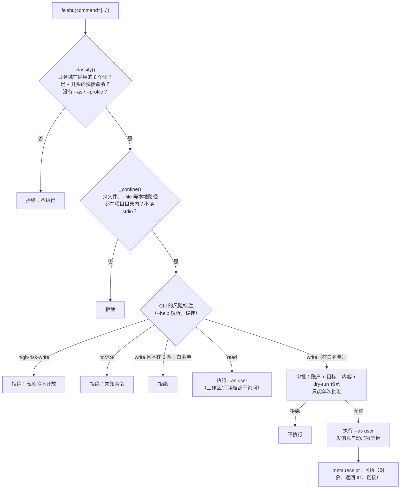
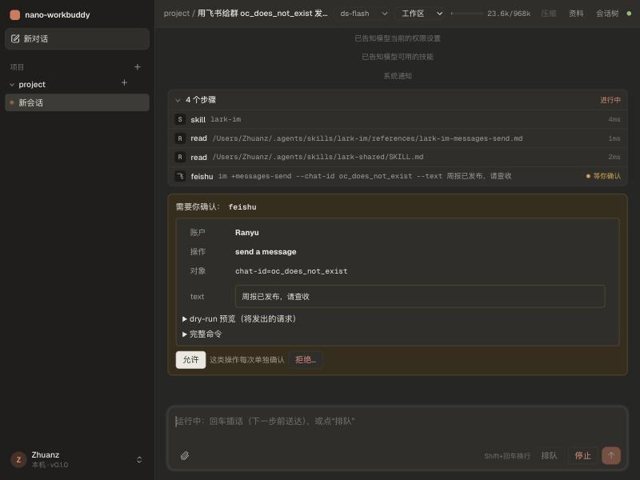
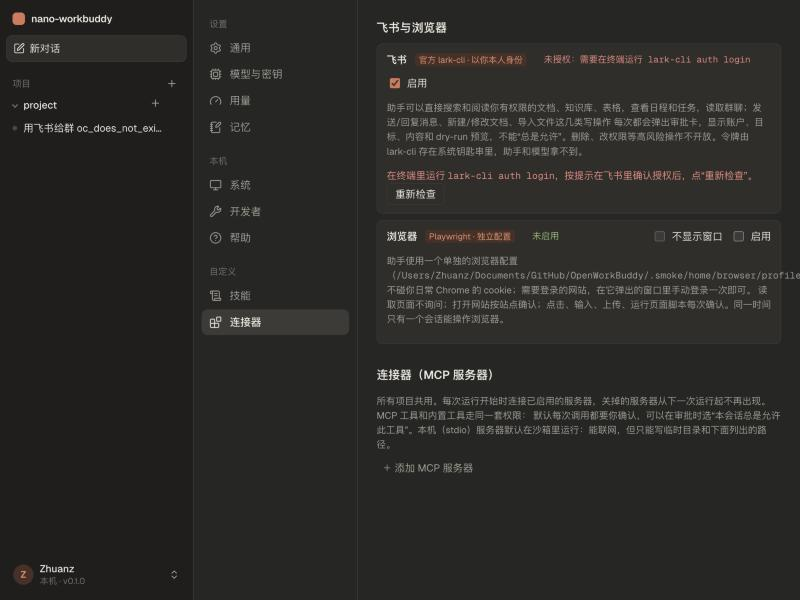

# 教程 15：飞书与浏览器（M2）

> 依据：[审查报告](../design/2026-10-24-personal-assistant-improvement-plan.md) 第 7.4、7.5 节和第 9 节的 M2。
> 新增：`connectors/feishu.py`（`feishu` 工具）、`connectors/browser.py`（内置的 Playwright MCP 服务器）、测试用的假 lark-cli（`tests/fixtures/fake_lark.py`）。
> 改动：`policy.py`（连接器的读权限、永远询问的固定规则、只能单次批准的操作）、审批卡支持预览、`[feishu]` 和 `[browser]` 配置、设置页“连接器”。
> 测试从 185 个增加到 204 个；分别用真实的 lark-cli 1.0.98、真实的 Playwright MCP 和真实模型做了冒烟测试。
> 上一篇：[14-文件与调研](14-文件与调研.md)。

## 1. 你的选择

| 问题 | 选择 | 落实 |
|---|---|---|
| 飞书身份 | 以你本人身份 | 每次调用都强制加 `--as user`；模型不能改身份，也不能切换 profile |
| 第一批能力 | 文档搜索/阅读、日程任务查询、消息读取与发送、文档创建/写回 | 读操作：8 个业务域的只读命令。写操作：5 条命令（发消息、回复、建文档、改文档、导入文件） |
| 高风险操作 | 完全不开放；升级 CLI | 删除、改权限等一律拒绝；lark-cli 从 1.0.56 升级到 1.0.98 |
| 浏览器 | 独立配置的专用浏览器 | Playwright MCP 用单独的 profile 目录，不碰你日常 Chrome 的 cookie |

升级 lark-cli 时有一个副作用：它把 28 个官方 `lark-*` 技能写进了 `~/.agents/skills` 和 `~/.claude/skills`。nano-workbuddy 也会读 `~/.agents/skills`，所以这些技能会出现在技能列表里。这反而是好事：官方技能教模型命令怎么写，而 `feishu` 工具的参数就是 CLI 的原始 argv，两者正好对得上（第 3.1 节）。

## 2. 为什么复用官方 CLI，而不是自己写飞书客户端

报告 7.5 的建议是：先封装官方 `larksuite/cli`，不要从零写文档、搜索、日历、任务的全部 HTTP 客户端。实际查看 CLI 之后，发现它有几个对我们特别有用的特性：

| CLI 的特性 | 我们怎么用 |
|---|---|
| 每条命令的 `--help` 末尾都标了风险：`Risk: read` / `write` / `high-risk-write` | 白名单直接按 CLI 自己的标注来定，不用自己维护几百条命令的分类 |
| 令牌存在系统钥匙串里，由 CLI 自己读取 | 令牌不会进入我们的进程环境、日志或模型上下文 |
| 写命令都支持 `--dry-run` | 审批卡上展示“将要发出的请求” |
| 发消息支持 `--idempotency-key` | 崩溃后重放时不会发出第二条 |
| 输出是结构化 JSON，错误也带 `type` / `hint` | 回执和错误提示直接取用 |

我们需要补上的，是 CLI 本身没有的**授权边界**。

## 3. feishu 工具

### 3.1 参数就是 argv

```json
{"command": ["docs", "+search", "--query", "季度规划"]}
{"command": ["im", "+messages-send", "--chat-id", "oc_xxx", "--markdown", "周报已发布"]}
```

为什么不按业务一个个定义工具（`feishu_send_message`、`feishu_fetch_doc`……）？原因有三：

1. 官方技能里的例子都是 `lark-cli docs +fetch --doc …` 这种写法。去掉开头的 `lark-cli` 就是我们的参数，技能可以原样复用。
2. CLI 有几百个命令。一一定义成工具，工具声明会占掉大量上下文，CLI 一升级还得跟着改。
3. 安全不靠工具怎么拆分，而靠下面这条每次调用都要经过的检查流程。

### 3.2 每次调用经过的检查



几个容易忽略的点：

- **`@文件` 是数据外泄通道。** CLI 支持 `--content @path`，从文件里读正文。不加限制的话，模型写一句 `--content @~/.ssh/id_rsa`，就能把私钥发进群里。所以凡是会让 CLI 读本地文件的值（`@xxx`、`--file`、`--image` 等），都必须落在项目目录或本会话的附件目录里；`-`（从标准输入读取）直接禁止。
- **`--dry-run` 算读操作。** 带了它的写命令只是预览请求，不需要审批。
- **只允许 `+` 开头的快捷命令。** `lark-cli api GET /open-apis/...` 这种原始 API 调用，以及 `im messages create` 这种资源级操作，都绕过了快捷命令的风险标注，因此不开放。

### 3.3 写操作：每次单独审批，永远不能“总是允许”

`policy.py` 增加了两样东西：

```python
ONCE_ONLY = ("feishu.write",)        # 审批卡上没有“本会话总是允许”；就算选了，也只算这一次

FIXED = (Rule("feishu.write", "*", "ask"),          # 追加在所有规则之后（最后匹配的规则生效）
         Rule("bash", "*lark-cli*", "ask"),
         Rule("bash.unsandboxed", "*lark-cli*", "ask"))
```

规则的优先级原本是 `预设 < config.toml < 本会话批准的规则`。现在在最后又加了一层 `FIXED`，所以**连“完全信任”档也照样会询问**飞书写操作。这对应的是你一开始定下的规则：“对外发送、发布、删除前确认”。

通过 bash 调用 `lark-cli` 也会被询问。这只是一道护栏，不是真正的边界：真正的边界在于沙箱里的 bash 不能联网、读不到钥匙串，就算执行了也拿不到令牌。

### 3.4 审批卡上显示什么

报告 7.5 第 5 条要求“审批卡展示账户、目标、收件人/共享范围、最终正文、附件和动作”。工具新增了一个 `preview` 钩子，`gate` 在弹出审批之前调用它：

```python
check = dataclasses.replace(check, preview=await tool.preview(args, ctx))
# feishu 的 preview：auth status 里的用户名 + 写操作的目标 + 用同一个 argv 加 --dry-run 跑出的请求
```



这张截图来自真实模型的冒烟测试。模型先加载了官方的 `lark-im` 技能，读了发消息的参考文档，然后调用 `feishu`。卡片上显示账户 Ranyu、操作“发送消息”、对象 `chat-id=oc_does_not_exist`、正文，可以展开看 dry-run 预览和完整命令。点“拒绝”后，模型确认消息没有发出。

**审批绑定在这一次调用的参数上。** 批准的就是要执行的这个 argv，模型没有机会在批准之后再改正文或收件人。改了就是一次新的调用，需要重新审批。

### 3.5 不重复发送，结果不确定时不重试

| 情况 | 处理 |
|---|---|
| 发消息、回复 | 自动加 `--idempotency-key`，键值 = hash(会话, `调用标识`, argv)。`调用标识` = 助手消息的条目 ID + call_id（M0 里讲过，供应商会复用 `call_0` 这类 ID，单靠 call_id 不够用） |
| 崩溃时调用正在进行 | 发消息/回复：可以重放（幂等键相同，飞书会去重；重启后审批要重新给）。建文档、改文档、导入：结果未知，不自动重放 |
| 写操作超时 | 告诉模型“结果未知，先用读命令查一下再决定”，不让它直接重试 |

### 3.6 登录与身份

用户身份需要你本人授权一次。CLI 用的是设备码流程：你在终端运行 `lark-cli auth login`，再到飞书里点确认。我们不替你做这一步，系统提示和错误信息都写明了“请用户运行，不要自己尝试登录”。授权状态在设置页能看到，还没授权时，模型收到的通知也会写明这一点。

## 4. 浏览器

### 4.1 复用官方 Playwright MCP

报告 7.4：“首个提供者用固定版本的官方 Playwright MCP，通过既有 MCP 运输复用；不自研完整 CDP 或像素视觉点击引擎。”我们已有的 MCP 接入（教程 05）正好用得上。启用浏览器后，`Workspace.mcp_specs()` 会多出一个内置服务器：

```python
McpServer("browser", "npx", ("-y", "@playwright/mcp@0.0.83",       # 版本固定
          "--user-data-dir", "~/.nwb/browser/profile",             # 独立配置
          "--output-dir", "~/.nwb/browser/output",
          "--image-responses", "omit"),                            # 截图只在模型主动要时才给
          sandbox=False)                                           # 浏览器需要网络、窗口和自己的配置目录
```

默认会显示浏览器窗口，方便你在里面手动登录、看着助手操作。设置页可以改成“不显示窗口”。

### 4.2 按工具做什么来定权限

Playwright MCP 有 25 个工具，按实际作用分成四类：

| 类别 | 工具 | 工作区 / 只读档 |
|---|---|---|
| 只是看 | snapshot、find、take_screenshot、console_messages、network_requests、wait_for、tabs、navigate_back、resize、hover… | 不询问 |
| 打开网址 | navigate | **按站点**询问，可以选“本会话总是允许这个站点”（和 `web_fetch` 一样） |
| 改变页面或外部状态 | click、type、fill_form、select_option、press_key、drag、drop、file_upload、handle_dialog、evaluate | 每次询问（可以选本会话总是允许这个工具） |
| 任意代码 | run_code_unsafe | **直接不提供** |

`navigate` 默认的权限资源是空字符串，“总是允许”一次就等于放行了所有网站。所以 `browser.wrap()` 把它的权限资源改成了 URL，`Check.suggestion()` 也就能像 `web_fetch` 一样生成“本站点总是允许”的规则。

浏览器的点击没有像飞书写操作那样设成“永远询问”：在完全信任档下会直接执行，也允许在本会话里设为“总是允许”。原因是填一个表单要点很多下，每一下都审批没法用；而飞书写操作每一次都意味着对外发布内容。

### 4.3 同一时间只有一个会话能操作

浏览器是整个进程共用的，两个会话同时操作会互相抢标签页。`browser.Lease` 的规则：

```
会话 A 的运行第一次调用浏览器工具 → A 拿到租约
会话 B 调用浏览器工具：
   A 还在运行 → 报错“浏览器正被另一个会话使用”
   A 已经结束 → B 接手
会话 A 的运行结束（_drive 的 finally）→ 释放租约
```

### 4.4 登录、验证码、二次验证

系统通知要求模型：遇到登录、验证码、二次验证时停下来，用 `ask_user` 请你在浏览器窗口里完成，然后继续；绝不自己设法绕过。

## 5. 设置页

“设置 → 连接器”最上面新增两张卡片：

- **飞书**：lark-cli 是否找到、版本、你的用户身份是否已授权（附授权命令）、“启用”开关、“重新检查”按钮。
- **浏览器**：运行状态、独立配置目录的位置、“不显示窗口”和“启用”开关。



对应的配置：

```toml
[feishu]
enabled = true
cli = "lark-cli"        # 可以写绝对路径

[browser]
enabled = true
headless = false
```

## 6. 验证

```
uv run ruff check src tests   → All checks passed!
uv run pytest -q              → 204 passed
cd web && npm run build       → ✓ built
```

**假 lark-cli**（`tests/fixtures/fake_lark.py`）：它模拟风险标注、登录状态、dry-run、写入回执和令牌过期，并把每次被调用时的 argv 记到文件里，所以测试可以断言“到底有哪些命令真正执行了”。覆盖的场景：

- 不允许的业务域、原始 API、`--as`、`--profile` 都被拒绝；dry-run 算读操作
- `@文件`、`--file`、标准输入不能读到项目以外的文件
- 读操作以用户身份执行、不弹审批，读到的文档登记为来源
- 写操作在工作区档和完全信任档下**都**弹审批；审批里有账户和 dry-run 预览；执行时带幂等键；结果里有回执
- 拒绝后不执行；高风险操作、不在白名单的写操作、未知命令一律不执行（只调用过 `--help`）
- 令牌过期时，告诉模型应该请用户做什么
- 通过 bash 调用 lark-cli 在两种档位下都要询问
- 通过 API 走的审批没有“总是允许”，选了也不会加规则；状态接口
- 浏览器：独立配置、`run_code_unsafe` 被隐藏、navigate 按站点、会话租约、各工具的权限

**真实组件冒烟测试**：

| 对象 | 结果 |
|---|---|
| lark-cli 1.0.98 | 风险标注解析正确（`docs +fetch`=read，`im +messages-send`=write，`drive +delete`=high-risk-write）；dry-run 预览出账户 Ranyu；未授权时读操作返回 CLI 的 `token_missing` 结构化错误和授权提示。全程没有发出真实请求 |
| Playwright MCP 0.0.83 | 无窗口模式启动 Chrome，25 个工具（隐藏 1 个），打开 example.com 并读到快照；另一个会话被租约挡住；独立配置目录已创建 |
| 真实模型（DeepSeek v4.1 flash） | 要求给一个不存在的群发消息：模型加载 lark-im 技能 → 调用 `feishu` → 出现审批卡 → 拒绝 → 模型确认未发送 |

## 7. 没做的，以及下一步

| 项目 | 说明 |
|---|---|
| 在界面里完成飞书授权 | CLI 支持 `auth login --no-wait --json` 返回授权链接，以后可以在设置页上直接点开授权；现在先在终端里做 |
| 审批卡把 ID 翻译成名字 | 现在显示的是 `oc_xxx`；模型发送前会先用 `im +chat-search` 查到 ID，名字出现在对话里。以后可以在预览时自动查出群名 |
| 浏览器下载自动登记为附件 | 下载的文件在 `~/.nwb/browser/output`，暂未登记成附件或产物 |
| 飞书写操作后自动回读核验 | 目前保存了回执（对象 ID 和链接）；“写完再读一遍确认”的自动化留到 M3 的任务层 |
| 你需要做的一步 | 在终端运行 `lark-cli auth login` 完成本人授权，然后在设置页启用飞书 |
| M3 主动任务与个人知识 | 下一阶段。开始前需要你定：第一条定时任务是什么、什么时间执行、机器离线错过后怎么补跑、通知渠道，以及允许建索引的本地文件夹 |
