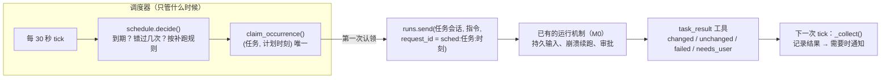
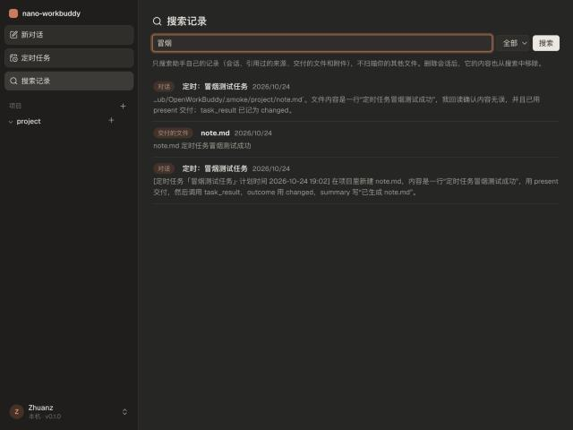
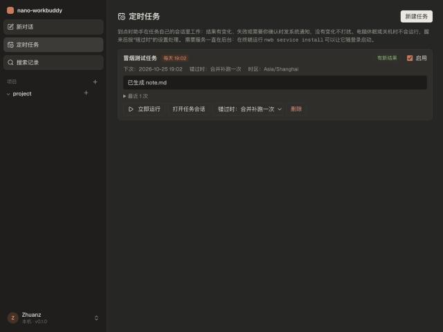

# 教程 16：定时任务与个人知识（M3）

> 依据：[审查报告](../design/2026-10-24-personal-assistant-improvement-plan.md) 第 7.6、7.7 节和第 9 节的 M3。
> 新增：`schedule.py`（规则与补跑决策，纯函数）、`scheduler.py`（调度服务、`task_result` 工具、“每周调研更新”模板）、`notify.py`（系统通知）、`knowledge.py`（个人记录全文检索）、`tools/recall.py`、`maintenance.py`（备份、恢复、开机自启）、前端 `Tasks.tsx`（任务页和搜索页）。
> 改动：SQLite 新增 `schedules` 和 `occurrences` 两张表；排队消息会记住自己的 request_id；RunManager 在运行等待用户时会通知调度器；CLI 新增 `nwb backup` / `nwb restore` / `nwb service`。
> 测试从 204 个增加到 221 个；用真实模型跑通了一次按时触发的定时任务。
> 上一篇：[15-飞书与浏览器](15-飞书与浏览器.md)。

## 1. 你的选择

| 问题 | 选择 | 落实 |
|---|---|---|
| 第一条定时任务 | 每周调研更新 | 做成模板：给一个主题，每周搜索新进展；有实质变化才生成新一期简报，没有变化就不打扰你 |
| 错过执行时间 | 合并补跑一次 | 默认值；每个任务可以单独改成“跳过”或“问我” |
| 通知 | macOS 系统通知 | 用 osascript 发送。没有变化不通知；有新结果、失败、需要你处理、等你审批或回答时通知 |
| 索引范围 | 只索引助手自己的记录 | 会话、来源、交付的文件、附件；不扫描你的其他文件 |

## 2. 任务不等于一条聊天

报告 7.6 第一句话：“调度器只负责在应触发时提交任务，不把一条 asyncio 长 sleep 当作持久调度。”这次的分工是：



调度器自己不执行任何工作，只负责在对的时间往任务自己的会话里投一条消息。具体工作复用了现成的整套运行机制：消息先落盘再确认、崩溃后续跑、审批、权限、产物、来源。M0 打下的地基在这里直接派上用场。

### 2.1 每个任务有自己的会话

新建任务时，会同时建一个名为“定时：任务名”的会话。之后每次执行都追加到这个会话里，所以：

- 第二期简报能看到第一期找到了什么、交付了什么，来源编号也接着往下排；
- `create_document(overwrite=true)` 会生成新版本（第 2 版、第 3 版……），旧版本仍可下载（M1 的版本快照）；
- 想知道某一次到底做了什么，打开任务会话就能看到全过程。

### 2.2 为什么不用 sleep 到点再执行

```
asyncio.sleep(到下周一 9 点)   ← 进程重启，计划就丢了；电脑休眠时计时器停走，醒来后时间对不上
```

改成每 30 秒对一次表：`next_run <= 现在` 就算到期。电脑睡醒、服务重启后，下一次 tick 自然会发现错过的执行，然后按补跑规则处理。不需要监听系统唤醒事件，也不需要额外的持久化计时器。

## 3. 规则与时区（schedule.py）

```python
Rule(kind="weekly", at="09:00", tz="Asia/Shanghai", weekdays=(1, 4))   # 每周一、四 9 点
```

- 在规则的时区里计算日期和钟点，存成 UTC 时间戳。这样夏令时切换不会让任务提前或推后一小时。测试里纽约时间跨过 11 月 1 日夏令时结束那天，相邻两次之间是 25 小时，钟点仍然是 9:00。
- 时区默认取本机设置（读 `/etc/localtime` 链接），你这台机器是 `Asia/Shanghai`。
- `next_after(t)` 返回严格晚于 t 的下一次；`between(a, b)` 列出一段时间内的所有执行时刻，用来数错过了几次。

### 3.1 补跑决策（decide）

```
next_run = 最早一个还没处理的执行时刻

next_run > 现在                         → 什么都不做
最近一次执行时刻离现在 ≤ 15 分钟          → 运行（之前错过的几次并进这一次，标注“含错过 N 次”）
最近一次也已经过了 15 分钟以上（错过了）  → 按补跑规则：
     合并补跑一次 → 只运行一次，消息里写明“补跑：错过了 N 次执行，只补这一次”
     跳过         → 记一条“已跳过”，不运行
     问我         → 记一条“错过”，发通知，在任务页点“立即运行”
然后 next_run 移到现在之后的下一次
```

报告：“定时摘要默认合并补跑，不把遗漏的几十次全部执行。”电脑出差关机两周，回来也只补跑一次。

有个细节：如果醒来时刚好赶上这一次的执行时间，即使选了“跳过”，这一次也照常运行，跳过的只是之前错过的那几次。

### 3.2 不重复执行

```sql
create table occurrences(schedule_id, planned_at, ..., primary key(schedule_id, planned_at));
```

`claim_occurrence()` 用的是 `insert or ignore`，**先认领，认领成功才提交**。同一个计划时刻无论 tick 多少次、服务重启几次，都只会执行一次。测试里把同一个时刻 tick 了两遍，确实只有一次执行。被“问我”处理过的时刻，之后也不会被单独补跑。

另外两道保险：

- 提交消息时带上 `request_id = sched:<任务>:<时刻>`。M0 的请求去重会再挡一次。
- 只有持有 `~/.nwb/scheduler.lock`（flock）的进程才运行调度器。不小心在同一个数据目录上开了两个服务，也只有一个会调度。

### 3.3 会话正忙怎么办

到点时你正在任务会话里聊天，调度器就**先不认领**，下一个 tick 再试。这样消息不会排进你正在进行的对话里，这一次执行也不会丢。

### 3.4 重启后结果还能对上

调度器靠 request_id 找到执行对应的运行记录，再读出结果。问题出在：消息已经被接收（落进了 inputs 表），但还没开始运行时服务就重启了，M0 的补投逻辑会重新开一个运行，而以前补投时不带 request_id，结果就对不上了。现在 `inputs.extra_json` 会保存 request_id，`resume_all()` 补投时带上它（测试 `test_scheduled_input_keeps_its_request_id_across_restart`）。

## 4. 结果从哪来：task_result

报告：“模型一句‘做完了’也不构成完成证据。”所以定时任务运行时，模型会多拿到一个工具：

```python
task_result(outcome: "changed" | "unchanged" | "failed" | "needs_user", summary: str)
```

它只在由定时任务发起的运行里出现（判断依据是运行的 request_id 以 `sched:` 开头），同时附带一条通知：“这次运行没有人在实时看着；不要对外发送任何东西；最后如实调用一次 task_result。”

| 结果 | 怎么来的 | 通知吗 |
|---|---|---|
| changed | 模型报告有新内容 | 通知“有新结果” |
| unchanged | 模型报告没有新内容 | **不通知** |
| failed | 模型报告做不了，或运行出错 | 通知“失败” |
| needs_user | 模型报告需要你决定（比如缺搜索密钥） | 通知“需要你处理” |
| unknown | 运行结束但没有调用 task_result | 通知“已完成（未报告结果）” |
| cancelled / skipped / missed | 被取消、按规则跳过、错过了 | 只有“问我”模式下的错过会通知 |

**等你确认时立刻通知。** 定时运行要写项目外的文件、发飞书消息、问你问题时，没有人在页面上看着。`RunManager` 新增了一个 `attention` 回调，审批或提问一出现，调度器就发通知“需要你确认：……”。测试里一个定时运行要写项目外的文件，通知立刻就弹出来了。

## 5. “每周调研更新”模板

```
主题：{你填的主题}
1. 用 web_search 搜最近的新信息（recency=week，多换几个关键词），重要结果用 web_fetch 读原文
2. 已有上一期 {文件} 的话先 read，只关注新增和变化的内容
3. 有实质新信息：create_document 生成新一期（overwrite=true，作为新版本），开头写“本期变化”，事实标 [S#]
4. 没有：不要生成文件
5. 不要对外发送或发布任何内容
6. 最后调用 task_result
```

这个模板把 M1（搜索、来源、文档生成、版本）、M2（对外发布始终要审批）、M3（定时、结果、通知）串成了报告第 8 节设想的那条完整工作流：“只在有新信息时生成差异与新版本，本地通知，等待用户决定是否对外发布。”

需要先在“设置 → 模型与密钥 → 联网搜索”里填好 Tavily 密钥。没填的话，模型会用 `needs_user` 报告，你会收到通知。

## 6. 个人知识检索（knowledge.py）

### 6.1 索引什么

| 来源 | 内容 |
|---|---|
| 会话 | 你说的话和助手的回答（不含附件的原文块、不含系统合成的消息） |
| 来源 | 标题、摘要、网址 |
| 交付的文件 | 文件名和抽取出的全文（用 M1 的读取器），每份内容在每个会话里只索引一次 |
| 附件 | 同上 |

索引存在单独的 `~/.nwb/knowledge.db`，属于缓存：随时可以删掉，下次搜索时会从会话日志和内容存储重建。每个会话记录“已经读到第几行、文件多大”，每次搜索前只补读新增的部分。删除会话时，它的索引同步删除（`forget`），这一点对应报告里的“删除要同步索引和未来检索”。

### 6.2 中文怎么搜

中文没有空格。SQLite 的默认分词器会把一整句当成一个词，所以搜不到其中的片段。

```
trigram 分词器：把每 3 个相邻字符作为一个索引单元
   "本周调研工作流" → 本周调 / 周调研 / 调研工 / 研工作 / 工作流
   搜 "调研工作流"（5 个字）  ✓ 命中
   搜 "调研"（2 个字）        ✗ 不足 3 个字，trigram 匹配不到
```

所以 `search()` 分两路：3 个字及以上的词走 FTS5 trigram（按 bm25 排序）；不足 3 个字的词（大多数两字中文词）用 `LIKE '%调研%'` 做子串匹配。一个人的记录量用子串扫描很快。多个词之间是“且”的关系。报告的要求是“不能直接把默认英文分词器当中文检索验收”，这样处理之后，两种长度的查询都有测试覆盖。

### 6.3 两个入口

- **模型**：`recall(query, kind, limit)` 工具，不需要审批。你说“上周那份简报”“我们之前怎么定的”时，模型可以自己去查。
- **你**：侧栏新增“搜索记录”页面，点击结果跳到对应会话，来源结果则打开原网页。



## 7. 系统通知（notify.py）

```python
osascript -e 'display notification "有新结果：已生成 note.md" with title "nano-workbuddy" subtitle "冒烟测试任务"'
```

macOS 自带，不用安装任何东西。限制是：用 osascript 发的通知，点击后打不开指定页面（那需要 terminal-notifier 之类的工具），所以通知只负责提醒，结果在任务页和任务会话里看。Linux 上改用 notify-send；都不可用时只写日志。发送失败不影响任务本身。

## 8. 让服务一直在后台：nwb service

定时任务只有在 `nwb serve` 运行时才会执行。

```bash
nwb service install     # 写 ~/Library/LaunchAgents/ai.nano-workbuddy.serve.plist，登录时自动启动，异常退出自动重启
nwb service status
nwb service uninstall
```

我实现了这几个命令，但**没有替你执行安装**：是否让一个程序随登录自启，应该由你决定。电脑休眠或关机时仍然不会执行任务，醒来后按补跑规则处理。项目放在“文稿”文件夹里的话，第一次以后台服务身份启动时，macOS 可能会弹窗询问访问权限。

## 9. 备份与恢复：nwb backup / restore

```bash
nwb backup                     # → ~/nwb-backup-20261024-190500.tar.gz（权限 0600）
nwb backup --with-secrets      # 同时备份 API 密钥
nwb backup --with-browser      # 同时备份浏览器配置（里面有登录 cookie）
nwb restore 备份.tar.gz         # 目标目录已有数据时拒绝；--force 会把原目录改名保留，再恢复
```

| 备份内容 | 说明 |
|---|---|
| 包含 | config.toml、index.db（用 SQLite 的 backup API 复制，服务运行中也能得到一致的快照）、sessions、files/blobs（交付的版本和附件）、spill、USER.md、skills |
| 不包含（可以重建） | 文档解析缓存、knowledge.db、日志、登录令牌 |
| 默认不包含（属于秘密） | secrets.json（API 密钥）、浏览器配置（登录 cookie） |

恢复时用 `tarfile` 的 `filter="data"`，拒绝绝对路径、`..` 和设备文件。测试构造了一个带 `../escaped.txt` 的恶意包，验证文件不会被写到目录外面。

## 10. 界面

侧栏新增“定时任务”和“搜索记录”两个入口。任务页可以：

- 新建任务：选“每周调研更新”模板或写自定义指令；选工作目录、重复方式（每周几 / 每天 / 仅一次）、时间、错过时的处理；
- 查看每个任务：规则、下次执行时间、时区、最近一次结果和摘要、最近 8 次的执行历史；
- 操作：启用/停用、立即运行、打开任务会话、修改补跑规则、删除（会话和产物会保留）。



## 11. 验证

```
uv run ruff check src tests   → All checks passed!
uv run pytest -q              → 221 passed
cd web && npm run build       → ✓ built
```

新测试：

- 规则：每天、每周、仅一次的下一次时间；夏令时；不合法的规则
- 补跑决策：准时、休眠三天后三种补跑规则、醒来时刚好赶上
- 调度端到端（假模型、假通知）：到期后只执行一次 → 记录 changed 并通知 → 下周 unchanged 不通知；“问我”模式只发通知、不运行，且同一时刻之后不会再被单独执行；补跑一次时消息里写明错过次数；会话正忙时推迟；定时运行等待审批时立刻通知；“立即运行”；task_result 只出现在定时运行里；重启后补投的消息仍能对上执行记录
- 任务 API：模板、规则校验、停用、修改规则、删除后会话保留
- 检索：5 个字和 2 个字的中文查询、按类型过滤、交付文件的全文、`recall` 工具、删除会话后不再搜到
- 备份恢复：往返一致、默认不含秘密、拒绝覆盖已有数据、`--force`、恶意压缩包、非备份文件
- LaunchAgent 配置的内容

**真实冒烟测试**：在一个隔离的数据目录里，通过界面新建自定义任务“冒烟测试任务”，每天 19:02 执行，指令是生成 note.md、用 present 交付、再调用 task_result。19:02 调度器按时触发，DeepSeek 模型完成任务，note.md 的内容正确。任务页显示“有新结果”和“已生成 note.md”，下次执行改到第二天 19:02，执行记录只有一条，系统通知发送成功。搜索页用两个字“冒烟”搜出了对话和交付的文件。在服务运行中执行 `nwb backup`，恢复到新目录后任务定义完整，重复恢复时被拒绝。

## 12. 没做的，以及下一步

| 项目 | 说明 |
|---|---|
| 运行预算 | 目前只有全局的步数上限（max_turns）；按任务设置 token 或费用上限，要等有了用量价格表再做 |
| 点击通知直接打开任务 | 需要 terminal-notifier 之类的工具，或者原生应用 |
| 带来源和范围的记忆条目 | USER.md / AGENTS.md 仍是两份可编辑的文件；报告设想的“候选记忆、来源、可遗忘”留到以后 |
| 索引你指定的文件夹 | 按你的选择，这次没做；接口已经预留（Knowledge 只需要再加一种来源） |
| 运行在一台常开的机器上 | 电脑休眠时任务不会执行；真需要 7×24 小时运行时，再评估常开设备或远程执行 |
| M4 按证据优化（可选） | 报告里的 M4：Code Mode、有限的子代理、复杂 OCR、更细的模型路由。报告的建议是先用一段时间，有了测量数据再决定做哪项 |
